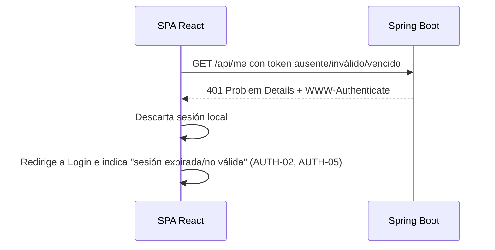

# Documento de diseño: 001-foundation

## Overview

Esta especificación diseña la **integración vertical de autenticación** de Arise Corp.: un usuario autorizado inicia sesión en la SPA de React mediante Supabase Auth, obtiene un JWT firmado con ES256, lo envía al backend Spring Boot en el encabezado `Authorization: Bearer <token>`, Spring Security valida el token y el usuario consume el endpoint protegido `GET /api/me`, con manejo claro de errores de autenticación.

El diseño cubre los requisitos AUTH-01 a AUTH-05 del MVP, los no funcionales NF-01, NF-02, NF-06 y NF-07, y los criterios globales CA-01, CA-02, CA-03 y CA-06, tal como se detallan en `requirements.md`.

### Estado del código y alcance del diseño

Parte del backend **ya está implementada** y este diseño la documenta sin re-implementarla:

| Componente | Estado | Qué falta diseñar/implementar en esta spec |
|---|---|---|
| `SecurityConfig` (OAuth2 Resource Server, CORS, STATELESS) | [Implementado] | Nada estructural; se documenta y se verifica mediante pruebas |
| `AuthController` → `GET /api/me` | [Implementado] | Mover al módulo `login` e integrar el perfil empresarial en el contrato |
| `application.properties` (datasource, JWT issuer/JWKS/ES256/aud) | [Implementado] | Nada; se documenta |
| Pruebas de `/api/me` + configuración de pruebas con H2 | [Implementado] | Verificado con 6 pruebas (DP-TEC-02) |
| Frontend React (login, rutas privadas, consumo de `/api/me`) | [Implementado] | 25 pruebas automáticas; validación manual con cuenta real pendiente |
| Perfil empresarial, matriz de roles y gestión de permisos | [Pendiente de implementación] | Decisiones adoptadas en steering; tareas 15–18 |

### Decisiones adoptadas que afectan a esta spec

- **DP-TEC-01/02:** stack del frontend y perfil H2/JWT simulado ya implementados y probados.
- **DP-SEG-01/02 y DP-PRO-01:** perfil en PostgreSQL, un rol por usuario, matriz de permisos y autorización backend adoptados; se implementan en tareas 15–18.
- **DP-EST-01/03:** `AuthController` pasa a `login.controller`; se conservan nombres/contratos españoles y estilo de 4 espacios. `SecurityConfig` permanece en `config`.
- **DP-API-02:** los errores usan RFC 9457 Problem Details; el 401/403 ya no se documenta como respuesta vacía.
- **DP-ARQ-02/DP-SEG-05/DP-TEC-03:** perfil y datos de negocio en esquema privado `app`, protegido por RLS/grants y creado por migraciones Supabase CLI; Hibernate usa `validate`.

## Architecture

El sistema sigue la arquitectura cliente-servidor de tres capas aprobada (`architecture.md`): presentación (SPA React), lógica de negocio (API REST Spring Boot) y datos (Supabase PostgreSQL). Para esta spec, la capa de datos de negocio no participa: la identidad proviene exclusivamente del JWT validado. React usa Supabase **solo** para autenticación.

### Diagrama de componentes

```mermaid
flowchart LR
    subgraph Navegador
        subgraph SPA["SPA React (Vite + Tailwind + React Router)"]
            LoginView["Vista de Login"]
            ProtectedView["Vista protegida (perfil)"]
            AuthContext["AuthContext (estado de sesión)"]
            ApiClient["Cliente HTTP (adjunta Bearer)"]
            SupabaseLib["lib/supabase (supabase-js)"]
        end
    end

    subgraph Supabase["Supabase (gestionado)"]
        Auth["Supabase Auth\n(ES256, JWKS)"]
    end

    subgraph Backend["Backend Spring Boot (OAuth2 Resource Server)"]
        SecurityFilter["SecurityConfig\nfiltro JWT + CORS + STATELESS"]
        AuthCtrl["AuthController\nGET /api/me"]
    end

    LoginView --> AuthContext
    AuthContext --> SupabaseLib
    SupabaseLib <--> Auth
    ProtectedView --> ApiClient
    ApiClient -->|Authorization: Bearer| SecurityFilter
    SecurityFilter -->|JWKS| Auth
    SecurityFilter --> AuthCtrl
    AuthCtrl -->|200 {id,email,role}| ApiClient
```

Responsabilidades (coherentes con `architecture.md`):

- **SPA React**: vistas, navegación y rutas protegidas, estado de sesión, formularios con validación y estados de carga/error, llamadas a la API con el token. No decide permisos ni contiene reglas de negocio (NF-02).
- **Supabase Auth**: inicio/cierre de sesión, emisión y renovación de JWT (ES256), publicación de claves públicas (JWKS).
- **API Spring Boot**: valida el JWT en cada petición, aplica la autorización por defecto (JWT válido requerido) y responde JSON con códigos HTTP coherentes.

### Flujo de autenticación extremo a extremo

```mermaid
sequenceDiagram
    actor U as Usuario
    participant FE as SPA React
    participant AUTH as Supabase Auth
    participant API as Spring Boot
    participant JWKS as Endpoint JWKS

    U->>FE: Introduce correo y contraseña
    FE->>FE: Valida formato (NF-06); muestra carga
    FE->>AUTH: signInWithPassword (supabase-js)
    alt Credenciales válidas
        AUTH-->>FE: access token (JWT ES256) + refresh token
        FE->>FE: Guarda sesión; redirige a vista protegida
        FE->>API: GET /api/me (Authorization: Bearer <token>)
        API->>JWKS: Obtiene claves públicas (cacheadas)
        JWKS-->>API: Claves públicas ES256
        API->>API: Valida firma, iss, aud, exp, nbf (tolerancia 60s)
        API-->>FE: 200 { id, email, role empresarial }
        FE->>U: Muestra identidad (AUTH-03)
    else Credenciales incorrectas / red / timeout
        AUTH-->>FE: Error
        FE->>U: Mensaje comprensible, conserva el correo (AUTH-05)
    end
```



Estado: el tramo desde la recepción de la petición hasta la validación del JWT en `GET /api/me` está [Implementado]. El login en React y el consumo del endpoint están implementados y verificados con servicios simulados; la validación con cuenta real es manual.

## Components and Interfaces

### Backend

#### SecurityConfig (`com.arise.corp.config`) — [Implementado; ampliación pendiente]

Cadena de filtros ya existente; se amplía en esta spec para resolver el perfil/rol empresarial conforme a las decisiones adoptadas. El diseño la documenta y la verifica mediante pruebas:

- CSRF deshabilitado (correcto porque la autenticación usa el encabezado `Authorization`, no cookies).
- CORS mediante el bean `corsConfigurationSource`: orígenes `http://localhost:5173`; métodos GET/POST/PUT/PATCH/DELETE/OPTIONS; encabezados `Authorization`, `Content-Type`; `allowCredentials=false`; rutas `/**`.
- Sesiones `STATELESS` (`SessionCreationPolicy.STATELESS`): cada petición se autentica solo con su JWT.
- Autorización de rutas: `/api/public/**` → `permitAll`; `anyRequest` → `authenticated`. Esto establece la autenticación base; la validación del perfil y rol empresarial se incorpora antes de ejecutar toda operación protegida (AUTH-04, NF-02, CA-03).
- `oauth2ResourceServer(oauth2 -> oauth2.jwt(Customizer.withDefaults()))`: validación de JWT con la configuración de `application.properties`.

La validación de firma usa **solo** las claves públicas del JWKS (ES256); no se usa HS256 ni el JWT secret compartido (`security.md`).

#### AuthController (destino `com.arise.corp.login.controller`) — [Implementado; reubicación y ampliación pendientes]

`@RestController` en el módulo `login`; el cambio de paquete forma parte de las tareas abiertas de esta spec (DP-EST-01).

Contrato del endpoint:

```markdown
### GET /api/me
- Requisitos: AUTH-03, AUTH-04, CA-02
- Autenticación: JWT obligatorio (Bearer)
- Permiso: cualquier perfil empresarial activo; el rol se devuelve como dato. Perfil ausente/inactivo → 403.
- Solicitud: sin cuerpo; token en `Authorization: Bearer <token>`
- Respuesta 200 (application/json, camelCase):
    { "id": "<claim sub>", "email": "<claim email o null>", "role": "<rol empresarial>" }
- Errores:
    - 401: token ausente, inválido, mal formado, con iss/aud incorrectos o vencido (Problem Details + WWW-Authenticate)
    - 403: perfil ausente/inactivo o rol sin permiso (Problem Details)
```

Reglas de derivación de identidad (AUTH-03, AUTH-04, `security.md`):

- `id` = `jwt.getSubject()` (claim `sub`, UUID autoritativo del usuario).
- `email` = `jwt.getClaimAsString("email")`; si el claim no existe, el valor es nulo sin provocar error (Requirement 5.5).
- `role` = rol empresarial leído desde el perfil activo asociado al `sub`. El claim técnico `role` de Supabase no se devuelve como rol empresarial ni se usa para autorización.
- La identidad se deriva del `Jwt` ya validado por Spring Security vía `@AuthenticationPrincipal`; no se decodifica el token a mano (Requirement 5.3).

> La implementación existente usa `LinkedHashMap` para tolerar claims opcionales nulos; la tarea 16 la migra a `MeResponse` record conforme a DP-EST-03.

#### Administración de perfiles (AUTH-04)

| Método | Ruta | Permiso | Resultado |
|---|---|---|---|
| PUT | `/api/admin/usuarios/{id}/perfil` | Administrador | Crea o actualiza un perfil para un UUID existente de Auth; respuesta 201 al crear y 200 al actualizar |
| PATCH | `/api/admin/usuarios/{id}/estado` | Administrador | Activa/desactiva un perfil; respuesta 200 |

El `id` de usuario es el UUID de Supabase Auth. No se permite crear un perfil para una identidad inexistente (404). La solicitud incluye `rol`; el servidor controla `activo` y los campos de auditoría. Los DTO no admiten asignar el actor; el backend registra el `sub` del administrador y fecha en la operación. El primer perfil Administrador se aprovisiona mediante SQL controlado según la tarea 15.

#### Manejo de 401 / 403

Esta spec normaliza los errores conforme a RFC 9457 Problem Details (DP-API-02):

- **401 Unauthorized**: peticiones sin token o con token inválido/vencido/mal formado o con iss/aud incorrectos. Respuesta Problem Details y el encabezado `WWW-Authenticate` (AUTH-03, CA-02, CA-06; Requirements 4.6–4.8, 5.6).
- **403 Forbidden**: JWT válido sin perfil activo o sin permiso para la operación; respuesta Problem Details sin ejecutar ni modificar la operación.

El formato uniforme se implementa como `@RestControllerAdvice` y handlers de Spring Security con Problem Details RFC 9457. El backend no expone trazas, SQL ni datos internos en cuerpos Problem Details (CA-06, Requirement 7.4).

### Frontend (DP-TEC-01 aprobada)

La estructura y el stack siguen la propuesta de `structure.md`/`tech.md`, aprobada mediante DP-TEC-01:

```text
frontend/
├── .env.example           # solo variables VITE_* públicas
├── index.html
├── package.json
└── src/
    ├── main.jsx           # punto de entrada
    ├── App.jsx            # define el enrutado
    ├── lib/
    │   └── supabase.js    # inicializa supabase-js (solo auth)
    ├── context/
    │   └── AuthContext.jsx# estado de sesión global
    ├── routes/
    │   └── ProtectedRoute.jsx  # guarda de rutas privadas
    ├── services/
    │   └── apiClient.js   # cliente HTTP; adjunta Bearer; maneja 401/403
    ├── components/        # componentes compartidos (inputs, botón de carga)
    └── pages/
        ├── Login.jsx      # formulario de inicio de sesión
        └── Perfil.jsx     # vista protegida que consume /api/me
```

Interfaces principales:

- **`lib/supabase.js`**: crea el cliente con `createClient(VITE_SUPABASE_URL, VITE_SUPABASE_PUBLISHABLE_KEY)`. `supabase-js` persiste y renueva la sesión automáticamente (AUTH-02). La clave publishable es pública por diseño; nunca se incluyen claves `service_role`/`secret` ni el JWT secret (NF-01, Requirements 8.1–8.3).
- **`context/AuthContext.jsx`**: expone `session`, `loading`, `signIn(email, password)` y `signOut()`. Se suscribe a `onAuthStateChange` para reflejar renovaciones e invalidaciones de token (AUTH-02, Requirements 3.1, 3.4). Al cerrar sesión, elimina el estado local aunque `signOut` falle (Requirement 2.3).
- **`routes/ProtectedRoute.jsx`**: si no hay sesión activa, redirige a `/login` sin renderizar el contenido privado (AUTH-02, Requirement 3.3).
- **`services/apiClient.js`**: obtiene el access token vigente de la sesión de `supabase-js` y lo adjunta como `Authorization: Bearer <token>` (AUTH-03, Requirement 4.1). Aplica un tiempo de espera de 30 s (Requirements 7.5, 1.4). Ante una respuesta 401, dispara el descarte de sesión y la redirección a login (AUTH-02, Requirements 3.5, 7.2, 10.2); ante 403, muestra "sin permisos" y mantiene la sesión (Requirement 7.3).
- **`pages/Login.jsx`**: formulario con correo y contraseña obligatorios; valida formato de correo y campos vacíos en cliente (NF-06, Requirements 1.1, 1.5, 1.6); indicador de carga con botón deshabilitado durante la petición (Requirement 1.4); mensaje de error comprensible que conserva el correo y no revela si el fallo es de correo o contraseña (AUTH-05, Requirements 1.7, 7.1).
- **`pages/Perfil.jsx`**: vista protegida que al montarse llama a `GET /api/me`, muestra `id`, `email` y el rol empresarial, con indicador de carga y sin permitir una segunda solicitud simultánea (AUTH-03/04, Requirements 5.7, 10.1, 10.3). Ofrece el botón de cierre de sesión (Requirement 2).

## Data Models

Esta spec no introduce tablas de negocio ni entidades JPA (`spring.jpa.hibernate.ddl-auto=none`; `supabase/migrations/` permanece vacío). Los únicos modelos relevantes son estructuras en memoria derivadas del JWT.

### Identidad del usuario (derivada del JWT validado)

| Campo JSON (camelCase) | Origen en el JWT | Tipo | Notas |
|---|---|---|---|
| `id` | claim `sub` | string (UUID) | Identificador autoritativo del usuario (AUTH-04) |
| `email` | claim `email` | string \| null | Informativo; puede ser nulo (Requirement 5.5) |
| `role` | claim `role` | string | Rol técnico de Supabase; **no** es el rol empresarial (AUTH-04) |

### Claims del JWT verificados por Spring Security

| Claim | Validación | Propiedad en `application.properties` |
|---|---|---|
| firma | ES256 contra JWKS | `jwk-set-uri`, `jws-algorithms=ES256` |
| `iss` | `${SUPABASE_URL}/auth/v1` | `issuer-uri` |
| `aud` | `authenticated` | `audiences[0]` |
| `exp` / `nbf` | vigencia, tolerancia 60 s | por defecto en Spring Security |

### Sesión del frontend

Gestionada íntegramente por `supabase-js` (access token + refresh token). La SPA no copia el token a `localStorage` propio, URLs ni logs (`security.md`). El estado expuesto por `AuthContext` es un reflejo de la sesión de `supabase-js`, no una fuente independiente.

## Error Handling

### Backend

| Situación | Código | Cuerpo | Requisitos |
|---|---|---|---|
| Token ausente | 401 | RFC 9457 Problem Details + `WWW-Authenticate` | 4.6, 5.6, CA-02, CA-06 |
| Firma inválida / iss o aud incorrectos / mal formado | 401 | RFC 9457 Problem Details | 4.7, CA-02 |
| Token expirado | 401 | RFC 9457 Problem Details | 4.8, CA-02 |
| Token válido y vigente | 200 | `{ id, email, role }` | 5.1 |

El formato común se implementa con `@RestControllerAdvice`, `AuthenticationEntryPoint` y `AccessDeniedHandler` según DP-API-02.

### Frontend

| Situación | Comportamiento | Requisitos |
|---|---|---|
| Campos vacíos | Mensaje de obligatoriedad junto al campo; no se llama a Supabase | 1.5, NF-06 |
| Correo con formato inválido | Mensaje junto al campo; no se llama a Supabase | 1.6, NF-06 |
| Credenciales incorrectas | Mensaje comprensible (≤2 s), conserva el correo, sin revelar correo vs contraseña | 1.7, 7.1, AUTH-05 |
| Error de red / timeout (30 s) en login | Mensaje comprensible, permite reintentar | 1.7, 7.5 |
| Respuesta 401 del backend | Descarta sesión, redirige a login, indica "sesión expirada/no válida" | 3.5, 7.2, 10.2 |
| Respuesta 403 del backend | Mensaje "sin permisos", mantiene la sesión y la vista | 7.3 |
| Timeout / sin respuesta del backend (30 s) | Mensaje comprensible, permite reintentar | 7.5 |

Ningún mensaje del frontend expone detalles técnicos, códigos internos, trazas ni el contenido del token (AUTH-05, CA-06, Requirements 1.7, 10.2).

## Configuración y variables de entorno

### Backend — [Implementado]

`backend/.env.example` ya versiona las variables (`SUPABASE_DB_HOST`, `SUPABASE_DB_PORT`, `SUPABASE_DB_NAME`, `SUPABASE_DB_USERNAME`, `SUPABASE_DB_PASSWORD`, `SUPABASE_URL`) con valores ficticios. No se añaden variables nuevas en esta spec. `backend/.env` nunca se versiona (NF-01, Requirement 8.4).

### Frontend (DP-TEC-01 aprobada)

`frontend/.env.example` versionado, solo con variables públicas `VITE_*` (NF-01, Requirements 8.1, 8.4). Nombres aprobados:

| Variable | Uso | Valor |
|---|---|---|
| `VITE_SUPABASE_URL` | URL del proyecto Supabase para `supabase-js` | público |
| `VITE_SUPABASE_PUBLISHABLE_KEY` | Clave publishable (pública por diseño) | público |
| `VITE_API_BASE_URL` | URL base de la API Spring Boot (`http://localhost:8080` en local) | público |

Se prohíbe explícitamente incluir en `VITE_*` la contraseña de la base, las claves `service_role`/`secret` o el JWT secret (NF-01, Requirements 8.1–8.3). El `README` versionado documentará los comandos de instalación y arranque y las variables requeridas por cada componente (CA-01, Requirements 8.5, 10.4).

## Testing Strategy

> Nota sobre pruebas basadas en propiedades (PBT): esta funcionalidad consiste en validación de JWT delegada al framework (Spring Security), un mapeo simple de claims a JSON y comportamiento de UI (formularios, rutas, estados de carga/error). No hay funciones puras con un espacio de entrada amplio donde "para todo input X se cumple la propiedad P" aporte valor sobre pruebas por ejemplo. Por tanto, **no se aplica PBT** y se omite la sección de propiedades de corrección, en línea con la guía del flujo para UI y operaciones delegadas a terceros. Se usan pruebas por ejemplo (unitarias) e integración.

### Backend (DP-TEC-02, aprobada)

Perfil de pruebas aislado en `src/test/resources` con **H2** y **valores ficticios** para las propiedades de JWT, de modo que el contexto arranque sin conectarse a Supabase ni a `arise-corp-dev`. Las pruebas de controlador usan **JWT simulado** con `SecurityMockMvcRequestPostProcessors.jwt()` de `spring-security-test` (Requirement 9.4); nunca tokens reales.

Casos de prueba de `/api/me` (MockMvc), todos exigidos por NF-07/CA-03:

| Prueba | Escenario | Resultado esperado | Requisitos |
|---|---|---|---|
| Sin token → 401 | petición sin `Authorization` | 401 Problem Details | 9.1, CA-02, CA-03 |
| JWT válido → 200 | `.jwt()` con claim `sub` | 200 | 9.2, CA-02, CA-03 |
| Cuerpo 200 | JWT con `sub`, `email` y perfil empresarial simulado | JSON contiene `id`, `email`, `role` | 9.3 |
| Token inválido/vencido → 401 | token manipulado o expirado | 401 | 9.5, CA-02 |

Librerías: ya disponibles en el `pom.xml` (scope test): `spring-boot-starter-webmvc-test`, `spring-boot-starter-security-test`, `spring-boot-starter-security-oauth2-resource-server-test`, `h2`. No se añaden dependencias nuevas. En Spring Boot 4 se usa `@MockitoBean` si hiciera falta simular beans; las pruebas de `/api/me` no requieren mocks de servicio porque la identidad proviene del `Jwt`.

Se conserva `AriseBackendApplicationTests.contextLoads()`, que al activarse el perfil de pruebas con H2 y propiedades JWT ficticias dejará de depender de credenciales reales.

El criterio 9.6 se verifica junto con las pruebas de perfil y permisos de las tareas 16–18; un JWT válido sin perfil/rol requerido recibe 403.

### Frontend (DP-TEC-01 aprobada: Vitest + React Testing Library)

Pruebas por ejemplo, con Supabase y la API simulados (sin tokens reales ni la base compartida):

- **Login**: campos obligatorios y validación de formato (1.1, 1.5, 1.6); estado de carga y botón deshabilitado (1.4); mensaje de credenciales incorrectas que conserva el correo (1.7, 7.1).
- **ProtectedRoute**: redirige a login sin sesión y no renderiza el contenido privado (3.3); permite el acceso con sesión activa (3.2).
- **apiClient / Perfil**: adjunta el Bearer (4.1); muestra `id` y `email` ante 200 (5.7, 10.1); ante 401 descarta la sesión y redirige a login (3.5, 10.2); ante 403 muestra "sin permisos" sin cerrar sesión (7.3); evita una segunda solicitud simultánea a `/api/me` (10.3).
- **Verificación de secretos** (NF-01): comprobación de que el bundle/código no contiene la contraseña de la base ni claves `service_role`/`secret`/JWT secret (Requirements 8.2, 8.3).

### Integración extremo a extremo (Requirement 10)

El flujo login → `/api/me` con un usuario real contra Supabase se valida manualmente en la tarea 20 (no en CI, para no depender de `arise-corp-dev`). La automatización E2E completa se define en una spec posterior.

## Decisiones de diseño

### D1 — Perfil empresarial y autorización

**Decisión (DP-SEG-01/02, DP-PRO-01):** guardar `usuario_id`, `rol` y `activo` en `app.perfiles_usuario`; resolver el perfil en cada petición protegida; denegar por defecto; aplicar la matriz de `.kiro/steering/product.md`. Solo Administrador administra perfiles. El bootstrap inicial del Administrador se hace con una operación SQL controlada después de crear su usuario en Supabase Auth; nunca se incluye un UUID o secreto real en la migración.

### D2 — Contrato de `/api/me`

**Decisión:** usar un DTO `MeResponse` como `record`, con `id` del claim `sub`, `email` nullable y `role` empresarial del perfil activo. Si el perfil falta/inactivo, responder 403 Problem Details. No devolver el claim técnico `role`.

### D3 — Organización del backend

**Decisión (DP-EST-01):** mover `AuthController` al módulo `login.controller`; `SecurityConfig` sigue en `config`. El perfil y su repositorio/servicio viven en `login`; errores comunes en `shared`.

### D4 — Errores

**Decisión (DP-API-02):** RFC 9457 Problem Details para errores de negocio, validación, 401 y 403, usando una extensión `errors` para campos y conservando `WWW-Authenticate` en 401.

### D5 — Stack y configuración frontend

**Decisión (DP-TEC-01):** Vite + React + Tailwind CSS + React Router + `@supabase/supabase-js`, `fetch`, Vitest + React Testing Library y JavaScript. Variables `VITE_SUPABASE_URL`, `VITE_SUPABASE_PUBLISHABLE_KEY`, `VITE_API_BASE_URL`; versiones exactas en manifests. Node.js 24 LTS y npm 11.

## Mapeo de requisitos a componentes de diseño

| Requisito | Componentes de diseño |
|---|---|
| **R1** Inicio de sesión (AUTH-01, NF-06) | `pages/Login.jsx`, `AuthContext.signIn`, `lib/supabase.js` |
| **R2** Cierre de sesión (AUTH-01) | `AuthContext.signOut`, `ProtectedRoute`, `pages/Perfil.jsx` |
| **R3** Sesión y rutas privadas (AUTH-02) | `AuthContext` (onAuthStateChange), `ProtectedRoute`, `apiClient` (401→login) |
| **R4** Envío del token y validación JWT (AUTH-03, CA-02) | `apiClient` (Bearer), `SecurityConfig`, `application.properties` (issuer/JWKS/ES256/aud) |
| **R5** `/api/me` identidad (AUTH-03, AUTH-04) | `AuthController.getCurrentUser`, `pages/Perfil.jsx` |
| **R6** Perfil y rol empresarial (AUTH-04) | `login` profile service, `SecurityConfig`, matriz de roles, endpoint administrativo y pruebas de 403 (D1) |
| **R7** Errores claros (AUTH-05, CA-06) | `Login`, `apiClient` (401/403), Problem Details del backend (D4) |
| **R8** Secretos y configuración (NF-01, CA-01) | `frontend/.env.example`, `backend/.env.example`, README, verificación de secretos |
| **R9** Pruebas de endpoints (NF-07, CA-03) | Estrategia de pruebas backend (perfil H2 + `jwt()`); pruebas de 401/403 con perfil/rol simulado |
| **R10** Integración vertical E2E | Flujo Login→Perfil→`/api/me`; validación manual controlada. El flujo global CA-05 queda para CRM/SGA |

## Resultado de implementación de las tareas 1–14

- Las pruebas del backend reemplazan la configuración de producción con H2 en memoria y URLs JWT ficticias en `src/test/resources/application.properties`, sin importar `.env`. Los éxitos usan `jwt()`; los casos inválido/vencido simulan el rechazo del `JwtDecoder` con `@MockitoBean` y verifican la cadena real de seguridad. No son pruebas criptográficas ni de PostgreSQL.
- `AuthProvider` restaura la sesión y se suscribe a cambios del SDK; ignora restauraciones obsoletas y eventos tardíos después del cierre. `signOut({ scope: 'local' })` elimina la sesión del dispositivo incluso cuando la revocación falla. No se mantiene una copia de tokens fuera del SDK.
- Login valida campos antes de llamar a Supabase, bloquea envíos duplicados y limita la espera a 30 segundos. El cliente configura un fetch con aborto; un resultado tardío se descarta y se vuelve a limpiar la sesión. Sin variables de Supabase, se presenta un mensaje de indisponibilidad sin inicializar el SDK.
- `apiRequest` obtiene el token vigente para cada petición y limita a 30 segundos la lectura de sesión, la petición y el cuerpo de respuesta. Un 401 limpia sesión y notifica al proveedor para redirigir con motivo de expiración; 403 conserva la sesión. Los fallos de red y de servidor permiten reintentar sin revelar sus cuerpos internos.
- Rutas: `/login` pública y `/perfil` protegida. El perfil comparte una única promesa de petición durante los efectos de StrictMode, muestra ID/correo en el código actual; la tarea 19 añade el rol empresarial. Permite reintentar o cerrar sesión.
- Pruebas frontend: formulario, proveedor, rutas y perfil integrados con Supabase/API simulados; cliente HTTP; configuración pública; y prueba del SDK real con almacenamiento local y transporte simulado para el cierre sin conexión.
- Verificación reproducible de patrones de credenciales en fuente, plantilla y bundle: `npm run check:secrets`. El prefijo literal de validación del SDK no es una clave: se detectan claves completas con sufijo. El build de verificación usa únicamente valores públicos ficticios; no se leen ni comparan secretos locales.
- La prueba manual con una cuenta autorizada de Supabase sigue pendiente; las pruebas simuladas no la sustituyen. Se completa en la tarea 20.

## Diseño visual del acceso — referencia aprobada por Paula

Solicitud: adaptar el frontend a [01 · Acceso · Claro](https://www.figma.com/design/1Cj9qZtJ9HeBpdTWhrX2sC/Sin-t%C3%ADtulo?node-id=9-2), nodo 9:2. Se implementa la pantalla enlazada de login con logo oficial local, fuente Inter, fondo claro, panel de marca azul y formulario blanco. Escritorio de referencia: 1440 × 960; disposición adaptable en tablet y móvil, sin posicionamiento absoluto del formulario. Los errores de validación y configuración amplían el formulario sin superponer contenido. Se conserva íntegro el flujo de sesión, timeout y rutas protegidas; la pantalla de perfil no tiene diseño en este nodo y se conserva. CRM, ERP y SGA en el panel son información de marca, no enlaces a módulos aún no implementados. No se añaden dependencias.

### Adaptación responsive del acceso

En móvil y tablet (hasta 900 px) el formulario aparece antes del panel de marca, también en el orden del documento para teclado y lectores de pantalla. Se mantienen las dos columnas de Figma en escritorio. El encabezado permite ajustar el texto del idioma, los campos móviles usan texto de 16 px y controles de al menos 48 px, y tarjetas/mensajes permiten crecer sin anchos mínimos que causen desbordamiento. Se verifica desde 320 px, tablet, escritorio y orientación horizontal.
