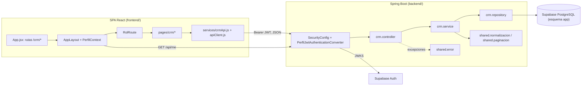
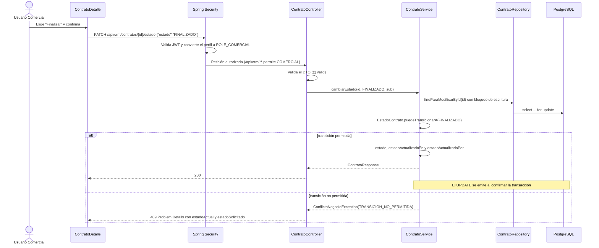
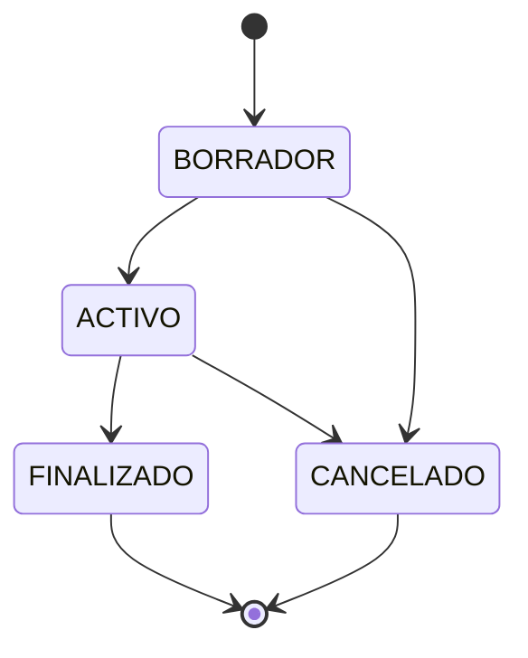
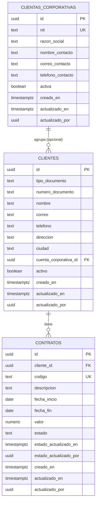

# Documento de diseño: 002-crm-clientes-contratos

## Overview

Esta especificación construye el módulo CRM (clientes, cuentas corporativas, contratos y resumen comercial) como patrón de referencia para ERP y SGA, y añade la contenedorización del backend, las pruebas de integración con PostgreSQL efímero y la integración continua con GitHub Actions. Cubre los requisitos 1 a 30 de `requirements.md`.

Requisitos del MVP cubiertos: CRM-01, CRM-03 y CRM-04 (Must); CRM-02 y CRM-05 (Should incluidos); NF-01 a NF-07; CA-01, CA-03, CA-04, CA-06, CA-07 y el tramo cliente → contrato de CA-05; ENG-01 a ENG-04; AUTH-05 en las vistas CRM.

### Estado de partida

| Elemento | Estado | Uso en esta spec |
|---|---|---|
| `SecurityConfig` con la matriz de módulos y las lecturas cruzadas de CRM | [Implementado] | Se usa sin cambios (Requirement 16.1) |
| `PerfilJwtAuthenticationConverter` (`ROLE_<ROL>` desde `app.perfiles_usuario`) | [Implementado] | Fuente del rol para la vista del cliente y las pruebas |
| `GlobalExceptionHandler`, `ProblemDetailsWriter`, `RecursoNoEncontradoException` | [Implementado] | Se amplían (conflictos, errores de tipo, 405/415 en español) |
| `AutorizacionModulosTests` con dobles bajo `/api/crm/**` | [Implementado] | Sus casos CRM se migran a los controladores reales |
| Perfil H2 de pruebas (`src/test/resources/application.properties`, `schema.sql`) | [Implementado] | Se reutiliza; las IT añaden un perfil `it` |
| Migración `20261108000000_app_perfiles_usuario.sql` | [Implementado] | Se aplica antes de la migración CRM en las IT |
| Frontend con login, `ProtectedRoute`, `apiClient` y `Perfil` | [Implementado] | Se amplía con layout privado, contexto de perfil y vistas CRM |
| Dockerfile, Compose y workflows | [Aprobado; por crear] | Se crean en esta spec |

### Decisiones resueltas en este diseño

| Código | Tema | Decisión | Sección |
|---|---|---|---|
| D1 | Relaciones dentro del CRM | `@ManyToOne(fetch = LAZY)` de `Cliente` a `CuentaCorporativa` y de `Contrato` a `Cliente`, sin colecciones inversas. Entre módulos se mantiene la regla de UUID sin asociaciones JPA (DP-ARQ-01) | Data Models |
| D2 | Normalización | Utilidades puras en `shared.normalizacion.NormalizadorTexto`, aplicadas en el constructor compacto de cada DTO de entrada | Servicios |
| D3 | Una violación por campo | Restricciones compuestas con `@ReportAsSingleViolation`, obligatoriedad separada del formato y deduplicación por campo en el handler | Validación |
| D4 | Errores de tipo | `HttpMessageNotReadableException` y `TypeMismatchException` devuelven `errors` con el campo afectado; 405 y 415 en español | Error Handling |
| D5 | Conflictos de negocio | `ConflictoNegocioException` en `shared.error` con extensiones `conflicto`, `campo` y datos adicionales (por ejemplo `clienteId`) | Error Handling |
| D6 | Vista del cliente | El controlador deriva `VistaCliente` de las authorities del token convertido; el servicio construye el DTO completo o reducido | Controladores |
| D7 | Paginación | Parámetros `page`, `size` y `sort` validados en el controlador (sin resolver `Pageable`) para responder 400; `PaginaResponse<T>` en `shared.paginacion` | API |
| D8 | Validación de parámetros | Validación de métodos integrada de Spring MVC (restricciones en `@RequestParam`, sin `@Validated` a nivel de clase) | API |
| D9 | Concurrencia | Bloqueo pesimista de escritura del contrato en `PUT` y `PATCH .../estado`; bloqueo de lectura del cliente o de la cuenta cuando su estado activo es precondición | Servicios |
| D10 | Auditoría | `Clock` inyectado; instantes truncados a microsegundos; el cambio de estado solo actualiza la auditoría de estado | Servicios |
| D11 | Columnas de actor | `actualizado_por` y `estado_actualizado_por` son `uuid not null` sin FK a `auth.users` | Data Models |
| D12 | Testcontainers | Contenedor como `@Bean @ServiceConnection`; migraciones aplicadas por JDBC en orden de nombre; sin `testcontainers-junit-jupiter` | Testing Strategy |
| D13 | Pruebas basadas en propiedades | Sin librería nueva (se descarta jqwik): pruebas parametrizadas exhaustivas y generadores con semilla fija, mínimo 100 casos por propiedad | Testing Strategy |
| D14 | Perfil en el frontend | `PerfilContext` comparte una única llamada a `/api/me`; el botón de cierre de sesión pasa al layout privado | Frontend |
| D15 | Compose y `.env` | `env_file` con el formato por defecto; los valores de `backend/.env` no pueden contener `$` | Infraestructura |
| D16 | `mvnw` en Linux | Se fija el bit ejecutable en Git y el Dockerfile ejecuta `chmod +x` | Infraestructura |
| D17 | Disparadores de CI | Sin filtros de rutas, para que los tres checks obligatorios existan en todo PR | CI |
| D18 | Aplicación de migraciones | Aclaración de DP-TEC-03 (ver abajo) | Migraciones |
| D19 | Ubicación de pruebas | `*Tests` en el paquete de la clase probada (práctica de `001-foundation`); `*IT` en `com.arise.corp.integration` | Testing Strategy |

### Confirmación de interpretaciones de los requisitos

| # | Interpretación | Resultado | Dónde se aplica |
|---|---|---|---|
| 1 | `nombre`, `correo` y `telefono` del cliente son obligatorios; `direccion`, `ciudad` y `cuentaCorporativaId` son opcionales | Confirmada | `ClienteRequest`, Requirement 4.2 |
| 2 | Límites de texto de los supuestos (nombre 200, correo 254, teléfono 7–20, dirección 200, ciudad 100, contacto 200, descripción 1000, `q` 100) | Confirmada; se repiten como `CHECK` en PostgreSQL | DTO, migración |
| 3 | La vista reducida incluye `ciudad` | Confirmada: la ciudad sirve a Operaciones para las entregas y no identifica a la persona por sí sola | `ClienteResumenResponse` |
| 4 | El 409 por cliente inactivo incluye su identificador | Confirmada; la extensión se llama `clienteId` | Error Handling |
| 5 | Un cliente asociado a una cuenta inactiva puede editarse si conserva esa cuenta | Confirmada | `ClienteService.actualizar` |
| 6 | Los contratos de un cliente inactivo conservan sus transiciones | Confirmada; la máquina de estados no consulta el estado del cliente | `ContratoService.cambiarEstado` |
| 7 | `PUT /api/crm/contratos/{id}` no cambia `clienteId` ni `estado` | Confirmada; `ContratoActualizarRequest` no tiene esos campos y Jackson ignora propiedades desconocidas | DTO |
| 8 | `GET /api/crm/contratos?clienteId=` con un cliente inexistente responde 200 con lista vacía | Confirmada; evita revelar existencia mediante 404 | `ContratoService.listar` |
| 9 | `DELETE /api/crm/clientes/{id}` responde 405 | Ajustada: el 405 aplica a los roles gestores. Spring Security evalúa antes la matriz, así que sin token se responde 401 y con `FINANZAS_RRHH` u `OPERACIONES` se responde 403. Se actualizó Requirement 8.6 | `GlobalExceptionHandler` |

Ajustes de coherencia registrados también en `requirements.md`:

- **Requirement 8.6:** el 405 se exige para un Actor con Rol_Gestor_CRM.
- **Requirement 24.1:** las dependencias de prueba son `org.testcontainers:testcontainers-postgresql` y `org.springframework.boot:spring-boot-testcontainers`. `testcontainers-junit-jupiter` no se añade porque el ciclo de vida del contenedor lo gestiona el contexto de Spring (D12).
- **Requirement 29.10:** las migraciones se aplican tras la revisión y antes de la validación manual y del PR final (D18).

### Aclaración de DP-TEC-03 (ajuste de steering registrado)

`tech.md` decía que las migraciones se aplican en `arise-corp-dev` "tras el merge". La validación manual del Requirement 30 necesita las tablas CRM en esa base antes del PR final. Se adopta el precedente de la tarea 20 de `001-foundation`, que aplicó la migración revisada de forma controlada antes del PR, manteniendo que sea Davidson quien prepare y aplique las migraciones:

1. Davidson prepara la migración CRM con Supabase CLI.
2. Sebastián la revisa en la rama de la spec.
3. Davidson, como autor, la aplica de forma controlada en `arise-corp-dev` cuando `MigracionesCrmIT` la ha validado en PostgreSQL efímero, con el mismo procedimiento de la tarea 20 de `001-foundation`. Es aditiva: solo crea tres tablas, sus índices y sus restricciones, y revoca privilegios sobre esas tablas.
4. Después de aplicada no se edita. Si la revisión del PR pide cambios de esquema, llegan en una migración nueva.

Mientras la migración no esté aplicada, el backend de la rama no arranca contra `arise-corp-dev` porque `ddl-auto=validate` no encuentra las tablas; las suites automáticas no se ven afectadas (H2 y PostgreSQL efímero).

Texto registrado en `tech.md`, decisión DP-TEC-03:

> Davidson prepara las migraciones y otro integrante las revisa antes de su aplicación. Davidson las aplica de forma controlada en `arise-corp-dev`: como regla general después del merge, y antes del PR final cuando la validación extremo a extremo de una spec necesita la migración y la migración es aditiva (solo crea objetos nuevos y ajusta la seguridad de esos objetos), una vez revisada y validada en PostgreSQL efímero. Nunca se editan migraciones aplicadas.

La misma regla se refleja en `supabase/migrations/README.md`. Este ajuste de DP-TEC-03 ya está registrado en `tech.md`; los demás ajustes de reglas que adopta el diseño (validación de parámetros sin `@Validated` a nivel de clase, D8, y ubicación de las pruebas, D19) se registran al inicio de la rama, antes de implementarse (`sdd-workflow.md`, "Registro de decisiones").

## Architecture

El CRM se añade al monolito modular sin cambiar el estilo de tres capas (`architecture.md`). La SPA llama a `/api/crm/**` con el Bearer de Supabase; Spring Security valida el JWT y convierte el perfil activo en `ROLE_<ROL>`; los controladores del CRM delegan en servicios transaccionales que usan repositorios Spring Data JPA sobre el esquema `app`.

### Diagrama de componentes



### Flujo de un cambio de estado de contrato



### Organización del backend

```text
com.arise.corp
├── config/
│   ├── SecurityConfig.java                  # sin cambios
│   ├── PerfilJwtAuthenticationConverter.java
│   └── ClockConfig.java                     # nuevo: bean Clock UTC (D10)
├── shared/
│   ├── error/
│   │   ├── GlobalExceptionHandler.java      # ampliado (D4, D5)
│   │   ├── ConflictoNegocioException.java   # nuevo
│   │   ├── RecursoNoEncontradoException.java# admite campo opcional
│   │   └── ...                              # resto sin cambios
│   ├── normalizacion/
│   │   └── NormalizadorTexto.java           # nuevo (D2)
│   ├── paginacion/
│   │   ├── PaginaResponse.java              # nuevo (DP-API-03)
│   │   └── Paginacion.java                  # nuevo (D7)
│   └── validacion/
│       ├── Correo.java, Telefono.java, ValorCop.java   # restricciones compuestas (D3)
├── login/                                   # sin cambios
└── crm/
    ├── controller/
    │   ├── ClienteController.java
    │   ├── CuentaCorporativaController.java
    │   ├── ContratoController.java
    │   ├── ResumenComercialController.java
    │   └── VistaClienteResolver.java        # authorities → VistaCliente (D6)
    ├── service/
    │   ├── ClienteService.java
    │   ├── CuentaCorporativaService.java
    │   ├── ContratoService.java
    │   ├── ResumenComercialService.java
    │   ├── VistaCliente.java                # COMPLETA | REDUCIDA
    │   └── ConflictosCrm.java               # fábrica de ConflictoNegocioException
    ├── repository/
    │   ├── ClienteRepository.java
    │   ├── CuentaCorporativaRepository.java
    │   ├── ContratoRepository.java
    │   ├── EspecificacionesCrm.java         # Specification de filtros y búsqueda
    │   └── ConteoPorClave.java              # proyección de conteos
    ├── entity/
    │   ├── Cliente.java, CuentaCorporativa.java, Contrato.java
    │   ├── TipoDocumento.java, EstadoContrato.java
    └── dto/
        ├── ClienteRequest, EstadoClienteRequest, ClienteResponse, ClienteResumenResponse, ClienteVista
        ├── CuentaCorporativaRequest, EstadoCuentaRequest, CuentaCorporativaResponse
        ├── ContratoCrearRequest, ContratoActualizarRequest, EstadoContratoRequest, ContratoResponse
        ├── CuentaCorporativaRef, ClienteRef, ResumenComercialResponse
        └── validacion/
            ├── NumeroDocumentoValido.java (+ validador)
            └── RangoFechasContrato.java (+ validador)
```

Dependencias permitidas: `crm.controller → crm.service → crm.repository → crm.entity`; `crm.* → shared.*`; `crm.controller → config.PerfilJwtAuthenticationConverter.PREFIJO_ROL` y `login.entity.RolUsuario` (solo para nombrar authorities). El CRM no depende de `erp` ni `sga` (Requirement 1.4, DP-ARQ-01). `shared` no depende de ningún módulo de negocio.

Las firmas públicas de entidades, repositorios y servicios descritas en este documento son el contrato interno entre capas: permiten implementar la persistencia, los servicios y el frontend por separado mientras se respeten.

## Components and Interfaces

### Contratos de la API del CRM

Este apartado es la documentación de API del CRM (DP-API-06, Requirement 29.1). Frontend y backend lo usan como referencia común.

#### Convenciones comunes

- **Autenticación:** todas las rutas exigen `Authorization: Bearer <access_token>`. Sin token o con un token inválido, vencido o con emisor o audiencia incorrectos responden 401 Problem Details con `WWW-Authenticate` (Requirement 16.2).
- **Autorización:** la matriz de la introducción de `requirements.md` se aplica en `SecurityConfig` sin cambios. Un JWT válido sin perfil activo o con un rol no permitido responde 403 antes de llegar al controlador, de modo que un recurso inexistente no se distingue de uno existente (Requirements 16.3–16.5).
- **Orden de evaluación:** 401 → 403 → 400 (cuerpo y parámetros) → 404 (recurso de la ruta y referencias del cuerpo) → 409 (duplicados, estado de referencias, reglas de estado).
- **Cuerpo:** `Content-Type: application/json` en UTF-8. Los DTO de entrada ignoran propiedades desconocidas (`@JsonIgnoreProperties(ignoreUnknown = true)`), así que `id`, `activo`, `activa`, `estado`, `clienteId` (en `PUT` de contrato) y los campos de auditoría enviados por el cliente no tienen efecto (Requirements 4.9, 11.12, 13.4).
- **Normalización (Requirement 3):** los textos se recortan (`strip`) y un texto vacío se convierte en `null`. `numeroDocumento` y `nit` se convierten en Documento_Normalizado (sin espacios, puntos ni guiones, en mayúsculas). `codigo` se convierte en Codigo_Normalizado (recortado y en mayúsculas). Las validaciones, comparaciones y el almacenamiento usan el valor normalizado, y las respuestas lo devuelven normalizado.
- **Tipos (DP-API-04):** identificadores UUID; fechas `AAAA-MM-DD`; instantes ISO-8601 UTC (por ejemplo `2026-11-20T15:04:05.123456Z`); `valor` como texto decimal con dos decimales (`"1500000.00"`); enumeraciones en `UPPER_SNAKE_CASE`.
- **Listas (DP-API-03):** `page` entero ≥ 0 (por defecto 0); `size` entero de 1 a 100 (por defecto 20); `sort` con el formato `campo,asc|desc`, solo con los campos permitidos de cada endpoint y la dirección en minúsculas. Se añade `id,asc` como desempate interno para que la paginación sea estable. Un valor fuera de rango, un tipo incorrecto o un campo de orden no permitido responde 400. La respuesta es:

```json
{ "content": [], "page": 0, "size": 20, "totalElements": 0, "totalPages": 0 }
```

- **Errores:** RFC 9457 Problem Details (`application/problem+json`) con mensajes en español (DP-API-02). Los 400 por campo usan `errors: [{ "field", "message" }]` con una entrada por campo. Los 409 de negocio añaden `conflicto` (código estable en `UPPER_SNAKE_CASE`), `campo` cuando el conflicto se refiere a un campo, y extensiones propias del conflicto. El catálogo completo está en "Error Handling".

Ejemplo de 409 por cliente inactivo:

```json
{
  "type": "about:blank",
  "title": "Conflicto",
  "status": 409,
  "detail": "El cliente ya existe, pero está inactivo. Reactívalo en lugar de registrarlo de nuevo.",
  "instance": "/api/crm/clientes",
  "conflicto": "CLIENTE_INACTIVO_EXISTENTE",
  "campo": "numeroDocumento",
  "clienteId": "3f2c9a4e-0000-4000-8000-000000000001"
}
```

#### Representaciones JSON

**Vista_Completa_Cliente (`ClienteResponse`)**, para ADMINISTRADOR y COMERCIAL:

```json
{
  "id": "3f2c9a4e-0000-4000-8000-000000000001",
  "tipoDocumento": "CC",
  "numeroDocumento": "10234567",
  "nombre": "Cliente de Ejemplo",
  "correo": "cliente@example.test",
  "telefono": "+57 300 000 0000",
  "direccion": "Calle 1 # 2-3",
  "ciudad": "Bogotá",
  "activo": true,
  "cuentaCorporativa": { "id": "7b1d0c2e-0000-4000-8000-000000000002", "razonSocial": "Empresa de Ejemplo S.A.S." },
  "creadoEn": "2026-11-20T15:04:05.123456Z",
  "actualizadoEn": "2026-11-20T15:04:05.123456Z",
  "actualizadoPor": "9a8b7c6d-0000-4000-8000-000000000003"
}
```

**Vista_Reducida_Cliente (`ClienteResumenResponse`)**, para FINANZAS_RRHH y OPERACIONES. Excluye `correo`, `telefono`, `direccion` y la auditoría:

```json
{
  "id": "3f2c9a4e-0000-4000-8000-000000000001",
  "tipoDocumento": "CC",
  "numeroDocumento": "10234567",
  "nombre": "Cliente de Ejemplo",
  "ciudad": "Bogotá",
  "activo": true,
  "cuentaCorporativa": { "id": "7b1d0c2e-0000-4000-8000-000000000002", "razonSocial": "Empresa de Ejemplo S.A.S." }
}
```

`cuentaCorporativa` es `null` cuando el cliente no tiene cuenta (Requirement 10.6).

**Cuenta corporativa (`CuentaCorporativaResponse`):**

```json
{
  "id": "7b1d0c2e-0000-4000-8000-000000000002",
  "nit": "900123456",
  "razonSocial": "Empresa de Ejemplo S.A.S.",
  "nombreContacto": "Contacto de Ejemplo",
  "correoContacto": "contacto@example.test",
  "telefonoContacto": "601 000 0000",
  "activa": true,
  "creadoEn": "2026-11-20T15:04:05.123456Z",
  "actualizadoEn": "2026-11-20T15:04:05.123456Z",
  "actualizadoPor": "9a8b7c6d-0000-4000-8000-000000000003"
}
```

**Contrato (`ContratoResponse`)**, el mismo para detalle y listas (Requirement 12.4):

```json
{
  "id": "c4d5e6f7-0000-4000-8000-000000000004",
  "codigo": "CTR-2026-001",
  "descripcion": "Servicio de entregas urbanas",
  "fechaInicio": "2026-12-01",
  "fechaFin": "2027-11-30",
  "valor": "1500000.00",
  "estado": "BORRADOR",
  "cliente": { "id": "3f2c9a4e-0000-4000-8000-000000000001", "nombre": "Cliente de Ejemplo" },
  "cuentaCorporativa": { "id": "7b1d0c2e-0000-4000-8000-000000000002", "razonSocial": "Empresa de Ejemplo S.A.S." },
  "estadoActualizadoEn": "2026-11-20T15:04:05.123456Z",
  "estadoActualizadoPor": "9a8b7c6d-0000-4000-8000-000000000003",
  "creadoEn": "2026-11-20T15:04:05.123456Z",
  "actualizadoEn": "2026-11-20T15:04:05.123456Z"
}
```

`cuentaCorporativa` es la cuenta actual del cliente, deducida en la consulta; el contrato no la guarda (Requirement 2.6).

**Resumen comercial (`ResumenComercialResponse`):**

```json
{
  "clientes": { "activos": 12, "inactivos": 3, "total": 15 },
  "contratos": {
    "porEstado": { "BORRADOR": 4, "ACTIVO": 6, "FINALIZADO": 2, "CANCELADO": 0 },
    "total": 12
  }
}
```

#### Campos de entrada y validaciones

`ClienteRequest` (POST y PUT de clientes):

| Campo | Tipo JSON | Obligatorio | Normalización | Regla | Mensaje |
|---|---|---|---|---|---|
| `tipoDocumento` | string | Sí | — | `CC`, `CE`, `NIT`, `PASAPORTE` | "es obligatorio" / "debe ser uno de: CC, CE, NIT, PASAPORTE" |
| `numeroDocumento` | string | Sí | Documento_Normalizado | 3 a 20 letras o dígitos; solo dígitos con `CC` o `NIT` | "debe tener entre 3 y 20 letras o dígitos" / "solo admite dígitos para el tipo CC o NIT" |
| `nombre` | string | Sí | Recorte | Máximo 200 | "debe tener como máximo 200 caracteres" |
| `correo` | string | Sí | Recorte | Formato `local@dominio.tld`, máximo 254 | "debe ser un correo válido de máximo 254 caracteres" |
| `telefono` | string | Sí | Recorte | 7 a 20 caracteres de `0-9`, espacio, `+`, `-`, `(`, `)` | "debe tener entre 7 y 20 caracteres: dígitos, espacios, +, - o paréntesis" |
| `direccion` | string o null | No | Recorte; vacío → null | Máximo 200 | "debe tener como máximo 200 caracteres" |
| `ciudad` | string o null | No | Recorte; vacío → null | Máximo 100 | "debe tener como máximo 100 caracteres" |
| `cuentaCorporativaId` | uuid o null | No | — | UUID | "debe ser un identificador UUID válido" |

`CuentaCorporativaRequest` (POST y PUT de cuentas):

| Campo | Obligatorio | Normalización | Regla |
|---|---|---|---|
| `nit` | Sí | Documento_Normalizado | 5 a 15 dígitos ("debe tener entre 5 y 15 dígitos") |
| `razonSocial` | Sí | Recorte | Máximo 200 |
| `nombreContacto` | No | Recorte; vacío → null | Máximo 200 |
| `correoContacto` | No | Recorte; vacío → null | Formato de correo, máximo 254 |
| `telefonoContacto` | No | Recorte; vacío → null | Formato de teléfono de los supuestos |

`ContratoCrearRequest` (POST) y `ContratoActualizarRequest` (PUT, sin `clienteId`):

| Campo | Obligatorio | Normalización | Regla |
|---|---|---|---|
| `clienteId` | Sí (solo POST) | — | UUID |
| `codigo` | Sí | Codigo_Normalizado | 3 a 30 caracteres de `A-Z`, `0-9` y `-` ("debe tener entre 3 y 30 caracteres: letras, dígitos o guiones") |
| `descripcion` | Sí | Recorte | Máximo 1000 |
| `fechaInicio` | Sí | — | Fecha ISO `AAAA-MM-DD` ("debe ser una fecha válida con formato AAAA-MM-DD") |
| `fechaFin` | No | — | Fecha ISO; igual o posterior a `fechaInicio` ("debe ser igual o posterior a la fecha de inicio") |
| `valor` | Sí | — | Texto o número decimal ≥ 0 con hasta 13 dígitos enteros y 2 decimales ("debe ser mayor o igual a 0, con hasta 13 dígitos enteros y 2 decimales") |

Cuerpos de cambio de estado:

| DTO | Cuerpo | Regla |
|---|---|---|
| `EstadoClienteRequest` | `{ "activo": true \| false }` | `activo` obligatorio y booleano |
| `EstadoCuentaRequest` | `{ "activa": true \| false }` | `activa` obligatorio y booleano |
| `EstadoContratoRequest` | `{ "estado": "ACTIVO" }` | `estado` obligatorio y Estado_Contrato |

Un valor de tipo incorrecto (por ejemplo `"activo": "quizas"`, `"estado": "PAUSADO"`, `"fechaInicio": "31/12/2026"` o `"valor": "abc"`) responde 400 con una entrada en `errors` para ese campo (D4). Los booleanos textuales `"true"` y `"false"` siguen la coerción por defecto de Jackson y se aceptan.

#### Clientes

##### GET /api/crm/clientes
- Requisitos: CRM-01, CRM-02, DP-API-03; Requirements 5.1–5.6, 6.1–6.3, 10.6.
- Roles permitidos: ADMINISTRADOR y COMERCIAL (Vista_Completa_Cliente); FINANZAS_RRHH y OPERACIONES (Vista_Reducida_Cliente).
- Parámetros de consulta:

| Parámetro | Tipo | Regla | Efecto |
|---|---|---|---|
| `q` | string | Máximo 100; vacío se ignora | `lower(nombre)` contiene `lower(q)` o `numeroDocumento` contiene el Documento_Normalizado de `q` (si no queda vacío) |
| `activo` | boolean | `true` o `false` | Filtra por estado |
| `cuentaCorporativaId` | uuid | UUID | Filtra por cuenta |
| `page`, `size` | entero | Ver convenciones | Paginación |
| `sort` | string | `nombre`, `numeroDocumento` o `creadoEn` con `asc` o `desc`; por defecto `nombre,asc` | Orden |

- Respuesta 200: Lista_Paginada de clientes activos e inactivos en la vista que corresponde al rol. Los comodines `%`, `_` y `\` de `q` se escapan antes de construir el `LIKE`.
- Errores: 400 (parámetros), 401, 403.

##### GET /api/crm/clientes/{id}
- Requisitos: CRM-01; Requirements 5.7–5.9, 6.1–6.3.
- Roles permitidos: los cuatro roles; la vista depende del rol.
- Respuesta 200: el cliente, activo o inactivo.
- Errores: 400 (`id` no UUID, con `errors[0].field = "id"`), 401, 403, 404 ("El cliente no existe.").

##### POST /api/crm/clientes
- Requisitos: CRM-01, CRM-02, CRM-04, DP-SEG-06; Requirements 4.1–4.9, 10.1, 10.3, 10.4.
- Roles permitidos: ADMINISTRADOR, COMERCIAL.
- Solicitud: `ClienteRequest`.
- Respuesta 201: Vista_Completa_Cliente con `activo = true`, `creadoEn = actualizadoEn = ahora` y `actualizadoPor = sub`. Encabezado `Location: /api/crm/clientes/{id}`.
- Errores: 400 (validación), 401, 403, 404 (`cuentaCorporativaId` inexistente, `campo = "cuentaCorporativaId"`), 409 (`CLIENTE_DUPLICADO`, `CLIENTE_INACTIVO_EXISTENTE` con `clienteId`, `CUENTA_INACTIVA`, o restricción de la base).

##### PUT /api/crm/clientes/{id}
- Requisitos: CRM-01, CRM-02, CRM-04; Requirements 7.1–7.6, 10.2–10.5.
- Roles permitidos: ADMINISTRADOR, COMERCIAL.
- Solicitud: `ClienteRequest`. Reemplaza todos los campos editables; un opcional omitido o nulo queda nulo; `cuentaCorporativaId` nulo elimina la asociación. Conserva `activo` y `creadoEn`.
- Respuesta 200: Vista_Completa_Cliente con `actualizadoEn` y `actualizadoPor` nuevos.
- Errores: 400, 401, 403, 404 (cliente o cuenta inexistentes), 409 (`CLIENTE_DUPLICADO` si el documento pertenece a otro cliente activo o inactivo; `CUENTA_INACTIVA` si se asigna una cuenta inactiva distinta de la actual).

##### PATCH /api/crm/clientes/{id}
- Requisitos: CRM-01, CRM-04, DP-API-05; Requirements 8.1–8.5, 8.7.
- Roles permitidos: ADMINISTRADOR, COMERCIAL.
- Solicitud: `EstadoClienteRequest`.
- Respuesta 200: Vista_Completa_Cliente. Si `activo` cambia, se actualizan `actualizadoEn` y `actualizadoPor`; si coincide con el estado actual, el cliente se devuelve sin cambios. Los contratos del cliente no se modifican.
- Errores: 400 (`activo` ausente, nulo o no booleano), 401, 403, 404.

##### DELETE /api/crm/clientes/{id}
- Requisitos: CRM-01; Requirement 8.6.
- No existe operación de borrado. Para ADMINISTRADOR y COMERCIAL responde 405 Problem Details ("La operación no está disponible para este recurso.") con el encabezado `Allow` que calcula Spring a partir de los métodos mapeados (incluye `GET`, `PUT` y `PATCH`). Sin token responde 401 y con los demás roles responde 403, porque la matriz de seguridad se evalúa antes.

#### Cuentas corporativas

##### GET /api/crm/cuentas-corporativas
- Requisitos: CRM-02, DP-API-03; Requirements 9.6, 9.7.
- Roles permitidos: ADMINISTRADOR, COMERCIAL.
- Parámetros: `q` (máximo 100; `lower(razonSocial)` contiene `lower(q)` o `nit` contiene el Documento_Normalizado de `q`), `activa` (boolean), `page`, `size`, `sort` (`razonSocial`, `nit`, `creadoEn`; por defecto `razonSocial,asc`).
- Respuesta 200: Lista_Paginada de `CuentaCorporativaResponse`.
- Errores: 400, 401, 403.

##### GET /api/crm/cuentas-corporativas/{id}
- Requisitos: CRM-02; Requirements 9.8, 9.13.
- Roles permitidos: ADMINISTRADOR, COMERCIAL.
- Respuesta 200: `CuentaCorporativaResponse`.
- Errores: 400, 401, 403, 404 ("La cuenta corporativa no existe.").

##### POST /api/crm/cuentas-corporativas
- Requisitos: CRM-02, CRM-04, DP-SEG-06; Requirements 9.1–9.5.
- Roles permitidos: ADMINISTRADOR, COMERCIAL.
- Solicitud: `CuentaCorporativaRequest`.
- Respuesta 201: la cuenta con `activa = true` y auditoría del actor. `Location: /api/crm/cuentas-corporativas/{id}`.
- Errores: 400, 401, 403, 409 (`CUENTA_NIT_DUPLICADO`, activa o inactiva).

##### PUT /api/crm/cuentas-corporativas/{id}
- Requisitos: CRM-02, CRM-04; Requirements 9.2–9.5, 9.9, 9.13.
- Roles permitidos: ADMINISTRADOR, COMERCIAL.
- Solicitud: `CuentaCorporativaRequest`. Reemplaza `nit`, `razonSocial` y los datos de contacto; conserva `activa` y `creadoEn`.
- Respuesta 200 con la auditoría actualizada.
- Errores: 400, 401, 403, 404, 409 (`CUENTA_NIT_DUPLICADO` si el NIT pertenece a otra cuenta).

##### PATCH /api/crm/cuentas-corporativas/{id}
- Requisitos: CRM-02, DP-API-05; Requirements 9.10–9.13.
- Roles permitidos: ADMINISTRADOR, COMERCIAL.
- Solicitud: `EstadoCuentaRequest`.
- Respuesta 200. La auditoría cambia solo si `activa` cambia. Desactivar una cuenta no modifica los clientes asociados.
- Errores: 400 (`activa` ausente o no booleano), 401, 403, 404.

#### Contratos

##### GET /api/crm/contratos
- Requisitos: CRM-03, DP-API-03; Requirements 12.1–12.3, 12.5.
- Roles permitidos: ADMINISTRADOR, COMERCIAL, OPERACIONES.
- Parámetros: `clienteId` (uuid), `estado` (Estado_Contrato), `page`, `size`, `sort` (`codigo`, `fechaInicio`, `creadoEn`; por defecto `creadoEn,desc`).
- Respuesta 200: Lista_Paginada de `ContratoResponse`. Con un `clienteId` sin contratos o inexistente, la lista está vacía.
- Errores: 400 (`clienteId` no UUID, `estado` desconocido, paginación u orden inválidos), 401, 403.

##### GET /api/crm/contratos/{id}
- Requisitos: CRM-03; Requirements 12.4–12.6.
- Roles permitidos: ADMINISTRADOR, COMERCIAL, OPERACIONES.
- Respuesta 200: `ContratoResponse`.
- Errores: 400, 401, 403, 404 ("El contrato no existe.").

##### POST /api/crm/contratos
- Requisitos: CRM-03, CRM-04, DP-SEG-06; Requirements 11.1–11.12.
- Roles permitidos: ADMINISTRADOR, COMERCIAL.
- Solicitud: `ContratoCrearRequest`.
- Respuesta 201: el contrato en `BORRADOR`, con `creadoEn = actualizadoEn = estadoActualizadoEn = ahora` y `actualizadoPor = estadoActualizadoPor = sub`. `Location: /api/crm/contratos/{id}`.
- Errores: 400, 401, 403, 404 (`clienteId` inexistente, `campo = "clienteId"`), 409 (`CLIENTE_INACTIVO_SIN_CONTRATOS`, `CONTRATO_CODIGO_DUPLICADO`, o restricción de la base).

##### PUT /api/crm/contratos/{id}
- Requisitos: CRM-03, CRM-04; Requirements 13.1–13.6.
- Roles permitidos: ADMINISTRADOR, COMERCIAL.
- Solicitud: `ContratoActualizarRequest`. Reemplaza `codigo`, `descripcion`, `fechaInicio`, `fechaFin` y `valor`; conserva el cliente y el estado aunque el cuerpo los incluya.
- Respuesta 200 con `actualizadoEn` y `actualizadoPor` nuevos.
- Errores: 400, 401, 403, 404, 409 (`CONTRATO_NO_EDITABLE` si el estado no es `BORRADOR`; `CONTRATO_CODIGO_DUPLICADO`).

##### PATCH /api/crm/contratos/{id}/estado
- Requisitos: CRM-03, DP-API-05, DP-SEG-06; Requirements 14.1–14.6.
- Roles permitidos: ADMINISTRADOR, COMERCIAL.
- Solicitud: `EstadoContratoRequest`.
- Respuesta 200: el contrato con `estado`, `estadoActualizadoEn` (instante UTC) y `estadoActualizadoPor` (`sub`) actualizados en la misma transacción. `actualizadoEn` y `actualizadoPor` no cambian (D10).
- Errores: 400 (`estado` ausente o desconocido), 401, 403, 404, 409 (`TRANSICION_NO_PERMITIDA` con `estadoActual` y `estadoSolicitado`; incluye el mismo estado, el paso a `BORRADOR` y cualquier cambio desde un Estado_Final).

Máquina de estados (Transicion_Permitida):



#### Resumen comercial

##### GET /api/crm/resumen
- Requisitos: CRM-05, CA-04; Requirements 15.1–15.3.
- Roles permitidos: ADMINISTRADOR, COMERCIAL.
- Respuesta 200: `ResumenComercialResponse`. Los cuatro estados aparecen siempre, con 0 si no hay contratos. `clientes.total = activos + inactivos` y `contratos.total` es la suma de `porEstado`. Los conteos se leen en una transacción de solo lectura en el momento de la solicitud.
- Errores: 401, 403.

#### Matriz de acceso por endpoint

| Endpoint | ADMINISTRADOR | COMERCIAL | FINANZAS_RRHH | OPERACIONES | Patrón de `SecurityConfig` que lo decide |
|---|---|---|---|---|---|
| `GET /api/crm/clientes`, `GET /api/crm/clientes/{id}` | Completa | Completa | Reducida | Reducida | `GET /api/crm/clientes`, `/api/crm/clientes/*` |
| `POST`, `PUT`, `PATCH` de clientes; `DELETE` (405) | Sí | Sí | 403 | 403 | `/api/crm/**` |
| Cuentas corporativas (todas) | Sí | Sí | 403 | 403 | `/api/crm/**` |
| `GET /api/crm/contratos`, `GET /api/crm/contratos/{id}` | Sí | Sí | 403 | Sí | `GET /api/crm/contratos`, `/api/crm/contratos/*` |
| `POST`, `PUT`, `PATCH .../estado` de contratos | Sí | Sí | 403 | 403 | `/api/crm/**` |
| `GET /api/crm/resumen` | Sí | Sí | 403 | 403 | `/api/crm/**` |

La ruta `/api/crm/contratos/{id}/estado` tiene dos segmentos después de `contratos`, por lo que no coincide con el patrón de lectura cruzada `/api/crm/contratos/*` y queda bajo `/api/crm/**` (solo gestores).

### Backend: controladores

Los controladores reciben y devuelven DTO, validan con `@Valid` y delegan en el servicio (Requirements 1.2, 1.3). Toman el actor de `@AuthenticationPrincipal Jwt jwt` (`jwt.getSubject()`, Requirement 16.6) y construyen `Location` con URI relativas, como `AdminPerfilController`.

| Controlador | Ruta base | Métodos |
|---|---|---|
| `ClienteController` | `/api/crm/clientes` | `GET`, `GET /{id}`, `POST`, `PUT /{id}`, `PATCH /{id}` |
| `CuentaCorporativaController` | `/api/crm/cuentas-corporativas` | `GET`, `GET /{id}`, `POST`, `PUT /{id}`, `PATCH /{id}` |
| `ContratoController` | `/api/crm/contratos` | `GET`, `GET /{id}`, `POST`, `PUT /{id}`, `PATCH /{id}/estado` |
| `ResumenComercialController` | `/api/crm/resumen` | `GET` |

Validación de parámetros (D8): las restricciones se declaran en los `@RequestParam` y Spring MVC aplica su validación de métodos integrada, que lanza `HandlerMethodValidationException` (ya traducida a 400 con `errors`). Los controladores **no** llevan `@Validated` a nivel de clase: esa anotación activa la validación por AOP, que lanza `ConstraintViolationException` y terminaría en 500. Los errores de conversión (`page=abc`, `activo=quizas`, `id` no UUID, `estado=PAUSADO`) llegan como `MethodArgumentTypeMismatchException`.

```java
@GetMapping
public PaginaResponse<ClienteVista> listar(
        @RequestParam(required = false)
        @Size(max = 100, message = "debe tener como máximo 100 caracteres") String q,
        @RequestParam(required = false) Boolean activo,
        @RequestParam(required = false) UUID cuentaCorporativaId,
        @RequestParam(defaultValue = "0")
        @Min(value = 0, message = "debe ser mayor o igual a 0") int page,
        @RequestParam(defaultValue = "20")
        @Min(value = 1, message = "debe estar entre 1 y 100")
        @Max(value = 100, message = "debe estar entre 1 y 100") int size,
        @RequestParam(defaultValue = "nombre,asc")
        @Pattern(regexp = "(nombre|numeroDocumento|creadoEn),(asc|desc)",
                message = "debe usar nombre, numeroDocumento o creadoEn con asc o desc") String sort,
        Authentication authentication) {

    VistaCliente vista = VistaClienteResolver.desde(authentication);
    FiltroClientes filtro = new FiltroClientes(q, activo, cuentaCorporativaId);
    return clienteService.listar(filtro, Paginacion.crear(page, size, sort, CAMPOS_ORDEN_CLIENTE), vista);
}
```

`VistaClienteResolver.desde(Authentication)` devuelve `COMPLETA` solo si las authorities contienen `ROLE_ADMINISTRADOR` o `ROLE_COMERCIAL`, construidas con `PerfilJwtAuthenticationConverter.PREFIJO_ROL + RolUsuario.X.name()`. Cualquier otro caso devuelve `REDUCIDA`, de modo que un error de configuración nunca expone datos personales. No acepta parámetros de la petición (Requirement 6.3).

### Backend: DTO

Todos los DTO son `record` (DP-EST-03). Los de entrada llevan `@JsonIgnoreProperties(ignoreUnknown = true)` y normalizan en el constructor compacto (D2):

```java
@JsonIgnoreProperties(ignoreUnknown = true)
@NumeroDocumentoValido
public record ClienteRequest(
        @NotNull(message = "es obligatorio") TipoDocumento tipoDocumento,
        @NotNull(message = "es obligatorio") String numeroDocumento,
        @NotNull(message = "es obligatorio")
        @Size(max = 200, message = "debe tener como máximo 200 caracteres") String nombre,
        @NotNull(message = "es obligatorio") @Correo String correo,
        @NotNull(message = "es obligatorio") @Telefono String telefono,
        @Size(max = 200, message = "debe tener como máximo 200 caracteres") String direccion,
        @Size(max = 100, message = "debe tener como máximo 100 caracteres") String ciudad,
        UUID cuentaCorporativaId) {

    public ClienteRequest {
        numeroDocumento = NormalizadorTexto.documento(numeroDocumento);
        nombre = NormalizadorTexto.texto(nombre);
        correo = NormalizadorTexto.texto(correo);
        telefono = NormalizadorTexto.texto(telefono);
        direccion = NormalizadorTexto.texto(direccion);
        ciudad = NormalizadorTexto.texto(ciudad);
    }

    @Override
    public String toString() {
        return "ClienteRequest[datos protegidos]";
    }
}
```

Reglas de validación (D3):

- La normalización convierte cualquier texto vacío en `null`. La obligatoriedad se comprueba con `@NotNull` y las reglas de formato aceptan `null`; así un campo vacío produce un único error ("es obligatorio") y un campo con formato inválido produce un único error de formato.
- Cada campo tiene como máximo una restricción de formato. Donde la regla combina varias condiciones se usa una restricción compuesta con `@ReportAsSingleViolation`: `@Correo` (`@Email(regexp = ".+@.+\\..+")` + `@Size(max = 254)`), `@Telefono` (`@Pattern("[0-9 +()\\-]{7,20}")`), `@ValorCop` (`@DecimalMin("0.00")` + `@Digits(integer = 13, fraction = 2)`). Estas tres viven en `shared.validacion` para que ERP y SGA las reutilicen.
- `@NumeroDocumentoValido` es una restricción de clase en `crm.dto.validacion`. Evalúa `numeroDocumento` ya normalizado: si es `null` no informa nada; si no cumple `[A-Z0-9]{3,20}` informa "debe tener entre 3 y 20 letras o dígitos"; si `tipoDocumento` es `CC` o `NIT` y contiene letras informa "solo admite dígitos para el tipo CC o NIT". Informa la violación sobre el nodo `numeroDocumento` (`addPropertyNode`), que Spring convierte en `FieldError`.
- `@RangoFechasContrato` es una restricción de clase sobre los dos DTO de contrato: si ambas fechas existen y `fechaFin < fechaInicio`, informa sobre `fechaFin`.
- `nit`: `@NotNull` + `@Pattern(regexp = "[0-9]{5,15}")` sobre el valor normalizado. `codigo`: `@NotNull` + `@Pattern(regexp = "[A-Z0-9-]{3,30}")`. `descripcion`: `@NotNull` + `@Size(max = 1000)`.
- Todos los mensajes se declaran en español en la anotación, para no depender del `Locale` del servidor ni del de CI.
- Los DTO de entrada y salida con datos personales (`ClienteRequest`, `ClienteResponse`, `CuentaCorporativaRequest`, `CuentaCorporativaResponse`) sobrescriben `toString()` para no volcar datos en logs (Requirement 6.4).

DTO de salida:

| DTO | Contenido |
|---|---|
| `ClienteVista` | Interfaz sellada implementada por `ClienteResponse` y `ClienteResumenResponse`; Jackson serializa el tipo real de cada elemento |
| `ClienteResponse` | Vista_Completa_Cliente |
| `ClienteResumenResponse` | Vista_Reducida_Cliente |
| `CuentaCorporativaRef(UUID id, String razonSocial)` | Referencia anidada |
| `ClienteRef(UUID id, String nombre)` | Referencia anidada del contrato |
| `CuentaCorporativaResponse` | Cuenta completa |
| `ContratoResponse` | `valor` como `String`, generado con `valor.setScale(2, RoundingMode.UNNECESSARY).toPlainString()` (Requirement 12.5) |
| `ResumenComercialResponse(ConteoClientes clientes, ConteoContratos contratos)` | `porEstado` es un `Map<EstadoContrato, Long>` construido como `EnumMap` con los cuatro estados |

### Backend: servicios

Todos los servicios reciben el `sub` del actor como `String`, lo convierten con `UUID.fromString` (el perfil activo garantiza que es un UUID) y usan `Instant.now(clock).truncatedTo(ChronoUnit.MICROS)` para que el valor devuelto coincida con el que guarda `timestamptz` (D10). Las lecturas usan `@Transactional(readOnly = true)` y las escrituras `@Transactional`. Convierten entidades en DTO dentro de la transacción, porque `open-in-view` está desactivado. No registran en logs datos de clientes ni de cuentas.

#### NormalizadorTexto (`shared.normalizacion`)

Clase `final` con métodos estáticos puros y sin excepciones:

```java
public static String texto(String valor)      // null → null; strip(); "" → null
public static String documento(String valor)  // texto(); elimina espacios Unicode, '.', '-'; toUpperCase(Locale.ROOT); "" → null
public static String codigo(String valor)     // texto(); toUpperCase(Locale.ROOT)
public static String patronContiene(String q) // escapa '\', '%', '_' y devuelve "%q%" para LIKE ... ESCAPE '\'
```

Las tres primeras son idempotentes: `f(f(x)) = f(x)` (Requirement 3.2).

#### ClienteService

| Método | Reglas |
|---|---|
| `PaginaResponse<ClienteVista> listar(FiltroClientes, Pageable, VistaCliente)` | `Specification` con `activo`, `cuentaCorporativaId` y `q`; carga la cuenta con `@EntityGraph` para evitar N+1 |
| `ClienteVista obtener(UUID id, VistaCliente)` | 404 si no existe |
| `ClienteResponse crear(ClienteRequest, String actorSub)` | 1) si hay `cuentaCorporativaId`, la carga con bloqueo de lectura (404 si no existe); 2) busca `(tipoDocumento, numeroDocumento)`: activo → `CLIENTE_DUPLICADO`, inactivo → `CLIENTE_INACTIVO_EXISTENTE` con `clienteId`; 3) cuenta inactiva → `CUENTA_INACTIVA`; 4) crea con `activo = true` y auditoría |
| `ClienteResponse actualizar(UUID id, ClienteRequest, String actorSub)` | 1) 404 si el cliente no existe; 2) cuenta destino: `null` quita la asociación, igual a la actual se conserva aunque esté inactiva, otra se carga con bloqueo de lectura (404 si no existe); 3) documento de otro cliente → `CLIENTE_DUPLICADO`; 4) cuenta destino distinta e inactiva → `CUENTA_INACTIVA`; 5) reemplaza campos y auditoría; conserva `activo` y `creadoEn` |
| `ClienteResponse cambiarEstado(UUID id, boolean activo, String actorSub)` | 404 si no existe; si `activo` coincide, devuelve sin tocar la auditoría; si no, cambia estado y auditoría. No consulta ni modifica contratos |

Regla de asignación de cuenta (Requirements 10.1–10.5): una asignación se acepta si el destino es `null`, si es la cuenta actual del cliente, o si es una cuenta existente y activa.

#### CuentaCorporativaService

| Método | Reglas |
|---|---|
| `listar(FiltroCuentas, Pageable)`, `obtener(UUID)` | 404 si no existe |
| `crear(CuentaCorporativaRequest, actorSub)` | NIT existente (activa o inactiva) → `CUENTA_NIT_DUPLICADO`; crea con `activa = true` |
| `actualizar(UUID, CuentaCorporativaRequest, actorSub)` | 404; NIT de otra cuenta → `CUENTA_NIT_DUPLICADO`; reemplaza datos; conserva `activa` y `creadoEn` |
| `cambiarEstado(UUID, boolean activa, actorSub)` | 404; sin cambios de auditoría si el valor coincide; no toca clientes |

#### ContratoService

| Método | Reglas |
|---|---|
| `listar(FiltroContratos, Pageable)` | Filtros `clienteId` y `estado`; carga `cliente` y `cliente.cuentaCorporativa` con `@EntityGraph`. Un `clienteId` inexistente produce una página vacía |
| `obtener(UUID)` | 404 si no existe |
| `crear(ContratoCrearRequest, actorSub)` | 1) carga el cliente con bloqueo de lectura (404 con `campo = "clienteId"`); 2) cliente inactivo → `CLIENTE_INACTIVO_SIN_CONTRATOS`; 3) código existente → `CONTRATO_CODIGO_DUPLICADO`; 4) crea en `BORRADOR` con la auditoría de datos y de estado iguales |
| `actualizar(UUID, ContratoActualizarRequest, actorSub)` | 1) carga con bloqueo de escritura (404); 2) estado distinto de `BORRADOR` → `CONTRATO_NO_EDITABLE`; 3) código de otro contrato → `CONTRATO_CODIGO_DUPLICADO`; 4) reemplaza datos y `actualizado_*` |
| `cambiarEstado(UUID, EstadoContrato destino, actorSub)` | 1) carga con bloqueo de escritura (404); 2) `!estado.puedeTransicionarA(destino)` → `TRANSICION_NO_PERMITIDA`; 3) `contrato.cambiarEstado(destino, actor, ahora)` actualiza `estado`, `estado_actualizado_en` y `estado_actualizado_por`. Las tres columnas están en la misma fila, así que el `UPDATE` es atómico; cualquier excepción revierte la transacción completa (Requirement 14.4). No consulta el estado del cliente (Requirement 14.5) |

```java
public enum EstadoContrato {
    BORRADOR, ACTIVO, FINALIZADO, CANCELADO;

    public Set<EstadoContrato> transicionesPermitidas() {
        return switch (this) {
            case BORRADOR -> EnumSet.of(ACTIVO, CANCELADO);
            case ACTIVO -> EnumSet.of(FINALIZADO, CANCELADO);
            case FINALIZADO, CANCELADO -> EnumSet.noneOf(EstadoContrato.class);
        };
    }

    public boolean puedeTransicionarA(EstadoContrato destino) {
        return transicionesPermitidas().contains(destino);
    }

    public boolean esFinal() {
        return transicionesPermitidas().isEmpty();
    }
}
```

#### ResumenComercialService

`obtener()` ejecuta dos consultas agrupadas (`group by activo` en clientes y `group by estado` en contratos) en una transacción de solo lectura. Inicializa un `EnumMap` con los cuatro estados en 0, suma los conteos recibidos y calcula los totales como suma de sus componentes, de modo que la coherencia no depende de consultas adicionales (Requirement 15.3).

#### Concurrencia (D9)

| Operación | Bloqueo | Motivo |
|---|---|---|
| `PUT` y `PATCH .../estado` de contrato | `PESSIMISTIC_WRITE` sobre la fila del contrato | Dos transiciones simultáneas desde `BORRADOR` (a `ACTIVO` y a `CANCELADO`) no pueden sobrescribirse; un `PUT` no puede editar un contrato que otra petición acaba de activar |
| `POST` de contrato | `PESSIMISTIC_READ` sobre la fila del cliente | Una desactivación simultánea espera a que termine la creación o la creación ve el cliente inactivo |
| Asignación de cuenta en `POST` o `PUT` de cliente | `PESSIMISTIC_READ` sobre la fila de la cuenta | Igual que el caso anterior con la desactivación de la cuenta |

Las consultas con bloqueo no hacen *fetch join* de relaciones opcionales, porque PostgreSQL rechaza `FOR UPDATE` sobre el lado anulable de un `LEFT JOIN`; las relaciones se cargan después de forma perezosa dentro de la transacción. Un duplicado concurrente que supere la comprobación previa lo rechaza la restricción `UNIQUE` y se traduce a 409 genérico (Requirement 17.5). Un `ConcurrencyFailureException` (bloqueo no obtenido o *deadlock*) también responde 409.

### Backend: repositorios

```java
public interface CuentaCorporativaRepository
        extends JpaRepository<CuentaCorporativa, UUID>, JpaSpecificationExecutor<CuentaCorporativa> {
    Optional<CuentaCorporativa> findByNit(String nit);
    @Lock(LockModeType.PESSIMISTIC_READ)
    Optional<CuentaCorporativa> findParaAsignarById(UUID id);
}

public interface ClienteRepository
        extends JpaRepository<Cliente, UUID>, JpaSpecificationExecutor<Cliente> {
    Optional<Cliente> findByTipoDocumentoAndNumeroDocumento(TipoDocumento tipo, String numero);
    @EntityGraph(attributePaths = "cuentaCorporativa")
    Page<Cliente> findAll(Specification<Cliente> spec, Pageable pageable);
    @EntityGraph(attributePaths = "cuentaCorporativa")
    Optional<Cliente> findConCuentaById(UUID id);
    @Lock(LockModeType.PESSIMISTIC_READ)
    Optional<Cliente> findParaContratoById(UUID id);
    @Query("select c.activo as clave, count(c) as total from Cliente c group by c.activo")
    List<ConteoPorClave<Boolean>> contarPorActivo();
}

public interface ContratoRepository
        extends JpaRepository<Contrato, UUID>, JpaSpecificationExecutor<Contrato> {
    Optional<Contrato> findByCodigo(String codigo);
    @EntityGraph(attributePaths = {"cliente", "cliente.cuentaCorporativa"})
    Page<Contrato> findAll(Specification<Contrato> spec, Pageable pageable);
    @EntityGraph(attributePaths = {"cliente", "cliente.cuentaCorporativa"})
    Optional<Contrato> findConClienteById(UUID id);
    @Lock(LockModeType.PESSIMISTIC_WRITE)
    Optional<Contrato> findParaModificarById(UUID id);
    @Query("select c.estado as clave, count(c) as total from Contrato c group by c.estado")
    List<ConteoPorClave<EstadoContrato>> contarPorEstado();
}
```

`ConteoPorClave<K>` es una proyección de interfaz (`K getClave(); long getTotal();`). Si Spring Data no resuelve la proyección genérica, se usan dos proyecciones concretas (`ConteoPorActivo`, `ConteoPorEstado`) sin cambiar el contrato del servicio.

`EspecificacionesCrm` construye las condiciones con la API de criterios y solo JPQL portable, para que funcionen en H2 y en PostgreSQL:

- `nombreODocumentoContiene(q)`: `lower(nombre) like lower(:patron) escape '\'` o `numeroDocumento like :patronDocumento escape '\'`, este último solo si el Documento_Normalizado de `q` no queda vacío.
- `activoIgual(Boolean)`, `cuentaIgual(UUID)`, `razonSocialONitContiene(q)`, `activaIgual(Boolean)`, `clienteIgual(UUID)`, `estadoIgual(EstadoContrato)`.
- Se combinan con `Specification.allOf(...)`, ignorando los filtros ausentes.

#### Paginación (`shared.paginacion`)

```java
public record PaginaResponse<T>(List<T> content, int page, int size, long totalElements, int totalPages) {
    public static <T> PaginaResponse<T> desde(Page<T> pagina) { ... }
}

public final class Paginacion {
    // sort ya validado por @Pattern en el controlador; camposPermitidos es una defensa adicional
    public static Pageable crear(int page, int size, String sort, Set<String> camposPermitidos) {
        // "campo,dir" → Sort.by(dir, campo).and(Sort.by("id")) ; campo fuera de la lista → IllegalArgumentException
    }
}
```

Los nombres de campo de orden de la API coinciden con los nombres de propiedad de las entidades (`nombre`, `numeroDocumento`, `creadoEn`, `razonSocial`, `nit`, `codigo`, `fechaInicio`), así que no se necesita una tabla de traducción.

#### Reloj (`config.ClockConfig`)

`@Bean Clock clock() { return Clock.systemUTC(); }`. Las pruebas unitarias construyen los servicios con `Clock.fixed(...)`.

### Backend: manejo de errores (`shared.error`)

#### ConflictoNegocioException (nueva)

```java
public class ConflictoNegocioException extends RuntimeException {
    private final String conflicto;                 // código estable, UPPER_SNAKE_CASE
    private final String campo;                     // campo afectado o null
    private final Map<String, Object> extensiones;  // p. ej. clienteId, estadoActual

    public ConflictoNegocioException(String conflicto, String detalle, String campo,
                                     Map<String, Object> extensiones) { ... }
}
```

`crm.service.ConflictosCrm` centraliza la construcción de cada conflicto del catálogo ("Error Handling") para que los textos y códigos sean únicos. El mensaje (`detalle`) ya está redactado para el usuario y no contiene datos personales.

#### RecursoNoEncontradoException (ampliada)

Se añade un constructor `RecursoNoEncontradoException(String mensaje, String campo)`. El constructor actual se conserva. El handler añade la extensión `campo` cuando existe, para que el formulario muestre el 404 de una referencia junto al campo (`cuentaCorporativaId`, `clienteId`).

#### Cambios en GlobalExceptionHandler

| Excepción | Cambio | Respuesta |
|---|---|---|
| `ConflictoNegocioException` | Nuevo `@ExceptionHandler` | 409, `title` "Conflicto", `detail` del conflicto, extensiones `conflicto`, `campo` (si existe) y las adicionales |
| `RecursoNoEncontradoException` | Añade `campo` si existe | 404 |
| `MethodArgumentNotValidException` | Deduplica por `field` conservando la primera entrada | 400 con una entrada por campo |
| `HttpMessageNotReadableException` | Busca en la cadena de causas una `tools.jackson.databind.DatabindException`; si su `getPath()` tiene nombres de propiedad, construye `field` (unidos con `.`) y el mensaje según el tipo de destino | 400 con `detail` "La solicitud contiene campos inválidos." y `errors`; sin ruta (JSON mal formado) conserva "El cuerpo de la solicitud no es válido." |
| `TypeMismatchException` (incluye `MethodArgumentTypeMismatchException`) | Sobrescribe `handleTypeMismatch` | 400, `detail` "Los parámetros de la solicitud no son válidos.", `errors` con el nombre del parámetro |
| `HttpRequestMethodNotSupportedException` | Sobrescribe `handleHttpRequestMethodNotSupported` conservando los encabezados recibidos (incluye `Allow`) | 405, `title` "Método no permitido", `detail` "La operación no está disponible para este recurso." |
| `HttpMediaTypeNotSupportedException` | Sobrescribe `handleHttpMediaTypeNotSupported` | 415, `title` "Tipo de contenido no admitido", `detail` "Envía el cuerpo como application/json." |
| `ConcurrencyFailureException` | Nuevo `@ExceptionHandler` | 409 genérico "El recurso está siendo modificado. Intenta nuevamente." |

Mensaje según el tipo de destino, para errores de deserialización y de conversión de parámetros (sin nombres de clases):

| Tipo de destino | Mensaje |
|---|---|
| Enumeración | "debe ser uno de: " + constantes separadas por coma |
| `LocalDate` | "debe ser una fecha válida con formato AAAA-MM-DD" |
| `BigDecimal`, `int`, `long` | "debe ser un número válido" |
| `Boolean`, `boolean` | "debe ser verdadero o falso" |
| `UUID` | "debe ser un identificador UUID válido" |
| Otro | "tiene un formato inválido" |

Los handlers no registran el mensaje de las excepciones de datos, que puede incluir valores de la fila (por ejemplo `Key (tipo_documento, numero_documento)=(...)`). El handler de 500 sigue registrando la traza para diagnóstico, pero no la devuelve (Requirement 17.6).

### Backend: seguridad

`SecurityConfig` no cambia (Requirement 16.1). Las reglas que ya cubren el CRM son, en orden: `GET /api/crm/clientes` y `/api/crm/clientes/*` para los cuatro roles; `GET /api/crm/contratos` y `/api/crm/contratos/*` para ADMINISTRADOR, COMERCIAL y OPERACIONES; `/api/crm/**` para ADMINISTRADOR y COMERCIAL. La única autorización fina es la elección de vista del cliente (D6).

### Frontend

#### Rutas

| Ruta | Página | Roles | Datos que solicita |
|---|---|---|---|
| `/login` | `Login` (sin cambios) | Público | — |
| `/perfil` | `Perfil` (consume `PerfilContext`) | Sesión activa | `GET /api/me` (una vez, vía contexto) |
| `/crm/clientes` | `ClientesLista` | Gestor y lectura cruzada | `GET /api/crm/clientes` |
| `/crm/clientes/nuevo` | `ClienteFormulario` | Gestor | `GET /api/crm/cuentas-corporativas?activa=true&size=100&sort=razonSocial,asc` |
| `/crm/clientes/:id` | `ClienteDetalle` | Gestor y lectura cruzada | `GET /api/crm/clientes/{id}`; `GET /api/crm/contratos?clienteId=` solo para gestor y OPERACIONES |
| `/crm/clientes/:id/editar` | `ClienteFormulario` | Gestor | Cliente y cuentas activas |
| `/crm/clientes/:id/contratos/nuevo` | `ContratoFormulario` | Gestor | Cliente (para comprobar que está activo) |
| `/crm/contratos/:id` | `ContratoDetalle` | Gestor y OPERACIONES | `GET /api/crm/contratos/{id}` |
| `/crm/contratos/:id/editar` | `ContratoFormulario` | Gestor | Contrato (solo si está en `BORRADOR`) |
| `/crm/cuentas-corporativas` | `CuentasLista` | Gestor | `GET /api/crm/cuentas-corporativas` |
| `/crm/cuentas-corporativas/nueva` | `CuentaFormulario` | Gestor | — |
| `/crm/cuentas-corporativas/:id` | `CuentaDetalle` | Gestor | Cuenta y `GET /api/crm/clientes?cuentaCorporativaId=` |
| `/crm/cuentas-corporativas/:id/editar` | `CuentaFormulario` | Gestor | Cuenta |
| `/crm/resumen` | `ResumenComercial` | Gestor | `GET /api/crm/resumen` |
| `*` | Redirección a `/perfil` (sin cambios) | — | — |

Estructura en `App.jsx`:

```jsx
<Route element={<ProtectedRoute />}>
  <Route element={<AppLayout />}>                      {/* PerfilProvider + menú + cerrar sesión */}
    <Route path="/perfil" element={<Perfil />} />
    <Route element={<RolRoute permite={puedeLeerClientes} />}>
      <Route path="/crm/clientes" element={<ClientesLista />} />
      <Route path="/crm/clientes/:id" element={<ClienteDetalle />} />
    </Route>
    <Route element={<RolRoute permite={puedeLeerContratos} />}>
      <Route path="/crm/contratos/:id" element={<ContratoDetalle />} />
    </Route>
    <Route element={<RolRoute permite={puedeGestionarCrm} />}>
      {/* formularios, cuentas corporativas y resumen */}
    </Route>
  </Route>
</Route>
```

#### Contexto, layout y protección por rol

- **`context/PerfilContext.jsx`:** `PerfilProvider` llama una sola vez a `GET /api/me` por montaje del layout, con la misma deduplicación bajo StrictMode que hoy tiene `Perfil` (referencia a la promesa en curso). Expone `usePerfil()` → `{ perfil, rol, cargando, error, recargar }`. Así `/perfil` sigue haciendo exactamente una petición y las pruebas de `001-foundation` siguen válidas (Requirements 18.9, 19.7).
- **`pages/Perfil.jsx`:** consume `usePerfil()` y conserva textos, estados y botones ("Cargando tu información…", mensaje 403, "Volver al inicio de sesión", "Reintentar"). El botón "Cerrar sesión" pasa al layout, de modo que sigue habiendo uno solo por pantalla.
- **`components/AppLayout.jsx`:** cabecera con el menú construido con `opcionesMenu(rol)` y el botón "Cerrar sesión"; `<Outlet />` para la página. El enlace al perfil se rotula "Perfil" para no duplicar el texto del encabezado "Mi perfil" (Requirement 19.1).
- **`routes/RolRoute.jsx`:** mientras el perfil carga muestra "Cargando…"; si `permite(rol)` es falso (incluido el caso sin perfil) muestra "No tienes permisos para acceder a esta sección." y no renderiza la página, así que no se solicitan sus datos (Requirement 19.5). La protección real es la del backend (Requirement 19.6).

#### Permisos y reglas de interfaz (`lib/permisos.js`)

```js
export const puedeGestionarCrm = rol => rol === 'ADMINISTRADOR' || rol === 'COMERCIAL'
export const puedeLeerClientes = rol => puedeGestionarCrm(rol) || rol === 'FINANZAS_RRHH' || rol === 'OPERACIONES'
export const puedeLeerContratos = rol => puedeGestionarCrm(rol) || rol === 'OPERACIONES'
export const TRANSICIONES = { BORRADOR: ['ACTIVO', 'CANCELADO'], ACTIVO: ['FINALIZADO', 'CANCELADO'], FINALIZADO: [], CANCELADO: [] }
export const esEstadoFinal = estado => estado === 'FINALIZADO' || estado === 'CANCELADO'
export function opcionesMenu(rol) // gestor: Clientes, Cuentas corporativas, Resumen comercial; lectura cruzada: Clientes; otro: []
```

#### Validación local (`lib/validacionCrm.js`)

Funciones puras que replican las reglas del backend y devuelven `{ campo: mensaje }`: `normalizarDocumento`, `normalizarCodigo`, `validarCliente`, `validarCuenta`, `validarContrato`. Usan los mismos límites y mensajes del contrato de API. La validación de `valor` usa la expresión `^\d{1,13}(\.\d{1,2})?$` sobre el texto, sin convertirlo a número (Requirements 20.5, 21.3, 21.4, 22.3).

#### Formato (`lib/formato.js`)

`formatoCop(valorTexto)` usa `new Intl.NumberFormat('es-CO', { style: 'currency', currency: 'COP', minimumFractionDigits: 2 })` y le pasa la cadena decimal, que Intl interpreta de forma exacta sin pasar por `Number` (Requirement 21.5). `formatoFecha` y `formatoInstante` muestran fechas en `es-CO`.

#### Cliente HTTP (`services/apiClient.js`)

Firma ampliada y compatible con las llamadas existentes:

```js
export async function apiRequest(path, { method = 'GET', body } = {})
```

| Situación | Comportamiento | `ApiError` |
|---|---|---|
| Cualquier método | `Authorization: Bearer <token vigente>`; `Content-Type: application/json` y `JSON.stringify(body)` solo si hay cuerpo | — |
| 2xx con cuerpo | Devuelve `response.json()`; 204 devuelve `null` | — |
| 400 | Lee Problem Details | `kind: 'validacion'`, `errors`, `detail` |
| 401 | Sin cambios: `endSession('expired')` sin leer el cuerpo | `kind: 'sesion'` |
| 403 | No lee el cuerpo ni cierra sesión. Mensaje "No tienes permisos para consultar esta información." en `GET` (texto actual) y "No tienes permisos para realizar esta operación." en escrituras | `kind: 'sin-permiso'` |
| 404 | Lee Problem Details | `kind: 'no-encontrado'`, `detail`, `campo` |
| 409 | Lee Problem Details | `kind: 'conflicto'`, `detail`, `conflicto`, `campo`, `problem` con todas las extensiones |
| Otros 4xx | Lee Problem Details con el límite actual de 300 caracteres para `detail` | `kind: 'cliente'` |
| 5xx | No lee el cuerpo; mensaje genérico ("No pudimos cargar tu información. Intenta nuevamente." en `GET`, "No pudimos completar la operación. Intenta nuevamente." en escrituras) | `kind: 'servidor'`, `reintentable: true` |
| Red o 30 s sin respuesta | Sin cambios: "No pudimos conectar con el servicio…" | `kind: 'red'`, `reintentable: true` |

`ApiError` conserva `status`, `problem`, `title`, `detail` y `errors`, y añade `kind`, `conflicto`, `campo` y `reintentable` (Requirements 18.1–18.9).

`services/crmApi.js` agrupa las llamadas del CRM y construye las consultas con `URLSearchParams`, omitiendo parámetros vacíos: `listarClientes(filtros)`, `obtenerCliente(id)`, `crearCliente(datos)`, `actualizarCliente(id, datos)`, `cambiarEstadoCliente(id, activo)`, `listarCuentas(filtros)`, `obtenerCuenta(id)`, `crearCuenta(datos)`, `actualizarCuenta(id, datos)`, `cambiarEstadoCuenta(id, activa)`, `listarContratos(filtros)`, `obtenerContrato(id)`, `crearContrato(datos)`, `actualizarContrato(id, datos)`, `cambiarEstadoContrato(id, estado)`, `obtenerResumen()`.

#### Componentes compartidos

| Componente | Responsabilidad |
|---|---|
| `components/AppLayout.jsx` | Menú por rol, "Cerrar sesión" y `<Outlet />` |
| `components/EstadoConsulta.jsx` | Estados comunes: carga (`role="status"`), error (`role="alert"` con "Reintentar" si `reintentable`), sin permiso (403) y no encontrado (404) |
| `components/Campo.jsx` | Etiqueta, marca de obligatorio, `aria-invalid` y mensaje con `aria-describedby` |
| `components/Paginacion.jsx` | "Anterior", "Siguiente" y "Página X de Y" a partir de `PaginaResponse` |
| `components/DialogoConfirmacion.jsx` | Diálogo `role="dialog"` con `aria-modal`, título, texto y botones "Confirmar"/"Cancelar" |
| `components/EstadoContratoEtiqueta.jsx` | Etiqueta visual del estado del contrato |
| `lib/useConsulta.js` | Hook `{ datos, cargando, error, recargar }` que ignora respuestas de efectos ya desmontados |

#### Páginas CRM (`pages/crm/`)

| Página | Comportamiento |
|---|---|
| `ClientesLista` | Formulario de búsqueda (`q`) con botón "Buscar", filtro Todos/Activos/Inactivos y paginación; estado en la URL (`useSearchParams`) para conservarlo al recargar. Columnas: nombre, documento, ciudad, cuenta y estado (iguales para todos los roles). Botón "Nuevo cliente" solo para gestor. Mensaje "No hay clientes para los criterios elegidos." si la página está vacía (Requirements 20.1–20.3) |
| `ClienteFormulario` | Alta y edición. Selector de tipo de documento y selector opcional de cuenta con las cuentas activas; al editar, la cuenta actual inactiva aparece como opción "(inactiva)". Validación local antes de enviar; botón deshabilitado y "Guardando…" durante el envío; errores 400 y 409 junto al campo (`campo`) sin perder lo escrito; con `CLIENTE_INACTIVO_EXISTENTE` muestra el mensaje y un enlace "Ver cliente" a `/crm/clientes/{clienteId}` (Requirements 20.4–20.8) |
| `ClienteDetalle` | Datos según la vista recibida, estado y cuenta. Para gestor: "Editar", "Desactivar"/"Reactivar" con confirmación y `PATCH`, y "Nuevo contrato" si el cliente está activo; si está inactivo, el texto "Un cliente inactivo no admite contratos nuevos." Para gestor y OPERACIONES: tabla de contratos (código, estado, fechas y valor en COP) con enlace al detalle. Para FINANZAS_RRHH no solicita contratos (Requirements 20.9–20.11, 21.1, 21.2) |
| `ContratoFormulario` | Alta desde el cliente y edición en `BORRADOR`. Campos código, descripción, fecha de inicio, fecha de fin opcional y valor (texto con `inputMode="decimal"` y ejemplo "1500000.50"). Envía `valor` como cadena. Un 409 `CONTRATO_CODIGO_DUPLICADO` se muestra junto a "Código" (Requirements 21.1, 21.3, 21.4, 21.6, 21.10) |
| `ContratoDetalle` | Datos del contrato y auditoría de estado. Para gestor: un botón por cada estado de `TRANSICIONES[estado]`; las transiciones a `FINALIZADO` o `CANCELADO` piden confirmación con el texto "Este cambio es irreversible."; "Editar" solo en `BORRADOR`. Un 409 muestra el mensaje y vuelve a cargar el contrato. OPERACIONES ve el detalle sin acciones (Requirements 21.7–21.10) |
| `CuentasLista` | Búsqueda por razón social o NIT, filtro Todas/Activas/Inactivas y paginación (Requirement 22.1) |
| `CuentaFormulario` | `nit` y `razonSocial` obligatorios; contacto opcional; errores 400/409 junto al campo (Requirements 22.2–22.4) |
| `CuentaDetalle` | Datos de la cuenta, "Activar"/"Desactivar" con confirmación y lista paginada de sus clientes (Requirements 22.5, 22.6) |
| `ResumenComercial` | Tarjetas con clientes activos, inactivos y total, y contratos por estado y total; indicador de carga y error con reintento (Requirement 22.7) |

Ninguna página renderiza HTML recibido (`dangerouslySetInnerHTML`) ni guarda el token fuera de `supabase-js`.

### Infraestructura: dependencias de Maven

Dependencias nuevas, todas de alcance `test` y con versión gestionada por `spring-boot-starter-parent` 4.1.2 (Requirement 24.1):

| Artefacto | Justificación |
|---|---|
| `org.springframework.boot:spring-boot-testcontainers` | Proporciona `@ServiceConnection`, que crea los `JdbcConnectionDetails` del contenedor y liga su ciclo de vida al contexto de Spring |
| `org.testcontainers:testcontainers-postgresql` | Módulo PostgreSQL de Testcontainers 2.x (`org.testcontainers.postgresql.PostgreSQLContainer`). En 2.x los módulos se renombraron con el prefijo `testcontainers-`; el antiguo `org.testcontainers:postgresql` no corresponde a esta versión |

`org.testcontainers:testcontainers-junit-jupiter` no se añade: el contenedor se declara como `@Bean` y no se usan `@Testcontainers` ni `@Container` (D12). El driver `org.postgresql:postgresql` ya está en alcance `runtime` y queda disponible en las pruebas.

Plugin nuevo:

```xml
<plugin>
	<groupId>org.apache.maven.plugins</groupId>
	<artifactId>maven-failsafe-plugin</artifactId>
	<configuration>
		<includes>
			<include>**/integration/**/*IT.java</include>
		</includes>
		<systemPropertyVariables>
			<arise.migraciones.dir>${project.basedir}/../supabase/migrations</arise.migraciones.dir>
		</systemPropertyVariables>
	</configuration>
	<executions>
		<execution>
			<goals>
				<goal>integration-test</goal>
				<goal>verify</goal>
			</goals>
		</execution>
	</executions>
</plugin>
```

- La versión y `classesDirectory` vienen del `pluginManagement` del parent. La ejecución sin `id` se fusiona con la ejecución por defecto, así que no se duplica.
- Surefire no se configura: sus inclusiones por defecto (`*Test`, `*Tests`, `Test*`, `*TestCase`) no recogen `*IT`, de modo que `.\mvnw.cmd test` no necesita Docker (Requirements 23.9, 24.2).
- `.\mvnw.cmd verify` ejecuta Surefire y después Failsafe (Requirement 24.11).

### Infraestructura: Docker

`backend/Dockerfile` (Requirements 26.1–26.7):

```dockerfile
# syntax=docker/dockerfile:1

# Etapa de compilación: JDK 21 y Maven Wrapper.
FROM eclipse-temurin:21-jdk AS build
WORKDIR /workspace
COPY .mvn/ .mvn/
COPY mvnw pom.xml ./
COPY src/main/ src/main/
RUN chmod +x mvnw
RUN --mount=type=cache,target=/root/.m2 \
    ./mvnw -B -q -Dmaven.test.skip=true package \
    && cp target/arise-backend-*.jar /workspace/app.jar

# Etapa de ejecución: JRE 21 con solo el JAR.
FROM eclipse-temurin:21-jre
RUN groupadd --system arise \
    && useradd --system --gid arise --no-create-home --shell /usr/sbin/nologin arise
WORKDIR /app
COPY --from=build /workspace/app.jar /app/app.jar
USER arise
EXPOSE 8080
ENTRYPOINT ["java", "-jar", "/app/app.jar"]
```

- `-Dmaven.test.skip=true` no compila ni ejecuta pruebas y solo copia `src/main`: la imagen no necesita Docker, Supabase ni `supabase/migrations` (Requirement 26.7). Las pruebas se ejecutan antes en CI.
- La caché de BuildKit guarda `~/.m2` (dependencias y distribución de Maven) entre construcciones sin incluirla en las capas.
- El patrón `arise-backend-*.jar` no recoge `*.jar.original`.
- `mvnw` usa `distributionType=only-script`: descarga Maven con `curl` o `wget` y, si faltan, compila su descargador con el JDK de la imagen.
- No hay `ARG` ni `ENV` con valores de configuración. Las variables `SUPABASE_*` y `CORS_ALLOWED_ORIGINS` se reciben en ejecución (Requirement 26.4). En el contenedor no existe `./.env`, y `spring.config.import=optional:file:./.env[.properties]` no falla porque la importación es opcional.

`backend/.dockerignore` (Requirement 26.6):

```text
.env
.env.*
target/
src/test/
.idea/
.vscode/
.settings/
.project
.classpath
.factorypath
*.iml
*.log
HELP.md
.gitattributes
```

`docker-compose.yml` en la raíz (Requirements 27.1–27.5):

```yaml
name: arise-corp

services:
  backend:
    build:
      context: ./backend
    image: arise-backend:local
    env_file:
      - path: ./backend/.env
        required: true
    ports:
      - "127.0.0.1:8080:8080"
```

- Solo existe el servicio `backend`; Supabase PostgreSQL sigue siendo externo.
- El puerto se publica en `127.0.0.1`, de modo que la API queda en `http://localhost:8080` y no se expone a la red local.
- `env_file` usa el formato por defecto de Compose (D15). Compose interpola `$` en valores sin comillas, mientras que Spring lee el mismo archivo como `.properties` sin interpolación de `$` ni eliminación de comillas. Para que ambos lean el mismo valor, `backend/.env` no debe usar comillas ni contener `$`. Si la contraseña de la base lo contiene, se restablece en Supabase con una que no lo contenga. El README lo documenta.
- Comandos: `docker compose build backend` y `docker compose up backend`; comprobación: `curl -i http://localhost:8080/api/me` → 401 con `WWW-Authenticate` (Requirement 27.5).

### Infraestructura: GitHub Actions

Decisiones comunes a los tres workflows (Requirement 28):

- Disparadores: `push` a cualquier rama (`branches: ['**']`, sin etiquetas), `pull_request` hacia `main` y `workflow_dispatch`. Sin filtros de rutas: los tres checks son obligatorios en la protección de `main` y deben existir en cada PR (D17).
- `concurrency: group: ${{ github.workflow }}-${{ github.ref }}` con `cancel-in-progress: true`.
- `permissions: contents: read` a nivel de workflow.
- Solo acciones oficiales con su versión mayor vigente, verificada en sus páginas de *releases* al redactar este diseño ([checkout](https://github.com/actions/checkout/releases), [setup-java](https://github.com/actions/setup-java/releases), [setup-node](https://github.com/actions/setup-node/releases)): `actions/checkout@v7`, `actions/setup-java@v6`, `actions/setup-node@v7`. `checkout` usa `persist-credentials: false`.
- `runs-on: ubuntu-latest` y `timeout-minutes` por job.
- Sin `secrets.*`, sin credenciales de `arise-corp-dev` y sin pasos de publicación o inicio de sesión en registros.
- El nombre del job coincide con el nombre del workflow para que el check obligatorio sea fácil de identificar.

`.github/workflows/backend-ci.yml`:

```yaml
name: backend-ci

on:
  push:
    branches: ['**']
  pull_request:
    branches: [main]
  workflow_dispatch:

concurrency:
  group: ${{ github.workflow }}-${{ github.ref }}
  cancel-in-progress: true

permissions:
  contents: read

jobs:
  backend-ci:
    name: backend-ci
    runs-on: ubuntu-latest
    timeout-minutes: 20
    defaults:
      run:
        working-directory: backend
    steps:
      - name: Obtener el código
        uses: actions/checkout@v7
        with:
          persist-credentials: false

      - name: Configurar Temurin 21 con caché de Maven
        uses: actions/setup-java@v6
        with:
          distribution: temurin
          java-version: '21'
          cache: maven

      - name: Pruebas unitarias, de contexto y de seguridad (Surefire, H2, sin Docker)
        run: ./mvnw -B test

      - name: Construir la imagen del backend sin publicarla
        run: docker build --pull -t arise-backend:ci .
```

`.github/workflows/integration-tests.yml`:

```yaml
name: integration-tests

on:
  push:
    branches: ['**']
  pull_request:
    branches: [main]
  workflow_dispatch:

concurrency:
  group: ${{ github.workflow }}-${{ github.ref }}
  cancel-in-progress: true

permissions:
  contents: read

jobs:
  integration-tests:
    name: integration-tests
    runs-on: ubuntu-latest
    timeout-minutes: 30
    defaults:
      run:
        working-directory: backend
    steps:
      - name: Obtener el código
        uses: actions/checkout@v7
        with:
          persist-credentials: false

      - name: Configurar Temurin 21 con caché de Maven
        uses: actions/setup-java@v6
        with:
          distribution: temurin
          java-version: '21'
          cache: maven

      - name: Pruebas unitarias y de integración con PostgreSQL efímero (Failsafe, Testcontainers)
        run: ./mvnw -B verify
```

El Docker del runner `ubuntu-latest` sirve a Testcontainers sin configuración adicional. La suite no recibe variables de entorno de Supabase.

`.github/workflows/frontend-ci.yml`:

```yaml
name: frontend-ci

on:
  push:
    branches: ['**']
  pull_request:
    branches: [main]
  workflow_dispatch:

concurrency:
  group: ${{ github.workflow }}-${{ github.ref }}
  cancel-in-progress: true

permissions:
  contents: read

jobs:
  frontend-ci:
    name: frontend-ci
    runs-on: ubuntu-latest
    timeout-minutes: 15
    defaults:
      run:
        working-directory: frontend
    steps:
      - name: Obtener el código
        uses: actions/checkout@v7
        with:
          persist-credentials: false

      - name: Configurar Node.js desde .nvmrc con caché de npm
        uses: actions/setup-node@v7
        with:
          node-version-file: frontend/.nvmrc
          cache: npm
          cache-dependency-path: frontend/package-lock.json

      - name: Instalar dependencias reproducibles
        run: npm ci

      - name: Pruebas unitarias y de integración (Vitest)
        run: npm test

      - name: Construir el bundle con configuración pública ficticia
        env:
          VITE_SUPABASE_URL: https://ci-placeholder.supabase.co
          VITE_SUPABASE_PUBLISHABLE_KEY: sb_publishable_ci_placeholder
          VITE_API_BASE_URL: http://localhost:8080
        run: npm run build

      - name: Verificar ausencia de credenciales en fuente y bundle
        run: npm run check:secrets
```

Las variables `VITE_*` se declaran solo en el paso de build, para que las pruebas sigan usando sus propios valores simulados. Ningún valor ficticio coincide con los patrones de `scripts/check-secrets.mjs`.

`backend/mvnw` está versionado con modo `100644`, así que `./mvnw` falla en Linux. Se fija el bit ejecutable con `git update-index --chmod=+x backend/mvnw` en un commit (D16); el Dockerfile ejecuta además `chmod +x mvnw` porque un contexto construido desde Windows no conserva ese bit.

Protección de `main` (Requirement 29.9, configuración manual en GitHub): PR obligatorio con una aprobación de otro integrante, *squash merge*, rama actualizada antes de integrar y los checks `backend-ci`, `integration-tests` y `frontend-ci` como obligatorios (DP-SDD-05).

## Data Models

### Diagrama entidad-relación



`(tipo_documento, numero_documento)` es único en `clientes`. Los contratos no tienen columna de cuenta: la cuenta se obtiene a través del cliente (Requirement 2.6).

### Migración CRM

- Archivo: `supabase/migrations/<timestamp>_app_crm_clientes_contratos.sql`, generado con `supabase migration new app_crm_clientes_contratos`. El timestamp lo asigna Supabase CLI y debe ser posterior a `20261108000000` (Requirement 2.1). La migración existente no se modifica.
- Una sola migración crea las tres tablas en orden de dependencia, para que su aplicación sea una unidad.
- Usa `create table` sin `if not exists`: si una tabla ya existe con otra forma, la migración falla en lugar de ocultar la diferencia.
- Usa `text` con `CHECK` de longitud, como `app.perfiles_usuario`. Hibernate valida `text` como `VARCHAR` para los campos `String`.
- Solo estructura: sin `insert`, UUID personales ni secretos (Requirement 2.9).
- No usa sentencias que no admiten transacción (por ejemplo `create index concurrently`), porque tanto Supabase CLI como el aplicador de las IT ejecutan cada archivo en una transacción.

```sql
-- Migracion: modulo CRM (cuentas corporativas, clientes y contratos)
-- Spec: 002-crm-clientes-contratos
-- Decisiones: DP-ARQ-02, DP-SEG-05, DP-SEG-06, DP-TEC-03, DP-API-04
-- Requisitos: CRM-01 a CRM-05, NF-01, NF-03, NF-05
-- Solo estructura: no inserta datos, UUID personales ni secretos (NF-01).

-- ====================================
-- Cuentas corporativas (CRM-02)
-- ====================================
create table app.cuentas_corporativas (
    id                 uuid        primary key default gen_random_uuid(),
    nit                text        not null,
    razon_social       text        not null,
    nombre_contacto    text,
    correo_contacto    text,
    telefono_contacto  text,
    activa             boolean     not null default true,
    creado_en          timestamptz not null default now(),
    actualizado_en     timestamptz not null default now(),
    -- sub del JWT del actor; sin FK para conservar la auditoria (DP-SEG-06)
    actualizado_por    uuid        not null,
    constraint cuentas_corporativas_nit_uk unique (nit),
    constraint cuentas_corporativas_nit_ck check (nit ~ '^[0-9]{5,15}$'),
    constraint cuentas_corporativas_razon_social_ck
        check (char_length(razon_social) between 1 and 200),
    constraint cuentas_corporativas_nombre_contacto_ck
        check (nombre_contacto is null or char_length(nombre_contacto) between 1 and 200),
    constraint cuentas_corporativas_correo_contacto_ck
        check (correo_contacto is null or char_length(correo_contacto) between 3 and 254),
    constraint cuentas_corporativas_telefono_contacto_ck
        check (telefono_contacto is null or telefono_contacto ~ '^[0-9 +()-]{7,20}$')
);

-- ====================================
-- Clientes (CRM-01, CRM-04)
-- ====================================
create table app.clientes (
    id                     uuid        primary key default gen_random_uuid(),
    tipo_documento         text        not null,
    numero_documento       text        not null,
    nombre                 text        not null,
    correo                 text        not null,
    telefono               text        not null,
    direccion              text,
    ciudad                 text,
    cuenta_corporativa_id  uuid        references app.cuentas_corporativas (id),
    activo                 boolean     not null default true,
    creado_en              timestamptz not null default now(),
    actualizado_en         timestamptz not null default now(),
    actualizado_por        uuid        not null,
    constraint clientes_documento_uk unique (tipo_documento, numero_documento),
    constraint clientes_tipo_documento_ck
        check (tipo_documento in ('CC', 'CE', 'NIT', 'PASAPORTE')),
    constraint clientes_numero_documento_ck
        check (numero_documento ~ '^[A-Z0-9]{3,20}$'
               and (tipo_documento not in ('CC', 'NIT') or numero_documento ~ '^[0-9]+$')),
    constraint clientes_nombre_ck check (char_length(nombre) between 1 and 200),
    constraint clientes_correo_ck check (char_length(correo) between 3 and 254),
    constraint clientes_telefono_ck check (telefono ~ '^[0-9 +()-]{7,20}$'),
    constraint clientes_direccion_ck
        check (direccion is null or char_length(direccion) between 1 and 200),
    constraint clientes_ciudad_ck
        check (ciudad is null or char_length(ciudad) between 1 and 100)
);

create index clientes_cuenta_corporativa_id_idx on app.clientes (cuenta_corporativa_id);

-- ====================================
-- Contratos (CRM-03)
-- ====================================
create table app.contratos (
    id                      uuid          primary key default gen_random_uuid(),
    cliente_id              uuid          not null references app.clientes (id),
    codigo                  text          not null,
    descripcion             text          not null,
    fecha_inicio            date          not null,
    fecha_fin               date,
    valor                   numeric(15,2) not null,
    estado                  text          not null default 'BORRADOR',
    estado_actualizado_en   timestamptz   not null default now(),
    estado_actualizado_por  uuid          not null,
    creado_en               timestamptz   not null default now(),
    actualizado_en          timestamptz   not null default now(),
    actualizado_por         uuid          not null,
    constraint contratos_codigo_uk unique (codigo),
    constraint contratos_codigo_ck check (codigo ~ '^[A-Z0-9-]{3,30}$'),
    constraint contratos_descripcion_ck check (char_length(descripcion) between 1 and 1000),
    constraint contratos_estado_ck
        check (estado in ('BORRADOR', 'ACTIVO', 'FINALIZADO', 'CANCELADO')),
    constraint contratos_valor_ck check (valor >= 0),
    constraint contratos_fechas_ck check (fecha_fin is null or fecha_fin >= fecha_inicio)
);

create index contratos_cliente_id_idx on app.contratos (cliente_id);
create index contratos_estado_idx on app.contratos (estado);

-- ====================================
-- Comentarios (resumen)
-- ====================================
comment on table app.cuentas_corporativas is 'Empresas que agrupan clientes (CRM-02).';
comment on table app.clientes is 'Clientes de Arise Corp.; se desactivan, no se eliminan (CRM-01).';
comment on table app.contratos is 'Contratos vinculados a un cliente; estados controlados (CRM-03).';

-- ====================================
-- Seguridad: RLS y revocacion de grants (DP-SEG-05)
-- ====================================
alter table app.cuentas_corporativas enable row level security;
alter table app.clientes enable row level security;
alter table app.contratos enable row level security;

-- La revocacion explicita no depende de los privilegios por defecto del esquema.
revoke all on table app.cuentas_corporativas, app.clientes, app.contratos
    from anon, authenticated;
```

Índices: las restricciones `UNIQUE` crean los índices de `nit`, `(tipo_documento, numero_documento)` y `codigo`. Se añaden índices para las FK `clientes.cuenta_corporativa_id` y `contratos.cliente_id` (filtros y verificación de FK) y para `contratos.estado` (filtro y resumen). La búsqueda "contiene" con `like '%q%'` no usa índices B-tree; con el volumen del MVP es aceptable y no se añade `pg_trgm`.

Las FK usan la acción por defecto (`no action`): no hay borrados físicos, así que nunca se dispara.

Verificación después de aplicar en `arise-corp-dev` (sin datos personales):

```sql
select relname, relrowsecurity
from pg_class
where relnamespace = 'app'::regnamespace
  and relname in ('cuentas_corporativas', 'clientes', 'contratos');

select t, has_table_privilege('anon', t, 'select') as anon_select,
          has_table_privilege('authenticated', t, 'select') as authenticated_select
from unnest(array['app.cuentas_corporativas', 'app.clientes', 'app.contratos']) as t;
```

Además se confirma en Supabase (Settings → Data API → Exposed schemas) que `app` sigue fuera de la lista.

### Entidades JPA (`crm.entity`)

Reglas comunes:

- `@Table(name = ...)` sin esquema; `hibernate.default_schema=app` lo aporta en producción y en las IT, y H2 usa su esquema por defecto en las pruebas unitarias.
- `@Id @GeneratedValue(strategy = GenerationType.UUID)`: Hibernate genera el UUID antes del `INSERT`, así que el identificador está disponible para `Location` y Spring Data detecta correctamente las entidades nuevas.
- Enumeraciones con `@Enumerated(EnumType.STRING)` sobre columnas `text` con `CHECK` (DP-API-04).
- `creadoEn` con `updatable = false`. Sin setters públicos: la entidad expone métodos de fábrica y de cambio que reciben el actor y el instante.
- `@ManyToOne(fetch = FetchType.LAZY)` dentro del CRM (D1) y ninguna colección inversa. No hay asociaciones JPA hacia otros módulos.
- Las restricciones `UNIQUE` se declaran también en las anotaciones (`@Table(uniqueConstraints = ...)`, `@Column(unique = true)`), para que el esquema que H2 genera con `create-drop` se parezca al de PostgreSQL. `ddl-auto=validate` no las compara.

| Entidad | Columna → campo | Métodos de dominio |
|---|---|---|
| `CuentaCorporativa` | `id`, `nit`, `razon_social → razonSocial`, `nombre_contacto`, `correo_contacto`, `telefono_contacto`, `activa`, `creado_en`, `actualizado_en`, `actualizado_por` | `static crear(nit, razonSocial, nombreContacto, correoContacto, telefonoContacto, UUID actor, Instant ahora)`; `actualizarDatos(..., actor, ahora)`; `boolean cambiarEstado(boolean activa, actor, ahora)` (devuelve `false` y no toca la auditoría si no cambia) |
| `Cliente` | `id`, `tipo_documento` (`TipoDocumento`), `numero_documento`, `nombre`, `correo`, `telefono`, `direccion`, `ciudad`, `cuenta_corporativa_id` (`@ManyToOne CuentaCorporativa cuentaCorporativa`, opcional), `activo`, auditoría | `static crear(...)`; `actualizarDatos(..., CuentaCorporativa cuenta, actor, ahora)`; `boolean cambiarEstado(boolean activo, actor, ahora)` |
| `Contrato` | `id`, `cliente_id` (`@ManyToOne(optional = false) @JoinColumn(updatable = false) Cliente cliente`), `codigo`, `descripcion`, `fecha_inicio`, `fecha_fin`, `valor` (`BigDecimal`, `precision = 15, scale = 2`), `estado` (`EstadoContrato`), `estado_actualizado_en`, `estado_actualizado_por`, auditoría | `static crear(cliente, codigo, descripcion, fechaInicio, fechaFin, valor, actor, ahora)` (estado `BORRADOR`, auditoría de estado = auditoría de datos); `actualizarDatos(..., actor, ahora)` (lanza `IllegalStateException` si no está en `BORRADOR`); `cambiarEstado(destino, actor, ahora)` (lanza `IllegalStateException` si la transición no está permitida) |

Las `IllegalStateException` de las entidades son defensas de invariantes: el servicio comprueba la regla antes y lanza el `ConflictoNegocioException` correspondiente.

`TipoDocumento { CC, CE, NIT, PASAPORTE }` y `EstadoContrato` (ver "Backend: servicios") viven en `crm.entity`, como `RolUsuario` en `login.entity`.

## Correctness Properties

*Una propiedad es una característica o un comportamiento que debe cumplirse en todas las ejecuciones válidas del sistema: una afirmación formal sobre lo que el sistema debe hacer. Las propiedades conectan la especificación legible con garantías verificables por máquina.*

Las propiedades se derivan del análisis previo de los criterios de aceptación. En la reflexión se agruparon las reglas de formato de todos los campos en una sola propiedad (Property 3), las reglas de duplicados de documento, NIT y código en otra (Property 7), y la máquina de estados del backend y del frontend en una (Property 11). Los criterios de estructura, infraestructura, CI y documentación no generan propiedades: se verifican con pruebas de humo, de integración o con revisión (ver "Testing Strategy").

### Property 1: La normalización es idempotente

*Para toda* cadena `s` (incluidas `null`, vacías, solo espacios y con caracteres Unicode), `texto(texto(s)) = texto(s)`, `documento(documento(s)) = documento(s)` y `codigo(codigo(s)) = codigo(s)`; además `texto(s)` es `null` si `s` solo contiene espacios y `s.strip()` en otro caso. Las funciones equivalentes del frontend cumplen lo mismo.

**Validates: Requirements 3.2, 3.4, 3.5**

### Property 2: Las variantes de formato de un documento son el mismo documento

*Para todo* documento base `d` formado por letras y dígitos y *para toda* variante `v` obtenida insertando espacios, puntos o guiones en cualquier posición y cambiando mayúsculas y minúsculas, `documento(v) = documento(d) = d.toUpperCase()`.

**Validates: Requirements 3.1, 3.3**

### Property 3: Las validaciones de formato coinciden con la regla de referencia

*Para toda* entrada generada de cada campo con regla de formato (número de documento según su tipo, NIT, código de contrato, teléfono, correo, longitudes máximas de texto, valor decimal y par de fechas), el validador del backend (Bean Validation sobre el DTO normalizado) y el validador local del frontend aceptan la entrada si y solo si la cumple el predicado de referencia escrito directamente desde los supuestos de `requirements.md`.

**Validates: Requirements 4.4, 4.5, 4.6, 7.2, 9.3, 9.4, 11.4, 11.5, 11.7, 11.8, 13.2, 20.5, 21.3, 22.3**

### Property 4: Un error por cada campo inválido

*Para todo* subconjunto `S` de campos de un DTO de entrada (`ClienteRequest`, `CuentaCorporativaRequest`, `ContratoCrearRequest`, `ContratoActualizarRequest`) que se dejan ausentes o se vuelven inválidos, la respuesta 400 contiene en `errors` exactamente una entrada por cada campo de `S` y ninguna entrada para los demás campos.

**Validates: Requirements 4.2, 4.3, 9.2, 11.2, 11.3, 17.2**

### Property 5: El valor del contrato viaja como texto sin perder precisión

*Para todo* valor decimal válido `x` (de 0 a 9999999999999.99 con 0, 1 o 2 decimales), crear o editar un contrato con `x` y leerlo devuelve un texto con exactamente dos decimales cuyo valor numérico es igual a `x`; en el frontend, el texto escrito por el usuario se envía sin cambios en el campo `valor`.

**Validates: Requirements 12.5, 21.4**

### Property 6: Los campos controlados por el servidor no se toman del cuerpo

*Para todo* cuerpo JSON válido al que se añaden valores arbitrarios en `id`, `activo`, `activa`, `estado`, `clienteId` (en `PUT` de contrato), `creadoEn`, `actualizadoEn`, `actualizadoPor`, `estadoActualizadoEn` o `estadoActualizadoPor`, y *para todo* actor con perfil activo, el recurso resultante tiene identificador generado por el servidor, `activo`/`activa = true` o `estado = BORRADOR` al crearse, el mismo cliente y estado al editarse, y `actualizadoPor` (y `estadoActualizadoPor` cuando aplica) igual al `sub` del actor.

**Validates: Requirements 4.1, 4.9, 11.1, 11.12, 13.4, 16.6**

### Property 7: Los duplicados se detectan sobre el valor normalizado

*Para todo* cliente existente con documento `(t, d)`, *para toda* variante `v` de `d` y *para todo* estado del cliente existente: registrar `(t, v)` responde 409 sin crear un cliente, con `CLIENTE_DUPLICADO` si el existente está activo y `CLIENTE_INACTIVO_EXISTENTE` con su `clienteId` si está inactivo; editar otro cliente con `(t, v)` responde 409 sin modificarlo. Lo mismo se cumple para el NIT de las cuentas y para el código de los contratos (variantes de mayúsculas y espacios extremos).

**Validates: Requirements 4.7, 4.8, 7.4, 9.5, 11.9, 13.5**

### Property 8: Activar y desactivar es idempotente

*Para todo* cliente o cuenta y *para todo* valor booleano `b`, aplicar `PATCH` con `b` deja el estado en `b`; aplicarlo una segunda vez produce el mismo estado y la misma auditoría que una sola vez; y si `b` ya era el estado actual, la auditoría no cambia.

**Validates: Requirements 8.1, 8.2, 8.3, 9.10**

### Property 9: Las referencias inactivas no se asignan

*Para toda* combinación de cuenta actual del cliente (ninguna, activa o inactiva) y cuenta destino (ninguna, la misma, otra activa u otra inactiva), la creación o edición del cliente se acepta si y solo si el destino es ninguna, es la cuenta actual o es una cuenta activa; en caso contrario responde 409 `CUENTA_INACTIVA` sin cambios. *Para todo* cliente, crear un contrato se acepta si y solo si el cliente está activo.

**Validates: Requirements 10.1, 10.2, 10.4, 10.5, 11.11**

### Property 10: La vista del cliente depende solo del rol

*Para todo* cliente y *para todo* rol con acceso de lectura, la representación devuelta por `GET /api/crm/clientes` y `GET /api/crm/clientes/{id}` contiene todos los campos de la Vista_Completa_Cliente si el rol es ADMINISTRADOR o COMERCIAL, y exactamente los campos de la Vista_Reducida_Cliente (sin `correo`, `telefono`, `direccion` ni auditoría) si el rol es FINANZAS_RRHH u OPERACIONES, con la cuenta corporativa como `{ id, razonSocial }` o `null` en ambos casos, independientemente de los parámetros de la petición.

**Validates: Requirements 6.1, 6.2, 6.3, 10.6**

### Property 11: Solo se aceptan las cuatro transiciones permitidas

*Para todo* par `(origen, destino)` de Estado_Contrato (16 combinaciones) y *para todo* estado del cliente (activo o inactivo), el cambio de estado se acepta si y solo si el par pertenece a {`BORRADOR→ACTIVO`, `ACTIVO→FINALIZADO`, `BORRADOR→CANCELADO`, `ACTIVO→CANCELADO`}; si se acepta, el contrato queda en `destino` con `estadoActualizadoEn` y `estadoActualizadoPor` del actor; si no, responde 409 y el contrato no cambia. *Para todo* estado, las transiciones que ofrece el frontend son exactamente las permitidas desde ese estado.

**Validates: Requirements 14.1, 14.2, 14.5, 21.7, 23.2**

### Property 12: Solo se editan contratos en borrador

*Para todo* contrato en cualquier Estado_Contrato y *para todo* cuerpo válido de edición, `PUT` se aplica si y solo si el estado es `BORRADOR`; en otro estado responde 409 `CONTRATO_NO_EDITABLE` y el contrato conserva todos sus datos.

**Validates: Requirements 13.1, 13.3**

### Property 13: El resumen comercial es consistente

*Para todo* conjunto de clientes y contratos persistidos, el Resumen_Comercial contiene los cuatro Estado_Contrato; cada conteo es igual al número de registros con ese estado (0 si no hay ninguno); `clientes.total = clientes.activos + clientes.inactivos`; y `contratos.total` es la suma de `porEstado`.

**Validates: Requirements 15.1, 15.2, 15.3**

### Property 14: Los parámetros de lista se aceptan o rechazan según DP-API-03

*Para todo* `page`, `size` y `sort` generados, una petición de lista se acepta si y solo si `page ≥ 0`, `1 ≤ size ≤ 100` y `sort` usa un campo permitido del endpoint con `asc` o `desc`; si se acepta, `size` de la respuesta es el solicitado, `content` tiene como máximo `size` elementos y `totalPages = ceil(totalElements / size)`; si no, responde 400 con un error en el parámetro inválido.

**Validates: Requirements 5.2, 5.6, 9.7, 12.3**

### Property 15: Filtros, búsqueda y orden coinciden con un modelo en memoria

*Para todo* conjunto sembrado de cuentas, clientes y contratos en PostgreSQL y *para toda* combinación generada de filtros (`q`, `activo`, `cuentaCorporativaId`, `activa`, `clienteId`, `estado`) y orden permitido, la unión de todas las páginas devueltas es exactamente el conjunto de registros que cumple el filtro según un modelo en memoria, en el orden que define `sort` con desempate por `id`.

**Validates: Requirements 5.1, 5.3, 5.4, 5.5, 9.6, 12.1, 24.7**

### Property 16: La matriz de acceso se aplica a todos los endpoints

*Para todo* endpoint del CRM y *para toda* condición del actor (sin token, JWT sin perfil, perfil inactivo y cada uno de los cuatro roles con perfil activo), la respuesta es 401 sin token, 403 sin perfil activo o con un rol no permitido por la matriz (también cuando el `{id}` no existe, y sin modificar datos), y una respuesta de éxito del endpoint con un rol permitido.

**Validates: Requirements 16.1, 16.2, 16.3, 16.4, 16.5, 23.4, 23.6**

### Property 17: Los errores no exponen información interna

*Para toda* respuesta de error producida en las pruebas del CRM (400, 401, 403, 404, 405, 409, 415 y 500), el cuerpo es Problem Details con `title` y `detail` en español y no contiene trazas de pila, SQL, nombres de restricciones, nombres de clases Java ni paquetes (`Exception`, `java.`, `tools.jackson`, `org.springframework`, `_uk`, `_ck`, `select `, `insert `).

**Validates: Requirements 17.1, 17.3, 17.5, 17.6**

### Property 18: El cliente HTTP clasifica cada respuesta de forma uniforme

*Para todo* método (`GET`, `POST`, `PUT`, `PATCH`), *para todo* cuerpo opcional y *para todo* estado HTTP de 200 a 599, `apiRequest` envía el Bearer vigente, envía `Content-Type: application/json` y el cuerpo serializado solo cuando hay cuerpo, y produce el resultado o el `ApiError` con el `kind` definido para ese estado; para estados ≥ 500 nunca lee el cuerpo y marca el error como reintentable; para 403 nunca cierra la sesión.

**Validates: Requirements 18.1, 18.2, 18.3, 18.4, 18.5, 18.7, 18.8, 25.1**

### Property 19: El menú y los controles derivan del rol

*Para todo* rol (los cuatro y la ausencia de perfil), las opciones del menú son exactamente las definidas por `opcionesMenu(rol)` (gestor: Clientes, Cuentas corporativas y Resumen comercial; lectura cruzada: Clientes; sin perfil: ninguna) y los controles de escritura solo se muestran a los roles gestores.

**Validates: Requirements 19.2, 19.3, 19.4**

## Error Handling

### Backend

| Situación | Código | `title` / `detail` | Extensiones | Requisitos |
|---|---|---|---|---|
| Sin token, token inválido o vencido | 401 | "No autenticado" (sin cambios) | `WWW-Authenticate` | 16.2 |
| JWT sin perfil activo o rol no permitido | 403 | "Acceso denegado" / "No tienes permisos para realizar esta operación." | — | 16.3–16.5 |
| DTO inválido | 400 | "Solicitud inválida" / "La solicitud contiene campos inválidos." | `errors` (una por campo) | 4.3–4.6, 9.3, 9.4, 11.3–11.8, 17.2 |
| JSON mal formado o sin cuerpo | 400 | "Solicitud inválida" / "El cuerpo de la solicitud no es válido." | — | 17.3 |
| Tipo incorrecto o enumeración desconocida en el cuerpo | 400 | "Solicitud inválida" / "La solicitud contiene campos inválidos." | `errors` con el campo | 4.4, 8.4, 9.11, 11.6, 14.3, 17.3 |
| Parámetro de consulta o de ruta inválido | 400 | "Solicitud inválida" / "Los parámetros de la solicitud no son válidos." | `errors` con el parámetro | 5.6, 5.9, 9.7, 12.3 |
| Cliente, cuenta o contrato de la ruta inexistente | 404 | "Recurso no encontrado" / "El cliente no existe.", "La cuenta corporativa no existe." o "El contrato no existe." | — | 5.8, 7.6, 8.7, 9.13, 12.6, 13.6, 14.6 |
| Referencia del cuerpo inexistente | 404 | "La cuenta corporativa indicada no existe." / "El cliente indicado no existe." | `campo` | 10.3, 11.10 |
| `DELETE /api/crm/clientes/{id}` (gestor) | 405 | "Método no permitido" / "La operación no está disponible para este recurso." | `Allow` | 8.6 |
| `Content-Type` distinto de JSON | 415 | "Tipo de contenido no admitido" / "Envía el cuerpo como application/json." | — | 17.1 |
| Restricción de la base (por ejemplo duplicado concurrente) | 409 | "Conflicto" / "La operación entra en conflicto con el estado actual del recurso." (sin cambios) | — | 17.5 |
| Bloqueo no obtenido o *deadlock* | 409 | "Conflicto" / "El recurso está siendo modificado. Intenta nuevamente." | — | 17.4 |
| Error inesperado | 500 | "Error interno" / "Ocurrió un error inesperado. Intenta nuevamente." (sin cambios) | — | 17.6 |

Catálogo de conflictos de negocio (409, `title` "Conflicto"):

| `conflicto` | `campo` | `detail` | Extensiones adicionales | Requisitos |
|---|---|---|---|---|
| `CLIENTE_DUPLICADO` | `numeroDocumento` | "Ya existe un cliente registrado con este tipo y número de documento." | — | 4.7, 7.4 |
| `CLIENTE_INACTIVO_EXISTENTE` | `numeroDocumento` | "El cliente ya existe, pero está inactivo. Reactívalo en lugar de registrarlo de nuevo." | `clienteId` | 4.8 |
| `CUENTA_NIT_DUPLICADO` | `nit` | "Ya existe una cuenta corporativa con este NIT." | — | 9.5 |
| `CUENTA_INACTIVA` | `cuentaCorporativaId` | "La cuenta corporativa está inactiva y no puede asignarse a clientes." | — | 10.4 |
| `CLIENTE_INACTIVO_SIN_CONTRATOS` | `clienteId` | "El cliente está inactivo y no admite contratos nuevos." | — | 11.11 |
| `CONTRATO_CODIGO_DUPLICADO` | `codigo` | "Ya existe un contrato con este código." | — | 11.9, 13.5 |
| `CONTRATO_NO_EDITABLE` | — | "Solo se pueden editar contratos en estado BORRADOR. Estado actual: {estado}." | `estadoActual` | 13.3 |
| `TRANSICION_NO_PERMITIDA` | `estado` | "No se puede cambiar el contrato de {estadoActual} a {estadoSolicitado}." | `estadoActual`, `estadoSolicitado` | 14.2 |

Los valores entre llaves son constantes de Estado_Contrato. Ningún `detail` incluye documentos, nombres ni datos de contacto.

### Frontend

| Situación | Comportamiento | Requisitos |
|---|---|---|
| Validación local fallida | Mensaje junto a cada campo; no se envía la petición | 20.5, 21.3, 22.3 |
| Envío en curso | Botón deshabilitado con "Guardando…" e indicador `role="status"` | 20.6 |
| 400 con `errors` | Cada mensaje junto a su campo; valores conservados; los campos sin control visible se muestran en un resumen superior | 20.7, 22.4 |
| 409 con `campo` | `detail` junto al campo; valores conservados | 21.6, 22.4 |
| 409 `CLIENTE_INACTIVO_EXISTENTE` | `detail` y enlace "Ver cliente" a `/crm/clientes/{clienteId}` | 20.8 |
| 409 en cambio de estado | `detail` en `role="alert"` y recarga del contrato | 21.9 |
| 404 | "No encontramos el registro solicitado." con enlace a la lista; en formularios, junto al `campo` si existe | 18.5 |
| 403 | "No tienes permisos para…" sin cerrar sesión ni reintentar | 18.7, 19.6, 30.3 |
| 401 | Comportamiento de `001-foundation`: fin de sesión y "Tu sesión expiró…" en `/login` | 18.6 |
| 5xx, red o 30 s | Mensaje genérico y botón "Reintentar" | 18.8 |
| Lista vacía | "No hay clientes para los criterios elegidos." (y equivalentes para cuentas y contratos) | 20.3 |
| Ruta CRM no permitida | "No tienes permisos para acceder a esta sección." sin pedir datos | 19.5 |

Ningún mensaje muestra trazas, códigos internos, el contenido del token ni el cuerpo de un 5xx (AUTH-05, CA-06).

## Testing Strategy

### Enfoque y decisión sobre pruebas basadas en propiedades (D13)

Se combinan pruebas por ejemplo (casos concretos, bordes y errores) y pruebas de propiedades (reglas universales de la sección anterior). No se añade jqwik ni fast-check:

- Las propiedades con dominio finito y pequeño se prueban de forma exhaustiva con `@ParameterizedTest` de JUnit 5 o `it.each` de Vitest: las 16 transiciones (Property 11), las combinaciones de cuenta actual y destino (Property 9), la matriz de acceso (Property 16) y el menú por rol (Property 19).
- Las propiedades con dominio amplio (cadenas, decimales, fechas, subconjuntos de campos, filtros) usan generadores propios con semilla fija: `java.util.Random(semilla)` en Java (clase de prueba `GeneradoresCrm`) y un generador `mulberry32(semilla)` en `frontend/src/test/generadores.js`. Cada propiedad ejecuta como mínimo 100 casos generados más los bordes conocidos. La semilla fija hace que un fallo sea reproducible; el mensaje de la aserción incluye la entrada que falló.
- jqwik aportaría reducción automática de contraejemplos, pero exige una dependencia nueva y un motor de JUnit adicional. Las reglas de esta spec son simples y la entrada que falla se puede leer directamente, así que el beneficio no justifica la dependencia.

Cada prueba de propiedad se identifica con un comentario y un `@DisplayName` (o el título de `it`) con el formato:

`Feature: 002-crm-clientes-contratos, Property {número}: {texto de la propiedad}`

### Backend: pruebas unitarias y de seguridad (Surefire, `.\mvnw.cmd test`)

Las clases `*Tests` se ubican en el paquete de la clase probada, como en `001-foundation` (D19). Ninguna necesita Docker, Supabase ni `.env` (Requirement 23.9).

| Clase de prueba | Tipo | Cubre |
|---|---|---|
| `shared/normalizacion/NormalizadorTextoTests` | Propiedad (generadores) + ejemplos | Properties 1 y 2; `patronContiene` escapa `%`, `_` y `\` |
| `shared/paginacion/PaginacionTests` | Propiedad + ejemplos | Construcción de `Pageable` con desempate por `id`; rechazo de campos fuera de la lista; `PaginaResponse.desde` conserva los metadatos (parte de Property 14) |
| `crm/entity/EstadoContratoTests` | Propiedad exhaustiva | Property 11 a nivel de enumeración (16 pares) y `esFinal` |
| `crm/repository/CrmRepositoriosTests` (`@DataJpaTest`, H2) | Humo | Guardado y lectura de las tres entidades, búsquedas derivadas, `@EntityGraph` y resolución de las proyecciones de conteo |
| `crm/dto/ClienteRequestValidacionTests`, `CuentaCorporativaRequestValidacionTests`, `ContratoRequestValidacionTests` | Propiedad (generadores) con `jakarta.validation.Validator` | Properties 3 y 4: aceptación según el predicado de referencia y una violación por campo; mensajes en español |
| `crm/dto/SerializacionCrmTests` (`@SpringBootTest`, usa el `ObjectMapper` de la aplicación) | Propiedad | Property 5 (valor) y parte de Property 6 (propiedades desconocidas ignoradas) |
| `crm/service/ClienteServiceTests` | Mockito + `Clock.fixed` | Creación y edición, duplicados activos e inactivos con variantes (Property 7), regla de cuenta (Property 9), idempotencia (Property 8), `actualizadoPor = sub`, conservación de `activo` y `creadoEn`, desactivación sin tocar contratos |
| `crm/service/CuentaCorporativaServiceTests` | Mockito | NIT duplicado con variantes, idempotencia del `PATCH`, conservación de clientes |
| `crm/service/ContratoServiceTests` | Mockito | Creación en `BORRADOR` con auditoría, cliente inactivo, código duplicado, edición solo en `BORRADOR` (Property 12), transiciones con cliente activo e inactivo (Property 11) y auditoría de estado |
| `crm/service/ResumenComercialServiceTests` | Propiedad (generadores sobre conteos simulados) | Property 13 a nivel de servicio |
| `crm/controller/VistaClienteResolverTests` | Exhaustiva | Elección de vista para cada authority, sin authorities y con varias |
| `crm/controller/ClienteControllerTests`, `CuentaCorporativaControllerTests`, `ContratoControllerTests`, `ResumenComercialControllerTests` | MockMvc + H2 | Ejemplos de éxito (201 con `Location`, 200), 400 por cada regla, 404, 409 por cada conflicto con su `conflicto` y `campo`, 405 de `DELETE`, vista por rol (Property 10), campos del servidor ignorados (Property 6), parámetros de lista (Property 14) |
| `crm/controller/CrmAutorizacionTests` | Exhaustiva MockMvc + H2 | Property 16: 17 operaciones (16 endpoints y `DELETE`) × {sin token, sin perfil, perfil inactivo, ADMINISTRADOR, COMERCIAL, FINANZAS_RRHH, OPERACIONES}; en los casos denegados verifica también que los datos no cambian y que un `{id}` inexistente da 403. Para `DELETE` el resultado esperado con rol gestor es 405 y el cliente se conserva |
| `crm/CrmLogsTests` (`OutputCaptureExtension`) | Ejemplo | Requirement 6.4: tras crear, editar y provocar 409 y 500 con datos personales conocidos, la salida capturada no contiene esos valores |
| `shared/error/ErroresApiTests` (ampliada) | Ejemplos | `ConflictoNegocioException` con extensiones, `campo` en 404, error de tipo con campo, error de parámetro, 405 en español con `Allow`, 415, deduplicación de `errors` y Property 17 sobre todas sus respuestas |

Autenticación en las pruebas MockMvc: se reutiliza `AutenticacionPerfilTestSupport.como(converter, sub, email)`, que construye un `Jwt` simulado y lo convierte con el `PerfilJwtAuthenticationConverter` real a partir de un perfil persistido en H2 (Requirement 23.5). Un `CrmDatosPrueba` (paquete de prueba `com.arise.corp.crm`) crea perfiles, cuentas, clientes y contratos con datos ficticios y limpia los repositorios en `@BeforeEach`.

Migración de `AutorizacionModulosTests` (Requirement 23.8). Se hace en el mismo cambio que añade los controladores reales, porque dos `@GetMapping("/api/crm/clientes")` en el mismo contexto provocan un error de mapeo ambiguo:

- Se eliminan los dobles `GET /api/crm/clientes`, `GET /api/crm/clientes/{id}`, `POST /api/crm/clientes` y `GET /api/crm/contratos/{id}`. Se conservan `GET /api/erp/proveedores` y `GET /api/sga/paquetes`.
- `sinTokenDevuelve401`, `sinPerfilActivoDevuelve403EnCualquierModulo` y `perfilInactivoDevuelve403EnCualquierModulo` pasan a usar `/api/erp/proveedores` y `/api/sga/paquetes`.
- `comercialAccedeACrm`, `finanzasPuedeLeerClientesDeCrmPeroNoEscribir`, `finanzasNoPuedeLeerContratosDeCrm` y `operacionesPuedeLeerClientesYContratosDeCrmPeroNoEscribir` se sustituyen por casos de `CrmAutorizacionTests` sobre los controladores reales.
- `administradorAccedeATodosLosModulos` conserva ERP y SGA; el acceso de Administrador al CRM queda en `CrmAutorizacionTests`.
- `comercialNoAccedeAErpNiSga`, `finanzasAccedeAErpYOperacionesNo` y `operacionesAccedeASgaYFinanzasNo` no cambian.

### Backend: pruebas de integración con PostgreSQL (Failsafe, `.\mvnw.cmd verify`)

Ubicación: `backend/src/test/java/com/arise/corp/integration/` con sufijo `IT` (Requirement 24.2). Ningún archivo usa credenciales de `arise-corp-dev`, `.env` ni red hacia Supabase (Requirement 24.10).

#### Configuración

`backend/src/test/resources/application-it.properties` (perfil `it`, se suma al `application.properties` de pruebas):

```properties
# Perfil de pruebas de integracion con PostgreSQL efimero (DP-TEC-04).
# La URL, el usuario y la contrasena los aporta @ServiceConnection.
spring.datasource.driver-class-name=org.postgresql.Driver
spring.sql.init.mode=never
spring.jpa.hibernate.ddl-auto=validate
spring.jpa.properties.hibernate.default_schema=app
```

`PostgresContenedorConfig` (`@TestConfiguration(proxyBeanMethods = false)`):

```java
@Bean
@ServiceConnection
PostgreSQLContainer postgres() {
    PostgreSQLContainer contenedor = new PostgreSQLContainer(IMAGEN_POSTGRES);
    contenedor.start();
    MigracionesSupabase.aplicar(contenedor);
    return contenedor;
}
```

- `IMAGEN_POSTGRES = "postgres:17-alpine"`. Debe coincidir con la versión mayor de PostgreSQL de `arise-corp-dev` (Supabase Dashboard → Settings → Infrastructure); si difiere, se cambia la constante.
- El contenedor se inicia y se migra dentro del método `@Bean`, antes de que Hibernate valide el esquema. Spring lo detiene al cerrar el contexto.
- Todas las IT usan la misma configuración (`@SpringBootTest`, `@AutoConfigureMockMvc`, `@ActiveProfiles("it")`, `@Import(PostgresContenedorConfig.class)`) a través de la clase abstracta `PostgresIntegracionBase`, así que la caché de contextos de Spring reutiliza un único contenedor para toda la suite.
- `PostgresIntegracionBase` vacía las tablas en `@BeforeEach` con `truncate table app.contratos, app.clientes, app.cuentas_corporativas, app.perfiles_usuario, auth.users cascade` y ofrece un ayudante que inserta un `auth.users` ficticio antes de crear un perfil (por la FK de `perfiles_usuario`).

`MigracionesSupabase.aplicar(JdbcDatabaseContainer)`:

1. Ejecuta `classpath:integration/preparacion-supabase.sql` (Script_Preparacion_IT).
2. Lee el directorio de la propiedad de sistema `arise.migraciones.dir` (Failsafe la fija en `${project.basedir}/../supabase/migrations`); desde el IDE usa `../supabase/migrations`. Falla con un mensaje claro si el directorio no existe o no contiene `.sql`.
3. Ordena los `*.sql` por nombre (el prefijo `<timestamp>` garantiza el orden cronológico) y ejecuta cada archivo, sin copiarlo ni modificarlo, con una conexión JDBC en una transacción (`Statement.execute` del contenido completo y `commit`). Si un archivo falla, hace `rollback` y lanza una excepción con el nombre del archivo.

`backend/src/test/resources/integration/preparacion-supabase.sql` (Requirements 24.3, 24.4):

```sql
-- Preparacion del PostgreSQL efimero de las IT. No se aplica nunca a Supabase.
-- Reproduce los objetos de Supabase de los que dependen las migraciones reales.
create role anon nologin;
create role authenticated nologin;

create schema auth;
create table auth.users (
    id uuid primary key
);

-- Caso mas desfavorable: privilegios por defecto globales para los roles de
-- cliente. Las migraciones deben revocarlos de forma explicita en sus tablas.
alter default privileges grant all on tables to anon, authenticated;
```

La última sentencia hace que la prueba de privilegios sea significativa: sin la revocación explícita de la migración CRM, `anon` y `authenticated` tendrían privilegios sobre sus tablas.

#### Clases IT

| Clase | Cubre |
|---|---|
| `MigracionesCrmIT` | El contexto arranca con `ddl-auto=validate` (Requirements 2.10, 24.5); las tablas están vacías tras migrar (2.9); `information_schema` confirma tipos `uuid`, `timestamptz`, `date`, `numeric(15,2)` y la ausencia de columna de cuenta en `contratos` (2.2–2.7); inserciones JDBC inválidas producen SQLState 23505 (unicidad de documento, NIT y código), 23514 (tipo de documento, formato de documento, estado, valor negativo, fechas) y 23503 (FK de cuenta y de cliente) (24.6); `relrowsecurity = true` y `has_table_privilege` falso para `anon` y `authenticated` en `select`, `insert`, `update` y `delete` sobre las tres tablas (2.8, 24.9) |
| `ConsultasCrmIT` | Property 15: siembra un conjunto con semilla fija (nombres con tildes y mayúsculas, documentos con letras, cuentas activas e inactivas, contratos en los cuatro estados) y ejecuta al menos 100 combinaciones generadas de filtros y orden contra la API, comparando con el modelo en memoria; incluye `q` con `%` y `_` |
| `ResumenComercialIT` | Property 13 contra PostgreSQL con datos persistidos |
| `ContratoTransaccionIT` | Requirement 14.4 y 24.8: tras un cambio de estado confirmado, las tres columnas cambian juntas; dentro de un `TransactionTemplate` que llama a `cambiarEstado` y después lanza una excepción, la lectura posterior conserva el estado y la auditoría anteriores |
| `FlujoCrmIT` | Flujo cuenta → cliente → contrato → `ACTIVO` → `FINALIZADO` por MockMvc contra PostgreSQL; un `saveAndFlush` de un cliente duplicado lanza `DataIntegrityViolationException` (Requirement 17.5) |

### Frontend (Vitest + React Testing Library, `npm test`)

Supabase y la API se simulan con `vi.mock('../lib/supabase.js')` y `vi.stubGlobal('fetch', ...)`, como en `001-foundation`; no hay llamadas de red reales (Requirement 25.4). Las interacciones usan `fireEvent`, ya disponible; no se añade `@testing-library/user-event`.

| Archivo | Tipo | Cubre |
|---|---|---|
| `services/apiClient.test.js` (ampliado) | Ejemplos + Property 18 | Métodos, cuerpo JSON y `Content-Type`, 400/401/403/404/409/5xx/tiempo agotado, mensaje de 403 en escrituras; las pruebas existentes siguen sin cambios |
| `services/crmApi.test.js` | Ejemplos | Rutas, consulta sin parámetros vacíos, `valor` enviado como texto (Property 5, lado frontend) |
| `lib/permisos.test.js` | Exhaustiva | Properties 11 (frontend) y 19 |
| `lib/validacionCrm.test.js` | Propiedad (generadores) | Properties 1, 2 y 3 en el frontend |
| `lib/formato.test.js` | Ejemplos | Formato COP de `"0.00"`, `"1500000.5"` y `"9999999999999.99"` |
| `App.test.jsx` (ampliado) | Integración | Menú por rol, ruta CRM no permitida sin solicitar sus datos, `/perfil` con una sola petición |
| `pages/crm/ClientesLista.test.jsx` | Integración | Carga, vacío, búsqueda, filtro, paginación y modo consulta |
| `pages/crm/ClienteFormulario.test.jsx` | Integración | Validación local, botón deshabilitado, errores 400 por campo, 409 con enlace al cliente inactivo |
| `pages/crm/ClienteDetalle.test.jsx` | Integración | Contratos para gestor y OPERACIONES, sin contratos para FINANZAS_RRHH, confirmación de desactivación, alta oculta para cliente inactivo |
| `pages/crm/ContratoFormulario.test.jsx` | Integración | Validación de fechas y valor, 409 de código junto al campo |
| `pages/crm/ContratoDetalle.test.jsx` | Integración | Transiciones ofrecidas, confirmación irreversible, recarga tras 409, edición solo en `BORRADOR` |
| `pages/crm/CuentasLista.test.jsx`, `CuentaFormulario.test.jsx`, `CuentaDetalle.test.jsx` | Integración | Lista, formulario con 400/409 y detalle con clientes asociados |
| `pages/crm/ResumenComercial.test.jsx` | Integración | Carga, error con reintento y conteos |

`npm run build` y `npm run check:secrets` completan sin errores (Requirement 25.6). Los archivos de prueba no contienen cadenas que coincidan con los patrones de `check-secrets.mjs`.

### Infraestructura y CI

| Verificación | Cómo | Requisitos |
|---|---|---|
| Imagen construida sin credenciales | Paso `docker build` de `backend-ci` | 26.1, 26.7 |
| Usuario sin privilegios y puerto | `docker run --rm --entrypoint id arise-backend:local` muestra `arise`; `docker image inspect` muestra `8080/tcp` | 26.2, 26.3 |
| Sin `.env` en la imagen | `docker run --rm --entrypoint sh arise-backend:local -c "find / -name '.env*' 2>/dev/null"` vacío; `docker history --no-trunc` sin valores de configuración | 26.5 |
| Compose | `docker compose config --services` devuelve solo `backend`; `docker compose up backend` y `curl -i http://localhost:8080/api/me` → 401 | 27.1–27.5 |
| Workflows | Una ejecución verde de cada workflow en la rama y en el PR; revisión del YAML contra Requirement 28 | 28.1–28.11 |

### Validación manual extremo a extremo (Requirement 30)

Precondiciones: migración CRM aplicada en `arise-corp-dev` según D18; cuentas de prueba en Supabase Auth con perfiles COMERCIAL, FINANZAS_RRHH y OPERACIONES creados con `PUT /api/admin/usuarios/{id}/perfil`; backend con `docker compose up backend`; frontend con `npm run dev`.

1. Con COMERCIAL: crear una cuenta corporativa, registrar un cliente asociado, encontrarlo en la lista con búsqueda por documento escrito con puntos, editar su teléfono, crear un contrato, activarlo y recargar la aplicación para comprobar los datos persistidos (Requirement 30.1).
2. Con FINANZAS_RRHH y OPERACIONES: comprobar la vista reducida, el modo consulta y que abrir `/crm/clientes/nuevo` muestra el mensaje de falta de permisos.
3. Escritura denegada sin copiar tokens (Requirements 30.2, 30.3): el usuario de prueba COMERCIAL abre el formulario de edición de un cliente; el Administrador cambia el rol de ese perfil a FINANZAS_RRHH con el procedimiento de administración de perfiles usado en la tarea 20 de `001-foundation`; el usuario envía el formulario. El backend consulta el perfil en cada petición (DP-SEG-01), responde 403 y el cliente no cambia; la interfaz muestra "No tienes permisos para realizar esta operación." sin cerrar la sesión. Al terminar, el Administrador restablece el rol.
4. Registrar en `tasks.md` fecha, pasos y resultado, sin credenciales, tokens, UUID personales ni datos personales reales (Requirement 30.4). Los datos creados son ficticios y se desactivan al terminar.

## Documentación y steering a actualizar

Todos los cambios se confirman en la rama `feat/crm-clientes-contratos` y se revisan en el PR final de la spec (DP-SDD-05). No se añaden variables de entorno, así que `backend/.env.example` y `frontend/.env.example` no cambian (Requirement 29.7).

Los cambios que modifican reglas vigentes se registran antes del código que los aplica: la aclaración de DP-TEC-03 en `tech.md` ya está registrada y solo se verifica; la validación de parámetros en `api-conventions.md` y la precisión de DP-EST-05 en `structure.md` se registran al inicio de la rama. El resto de la tabla refleja el estado implementado y se actualiza al terminar cada área.

| Archivo | Cambio | Requisitos |
|---|---|---|
| `README.md` §4 y §5 | Estado: CRM, Docker y CI implementados; estructura con `crm/`, `shared/`, `Dockerfile`, `docker-compose.yml` y `.github/workflows/` | 29.5 |
| `README.md` §8 y §11.5 | Diferencia entre `.\mvnw.cmd test` (Surefire, H2, sin Docker) y `.\mvnw.cmd verify` (añade Failsafe y Testcontainers, requiere Docker en ejecución) | 29.4 |
| `README.md` §9 | `docker compose build backend`, `docker compose up backend`, `docker build -t arise-backend:local backend`; inyección de `backend/.env` con `env_file` en ejecución; restricción de `$` y comillas en `.env`; comprobación con `curl -i http://localhost:8080/api/me` | 29.2 |
| `README.md` §10 | Los tres workflows, sus disparadores, sus comandos, la ausencia de secretos y los checks obligatorios de `main` | 29.3, 29.9 |
| `supabase/migrations/README.md` | Fila de la migración CRM en la tabla; reglas con la aclaración de DP-TEC-03 | 29.6, 29.10 |
| `.kiro/steering/tech.md` | Dependencias nuevas de prueba y Failsafe; Docker y CI como [Implementado] con las versiones de las acciones; comando `verify`; verificación de la aclaración de DP-TEC-03 ya registrada; nota sobre `$` en `.env` y el bit ejecutable de `mvnw` | 29.5 |
| `.kiro/steering/structure.md` | Árbol de `crm/`, `shared/normalizacion`, `shared/paginacion`, `shared/validacion` y `config/ClockConfig`; frontend con `pages/crm`, `context/PerfilContext`, `routes/RolRoute`; Dockerfile, `.dockerignore`, Compose y workflows como [Implementado]; precisión de DP-EST-05 (D19): las `*Tests` van en el paquete de la clase probada y el paquete `unit` no se usa | 29.5 |
| `.kiro/steering/api-conventions.md` | Endpoints CRM en "Endpoints existentes"; extensiones `conflicto` y `campo` de los 409; `campo` en 404 de referencias; 405 y 415 en español; validación de parámetros con la validación de métodos integrada, sin `@Validated` a nivel de clase (sustituye la frase actual sobre `@Validated`) | 29.5 |
| `.kiro/steering/product.md` | "Estado actual": CRM (CRM-01 a CRM-05), Docker, Testcontainers y CI implementados; `002-crm-clientes-contratos` cerrada al integrar el PR | 29.5 |
| `.kiro/steering/security.md` | Vista reducida del cliente implementada; regla de no registrar DTO con datos personales | 6.4 |
| `.kiro/steering/architecture.md` | Estado de componentes: API con CRM, contenedor y CI | 29.5 |
| `.kiro/specs/002-crm-clientes-contratos/tasks.md` | Evidencia de la validación manual sin datos sensibles | 30.4 |

## Riesgos y limitaciones

| Riesgo | Mitigación |
|---|---|
| `.\mvnw.cmd verify` falla sin Docker en ejecución | Documentado en README; `.\mvnw.cmd test` no lo necesita y CI siempre tiene Docker |
| La versión de PostgreSQL de las IT difiere de la de Supabase | Constante única `IMAGEN_POSTGRES` alineada con `arise-corp-dev` |
| Diferencias entre H2 y PostgreSQL en búsqueda y orden (mayúsculas, tildes, intercalación) | Las pruebas H2 solo comprueban contratos y reglas; búsqueda y orden se verifican en `ConsultasCrmIT` |
| El script de preparación no replica todo Supabase | Solo crea lo que usan las migraciones (`auth.users`, `anon`, `authenticated`); simula el caso más desfavorable de privilegios. La validación manual confirma el comportamiento en `arise-corp-dev` |
| Contraseña de la base con `$` en `.env` | Restricción documentada (D15) |
| Búsqueda "contiene" sin índice | Aceptable con el volumen del MVP; `pg_trgm` se evaluaría en una spec posterior |
| Espera por bloqueos sin tiempo máximo | Las transacciones del CRM son cortas; un *deadlock* se traduce a 409 |
| Una migración aplicada en `arise-corp-dev` antes del PR no puede editarse | Revisión previa obligatoria (D18); los cambios posteriores van en una migración nueva |
| `docker compose` anterior a 2.24 no admite la forma larga de `env_file` | README indica Docker Compose 2.24 o posterior |
| `backend-ci` falla en la rama desde que se crea el workflow hasta que existe `backend/Dockerfile` | Se acepta y se documenta en `tasks.md`: en ese periodo no hay PR abierto y la protección de `main` solo evalúa el PR final, que se abre con el Dockerfile ya creado. El fallo esperado está solo en el paso `docker build`; el paso `./mvnw -B test` sigue indicando el estado de las pruebas. No se añade una condición que omita la construcción, porque una condición permanente debilitaría el Requirement 28.7 y una temporal obligaría a retirarla después |

## Trazabilidad

| Requirement | Diseño | Pruebas principales |
|---|---|---|
| 1 Organización | Architecture: organización del backend | Revisión de código |
| 2 Modelo y migraciones | Data Models | `MigracionesCrmIT` |
| 3 Normalización | `NormalizadorTexto`, DTO | Properties 1, 2; `NormalizadorTextoTests`, `validacionCrm.test.js` |
| 4 Registro de clientes | `POST /api/crm/clientes`, `ClienteService.crear` | Properties 3, 4, 6, 7; `ClienteControllerTests` |
| 5 Listado y consulta | `GET /api/crm/clientes`, `EspecificacionesCrm`, `Paginacion` | Properties 14, 15; `ConsultasCrmIT` |
| 6 Vista por rol | D6, `VistaClienteResolver` | Property 10; `CrmLogsTests` |
| 7 Edición de clientes | `PUT /api/crm/clientes/{id}` | Properties 3, 7, 9 |
| 8 Desactivación | `PATCH` y `DELETE` de clientes | Property 8; `ClienteControllerTests` (405, contratos intactos) |
| 9 Cuentas corporativas | Endpoints de cuentas, `CuentaCorporativaService` | Properties 3, 4, 7, 8, 15 |
| 10 Cliente y cuenta | Regla de asignación | Property 9 |
| 11 Registro de contratos | `POST /api/crm/contratos` | Properties 3, 4, 5, 6, 7, 9 |
| 12 Consulta de contratos | `GET /api/crm/contratos` | Properties 5, 14, 15 |
| 13 Edición en borrador | `PUT /api/crm/contratos/{id}` | Properties 6, 7, 12 |
| 14 Cambio de estado | `EstadoContrato`, `ContratoService.cambiarEstado`, D9 | Property 11; `ContratoTransaccionIT` |
| 15 Resumen comercial | `ResumenComercialService` | Property 13; `ResumenComercialIT` |
| 16 Autorización | Matriz de acceso, `SecurityConfig` sin cambios | Property 16; `CrmAutorizacionTests` |
| 17 Errores | Error Handling, `GlobalExceptionHandler` | Property 17; `ErroresApiTests` |
| 18 Cliente HTTP | `apiClient.js`, `crmApi.js` | Property 18; `apiClient.test.js` |
| 19 Navegación por rol | `AppLayout`, `PerfilContext`, `RolRoute`, `permisos.js` | Property 19; `App.test.jsx` |
| 20 Vistas de clientes | Páginas `Clientes*` | Pruebas de páginas |
| 21 Vistas de contratos | Páginas `Contrato*` | Properties 3, 5, 11; pruebas de páginas |
| 22 Cuentas y resumen | Páginas `Cuenta*`, `ResumenComercial` | Pruebas de páginas |
| 23 Pruebas backend | Testing Strategy: Surefire | Suite `.\mvnw.cmd test` |
| 24 Pruebas de integración | Testing Strategy: Failsafe y Testcontainers | Suite `.\mvnw.cmd verify` |
| 25 Pruebas frontend | Testing Strategy: Frontend | `npm test`, `npm run build`, `npm run check:secrets` |
| 26 Docker | Dockerfile, `.dockerignore` | `backend-ci`, verificaciones de imagen |
| 27 Compose | `docker-compose.yml` | Verificación manual |
| 28 CI | Tres workflows | Ejecuciones verdes |
| 29 Documentación | Documentación y steering | Revisión del PR |
| 30 Validación E2E | Validación manual, D18 | Evidencia en `tasks.md` |
