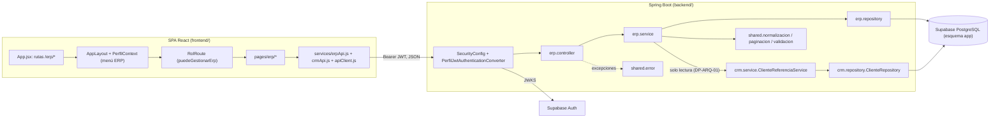
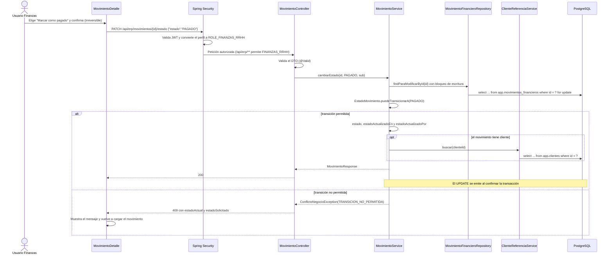
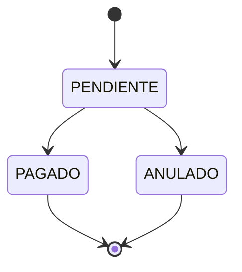
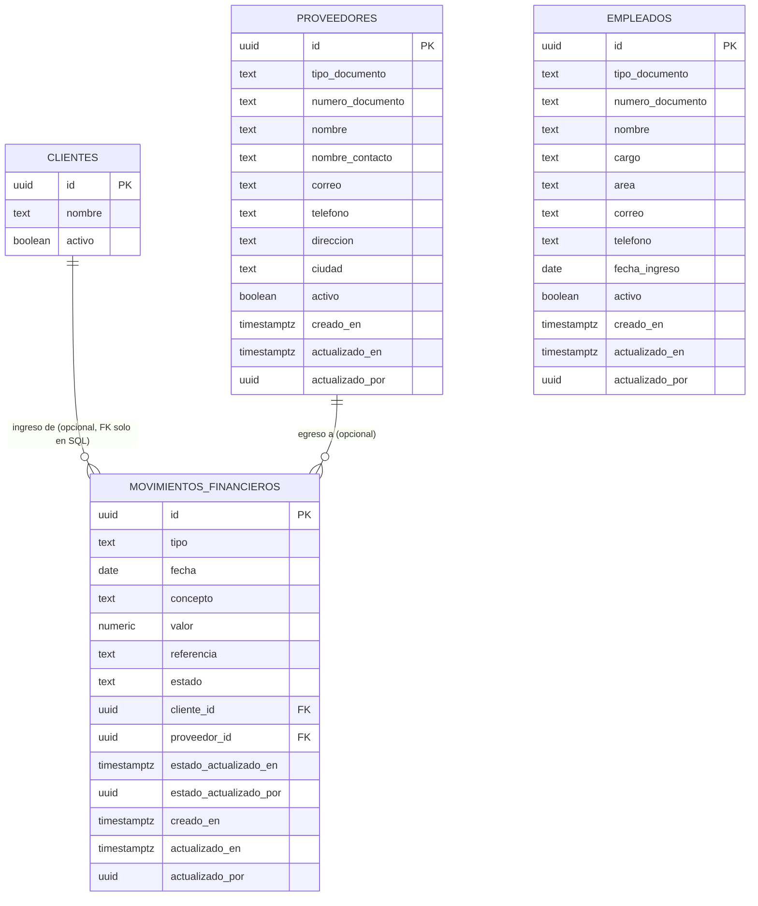

# Documento de diseño: 003-erp-empleados-proveedores-finanzas

## Overview

Esta especificación construye el módulo ERP (empleados, proveedores, movimientos financieros básicos y panel financiero) sobre el patrón del CRM de `002-crm-clientes-contratos`. Los movimientos se relacionan con clientes del CRM mediante un servicio de solo lectura del CRM y con proveedores del propio ERP. La spec reutiliza Docker, Docker Compose, Testcontainers y los tres workflows de CI sin cambiarlos. Cubre los requisitos 1 a 30 de `requirements.md`.

Requisitos del MVP cubiertos: ERP-01, ERP-02 y ERP-03 (Must); ERP-04 y ERP-05 (Should incluidos); NF-01 a NF-07; CA-01, CA-02, CA-03, CA-04, CA-06 y CA-07; ENG-01 a ENG-04; AUTH-03 y AUTH-05 en las vistas ERP.

### Estado de partida

| Elemento | Ruta | Estado | Uso en esta spec |
|---|---|---|---|
| Matriz de seguridad con `/api/erp/**` para ADMINISTRADOR y FINANZAS_RRHH y lectura cruzada de clientes | `backend/src/main/java/com/arise/corp/config/SecurityConfig.java` | [Implementado] | Se usa sin cambios (Requirement 19.1) |
| Converter de authorities `ROLE_<ROL>` desde el perfil activo | `config/PerfilJwtAuthenticationConverter.java` | [Implementado] | Fuente del rol en producción y en las pruebas MockMvc |
| Bean `Clock` UTC | `config/ClockConfig.java` | [Implementado] | Se amplía con el `ClockProvider` de Bean Validation (D7) |
| Entidad, repositorio y servicio de clientes | `crm/entity/Cliente.java`, `crm/repository/ClienteRepository.java`, `crm/service/ClienteService.java` | [Implementado] | El ERP no los usa directamente. Un servicio nuevo del CRM (`ClienteReferenciaService`) los envuelve para la lectura cruzada (D2) |
| `ClienteRepository.findParaContratoById` con `PESSIMISTIC_READ` y sin *fetch join* | `crm/repository/ClienteRepository.java` | [Implementado] | Lo reutiliza `ClienteReferenciaService.buscarParaAsociar` (D2, D12) |
| DTO `ClienteResumenResponse` (Vista_Reducida_Cliente) y `ClienteRef` | `crm/dto/` | [Implementado] | La vista reducida alimenta el selector de cliente del frontend. El ERP no expone `ClienteRef`: define su propia referencia (D3) |
| Controladores CRM y `VistaClienteResolver` | `crm/controller/` | [Implementado] | Patrón de controladores, `Location` y validación de parámetros (D8 de 002) |
| `ConflictoNegocioException`, `RecursoNoEncontradoException` (con `campo`), `GlobalExceptionHandler` | `shared/error/` | [Implementado] | Se reutilizan; se añade `ParametroInvalidoException` (D9) |
| `NormalizadorTexto` (`texto`, `documento`, `codigo`, `patronContiene`) | `shared/normalizacion/NormalizadorTexto.java` | [Implementado] | Se reutiliza sin cambios; `codigo` produce la Referencia_Normalizada (D5) |
| `Paginacion` y `PaginaResponse` | `shared/paginacion/` | [Implementado] | Se reutilizan sin cambios |
| `@Correo`, `@Telefono`, `@ValorCop` | `shared/validacion/` | [Implementado] | `@Correo` y `@Telefono` se reutilizan; `@ValorCop` admite 0, así que se añade `@ValorCopPositivo` (D6) |
| Pruebas de autorización con dobles ERP y SGA | `backend/src/test/java/com/arise/corp/login/controller/AutorizacionModulosTests.java` | [Implementado] | Su doble `GET /api/erp/proveedores` se retira; los casos ERP pasan a `ErpAutorizacionTests` (D16) |
| `CrmAutorizacionTests`, `CrmLogsTests`, `CrmDatosPrueba`, `GeneradoresCrm`, `AutenticacionPerfilTestSupport` | `backend/src/test/java/com/arise/corp/crm/`, `login/` | [Implementado] | Plantillas de `ErpAutorizacionTests`, `ErpLogsTests`, `ErpDatosPrueba` y `GeneradoresErp` |
| Base de IT, aplicador de migraciones y Script_Preparacion_IT | `integration/PostgresIntegracionBase.java`, `integration/MigracionesSupabase.java`, `src/test/resources/integration/preparacion-supabase.sql` | [Implementado] | Se reutilizan; la base amplía el `truncate` con las tablas del ERP |
| Migración CRM `20261111120000_app_crm_clientes_contratos.sql` | `supabase/migrations/` | [Implementado, aplicada] | `app.clientes` es destino de la FK `cliente_id`. No se modifica |
| Workflows `backend-ci`, `integration-tests` y `frontend-ci` | `.github/workflows/` | [Implementado] | Se usan sin cambios (D21) |
| SPA con `AppLayout`, `PerfilContext`, `RolRoute`, `Panel`, `apiClient`, `crmApi`, `permisos`, `validacionCrm`, `formato`, `useConsulta` y componentes comunes | `frontend/src/` | [Implementado] | Se amplía con rutas `/erp/*`, `erpApi.js`, `validacionErp.js`, páginas `pages/erp/*`, menú y tarjetas ERP |
| Generador `mulberry32` | `frontend/src/test/generadores.js` | [Implementado] | Se amplía con utilidades de generación para las propiedades del ERP |

### Decisiones resueltas en este diseño

| Código | Tema | Decisión | Sección |
|---|---|---|---|
| D1 | Relaciones del ERP | `MovimientoFinanciero → Proveedor` con `@ManyToOne(fetch = LAZY)` (mismo módulo), sin colecciones inversas. `cliente_id` es un `UUID` sin asociación JPA; la FK a `app.clientes` solo existe en PostgreSQL (DP-ARQ-01) | Data Models |
| D2 | Lectura de clientes desde el ERP | Servicio nuevo `crm.service.ClienteReferenciaService` con `buscar`, `buscarTodos` (lote) y `buscarParaAsociar` (bloqueo de lectura, propagación `MANDATORY`). Devuelve el DTO nuevo `crm.dto.ClienteReferencia(id, nombre, activo)`. `ClienteService` y los endpoints CRM no cambian | Integración con el CRM |
| D3 | Referencias anidadas del movimiento | `erp.dto.RegistroAsociado(id, nombre, activo)` para `cliente` y `proveedor`. Las listas resuelven los clientes de la página con una sola consulta en lote | DTO, Servicios |
| D4 | Tipos de documento | Enumeraciones propias `TipoDocumentoEmpleado {CC, CE, PASAPORTE}` y `TipoDocumentoProveedor {NIT, CC, CE, PASAPORTE}` en `erp.entity`; restricción de clase `@NumeroDocumentoErpValido` en `erp.dto.validacion` | DTO |
| D5 | Normalización | Se reutiliza `NormalizadorTexto` sin cambios: `documento` para documentos, `texto` para textos y `codigo` (recorte y mayúsculas) como Referencia_Normalizada | Servicios |
| D6 | Restricciones compartidas nuevas | `@ValorCopPositivo` (`> 0`, 13 enteros, 2 decimales) y `@FechaNoFutura` en `shared.validacion`, reutilizables por SGA | DTO |
| D7 | Fecha_Actual_Colombia | `ClockConfig` registra un `ValidationConfigurationCustomizer` que entrega el `Clock` de la aplicación como `ClockProvider`; `@FechaNoFutura` convierte ese reloj a `America/Bogota`. El frontend replica la fecha con `Intl.DateTimeFormat` y `timeZone: 'America/Bogota'` | DTO, Frontend |
| D8 | Coherencia tipo–relación | Restricción de clase `@RelacionCoherente` en `MovimientoRequest` (400 por campo), defensa en la entidad y `CHECK` en SQL | DTO, Data Models |
| D9 | Rango de fechas de los filtros | Record `erp.service.RangoFechas` que lanza `shared.error.ParametroInvalidoException` si `desde > hasta`; el handler responde 400 con `errors[0].field = "hasta"` | API, Error Handling |
| D10 | Panel financiero | Fragmento de repositorio con Criteria API que agrupa por tipo y estado, omitiendo los límites ausentes (sin parámetros nulos en JPQL). El cálculo de totales y saldo es una función pura en `ResumenFinancieroResponse.desde` con `EnumMap` | Servicios, Repositorios |
| D11 | Máquina de estados | `EstadoMovimiento` con `transicionesPermitidas()`, `puedeTransicionarA`, `esFinal` y `esEditable`; defensas en la entidad; réplica `TRANSICIONES_MOVIMIENTO` en `frontend/src/lib/permisos.js` | Servicios, Frontend |
| D12 | Concurrencia | Patrón D9 de 002: `PESSIMISTIC_WRITE` sobre el movimiento en `PUT` y `PATCH .../estado`; `PESSIMISTIC_READ` sobre el proveedor o el cliente cuando se asocia uno nuevo; sin *fetch join* en consultas con bloqueo; `UNIQUE` y `ConcurrencyFailureException` → 409 | Servicios |
| D13 | Auditoría | `Clock` inyectado, instantes truncados a microsegundos; `PATCH .../estado` solo actualiza la auditoría de estado; `PUT` solo la de datos | Servicios |
| D14 | DTO de entrada compartidos | Un `MovimientoRequest` para `POST` y `PUT` (mismos campos); un `EstadoActivoRequest` para el `PATCH` de empleados y proveedores | DTO |
| D15 | Pruebas basadas en propiedades | Sin librería nueva (D13 de 002): pruebas exhaustivas con `@ParameterizedTest`/`it.each` y generadores con semilla fija (`GeneradoresErp`, `frontend/src/test/generadores.js`), mínimo 100 casos por propiedad | Testing Strategy |
| D16 | Dobles de autorización | Se retira el doble `GET /api/erp/proveedores` de `AutorizacionModulosTests` en el mismo commit que crea `ProveedorController` (evita el mapeo ambiguo); los casos ERP pasan a `ErpAutorizacionTests`; se conserva el doble SGA | Testing Strategy |
| D17 | Menú y panel ERP | Función nueva `opcionesMenuErp(rol)` separada de `opcionesMenu(rol)`, para que el menú CRM y sus pruebas no cambien; grupo "ERP" en `AppLayout` y cuatro tarjetas en `Panel.jsx` | Frontend |
| D18 | Validación local del ERP | `lib/validacionErp.js` reutiliza las utilidades de `lib/validacionCrm.js`, que pasan a exportarse sin cambiar su comportamiento | Frontend |
| D19 | Selector de cliente y proveedor | Componente `SelectorRegistro` con búsqueda (`q`) sobre la primera página de 20 registros activos ordenados por nombre; la asociación actual inactiva se muestra como opción "(inactivo)" | Frontend |
| D20 | Migración ERP | Aditiva; la prepara Davidson con Supabase CLI, la revisa Sebastián y Davidson la aplica en `arise-corp-dev` antes de la validación manual, tras validarla `MigracionesErpIT` (DP-TEC-03 vigente) | Data Models |
| D21 | Infraestructura | Sin cambios en `Dockerfile`, `.dockerignore`, `docker-compose.yml`, workflows, dependencias de Maven o npm ni variables de entorno | Infraestructura |

### Confirmación de interpretaciones de los requisitos

| # | Interpretación | Resultado | Dónde se aplica |
|---|---|---|---|
| 1 | `tipoDocumento: "NIT"` en un empleado es un valor de enumeración desconocido | Confirmada: Jackson rechaza el valor y el handler existente responde 400 con `errors[0] = { field: "tipoDocumento", message: "debe ser uno de: CC, CE, PASAPORTE" }` (Requirements 4.4, 20.3) | `TipoDocumentoEmpleado`, `GlobalExceptionHandler` |
| 2 | La Referencia_Normalizada es exactamente `NormalizadorTexto.codigo` (recorte y mayúsculas con `Locale.ROOT`) | Confirmada; `ñ` pasa a `Ñ`, que no está en A–Z, y la referencia se rechaza (Requirement 13.8) | `MovimientoRequest`, migración |
| 3 | La referencia anidada `cliente`/`proveedor` del movimiento incluye `activo` además de `id` y `nombre` | Confirmada: Requirements 14.12 y 15.8 y el supuesto "Integración con el CRM" incluyen el estado activo, que permite cumplir Requirement 23.9 (mostrar la asociación actual inactiva) sin peticiones adicionales. `activo` ya forma parte de la Vista_Reducida_Cliente | `RegistroAsociado` |
| 4 | Orden de evaluación del `PUT /api/erp/movimientos/{id}` | Decidida: 400 (DTO, incluida la coherencia tipo–relación) → 404 del movimiento → 404 de `clienteId`/`proveedorId` → 409 `MOVIMIENTO_NO_EDITABLE` → 409 `CLIENTE_INACTIVO`/`PROVEEDOR_INACTIVO`. Sigue la regla general de 002 (404 antes que 409) | `MovimientoService.actualizar` |
| 5 | Un `PUT` que cambia el tipo y conserva la relación del tipo anterior | Confirmada: es incoherente y responde 400 en el campo de la relación (supuesto "Edición del movimiento"). El formulario evita el caso al quitar la selección incompatible (Requirement 23.8) | `@RelacionCoherente` |
| 6 | Campo afectado cuando `desde > hasta` | Decidida: `hasta`, con el mensaje "debe ser igual o posterior a la fecha desde", igual que `fechaFin` en el CRM (Requirements 15.7, 18.5) | `RangoFechas` |
| 7 | `GET /api/erp/movimientos?clienteId=` o `?proveedorId=` con un identificador sin registro | Confirmada: 200 con lista vacía, sin consultar la existencia (Requirement 15.6) | `MovimientoService.listar` |
| 8 | Fecha de ingreso igual a la Fecha_Actual_Colombia | Confirmada: se acepta; solo una fecha posterior responde 400. "Hoy" se calcula en `America/Bogota` aunque el reloj del servidor sea UTC (Requirement 4.7) | `@FechaNoFutura` |
| 9 | `fecha_ingreso` no futura como `CHECK` de PostgreSQL | Descartada: un `CHECK` con `current_date` no es inmutable, usa la zona de la sesión (UTC en Supabase) y fallaría al restaurar datos antiguos. La regla vive en el backend y en el frontend; el resto de formatos sí tienen `CHECK` (Requirement 2.6 no la exige) | Migración |
| 10 | El resumen incluye los movimientos `ANULADO` | Confirmada: se informan con su cantidad y su suma, pero no participan en el Saldo_Pagado (Requirements 18.1, 18.7) | `ResumenFinancieroResponse` |
| 11 | La auditoría de estado al crear | Confirmada: `estadoActualizadoEn = creadoEn = actualizadoEn` y `estadoActualizadoPor = actualizadoPor = sub` (Requirement 13.1) | `MovimientoFinanciero.crear` |
| 12 | `DELETE` de empleados, proveedores y movimientos | Confirmada: 405 con `Allow` para Rol_Gestor_ERP; la matriz de seguridad se evalúa antes, así que sin token responde 401 y con COMERCIAL u OPERACIONES responde 403 (Requirements 7.5, 12.5, 17.7) | `GlobalExceptionHandler` (sin cambios) |
| 13 | Requirement 25.10 (vista reducida de FINANZAS_RRHH) | Confirmada: lo cubren las pruebas existentes de 002 (`CrmAutorizacionTests`, `ClienteControllerTests`), que siguen sin cambios, más un caso explícito en `ErpAutorizacionTests` | Testing Strategy |

Las decisiones anteriores concretan los supuestos de `requirements.md` sin contradecirlos. La única alineación aplicada en `requirements.md` es la de la interpretación 3 (estado activo en la referencia anidada del movimiento).

### Ajustes de steering a registrar

Cambios de reglas, que se registran al inicio de la rama `feat/erp-empleados-proveedores-finanzas`, antes del código que los aplica (`sdd-workflow.md`, "Registro de decisiones"):

| Archivo | Ajuste | Decisión |
|---|---|---|
| `architecture.md`, DP-ARQ-01 | Los módulos consumidores leen clientes mediante `crm.service.ClienteReferenciaService` (solo lectura, en lote y con bloqueo de lectura dentro de la transacción del llamador). El ERP define sus propios DTO de salida | D2, D3 |
| `api-conventions.md`, "Validaciones" | Las reglas entre parámetros de consulta (por ejemplo `desde ≤ hasta`) lanzan `ParametroInvalidoException` y responden 400 con `errors` en el parámetro afectado | D9 |
| `api-conventions.md`, DP-API-04 | La "fecha actual" de una regla de negocio es la fecha calendario en `America/Bogota`, calculada con el `Clock` de la aplicación | D7 |
| `tech.md`, "Configuración del backend" | `ClockConfig` registra el `ValidationConfigurationCustomizer` que entrega el `Clock` a Bean Validation | D7 |

Cambios de estado, que se registran al terminar cada área (Requirement 29.3): ver "Documentación y steering a actualizar".

### Migración y DP-TEC-03

DP-TEC-03 ya contempla el caso (ajuste registrado en 002): una migración aditiva puede aplicarse antes del PR final cuando la validación extremo a extremo la necesita. La Migracion_ERP solo crea tres tablas, sus índices y restricciones, y revoca privilegios sobre esas tablas, así que se sigue el mismo procedimiento (D20, Requirement 29.7):

1. Davidson crea el archivo con `supabase migration new app_erp_empleados_proveedores_movimientos`. Supabase CLI asigna un timestamp posterior a `20261111120000` (Requirement 2.1). El nombre definitivo se registra en `tasks.md` y en `supabase/migrations/README.md`.
2. Sebastián la revisa en la rama de la spec.
3. Cuando `MigracionesErpIT` la ha validado en PostgreSQL efímero, Davidson la aplica de forma controlada en `arise-corp-dev`, antes de la validación manual del Requirement 30.
4. Después de aplicada no se edita. Un cambio de esquema posterior llega en una migración nueva.

Mientras no esté aplicada, el backend de la rama no arranca contra `arise-corp-dev` (`ddl-auto=validate` no encuentra las tablas); las suites automáticas no se ven afectadas.

## Architecture

El ERP se añade al monolito modular con las mismas capas que el CRM (`architecture.md`). La SPA llama a `/api/erp/**` con el Bearer de Supabase; Spring Security valida el JWT y convierte el perfil activo en `ROLE_<ROL>`; los controladores del ERP delegan en servicios transaccionales que usan repositorios Spring Data JPA sobre el esquema `app`. Para los clientes, los servicios del ERP llaman a `ClienteReferenciaService`, que pertenece al CRM.

### Diagrama de componentes



La flecha `erp.service → crm.service` es la única dependencia entre módulos. No existe ninguna dependencia de `crm` hacia `erp` (Requirement 1.8).

### Flujo de un cambio de estado de movimiento



### Flujo de creación de un ingreso asociado a un cliente

```mermaid
sequenceDiagram
    participant C as MovimientoController
    participant S as MovimientoService
    participant CRM as ClienteReferenciaService
    participant CR as ClienteRepository
    participant R as MovimientoFinancieroRepository
    participant DB as PostgreSQL

    C->>C: @Valid MovimientoRequest (formato y @RelacionCoherente)
    C->>S: crear(solicitud, sub)
    Note over S: @Transactional (transacción del ERP)
    S->>CRM: buscarParaAsociar(clienteId) [MANDATORY]
    CRM->>CR: findParaContratoById(clienteId)
    CR->>DB: select ... from app.clientes where id = ? for share
    alt cliente inexistente
        CRM-->>S: Optional.empty()
        S-->>C: RecursoNoEncontradoException(campo = clienteId) → 404
    else cliente inactivo
        CRM-->>S: ClienteReferencia(activo = false)
        S-->>C: ConflictoNegocioException(CLIENTE_INACTIVO) → 409
    else cliente activo
        CRM-->>S: ClienteReferencia(id, nombre, true)
        S->>R: save(MovimientoFinanciero.crear(...))
        S-->>C: MovimientoResponse → 201 con Location
        Note over DB: El bloqueo de lectura se libera al confirmar; una desactivación simultánea espera
    end
```

### Organización del backend

```text
com.arise.corp
├── config/
│   ├── SecurityConfig.java                     # sin cambios
│   ├── PerfilJwtAuthenticationConverter.java   # sin cambios
│   └── ClockConfig.java                        # ampliado: ValidationConfigurationCustomizer (D7)
├── shared/
│   ├── error/
│   │   ├── GlobalExceptionHandler.java         # ampliado: handler de ParametroInvalidoException (D9)
│   │   ├── ParametroInvalidoException.java     # nuevo (D9)
│   │   └── ...                                 # resto sin cambios
│   ├── normalizacion/NormalizadorTexto.java    # sin cambios (D5)
│   ├── paginacion/                             # sin cambios
│   └── validacion/
│       ├── Correo.java, Telefono.java, ValorCop.java   # sin cambios
│       ├── ValorCopPositivo.java               # nuevo (D6)
│       └── FechaNoFutura.java                  # nuevo, con su validador (D6, D7)
├── login/                                      # sin cambios
├── crm/
│   ├── service/
│   │   ├── ClienteReferenciaService.java       # nuevo: lectura de clientes para otros módulos (D2)
│   │   └── ...                                 # resto sin cambios
│   ├── dto/
│   │   ├── ClienteReferencia.java              # nuevo (D2)
│   │   └── ...                                 # resto sin cambios
│   └── ...                                     # controller, repository y entity sin cambios
└── erp/
    ├── controller/
    │   ├── EmpleadoController.java
    │   ├── ProveedorController.java
    │   ├── MovimientoController.java
    │   └── ResumenFinancieroController.java
    ├── service/
    │   ├── EmpleadoService.java
    │   ├── ProveedorService.java
    │   ├── MovimientoService.java
    │   ├── ResumenFinancieroService.java
    │   ├── ConflictosErp.java                  # fábrica de ConflictoNegocioException
    │   ├── FiltroEmpleados.java, FiltroProveedores.java, FiltroMovimientos.java
    │   └── RangoFechas.java                    # validación desde ≤ hasta (D9)
    ├── repository/
    │   ├── EmpleadoRepository.java
    │   ├── ProveedorRepository.java
    │   ├── MovimientoFinancieroRepository.java
    │   ├── TotalesMovimientos.java             # fragmento del panel (D10)
    │   ├── TotalesMovimientosImpl.java         # Criteria API
    │   ├── TotalMovimientos.java               # fila agrupada (tipo, estado, cantidad, suma)
    │   └── EspecificacionesErp.java            # Specification de filtros y búsqueda
    ├── entity/
    │   ├── Empleado.java, Proveedor.java, MovimientoFinanciero.java
    │   ├── TipoDocumentoEmpleado.java, TipoDocumentoProveedor.java
    │   └── TipoMovimiento.java, EstadoMovimiento.java
    └── dto/
        ├── EmpleadoRequest, EmpleadoResponse
        ├── ProveedorRequest, ProveedorResponse
        ├── EstadoActivoRequest
        ├── MovimientoRequest, EstadoMovimientoRequest, MovimientoResponse, RegistroAsociado
        ├── ResumenFinancieroResponse
        └── validacion/
            ├── DocumentoErp.java               # interfaz común de EmpleadoRequest y ProveedorRequest
            ├── NumeroDocumentoErpValido.java   # (+ validador)
            └── RelacionCoherente.java          # (+ validador)
```

Dependencias permitidas: `erp.controller → erp.service → erp.repository → erp.entity`; `erp.service → crm.service.ClienteReferenciaService`; `erp.service` y `erp.dto → crm.dto.ClienteReferencia` (los dos únicos tipos del CRM que usa el ERP); `erp.* → shared.*`. El ERP no importa `crm.entity`, `crm.repository` ni `crm.controller` (Requirement 1.5). El CRM no importa nada de `erp` (Requirement 1.8). `shared` no depende de ningún módulo de negocio.

Las firmas públicas descritas en este documento son el contrato interno entre capas: permiten implementar migración, entidades, servicios, controladores y frontend en paralelo mientras se respeten.

### Organización del frontend

```text
frontend/src/
├── App.jsx                         # ampliado: rutas /erp/* bajo RolRoute(puedeGestionarErp)
├── components/
│   ├── AppLayout.jsx               # ampliado: grupo de menú "ERP" y sección "ERP" en la ruta de navegación
│   ├── SelectorRegistro.jsx        # nuevo (D19)
│   ├── EstadoMovimientoEtiqueta.jsx# nuevo
│   └── ...                         # Campo, EstadoConsulta, Paginacion, DialogoConfirmacion sin cambios
├── lib/
│   ├── permisos.js                 # ampliado: puedeGestionarErp, opcionesMenuErp, TRANSICIONES_MOVIMIENTO (D11, D17)
│   ├── validacionCrm.js            # exporta sus utilidades internas, sin cambios de comportamiento (D18)
│   ├── validacionErp.js            # nuevo (D7, D18)
│   ├── formato.js, useConsulta.js  # sin cambios
├── pages/
│   ├── Panel.jsx                   # ampliado: tarjetas ERP
│   └── erp/
│       ├── EmpleadosLista.jsx, EmpleadoFormulario.jsx, EmpleadoDetalle.jsx
│       ├── ProveedoresLista.jsx, ProveedorFormulario.jsx, ProveedorDetalle.jsx
│       ├── MovimientosLista.jsx, MovimientoFormulario.jsx, MovimientoDetalle.jsx
│       └── PanelFinanciero.jsx
├── services/
│   └── erpApi.js                   # nuevo
└── test/generadores.js             # ampliado
frontend/public/assets/erp.svg      # nuevo icono del grupo de menú (SVG estático propio)
```

## Components and Interfaces

### Contratos de la API del ERP

Este apartado es la documentación de API del ERP (DP-API-06, Requirement 29.1). Frontend y backend lo usan como referencia común.

#### Convenciones comunes

- **Autenticación:** todas las rutas exigen `Authorization: Bearer <access_token>`. Sin token o con un token inválido, vencido o con emisor o audiencia incorrectos responden 401 Problem Details con `WWW-Authenticate` (Requirement 19.2).
- **Autorización:** `SecurityConfig` aplica `/api/erp/**` → ADMINISTRADOR y FINANZAS_RRHH, sin cambios (Requirement 19.1). Un JWT válido sin Perfil_Activo o con COMERCIAL u OPERACIONES responde 403 antes de llegar al controlador, así que un recurso inexistente no se distingue de uno existente (Requirements 19.3–19.5).
- **Orden de evaluación:** 401 → 403 → 400 (cuerpo y parámetros) → 404 (recurso de la ruta y referencias del cuerpo) → 409 (duplicados, estado editable, estado de las referencias, transiciones).
- **Cuerpo:** `Content-Type: application/json` en UTF-8. Los DTO de entrada ignoran propiedades desconocidas (`@JsonIgnoreProperties(ignoreUnknown = true)`), así que `id`, `activo`, `estado` y los campos de auditoría enviados por el cliente no tienen efecto (Requirements 4.10, 9.9, 13.9, 16.5).
- **Normalización (Requirement 3):** los textos se recortan (`strip`) y un texto vacío se convierte en `null`. `numeroDocumento` se convierte en Documento_Normalizado (sin espacios, puntos ni guiones, en mayúsculas) y `referencia` en Referencia_Normalizada (recortada y en mayúsculas). Las validaciones, comparaciones y el almacenamiento usan el valor normalizado, y las respuestas lo devuelven normalizado.
- **Tipos (DP-API-04):** identificadores UUID; fechas `AAAA-MM-DD`; instantes ISO-8601 UTC con microsegundos (por ejemplo `2026-11-20T15:04:05.123456Z`); `valor`, sumas y saldo como texto decimal con dos decimales (`"2500000.00"`, `"-1200000.00"`); enumeraciones en `UPPER_SNAKE_CASE`.
- **Fecha_Actual_Colombia:** fecha calendario en `America/Bogota` calculada con el `Clock` de la aplicación (D7). Solo la usa la regla de `fechaIngreso`.
- **Listas (DP-API-03):** `page` entero ≥ 0 (por defecto 0); `size` entero de 1 a 100 (por defecto 20); `sort` con el formato `campo,asc|desc`, solo con los campos permitidos de cada endpoint y la dirección en minúsculas. Se añade `id,asc` como desempate interno. Un valor fuera de rango, un tipo incorrecto o un campo de orden no permitido responde 400. La respuesta es:

```json
{ "content": [], "page": 0, "size": 20, "totalElements": 0, "totalPages": 0 }
```

- **Errores:** RFC 9457 Problem Details (`application/problem+json`) con mensajes en español (DP-API-02). Los 400 por campo usan `errors: [{ "field", "message" }]` con una entrada por campo. Los 409 de negocio añaden `conflicto`, `campo` cuando el conflicto se refiere a un campo y extensiones propias. El catálogo completo está en "Error Handling".

Ejemplo de 409 por empleado inactivo existente:

```json
{
  "type": "about:blank",
  "title": "Conflicto",
  "status": 409,
  "detail": "El empleado ya existe, pero está inactivo. Reactívalo en lugar de registrarlo de nuevo.",
  "instance": "/api/erp/empleados",
  "conflicto": "EMPLEADO_INACTIVO_EXISTENTE",
  "campo": "numeroDocumento",
  "empleadoId": "5d1e2f3a-0000-4000-8000-000000000011"
}
```

Ejemplo de 400 por rango de fechas invertido:

```json
{
  "type": "about:blank",
  "title": "Solicitud inválida",
  "status": 400,
  "detail": "Los parámetros de la solicitud no son válidos.",
  "instance": "/api/erp/resumen",
  "errors": [
    { "field": "hasta", "message": "debe ser igual o posterior a la fecha desde" }
  ]
}
```

#### Representaciones JSON

**Empleado (`EmpleadoResponse`)**, la misma para ADMINISTRADOR y FINANZAS_RRHH, en detalle y en listas (Requirements 5.6, 8.1, 8.2):

```json
{
  "id": "5d1e2f3a-0000-4000-8000-000000000011",
  "tipoDocumento": "CC",
  "numeroDocumento": "52123456",
  "nombre": "Empleada de Ejemplo",
  "cargo": "Analista contable",
  "area": "Finanzas",
  "correo": "empleada@example.test",
  "telefono": "+57 310 000 0000",
  "fechaIngreso": "2025-03-01",
  "activo": true,
  "creadoEn": "2026-11-20T15:04:05.123456Z",
  "actualizadoEn": "2026-11-20T15:04:05.123456Z",
  "actualizadoPor": "9a8b7c6d-0000-4000-8000-000000000003"
}
```

No incluye salario, datos de nómina ni datos bancarios: el modelo no los tiene (Requirement 8.2).

**Proveedor (`ProveedorResponse`)**, la misma para ambos roles, en detalle y en listas (Requirement 10.6):

```json
{
  "id": "6e2f3a4b-0000-4000-8000-000000000012",
  "tipoDocumento": "NIT",
  "numeroDocumento": "900765432",
  "nombre": "Proveedor de Ejemplo S.A.S.",
  "nombreContacto": "Contacto de Ejemplo",
  "correo": "proveedor@example.test",
  "telefono": "601 000 0000",
  "direccion": "Carrera 10 # 20-30",
  "ciudad": "Medellín",
  "activo": true,
  "creadoEn": "2026-11-20T15:04:05.123456Z",
  "actualizadoEn": "2026-11-20T15:04:05.123456Z",
  "actualizadoPor": "9a8b7c6d-0000-4000-8000-000000000003"
}
```

`nombreContacto`, `direccion` y `ciudad` son `null` cuando no se informan.

**Movimiento financiero (`MovimientoResponse`)**, el mismo en detalle y en listas (Requirements 14.12, 15.8, 15.9):

```json
{
  "id": "e1f2a3b4-0000-4000-8000-000000000021",
  "tipo": "EGRESO",
  "fecha": "2026-11-20",
  "concepto": "Compra de baterías para drones",
  "valor": "2500000.00",
  "referencia": "FAC-2026/0045",
  "estado": "PENDIENTE",
  "cliente": null,
  "proveedor": { "id": "6e2f3a4b-0000-4000-8000-000000000012", "nombre": "Proveedor de Ejemplo S.A.S.", "activo": true },
  "estadoActualizadoEn": "2026-11-20T15:04:05.123456Z",
  "estadoActualizadoPor": "9a8b7c6d-0000-4000-8000-000000000003",
  "creadoEn": "2026-11-20T15:04:05.123456Z",
  "actualizadoEn": "2026-11-20T15:04:05.123456Z",
  "actualizadoPor": "9a8b7c6d-0000-4000-8000-000000000003"
}
```

Un `INGRESO` asociado a un cliente lleva `"cliente": { "id": "3f2c9a4e-0000-4000-8000-000000000001", "nombre": "Cliente de Ejemplo", "activo": true }` y `"proveedor": null`. Sin relación, ambos son `null`. El nombre y el estado activo del cliente se leen del CRM en cada consulta, así que reflejan su valor actual (D3). `referencia` es `null` cuando no se informa.

**Resumen financiero (`ResumenFinancieroResponse`)** (Requirement 18):

```json
{
  "desde": "2026-01-01",
  "hasta": null,
  "porTipo": {
    "INGRESO": {
      "porEstado": {
        "PENDIENTE": { "cantidad": 2, "suma": "300000.00" },
        "PAGADO": { "cantidad": 5, "suma": "1500000.00" },
        "ANULADO": { "cantidad": 0, "suma": "0.00" }
      },
      "cantidad": 7
    },
    "EGRESO": {
      "porEstado": {
        "PENDIENTE": { "cantidad": 1, "suma": "2500000.00" },
        "PAGADO": { "cantidad": 3, "suma": "2700000.50" },
        "ANULADO": { "cantidad": 1, "suma": "100000.00" }
      },
      "cantidad": 5
    }
  },
  "saldoPagado": "-1200000.50"
}
```

`porTipo` contiene siempre `INGRESO` y `EGRESO`, y cada `porEstado` contiene siempre `PENDIENTE`, `PAGADO` y `ANULADO` (Requirement 18.2). `cantidad` del tipo es la suma de las tres cantidades (Requirement 18.6). `saldoPagado = porTipo.INGRESO.porEstado.PAGADO.suma − porTipo.EGRESO.porEstado.PAGADO.suma` (Requirement 18.7). `desde` y `hasta` repiten los límites aplicados y son `null` si no se enviaron (Requirement 18.4).

#### Campos de entrada y validaciones

`EmpleadoRequest` (POST y PUT de empleados):

| Campo | Tipo JSON | Obligatorio | Normalización | Regla | Mensaje |
|---|---|---|---|---|---|
| `tipoDocumento` | string | Sí | — | `CC`, `CE`, `PASAPORTE` | "es obligatorio" / "debe ser uno de: CC, CE, PASAPORTE" |
| `numeroDocumento` | string | Sí | Documento_Normalizado | 3 a 20 letras o dígitos; solo dígitos con `CC` | "debe tener entre 3 y 20 letras o dígitos" / "solo admite dígitos para el tipo CC" |
| `nombre` | string | Sí | Recorte | Máximo 200 | "debe tener como máximo 200 caracteres" |
| `cargo` | string | Sí | Recorte | Máximo 100 | "debe tener como máximo 100 caracteres" |
| `area` | string | Sí | Recorte | Máximo 100 | "debe tener como máximo 100 caracteres" |
| `correo` | string | Sí | Recorte | `@Correo`: formato `local@dominio.tld`, máximo 254 | "debe ser un correo válido de máximo 254 caracteres" |
| `telefono` | string | Sí | Recorte | `@Telefono`: 7 a 20 caracteres de `0-9`, espacio, `+`, `-`, `(`, `)` | "debe tener entre 7 y 20 caracteres: dígitos, espacios, +, - o paréntesis" |
| `fechaIngreso` | string `AAAA-MM-DD` | Sí | — | Fecha válida; igual o anterior a la Fecha_Actual_Colombia | "debe ser una fecha válida con formato AAAA-MM-DD" / "no puede ser posterior a la fecha actual" |

`ProveedorRequest` (POST y PUT de proveedores):

| Campo | Tipo JSON | Obligatorio | Normalización | Regla | Mensaje |
|---|---|---|---|---|---|
| `tipoDocumento` | string | Sí | — | `NIT`, `CC`, `CE`, `PASAPORTE` | "es obligatorio" / "debe ser uno de: NIT, CC, CE, PASAPORTE" |
| `numeroDocumento` | string | Sí | Documento_Normalizado | 3 a 20 letras o dígitos; solo dígitos con `CC` o `NIT` | "debe tener entre 3 y 20 letras o dígitos" / "solo admite dígitos para el tipo CC o NIT" |
| `nombre` | string | Sí | Recorte | Máximo 200 | "debe tener como máximo 200 caracteres" |
| `nombreContacto` | string o null | No | Recorte; vacío → null | Máximo 200 | "debe tener como máximo 200 caracteres" |
| `correo` | string | Sí | Recorte | `@Correo` | "debe ser un correo válido de máximo 254 caracteres" |
| `telefono` | string | Sí | Recorte | `@Telefono` | "debe tener entre 7 y 20 caracteres: dígitos, espacios, +, - o paréntesis" |
| `direccion` | string o null | No | Recorte; vacío → null | Máximo 200 | "debe tener como máximo 200 caracteres" |
| `ciudad` | string o null | No | Recorte; vacío → null | Máximo 100 | "debe tener como máximo 100 caracteres" |

`MovimientoRequest` (POST y PUT de movimientos, D14):

| Campo | Tipo JSON | Obligatorio | Normalización | Regla | Mensaje |
|---|---|---|---|---|---|
| `tipo` | string | Sí | — | `INGRESO`, `EGRESO` | "es obligatorio" / "debe ser uno de: INGRESO, EGRESO" |
| `fecha` | string `AAAA-MM-DD` | Sí | — | Fecha válida (se admiten fechas futuras) | "es obligatorio" / "debe ser una fecha válida con formato AAAA-MM-DD" |
| `concepto` | string | Sí | Recorte | 3 a 300 caracteres | "debe tener entre 3 y 300 caracteres" |
| `valor` | string o number | Sí | — | `@ValorCopPositivo`: mayor que 0, hasta 13 dígitos enteros y 2 decimales | "debe ser mayor que 0, con hasta 13 dígitos enteros y 2 decimales" / "debe ser un número válido" |
| `referencia` | string o null | No | Referencia_Normalizada; vacío → null | 1 a 50 caracteres de `A-Z`, `0-9`, espacio, `.`, `/`, `-` | "debe tener como máximo 50 caracteres: letras A-Z, dígitos, espacios, puntos, barras o guiones" |
| `clienteId` | uuid o null | No | — | UUID; solo con `tipo = INGRESO` | "debe ser un identificador UUID válido" / "solo se admite en movimientos de tipo INGRESO" |
| `proveedorId` | uuid o null | No | — | UUID; solo con `tipo = EGRESO` | "debe ser un identificador UUID válido" / "solo se admite en movimientos de tipo EGRESO" |

Cuerpos de cambio de estado:

| DTO | Cuerpo | Regla |
|---|---|---|
| `EstadoActivoRequest` | `{ "activo": true \| false }` | `activo` obligatorio y booleano ("es obligatorio" / "debe ser verdadero o falso") |
| `EstadoMovimientoRequest` | `{ "estado": "PAGADO" }` | `estado` obligatorio y Estado_Movimiento ("es obligatorio" / "debe ser uno de: PENDIENTE, PAGADO, ANULADO") |

Un valor de tipo incorrecto (por ejemplo `"activo": "quizas"`, `"estado": "PAUSADO"`, `"fecha": "20/11/2026"` o `"valor": "abc"`) responde 400 con una entrada en `errors` para ese campo, con el mecanismo D4 de 002 que ya implementa `GlobalExceptionHandler`. Los booleanos textuales `"true"` y `"false"` siguen la coerción por defecto de Jackson.

#### Empleados

##### GET /api/erp/empleados
- Requisitos: ERP-01, DP-API-03; Requirements 5.1–5.5, 8.1.
- Roles permitidos: ADMINISTRADOR, FINANZAS_RRHH.
- Parámetros de consulta:

| Parámetro | Tipo | Regla | Efecto |
|---|---|---|---|
| `q` | string | Máximo 100; vacío se ignora | `lower(nombre)` contiene `lower(q)` o `numeroDocumento` contiene el Documento_Normalizado de `q` (si no queda vacío) |
| `activo` | boolean | `true` o `false` | Filtra por estado |
| `page`, `size` | entero | Ver convenciones | Paginación |
| `sort` | string | `nombre`, `numeroDocumento`, `fechaIngreso` o `creadoEn` con `asc` o `desc`; por defecto `nombre,asc` | Orden |

- Respuesta 200: Lista_Paginada de `EmpleadoResponse`, activos e inactivos. Los comodines `%`, `_` y `\` de `q` se escapan antes de construir el `LIKE`.
- Errores: 400 (parámetros), 401, 403.

##### GET /api/erp/empleados/{id}
- Requisitos: ERP-01; Requirements 5.6–5.8, 8.1, 8.2.
- Roles permitidos: ADMINISTRADOR, FINANZAS_RRHH.
- Respuesta 200: `EmpleadoResponse`, activo o inactivo.
- Errores: 400 (`id` no UUID, `errors[0].field = "id"`), 401, 403, 404 ("El empleado no existe.").

##### POST /api/erp/empleados
- Requisitos: ERP-01, DP-SEG-06; Requirements 3.1, 3.2, 3.5, 4.1–4.10.
- Roles permitidos: ADMINISTRADOR, FINANZAS_RRHH.
- Solicitud: `EmpleadoRequest`.
- Respuesta 201: `EmpleadoResponse` con `activo = true`, `creadoEn = actualizadoEn = ahora` y `actualizadoPor = sub`. Encabezado `Location: /api/erp/empleados/{id}`.
- Errores: 400 (validación), 401, 403, 409 (`EMPLEADO_DUPLICADO`, `EMPLEADO_INACTIVO_EXISTENTE` con `empleadoId`, o restricción de la base).

##### PUT /api/erp/empleados/{id}
- Requisitos: ERP-01, DP-SEG-06; Requirements 6.1–6.5.
- Roles permitidos: ADMINISTRADOR, FINANZAS_RRHH.
- Solicitud: `EmpleadoRequest`. Reemplaza los ocho campos editables; conserva `activo` y `creadoEn`.
- Respuesta 200: `EmpleadoResponse` con `actualizadoEn` y `actualizadoPor` nuevos.
- Errores: 400, 401, 403, 404, 409 (`EMPLEADO_DUPLICADO` si el documento pertenece a otro empleado activo o inactivo).

##### PATCH /api/erp/empleados/{id}
- Requisitos: ERP-01, DP-API-05; Requirements 7.1–7.4, 7.6.
- Roles permitidos: ADMINISTRADOR, FINANZAS_RRHH.
- Solicitud: `EstadoActivoRequest`.
- Respuesta 200: `EmpleadoResponse`. Si `activo` cambia, se actualizan `actualizadoEn` y `actualizadoPor`; si coincide con el estado actual, se devuelve sin cambios.
- Errores: 400 (`activo` ausente, nulo o no booleano), 401, 403, 404.

##### DELETE /api/erp/empleados/{id}
- Requisitos: ERP-01; Requirement 7.5.
- No existe operación de borrado. Para ADMINISTRADOR y FINANZAS_RRHH responde 405 Problem Details ("La operación no está disponible para este recurso.") con el encabezado `Allow` que calcula Spring a partir de los métodos mapeados (`GET`, `PUT`, `PATCH`). Sin token responde 401 y con COMERCIAL u OPERACIONES responde 403.

#### Proveedores

##### GET /api/erp/proveedores
- Requisitos: ERP-02, DP-API-03; Requirements 10.1–10.5, 8.1.
- Roles permitidos: ADMINISTRADOR, FINANZAS_RRHH.
- Parámetros: `q` (máximo 100; `lower(nombre)` contiene `lower(q)` o `numeroDocumento` contiene el Documento_Normalizado de `q`), `activo` (boolean), `page`, `size`, `sort` (`nombre`, `numeroDocumento`, `creadoEn`; por defecto `nombre,asc`).
- Respuesta 200: Lista_Paginada de `ProveedorResponse`. El selector de proveedor del formulario de movimientos usa `?activo=true&q=...&size=20&sort=nombre,asc`.
- Errores: 400, 401, 403.

##### GET /api/erp/proveedores/{id}
- Requisitos: ERP-02; Requirements 10.6, 10.7, 8.1, 8.2.
- Roles permitidos: ADMINISTRADOR, FINANZAS_RRHH.
- Respuesta 200: `ProveedorResponse`, activo o inactivo.
- Errores: 400 (`id` no UUID), 401, 403, 404 ("El proveedor no existe.").

##### POST /api/erp/proveedores
- Requisitos: ERP-02, DP-SEG-06; Requirements 3.1, 3.2, 3.5, 9.1–9.9.
- Roles permitidos: ADMINISTRADOR, FINANZAS_RRHH.
- Solicitud: `ProveedorRequest`.
- Respuesta 201: `ProveedorResponse` con `activo = true` y la auditoría del actor. `Location: /api/erp/proveedores/{id}`.
- Errores: 400, 401, 403, 409 (`PROVEEDOR_DUPLICADO`, `PROVEEDOR_INACTIVO_EXISTENTE` con `proveedorId`, o restricción de la base).

##### PUT /api/erp/proveedores/{id}
- Requisitos: ERP-02, DP-SEG-06; Requirements 11.1–11.6.
- Roles permitidos: ADMINISTRADOR, FINANZAS_RRHH.
- Solicitud: `ProveedorRequest`. Reemplaza los ocho campos editables; un opcional omitido o nulo queda nulo; conserva `activo` y `creadoEn`.
- Respuesta 200: `ProveedorResponse` con la auditoría actualizada.
- Errores: 400, 401, 403, 404, 409 (`PROVEEDOR_DUPLICADO` si el documento pertenece a otro proveedor).

##### PATCH /api/erp/proveedores/{id}
- Requisitos: ERP-02, DP-API-05; Requirements 12.1–12.4, 12.6.
- Roles permitidos: ADMINISTRADOR, FINANZAS_RRHH.
- Solicitud: `EstadoActivoRequest`.
- Respuesta 200: `ProveedorResponse`. La auditoría cambia solo si `activo` cambia. Desactivar un proveedor no consulta ni modifica sus movimientos.
- Errores: 400, 401, 403, 404.

##### DELETE /api/erp/proveedores/{id}
- Requisitos: ERP-02; Requirement 12.5.
- 405 con `Allow` para los roles gestores, en las mismas condiciones que el `DELETE` de empleados.

#### Movimientos financieros

##### GET /api/erp/movimientos
- Requisitos: ERP-03, ERP-05, DP-API-03, DP-API-04; Requirements 15.1–15.7, 15.9.
- Roles permitidos: ADMINISTRADOR, FINANZAS_RRHH.
- Parámetros de consulta:

| Parámetro | Tipo | Regla | Efecto |
|---|---|---|---|
| `tipo` | Tipo_Movimiento | `INGRESO` o `EGRESO` | Filtra por tipo |
| `estado` | Estado_Movimiento | `PENDIENTE`, `PAGADO` o `ANULADO` | Filtra por estado |
| `clienteId` | uuid | UUID | Filtra por cliente (sin comprobar su existencia) |
| `proveedorId` | uuid | UUID | Filtra por proveedor (sin comprobar su existencia) |
| `desde` | fecha | `AAAA-MM-DD` | `fecha >= desde` |
| `hasta` | fecha | `AAAA-MM-DD`; igual o posterior a `desde` | `fecha <= hasta` |
| `q` | string | Máximo 100; vacío se ignora | `lower(concepto)` contiene `lower(q)` o `referencia` contiene la Referencia_Normalizada de `q` |
| `page`, `size` | entero | Ver convenciones | Paginación |
| `sort` | string | `fecha`, `valor` o `creadoEn` con `asc` o `desc`; por defecto `fecha,desc` | Orden |

- Respuesta 200: Lista_Paginada de `MovimientoResponse`. Todos los filtros recibidos se combinan con `y` (Requirement 15.5). Un `clienteId` o `proveedorId` sin movimientos o sin registro produce una lista vacía (Requirement 15.6).
- Errores: 400 (parámetros de paginación u orden, `q` largo, `tipo` o `estado` desconocidos, UUID inválidos, fechas inválidas, `desde > hasta` con `errors[0].field = "hasta"`), 401, 403.

##### GET /api/erp/movimientos/{id}
- Requisitos: ERP-03, ERP-05; Requirements 14.12, 15.8–15.10.
- Roles permitidos: ADMINISTRADOR, FINANZAS_RRHH.
- Respuesta 200: `MovimientoResponse`.
- Errores: 400 (`id` no UUID), 401, 403, 404 ("El movimiento financiero no existe.").

##### POST /api/erp/movimientos
- Requisitos: ERP-03, ERP-05, DP-ARQ-01, DP-SEG-06; Requirements 3.3, 13.1–13.9, 14.1–14.7, 14.11, 14.12.
- Roles permitidos: ADMINISTRADOR, FINANZAS_RRHH.
- Solicitud: `MovimientoRequest`.
- Respuesta 201: el movimiento en `PENDIENTE`, con `creadoEn = actualizadoEn = estadoActualizadoEn = ahora` y `actualizadoPor = estadoActualizadoPor = sub`. `Location: /api/erp/movimientos/{id}`.
- Errores: 400 (validación, incluida la relación incoherente con el tipo), 401, 403, 404 (`clienteId` o `proveedorId` inexistente, con `campo`), 409 (`CLIENTE_INACTIVO` o `PROVEEDOR_INACTIVO` con `campo`, o restricción de la base).

##### PUT /api/erp/movimientos/{id}
- Requisitos: ERP-03, ERP-05, DP-SEG-06; Requirements 14.2–14.9, 14.11, 16.1–16.6.
- Roles permitidos: ADMINISTRADOR, FINANZAS_RRHH.
- Solicitud: `MovimientoRequest`. Reemplaza `tipo`, `fecha`, `concepto`, `valor`, `referencia`, `clienteId` y `proveedorId`. Una `referencia` omitida queda nula. Omitir o enviar nulos `clienteId` y `proveedorId` elimina la Relacion_Financiera. Conserva `estado`, `estadoActualizadoEn` y `estadoActualizadoPor` aunque el cuerpo incluya `estado`.
- Regla de asociación (Requirements 14.6–14.8): un destino se acepta si es `null`, si es el cliente o proveedor actual del movimiento (aunque esté inactivo) o si es un registro existente y activo.
- Respuesta 200 con `actualizadoEn` y `actualizadoPor` nuevos.
- Errores: 400, 401, 403, 404 (movimiento; `clienteId` o `proveedorId` con `campo`), 409 (`MOVIMIENTO_NO_EDITABLE` con `estadoActual`; `CLIENTE_INACTIVO` o `PROVEEDOR_INACTIVO` para un destino nuevo inactivo).

##### PATCH /api/erp/movimientos/{id}/estado
- Requisitos: ERP-03, DP-API-05, DP-SEG-06; Requirements 17.1–17.6, 17.8.
- Roles permitidos: ADMINISTRADOR, FINANZAS_RRHH.
- Solicitud: `EstadoMovimientoRequest`.
- Respuesta 200: el movimiento con `estado`, `estadoActualizadoEn` (instante UTC) y `estadoActualizadoPor` (`sub`) actualizados en la misma transacción. Los datos, `actualizadoEn` y `actualizadoPor` no cambian (D13). La regla de transición no tiene en cuenta si el cliente o el proveedor asociado está inactivo (Requirement 17.6).
- Errores: 400 (`estado` ausente o desconocido), 401, 403, 404, 409 (`TRANSICION_NO_PERMITIDA` con `estadoActual` y `estadoSolicitado`; incluye el mismo estado, el paso a `PENDIENTE` y cualquier cambio desde un Estado_Final_Movimiento).

Máquina de estados (Transicion_Permitida_Movimiento):



##### DELETE /api/erp/movimientos/{id}
- Requisitos: ERP-03; Requirement 17.7.
- 405 con `Allow` (`GET`, `PUT`) para los roles gestores. Un movimiento no se elimina: se anula. La ruta `/{id}/estado` solo mapea `PATCH`.

#### Panel financiero

##### GET /api/erp/resumen
- Requisitos: ERP-04, CA-04, DP-API-04; Requirements 18.1–18.8.
- Roles permitidos: ADMINISTRADOR, FINANZAS_RRHH.
- Parámetros: `desde` y `hasta` opcionales (`AAAA-MM-DD`, límites inclusivos sobre `fecha`; `desde ≤ hasta`).
- Respuesta 200: `ResumenFinancieroResponse`, calculado en una transacción de solo lectura con los datos persistidos en el momento de la solicitud.
- Errores: 400 (fecha inválida en el parámetro afectado; `desde > hasta` en `hasta`), 401, 403.

#### Matriz de acceso por endpoint

| Endpoint | ADMINISTRADOR | COMERCIAL | FINANZAS_RRHH | OPERACIONES | Patrón de `SecurityConfig` |
|---|---|---|---|---|---|
| `GET`, `POST`, `PUT`, `PATCH` de `/api/erp/empleados` y `/api/erp/empleados/{id}` | Sí | 403 | Sí | 403 | `/api/erp/**` |
| `GET`, `POST`, `PUT`, `PATCH` de `/api/erp/proveedores` y `/api/erp/proveedores/{id}` | Sí | 403 | Sí | 403 | `/api/erp/**` |
| `GET`, `POST`, `PUT` de `/api/erp/movimientos` y `/{id}`; `PATCH /api/erp/movimientos/{id}/estado` | Sí | 403 | Sí | 403 | `/api/erp/**` |
| `GET /api/erp/resumen` | Sí | 403 | Sí | 403 | `/api/erp/**` |
| `DELETE` de empleados, proveedores y movimientos | 405 | 403 | 405 | 403 | `/api/erp/**` |
| `GET /api/crm/clientes`, `GET /api/crm/clientes/{id}` (selector y enlace de ERP-05) | Completa | Completa | Reducida | Reducida | `GET /api/crm/clientes`, `/api/crm/clientes/*` (sin cambios) |
| Escrituras del CRM | Sí | Sí | 403 | 403 | `/api/crm/**` (sin cambios) |

`/api/erp/**` es el último patrón de módulo antes de `/api/sga/**`; ninguna regla anterior de `SecurityConfig` coincide con rutas ERP, así que no hay lecturas cruzadas hacia el ERP (supuesto "Vista de empleados y proveedores").

### Backend: controladores

Los controladores reciben y devuelven DTO, validan con `@Valid` y delegan en el servicio (Requirements 1.2, 1.3). Toman el actor de `@AuthenticationPrincipal Jwt jwt` (`jwt.getSubject()`, Requirement 19.6) y construyen `Location` con URI relativas, como `ClienteController`. No reciben `Authentication` para elegir vistas: la representación es única (Requirement 8.1).

| Controlador | Ruta base | Métodos | Campos de orden |
|---|---|---|---|
| `EmpleadoController` | `/api/erp/empleados` | `GET`, `GET /{id}`, `POST`, `PUT /{id}`, `PATCH /{id}` | `nombre`, `numeroDocumento`, `fechaIngreso`, `creadoEn` |
| `ProveedorController` | `/api/erp/proveedores` | `GET`, `GET /{id}`, `POST`, `PUT /{id}`, `PATCH /{id}` | `nombre`, `numeroDocumento`, `creadoEn` |
| `MovimientoController` | `/api/erp/movimientos` | `GET`, `GET /{id}`, `POST`, `PUT /{id}`, `PATCH /{id}/estado` | `fecha`, `valor`, `creadoEn` |
| `ResumenFinancieroController` | `/api/erp/resumen` | `GET` | — |

Validación de parámetros: igual que en el CRM (D8 de 002), las restricciones se declaran en los `@RequestParam` sin `@Validated` a nivel de clase; la validación de métodos integrada lanza `HandlerMethodValidationException`, ya traducida a 400 con `errors`. Las fechas de consulta llevan `@DateTimeFormat(iso = DateTimeFormat.ISO.DATE)`, de modo que un valor inválido llega como `MethodArgumentTypeMismatchException` ("debe ser una fecha válida con formato AAAA-MM-DD"). La regla entre parámetros `desde ≤ hasta` la aplica el record `RangoFechas` al construirse en el controlador (D9).

```java
@GetMapping
public PaginaResponse<MovimientoResponse> listar(
        @RequestParam(required = false) TipoMovimiento tipo,
        @RequestParam(required = false) EstadoMovimiento estado,
        @RequestParam(required = false) UUID clienteId,
        @RequestParam(required = false) UUID proveedorId,
        @RequestParam(required = false)
        @DateTimeFormat(iso = DateTimeFormat.ISO.DATE) LocalDate desde,
        @RequestParam(required = false)
        @DateTimeFormat(iso = DateTimeFormat.ISO.DATE) LocalDate hasta,
        @RequestParam(required = false)
        @Size(max = 100, message = "debe tener como máximo 100 caracteres") String q,
        @RequestParam(defaultValue = "0")
        @Min(value = 0, message = "debe ser mayor o igual a 0") int page,
        @RequestParam(defaultValue = "20")
        @Min(value = 1, message = "debe estar entre 1 y 100")
        @Max(value = 100, message = "debe estar entre 1 y 100") int size,
        @RequestParam(defaultValue = "fecha,desc")
        @Pattern(regexp = "(fecha|valor|creadoEn),(asc|desc)",
                message = "debe usar fecha, valor o creadoEn con asc o desc") String sort) {

    FiltroMovimientos filtro = new FiltroMovimientos(
            tipo, estado, clienteId, proveedorId, new RangoFechas(desde, hasta), q);
    return movimientoService.listar(filtro, Paginacion.crear(page, size, sort, CAMPOS_ORDEN));
}

@PostMapping
public ResponseEntity<MovimientoResponse> crear(
        @Valid @RequestBody MovimientoRequest request,
        @AuthenticationPrincipal Jwt jwt) {

    MovimientoResponse creado = movimientoService.crear(request, jwt.getSubject());
    return ResponseEntity.created(URI.create("/api/erp/movimientos/" + creado.id())).body(creado);
}

@PatchMapping("/{id}/estado")
public MovimientoResponse cambiarEstado(
        @PathVariable UUID id,
        @Valid @RequestBody EstadoMovimientoRequest request,
        @AuthenticationPrincipal Jwt jwt) {

    return movimientoService.cambiarEstado(id, request.estado(), jwt.getSubject());
}
```

`ResumenFinancieroController.obtener(desde, hasta)` recibe los dos parámetros con `@DateTimeFormat` y llama a `resumenService.obtener(new RangoFechas(desde, hasta))`. `EmpleadoController` y `ProveedorController` siguen la forma de `ClienteController` sin el parámetro `Authentication`; su `PATCH /{id}` recibe `@Valid @RequestBody EstadoActivoRequest` y llama a `cambiarEstado(id, request.activo(), sub)`.

### Backend: DTO

Todos los DTO son `record` (DP-EST-03). Los de entrada llevan `@JsonIgnoreProperties(ignoreUnknown = true)` y normalizan en el constructor compacto (D5), como `ClienteRequest`:

```java
@JsonIgnoreProperties(ignoreUnknown = true)
@NumeroDocumentoErpValido
public record EmpleadoRequest(
        @NotNull(message = "es obligatorio") TipoDocumentoEmpleado tipoDocumento,
        @NotNull(message = "es obligatorio") String numeroDocumento,
        @NotNull(message = "es obligatorio")
        @Size(max = 200, message = "debe tener como máximo 200 caracteres") String nombre,
        @NotNull(message = "es obligatorio")
        @Size(max = 100, message = "debe tener como máximo 100 caracteres") String cargo,
        @NotNull(message = "es obligatorio")
        @Size(max = 100, message = "debe tener como máximo 100 caracteres") String area,
        @NotNull(message = "es obligatorio") @Correo String correo,
        @NotNull(message = "es obligatorio") @Telefono String telefono,
        @NotNull(message = "es obligatorio") @FechaNoFutura LocalDate fechaIngreso)
        implements DocumentoErp {

    public EmpleadoRequest {
        numeroDocumento = NormalizadorTexto.documento(numeroDocumento);
        nombre = NormalizadorTexto.texto(nombre);
        cargo = NormalizadorTexto.texto(cargo);
        area = NormalizadorTexto.texto(area);
        correo = NormalizadorTexto.texto(correo);
        telefono = NormalizadorTexto.texto(telefono);
    }

    @Override
    public boolean exigeSoloDigitos() {
        return tipoDocumento == TipoDocumentoEmpleado.CC;
    }

    @Override
    public String mensajeSoloDigitos() {
        return "solo admite dígitos para el tipo CC";
    }

    @Override
    public String toString() {
        return "EmpleadoRequest[datos protegidos]";
    }
}
```

`ProveedorRequest` tiene la misma forma con `TipoDocumentoProveedor`, `nombreContacto`, `direccion` y `ciudad` opcionales (`@Size` sin `@NotNull`), `exigeSoloDigitos()` verdadero para `CC` y `NIT` y el mensaje "solo admite dígitos para el tipo CC o NIT".

```java
@JsonIgnoreProperties(ignoreUnknown = true)
@RelacionCoherente
public record MovimientoRequest(
        @NotNull(message = "es obligatorio") TipoMovimiento tipo,
        @NotNull(message = "es obligatorio") LocalDate fecha,
        @NotNull(message = "es obligatorio")
        @Size(min = 3, max = 300, message = "debe tener entre 3 y 300 caracteres") String concepto,
        @NotNull(message = "es obligatorio") @ValorCopPositivo BigDecimal valor,
        @Pattern(regexp = "[A-Z0-9 ./-]{1,50}",
                message = "debe tener como máximo 50 caracteres: letras A-Z, dígitos, espacios, puntos, barras o guiones")
        String referencia,
        UUID clienteId,
        UUID proveedorId) {

    public MovimientoRequest {
        concepto = NormalizadorTexto.texto(concepto);
        referencia = NormalizadorTexto.codigo(referencia);
    }
}
```

Reglas de validación (como D3 de 002):

- La normalización convierte cualquier texto vacío en `null`; la obligatoriedad se comprueba con `@NotNull` y las reglas de formato aceptan `null`. Un campo vacío produce un único error ("es obligatorio") y un campo con formato inválido produce un único error de formato. El handler deduplica por campo conservando la primera entrada.
- `@NumeroDocumentoErpValido` (restricción de clase en `erp.dto.validacion`, aplicable a `DocumentoErp`) evalúa `numeroDocumento` ya normalizado: si es `null` no informa nada; si no cumple `[A-Z0-9]{3,20}` informa "debe tener entre 3 y 20 letras o dígitos"; si `exigeSoloDigitos()` y contiene letras informa `mensajeSoloDigitos()`. La violación se informa sobre el nodo `numeroDocumento` (`addPropertyNode`), igual que `NumeroDocumentoValido` del CRM, que no cambia.

```java
public interface DocumentoErp {
    String numeroDocumento();      // ya normalizado
    boolean exigeSoloDigitos();    // según el tipo enviado; false si el tipo es null
    String mensajeSoloDigitos();
}
```

- `@RelacionCoherente` (restricción de clase sobre `MovimientoRequest`) no informa nada si `tipo` es `null` (el error de `tipo` ya existe). Con `tipo = EGRESO` y `clienteId != null` informa "solo se admite en movimientos de tipo INGRESO" sobre `clienteId`; con `tipo = INGRESO` y `proveedorId != null` informa "solo se admite en movimientos de tipo EGRESO" sobre `proveedorId` (Requirements 14.2, 14.3). Como es una violación de Bean Validation, la coherencia se informa junto con los demás errores del cuerpo en el mismo 400.
- `@ValorCopPositivo` (en `shared.validacion`): restricción compuesta con `@ReportAsSingleViolation`, `@DecimalMin(value = "0.00", inclusive = false)` y `@Digits(integer = 13, fraction = 2)`; acepta `null`. `@ValorCop` del CRM no cambia.
- `@FechaNoFutura` (en `shared.validacion`): acepta `null`; para un `LocalDate` informa "no puede ser posterior a la fecha actual" si es posterior a `LocalDate.now(contexto.getClockProvider().getClock().withZone(FechaNoFutura.ZONA_COLOMBIA))`, con `ZONA_COLOMBIA = ZoneId.of("America/Bogota")`. `withZone` conserva el instante del reloj y cambia solo la zona, así que el resultado no depende de la zona del servidor ni de la del `Clock` (D7).
- Todos los mensajes se declaran en español en la anotación.
- Los DTO con datos personales (`EmpleadoRequest`, `EmpleadoResponse`, `ProveedorRequest`, `ProveedorResponse`) sobrescriben `toString()` con "`<Nombre>[datos protegidos]`" (Requirement 8.3). `MovimientoRequest` y `MovimientoResponse` no contienen datos de contacto; el nombre del cliente o proveedor solo viaja en la respuesta y no se registra.

DTO de salida:

| DTO | Contenido |
|---|---|
| `EmpleadoResponse` | Los 13 campos de Requirement 5.6; `static desde(Empleado)` |
| `ProveedorResponse` | Los 13 campos de Requirement 10.6; `static desde(Proveedor)` |
| `RegistroAsociado(UUID id, String nombre, boolean activo)` | Referencia anidada; `static desde(Proveedor)` y `static desde(ClienteReferencia)`, ambas devuelven `null` con entrada `null` |
| `MovimientoResponse` | Los campos de Requirement 15.8; `valor` como `String` generado con `valor.setScale(2, RoundingMode.UNNECESSARY).toPlainString()`; `static desde(MovimientoFinanciero, ClienteReferencia cliente)` |
| `ResumenFinancieroResponse(LocalDate desde, LocalDate hasta, Map<TipoMovimiento, ResumenTipo> porTipo, String saldoPagado)` | `ResumenTipo(Map<EstadoMovimiento, ResumenEstado> porEstado, long cantidad)` y `ResumenEstado(long cantidad, String suma)`; mapas `EnumMap` con todas las constantes (D10) |

`MovimientoResponse.desde` comprueba con `Objects.requireNonNull` que, si el movimiento tiene `clienteId`, la referencia recibida no es nula: la FK de PostgreSQL garantiza que el cliente existe y el CRM no borra clientes, así que una ausencia es un error de programación (500), no un caso de negocio.

### Backend: integración con el CRM (D2)

El ERP necesita tres lecturas de clientes: comprobar existencia, estado y nombre al asociar uno nuevo; resolver el nombre al devolver un movimiento; y resolver los nombres de una página completa. El CRM las ofrece en un servicio nuevo, sin cambiar `ClienteService` ni sus endpoints (Requirement 1.6):

```java
package com.arise.corp.crm.dto;

/** Lectura de un cliente para otros módulos (DP-ARQ-01): identificador, nombre y estado. */
public record ClienteReferencia(UUID id, String nombre, boolean activo) {
    public static ClienteReferencia desde(Cliente cliente) { ... }
}
```

```java
package com.arise.corp.crm.service;

@Service
@Transactional(readOnly = true)
public class ClienteReferenciaService {

    private final ClienteRepository clientes;

    /** Existencia, nombre y estado, sin bloqueo. */
    public Optional<ClienteReferencia> buscar(UUID id);

    /**
     * Referencias de varios clientes en una sola consulta (findAllById).
     * Una colección vacía devuelve un mapa vacío sin consultar. Los ids sin cliente no aparecen.
     */
    public Map<UUID, ClienteReferencia> buscarTodos(Collection<UUID> ids);

    /**
     * Carga el cliente con bloqueo de lectura (PESSIMISTIC_READ) dentro de la transacción del
     * llamador, que debe existir. Reutiliza ClienteRepository.findParaContratoById.
     */
    @Transactional(propagation = Propagation.MANDATORY)
    public Optional<ClienteReferencia> buscarParaAsociar(UUID id);
}
```

- **Sin dependencia inversa:** `ClienteReferencia` y `ClienteReferenciaService` pertenecen al CRM y no conocen el ERP. El ERP no ve la entidad `Cliente` ni el repositorio (Requirements 1.5, 1.7, 1.8).
- **Transacción:** `buscar` y `buscarTodos` se unen a la transacción del servicio ERP que los llama (propagación `REQUIRED`). `buscarParaAsociar` usa `MANDATORY`: si se llamara fuera de una transacción lanzaría `IllegalTransactionStateException`, porque un bloqueo de lectura fuera de la transacción del movimiento no protegería nada. Así se cumple Requirement 14.11.
- **Bloqueo del cliente desde el ERP:** `findParaContratoById` ya existe con `@Lock(PESSIMISTIC_READ)` y sin *fetch join* (D9 de 002). Se reutiliza tal cual y su Javadoc se amplía para mencionar el segundo uso; no se añade otro método al repositorio. En PostgreSQL produce `select ... for share`: un `PATCH /api/crm/clientes/{id}` simultáneo que desactive el cliente espera a que termine la creación del movimiento, o la creación ve el cliente ya inactivo y responde 409.
- **Sin N+1:** la lista de movimientos llama una vez a `buscarTodos` con los `clienteId` no nulos de la página. `findAllById` no inicializa la cuenta corporativa (relación perezosa que `ClienteReferencia` no lee).
- **Datos expuestos:** solo `id`, `nombre` y `activo`, que ya forman parte de la Vista_Reducida_Cliente que FINANZAS_RRHH recibe del CRM.

### Backend: servicios

Todos los servicios reciben el `sub` del actor como `String`, lo convierten con `UUID.fromString` y usan `Instant.now(clock).truncatedTo(ChronoUnit.MICROS)` (D13). Las lecturas usan `@Transactional(readOnly = true)` (a nivel de clase) y las escrituras `@Transactional`. Convierten entidades en DTO dentro de la transacción, porque `open-in-view` está desactivado. No registran en logs datos de empleados, proveedores ni clientes (Requirement 8.3).

#### EmpleadoService

| Método | Reglas |
|---|---|
| `PaginaResponse<EmpleadoResponse> listar(FiltroEmpleados filtro, Pageable)` | `Specification` con `q` (nombre o documento) y `activo` |
| `EmpleadoResponse obtener(UUID id)` | 404 "El empleado no existe." |
| `EmpleadoResponse crear(EmpleadoRequest, String actorSub)` | 1) busca `(tipoDocumento, numeroDocumento)`: activo → `EMPLEADO_DUPLICADO`, inactivo → `EMPLEADO_INACTIVO_EXISTENTE` con `empleadoId`; 2) crea con `activo = true` y auditoría |
| `EmpleadoResponse actualizar(UUID id, EmpleadoRequest, String actorSub)` | 1) 404; 2) documento de otro empleado (activo o inactivo) → `EMPLEADO_DUPLICADO`; 3) reemplaza los campos y la auditoría; conserva `activo` y `creadoEn` |
| `EmpleadoResponse cambiarEstado(UUID id, boolean activo, String actorSub)` | 404; si `activo` coincide, devuelve sin tocar la auditoría; si no, cambia estado y auditoría |

#### ProveedorService

| Método | Reglas |
|---|---|
| `listar(FiltroProveedores, Pageable)`, `obtener(UUID)` | Igual que empleados; 404 "El proveedor no existe." |
| `crear(ProveedorRequest, actorSub)` | Activo → `PROVEEDOR_DUPLICADO`; inactivo → `PROVEEDOR_INACTIVO_EXISTENTE` con `proveedorId`; crea con `activo = true` |
| `actualizar(UUID, ProveedorRequest, actorSub)` | 404; documento de otro proveedor → `PROVEEDOR_DUPLICADO`; reemplaza datos (opcionales omitidos quedan nulos); conserva `activo` y `creadoEn` |
| `cambiarEstado(UUID, boolean activo, actorSub)` | 404; sin cambios de auditoría si el valor coincide; no consulta ni modifica movimientos (Requirement 12.4) |

Un mismo documento puede existir a la vez como empleado, proveedor y cliente: cada servicio busca solo en su tabla.

#### MovimientoService

Dependencias: `MovimientoFinancieroRepository`, `ProveedorRepository`, `ClienteReferenciaService`, `Clock`.

| Método | Reglas |
|---|---|
| `PaginaResponse<MovimientoResponse> listar(FiltroMovimientos, Pageable)` | `Specification.allOf` de `tipo`, `estado`, `clienteId`, `proveedorId`, `fecha >= desde`, `fecha <= hasta` y `q`; `findAll` con `@EntityGraph("proveedor")`; después `clientesCrm.buscarTodos(clienteIds de la página)` y conversión con el mapa |
| `MovimientoResponse obtener(UUID id)` | `findConProveedorById` (404 "El movimiento financiero no existe."); `clientesCrm.buscar(clienteId)` si hay cliente |
| `MovimientoResponse crear(MovimientoRequest, String actorSub)` | 1) si hay `clienteId`: `clientesCrm.buscarParaAsociar` (404 con `campo = "clienteId"`; inactivo → `CLIENTE_INACTIVO`); 2) si hay `proveedorId`: `proveedores.findParaAsociarById` con `PESSIMISTIC_READ` (404 con `campo = "proveedorId"`; inactivo → `PROVEEDOR_INACTIVO`); 3) `MovimientoFinanciero.crear(...)` en `PENDIENTE` con la auditoría de datos y de estado iguales; 4) `save` y conversión |
| `MovimientoResponse actualizar(UUID id, MovimientoRequest, String actorSub)` | 1) `findParaModificarById` con `PESSIMISTIC_WRITE` (404); 2) resuelve el cliente destino y el proveedor destino con la regla de asociación (404 con `campo` si no existen); 3) estado distinto de `PENDIENTE` → `MOVIMIENTO_NO_EDITABLE` con `estadoActual`; 4) destino nuevo inactivo → `CLIENTE_INACTIVO` o `PROVEEDOR_INACTIVO`; 5) `actualizarDatos(...)` reemplaza los siete campos y `actualizado_*`, sin tocar el estado ni su auditoría |
| `MovimientoResponse cambiarEstado(UUID id, EstadoMovimiento destino, String actorSub)` | 1) `findParaModificarById` con `PESSIMISTIC_WRITE` (404); 2) `!estado.puedeTransicionarA(destino)` → `TRANSICION_NO_PERMITIDA`; 3) `movimiento.cambiarEstado(destino, actor, ahora)` actualiza `estado`, `estado_actualizado_en` y `estado_actualizado_por` en la misma fila; cualquier excepción revierte la transacción completa (Requirement 17.4); 4) resuelve el cliente con `clientesCrm.buscar` solo para construir la respuesta. No usa el estado activo del cliente ni del proveedor en la regla (Requirement 17.6) |

Regla de asociación en `actualizar` (Requirements 14.6–14.9):

```java
// Cliente destino
if (solicitud.clienteId() == null) cliente = null;                                 // elimina la relación
else if (solicitud.clienteId().equals(movimiento.getClienteId()))
    cliente = clientesCrm.buscar(solicitud.clienteId()).orElseThrow();             // se conserva aunque esté inactivo
else cliente = clientesCrm.buscarParaAsociar(solicitud.clienteId())
        .orElseThrow(() -> new RecursoNoEncontradoException("El cliente indicado no existe.", "clienteId"));
// nuevo: si !cliente.activo() → CLIENTE_INACTIVO (después de comprobar MOVIMIENTO_NO_EDITABLE)

// Proveedor destino: misma regla con movimiento.getProveedor() (carga perezosa dentro de la transacción)
// y proveedores.findParaAsociarById para un proveedor distinto del actual.
```

La coherencia entre `tipo` y la relación ya la ha validado `@RelacionCoherente` (400) antes de llegar al servicio; la entidad la comprueba de nuevo como defensa.

```java
public enum EstadoMovimiento {
    PENDIENTE, PAGADO, ANULADO;

    public Set<EstadoMovimiento> transicionesPermitidas() {
        return switch (this) {
            case PENDIENTE -> EnumSet.of(PAGADO, ANULADO);
            case PAGADO, ANULADO -> EnumSet.noneOf(EstadoMovimiento.class);
        };
    }

    public boolean puedeTransicionarA(EstadoMovimiento destino) {
        return transicionesPermitidas().contains(destino);
    }

    public boolean esFinal() {
        return transicionesPermitidas().isEmpty();
    }

    /** Solo un movimiento pendiente admite PUT (Requirement 16.4). */
    public boolean esEditable() {
        return this == PENDIENTE;
    }
}
```

`TipoMovimiento { INGRESO, EGRESO }` vive en `erp.entity`, como `EstadoMovimiento`.

#### RangoFechas (D9)

```java
package com.arise.corp.erp.service;

public record RangoFechas(LocalDate desde, LocalDate hasta) {
    public RangoFechas {
        if (desde != null && hasta != null && desde.isAfter(hasta)) {
            throw new ParametroInvalidoException("hasta", "debe ser igual o posterior a la fecha desde");
        }
    }
}
```

Los filtros son records sin lógica: `FiltroEmpleados(String q, Boolean activo)`, `FiltroProveedores(String q, Boolean activo)` y `FiltroMovimientos(TipoMovimiento tipo, EstadoMovimiento estado, UUID clienteId, UUID proveedorId, RangoFechas rango, String q)`.

#### ResumenFinancieroService (D10)

```java
@Service
@Transactional(readOnly = true)
public class ResumenFinancieroService {
    public ResumenFinancieroResponse obtener(RangoFechas rango) {
        List<TotalMovimientos> filas = movimientos.totalizar(rango.desde(), rango.hasta());
        return ResumenFinancieroResponse.desde(rango.desde(), rango.hasta(), filas);
    }
}
```

`ResumenFinancieroResponse.desde(desde, hasta, filas)` es una función pura:

1. Crea un `EnumMap<TipoMovimiento, EnumMap<EstadoMovimiento, (cantidad, suma)>>` con las seis combinaciones en `(0, 0.00)`.
2. Copia cada fila `(tipo, estado, cantidad, suma)` en su combinación. Una fila por combinación como máximo, porque la consulta agrupa por tipo y estado.
3. Para cada tipo, `cantidad = Σ cantidad por estado` (Requirement 18.6).
4. `saldoPagado = suma(INGRESO, PAGADO) − suma(EGRESO, PAGADO)` (Requirement 18.7).
5. Serializa cada suma y el saldo con `setScale(2, RoundingMode.UNNECESSARY).toPlainString()`. Las sumas de valores con dos decimales nunca necesitan redondeo, y `toPlainString()` conserva el signo negativo sin notación científica (Requirement 18.8).

Las cantidades y las sumas salen de una única consulta agrupada en una transacción de solo lectura, así que los totales del tipo y el saldo son coherentes con las cifras por estado del mismo resumen.

#### ConflictosErp

Clase `final` en `erp.service` con una fábrica por conflicto del catálogo ("Error Handling"), igual que `ConflictosCrm`: `empleadoDuplicado()`, `empleadoInactivoExistente(UUID)`, `proveedorDuplicado()`, `proveedorInactivoExistente(UUID)`, `clienteInactivo()`, `proveedorInactivo()`, `movimientoNoEditable(EstadoMovimiento)`, `transicionNoPermitida(EstadoMovimiento, EstadoMovimiento)`. Los textos ya están redactados para el usuario y no contienen documentos, nombres ni datos de contacto (Requirement 8.4).

#### Concurrencia (D12)

| Operación | Bloqueo | Motivo |
|---|---|---|
| `PUT` y `PATCH .../estado` de movimiento | `PESSIMISTIC_WRITE` sobre la fila del movimiento (`findParaModificarById`) | Dos transiciones simultáneas desde `PENDIENTE` (a `PAGADO` y a `ANULADO`) no pueden sobrescribirse; un `PUT` no edita un movimiento que otra petición acaba de pagar |
| Asociación de un proveedor nuevo en `POST` o `PUT` | `PESSIMISTIC_READ` sobre la fila del proveedor (`findParaAsociarById`) | Una desactivación simultánea espera a que termine la asociación, o la asociación ve el proveedor inactivo |
| Asociación de un cliente nuevo en `POST` o `PUT` | `PESSIMISTIC_READ` sobre la fila de `app.clientes` mediante `ClienteReferenciaService.buscarParaAsociar` (`MANDATORY`) | Igual que el caso anterior, sin que el ERP acceda al repositorio del CRM |
| Asociación conservada en `PUT` | Sin bloqueo adicional | El registro actual se acepta aunque esté inactivo; su estado no es precondición |

Orden de bloqueo en `PUT`: primero el movimiento y después el cliente o el proveedor. Ninguna operación bloquea en el orden inverso (las desactivaciones de clientes y proveedores no tocan movimientos), así que no se forman ciclos. Las consultas con bloqueo no hacen *fetch join* de relaciones opcionales, porque PostgreSQL rechaza `FOR UPDATE` sobre el lado anulable de un `LEFT JOIN`; el proveedor se carga después de forma perezosa. Un duplicado concurrente de documento que supere la comprobación previa lo rechaza la restricción `UNIQUE` y se traduce a 409 genérico (Requirement 20.7). Un `ConcurrencyFailureException` (bloqueo no obtenido o *deadlock*) también responde 409.

### Backend: repositorios

```java
public interface EmpleadoRepository
        extends JpaRepository<Empleado, UUID>, JpaSpecificationExecutor<Empleado> {
    Optional<Empleado> findByTipoDocumentoAndNumeroDocumento(TipoDocumentoEmpleado tipo, String numero);
}

public interface ProveedorRepository
        extends JpaRepository<Proveedor, UUID>, JpaSpecificationExecutor<Proveedor> {
    Optional<Proveedor> findByTipoDocumentoAndNumeroDocumento(TipoDocumentoProveedor tipo, String numero);
    @Lock(LockModeType.PESSIMISTIC_READ)
    Optional<Proveedor> findParaAsociarById(UUID id);
}

public interface MovimientoFinancieroRepository
        extends JpaRepository<MovimientoFinanciero, UUID>,
                JpaSpecificationExecutor<MovimientoFinanciero>,
                TotalesMovimientos {
    @Override
    @EntityGraph(attributePaths = "proveedor")
    Page<MovimientoFinanciero> findAll(Specification<MovimientoFinanciero> spec, Pageable pageable);
    @EntityGraph(attributePaths = "proveedor")
    Optional<MovimientoFinanciero> findConProveedorById(UUID id);
    @Lock(LockModeType.PESSIMISTIC_WRITE)
    Optional<MovimientoFinanciero> findParaModificarById(UUID id);
}
```

Fragmento del panel (D10). Spring Data compone el fragmento porque la implementación se llama como la interfaz con el sufijo `Impl` y está en el mismo paquete:

```java
public interface TotalesMovimientos {
    /** Cantidad y suma por (tipo, estado); un límite null no restringe. */
    List<TotalMovimientos> totalizar(LocalDate desde, LocalDate hasta);
}

public record TotalMovimientos(TipoMovimiento tipo, EstadoMovimiento estado, Long cantidad, BigDecimal suma) { }

public class TotalesMovimientosImpl implements TotalesMovimientos {
    private final EntityManager entityManager;

    public TotalesMovimientosImpl(EntityManager entityManager) {
        this.entityManager = entityManager;
    }

    @Override
    public List<TotalMovimientos> totalizar(LocalDate desde, LocalDate hasta) {
        CriteriaBuilder cb = entityManager.getCriteriaBuilder();
        CriteriaQuery<TotalMovimientos> consulta = cb.createQuery(TotalMovimientos.class);
        Root<MovimientoFinanciero> m = consulta.from(MovimientoFinanciero.class);
        List<Predicate> condiciones = new ArrayList<>();
        if (desde != null) condiciones.add(cb.greaterThanOrEqualTo(m.get("fecha"), desde));
        if (hasta != null) condiciones.add(cb.lessThanOrEqualTo(m.get("fecha"), hasta));
        consulta.select(cb.construct(TotalMovimientos.class,
                        m.get("tipo"), m.get("estado"), cb.count(m), cb.sum(m.<BigDecimal>get("valor"))))
                .where(condiciones.toArray(Predicate[]::new))
                .groupBy(m.get("tipo"), m.get("estado"));
        return entityManager.createQuery(consulta).getResultList();
    }
}
```

Se usa Criteria API en lugar de JPQL con `(:desde is null or m.fecha >= :desde)` para no enviar parámetros nulos a PostgreSQL, donde su tipo depende de la inferencia de Hibernate, y para que la misma consulta funcione en H2 y en PostgreSQL. Cada grupo tiene al menos un movimiento con `valor not null`, así que `sum` nunca es nulo.

`EspecificacionesErp` construye las condiciones con la API de criterios y solo JPQL portable, como `EspecificacionesCrm`:

- `nombreODocumentoContiene(q)` (genérica sobre `Empleado` y `Proveedor`, ambos con `nombre` y `numeroDocumento`): `lower(nombre) like lower(:patron) escape '\'` o `numeroDocumento like :patronDocumento escape '\'`, este último solo si el Documento_Normalizado de `q` no queda vacío.
- `activoIgual(Boolean)` (genérica), `tipoIgual(TipoMovimiento)`, `estadoIgual(EstadoMovimiento)`, `clienteIgual(UUID)` (`clienteId = :id`), `proveedorIgual(UUID)` (`proveedor.id = :id`, que Hibernate resuelve sobre la columna FK sin *join*), `fechaDesde(LocalDate)`, `fechaHasta(LocalDate)`.
- `conceptoOReferenciaContiene(q)`: `lower(concepto) like lower(patronContiene(q))` o `referencia like patronContiene(codigo(q))`. Una referencia nula no coincide.
- Un filtro ausente devuelve `Specification.unrestricted()` y se combinan con `Specification.allOf(...)`.

Los nombres de orden de la API coinciden con las propiedades de las entidades (`nombre`, `numeroDocumento`, `fechaIngreso`, `creadoEn`, `fecha`, `valor`), así que `Paginacion.crear` se usa sin tabla de traducción.

### Backend: manejo de errores (`shared.error`)

#### ParametroInvalidoException (nueva, D9)

```java
public class ParametroInvalidoException extends RuntimeException {
    private final String parametro;   // nombre del parámetro de consulta afectado
    public ParametroInvalidoException(String parametro, String mensaje) { super(mensaje); ... }
    public String getParametro() { ... }
}
```

Nuevo `@ExceptionHandler` en `GlobalExceptionHandler`: 400, `title` "Solicitud inválida", `detail` "Los parámetros de la solicitud no son válidos." (el mismo texto que los errores de parámetros existentes) y `errors: [{ "field": parametro, "message": mensaje }]`. No registra nada en el log.

#### Sin otros cambios

`ConflictoNegocioException`, `RecursoNoEncontradoException` con `campo`, los handlers de tipo, de JSON mal formado, de 405 con `Allow`, de 415, de `DataIntegrityViolationException`, de `ConcurrencyFailureException` y de 500 ya cubren el ERP sin cambios (Requirements 20.1–20.8). Los handlers no registran el mensaje de las excepciones de datos, que puede incluir valores de la fila; el 500 registra la traza para diagnóstico sin devolverla.

### Backend: seguridad

`SecurityConfig` no cambia (Requirement 19.1). `/api/erp/**` ya permite ADMINISTRADOR y FINANZAS_RRHH, y las reglas de lectura cruzada de clientes ya permiten a FINANZAS_RRHH el `GET` de `/api/crm/clientes` y `/api/crm/clientes/*` con la Vista_Reducida_Cliente (Requirement 19.7). No hay autorización fina dentro del ERP: los dos roles permitidos tienen las mismas operaciones y la misma representación.

### Backend: configuración del reloj de validación (D7)

`ClockConfig` añade un bean:

```java
@Bean
public ValidationConfigurationCustomizer relojDeValidacion(Clock clock) {
    // org.springframework.boot.validation.autoconfigure.ValidationConfigurationCustomizer
    return configuracion -> configuracion.clockProvider(() -> clock);
}
```

Spring Boot 4.1.2 aplica los `ValidationConfigurationCustomizer` al `LocalValidatorFactoryBean` por defecto, que es el mismo que usan `@Valid` en Spring MVC y la validación de métodos. La clase está en el módulo `spring-boot-validation` 4.1.2, ya incluido por `spring-boot-starter-validation` (verificado en el JAR). Las pruebas unitarias de los DTO construyen su propio `Validator` con `Validation.byDefaultProvider().configure().clockProvider(() -> relojFijo)`.

### Frontend

#### Rutas

Siguen el patrón de las rutas CRM (`/crm/clientes`, `/crm/clientes/nuevo`, `/crm/clientes/:id`, `/crm/clientes/:id/editar`). Todas las rutas ERP están bajo `RolRoute permite={puedeGestionarErp}` (Requirement 21.9).

| Ruta | Página | Roles | Datos que solicita |
|---|---|---|---|
| `/erp/empleados` | `EmpleadosLista` | Gestor ERP | `GET /api/erp/empleados` |
| `/erp/empleados/nuevo` | `EmpleadoFormulario` | Gestor ERP | — |
| `/erp/empleados/:id` | `EmpleadoDetalle` | Gestor ERP | `GET /api/erp/empleados/{id}` |
| `/erp/empleados/:id/editar` | `EmpleadoFormulario` | Gestor ERP | `GET /api/erp/empleados/{id}` |
| `/erp/proveedores` | `ProveedoresLista` | Gestor ERP | `GET /api/erp/proveedores` |
| `/erp/proveedores/nuevo` | `ProveedorFormulario` | Gestor ERP | — |
| `/erp/proveedores/:id` | `ProveedorDetalle` | Gestor ERP | `GET /api/erp/proveedores/{id}` y `GET /api/erp/movimientos?proveedorId={id}` |
| `/erp/proveedores/:id/editar` | `ProveedorFormulario` | Gestor ERP | `GET /api/erp/proveedores/{id}` |
| `/erp/movimientos` | `MovimientosLista` | Gestor ERP | `GET /api/erp/movimientos` |
| `/erp/movimientos/nuevo` | `MovimientoFormulario` | Gestor ERP | Selectores: `GET /api/crm/clientes?activo=true&...` o `GET /api/erp/proveedores?activo=true&...` según el tipo |
| `/erp/movimientos/:id` | `MovimientoDetalle` | Gestor ERP | `GET /api/erp/movimientos/{id}` |
| `/erp/movimientos/:id/editar` | `MovimientoFormulario` | Gestor ERP | Movimiento (solo si está en `PENDIENTE`) y selectores |
| `/erp/resumen` | `PanelFinanciero` | Gestor ERP | `GET /api/erp/resumen` |

Las rutas `/login`, `/perfil`, `/panel`, `/admin/usuarios` y `/crm/*` no cambian (Requirement 21.11). Las páginas ERP se cargan con `lazy(() => import(...))`, como las del CRM.

Estructura añadida en `App.jsx`, dentro de `<Route element={<AppLayout />}>`:

```jsx
<Route element={<RolRoute permite={puedeGestionarErp} />}>
  <Route path="/erp/empleados" element={<EmpleadosLista />} />
  <Route path="/erp/empleados/nuevo" element={<EmpleadoFormulario />} />
  <Route path="/erp/empleados/:id" element={<EmpleadoDetalle />} />
  <Route path="/erp/empleados/:id/editar" element={<EmpleadoFormulario />} />
  <Route path="/erp/proveedores" element={<ProveedoresLista />} />
  <Route path="/erp/proveedores/nuevo" element={<ProveedorFormulario />} />
  <Route path="/erp/proveedores/:id" element={<ProveedorDetalle />} />
  <Route path="/erp/proveedores/:id/editar" element={<ProveedorFormulario />} />
  <Route path="/erp/movimientos" element={<MovimientosLista />} />
  <Route path="/erp/movimientos/nuevo" element={<MovimientoFormulario />} />
  <Route path="/erp/movimientos/:id" element={<MovimientoDetalle />} />
  <Route path="/erp/movimientos/:id/editar" element={<MovimientoFormulario />} />
  <Route path="/erp/resumen" element={<PanelFinanciero />} />
</Route>
```

#### Permisos, menú y panel (`lib/permisos.js`, `AppLayout.jsx`, `Panel.jsx`)

Adiciones a `lib/permisos.js` (las funciones existentes no cambian, D17):

```js
export const puedeGestionarErp = rol => rol === 'ADMINISTRADOR' || rol === 'FINANZAS_RRHH'

export const TRANSICIONES_MOVIMIENTO = { PENDIENTE: ['PAGADO', 'ANULADO'], PAGADO: [], ANULADO: [] }
export const esMovimientoEditable = estado => estado === 'PENDIENTE'

export const OPCIONES_ERP = [
  { texto: 'Empleados', ruta: '/erp/empleados', accion: 'Gestionar empleados' },
  { texto: 'Proveedores', ruta: '/erp/proveedores', accion: 'Gestionar proveedores' },
  { texto: 'Movimientos financieros', ruta: '/erp/movimientos', accion: 'Registrar movimientos' },
  { texto: 'Panel financiero', ruta: '/erp/resumen', accion: 'Ver totales' },
]
export const opcionesMenuErp = rol => (puedeGestionarErp(rol) ? OPCIONES_ERP : [])
```

- `opcionesMenu(rol)` no cambia: FINANZAS_RRHH sigue recibiendo solo "Clientes" del CRM, en modo consulta (Requirement 21.6), y las pruebas existentes de `permisos.test.js` siguen válidas.
- `AppLayout` calcula `const erp = opcionesMenuErp(rol)` y, si no está vacío, muestra un grupo "ERP" con el icono `/assets/erp.svg` y los cuatro enlaces debajo del grupo CRM. La ruta de navegación muestra la sección "ERP" cuando `pathname.startsWith('/erp/')`, y el título de la página se busca en `[...opciones, ...erp]` (Requirements 21.5, 21.7).
- `Panel.jsx` añade, si `puedeGestionarErp(rol)`, una tarjeta por cada elemento de `OPCIONES_ERP` con la etiqueta `<small>ERP</small>`, el título y el enlace `accion →` (Requirement 21.8). Para COMERCIAL y OPERACIONES no aparece ninguna tarjeta ERP (Requirement 21.7).
- La visibilidad es una ayuda de interfaz. Si el backend responde 403, `EstadoConsulta` y los formularios muestran el mensaje de falta de permisos del Cliente_HTTP sin cerrar la sesión (Requirement 21.10).

#### Validación local (`lib/validacionErp.js`, D18)

`lib/validacionCrm.js` pasa a exportar `texto`, `revisar`, `maximo`, `correo`, `telefono` y `fecha`, sin cambiar su implementación. `lib/validacionErp.js` las importa y define funciones puras que devuelven `{ campo: mensaje }` con los mismos límites y mensajes del contrato de API:

```js
export const normalizarReferencia = valor => normalizarCodigo(valor)        // recorte y mayúsculas
export function fechaHoyColombia(ahora = new Date())                         // 'AAAA-MM-DD' en America/Bogota
export function validarEmpleado(datos, hoy = fechaHoyColombia())
export function validarProveedor(datos)
export function validarMovimiento(datos)
export function validarRangoFechas(desde, hasta)                             // { hasta: 'debe ser igual o posterior a la fecha desde' } o {}
export function cuerpoMovimiento(datos)                                      // cuerpo JSON coherente con el tipo
```

- `fechaHoyColombia` usa `new Intl.DateTimeFormat('en-CA', { timeZone: 'America/Bogota', year: 'numeric', month: '2-digit', day: '2-digit' }).formatToParts(ahora)` y une año, mes y día. El campo de fecha de ingreso lleva además `max={fechaHoyColombia()}`. Como las fechas `AAAA-MM-DD` se comparan bien como texto, `fechaIngreso > hoy` produce "no puede ser posterior a la fecha actual" (Requirement 22.6).
- `validarEmpleado` aplica: tipo en `CC`, `CE`, `PASAPORTE`; documento normalizado `^[A-Z0-9]{3,20}$` y solo dígitos con `CC`; nombre ≤ 200; cargo y área ≤ 100; correo y teléfono con las reglas del CRM; fecha válida y no futura.
- `validarProveedor` aplica: tipo en `NIT`, `CC`, `CE`, `PASAPORTE`; solo dígitos con `CC` o `NIT`; nombre y contacto ≤ 200; dirección ≤ 200; ciudad ≤ 100; correo y teléfono obligatorios.
- `validarMovimiento` aplica: tipo obligatorio; fecha válida; concepto de 3 a 300 caracteres después del recorte; valor como texto que cumple `^\d{1,13}(\.\d{1,2})?$` y contiene al menos un dígito distinto de 0 (mayor que 0 sin convertir a número); referencia normalizada `^[A-Z0-9 ./-]{1,50}$` (Requirement 23.10).
- `cuerpoMovimiento(datos)` devuelve `{ tipo, fecha, concepto, valor, referencia, clienteId, proveedorId }` con `valor` como el texto escrito, `referencia` normalizada o `null`, `clienteId` solo si `tipo === 'INGRESO'` y `proveedorId` solo si `tipo === 'EGRESO'` (Requirements 21.2, 23.8, 23.11).

#### Formato (`lib/formato.js`)

No cambia. `formatoCop(valorTexto)` ya pasa la cadena decimal a `Intl.NumberFormat('es-CO', { style: 'currency', currency: 'COP', minimumFractionDigits: 2 })`, que la interpreta de forma exacta y antepone el signo menos a un saldo negativo (Requirements 23.12, 24.1, 24.7). `formatoFecha` muestra fechas calendario y `formatoInstante` las auditorías.

#### Servicio del ERP (`services/erpApi.js`)

Usa `apiRequest` de `apiClient.js` (token de la sesión vigente y tratamiento de errores de 002, Requirements 21.1, 21.4) y una función local `listar(ruta, filtros)` con la misma implementación que la de `crmApi.js`: solo añade a `URLSearchParams` los filtros con valor no nulo y no vacío después de `trim` (Requirement 21.3).

| Función | Petición |
|---|---|
| `listarEmpleados(filtros)` | `GET /api/erp/empleados?q&activo&page&size&sort` |
| `obtenerEmpleado(id)` | `GET /api/erp/empleados/{id}` |
| `crearEmpleado(datos)` | `POST /api/erp/empleados` |
| `actualizarEmpleado(id, datos)` | `PUT /api/erp/empleados/{id}` |
| `cambiarEstadoEmpleado(id, activo)` | `PATCH /api/erp/empleados/{id}` con `{ activo }` |
| `listarProveedores(filtros)` | `GET /api/erp/proveedores?q&activo&page&size&sort` |
| `obtenerProveedor(id)` | `GET /api/erp/proveedores/{id}` |
| `crearProveedor(datos)` | `POST /api/erp/proveedores` |
| `actualizarProveedor(id, datos)` | `PUT /api/erp/proveedores/{id}` |
| `cambiarEstadoProveedor(id, activo)` | `PATCH /api/erp/proveedores/{id}` con `{ activo }` |
| `listarMovimientos(filtros)` | `GET /api/erp/movimientos?tipo&estado&clienteId&proveedorId&desde&hasta&q&page&size&sort` |
| `obtenerMovimiento(id)` | `GET /api/erp/movimientos/{id}` |
| `crearMovimiento(datos)` | `POST /api/erp/movimientos` con `{ ...datos, valor: String(datos.valor) }` |
| `actualizarMovimiento(id, datos)` | `PUT /api/erp/movimientos/{id}` con `{ ...datos, valor: String(datos.valor) }` |
| `cambiarEstadoMovimiento(id, estado)` | `PATCH /api/erp/movimientos/{id}/estado` con `{ estado }` |
| `obtenerResumenFinanciero(filtros)` | `GET /api/erp/resumen?desde&hasta` |

Las fechas viajan tal como las produce `<input type="date">` (`AAAA-MM-DD`) y el valor como texto (Requirement 21.2). El selector de clientes usa la función existente `listarClientes` de `crmApi.js`.

#### Componentes compartidos

| Componente | Estado | Responsabilidad |
|---|---|---|
| `components/SelectorRegistro.jsx` | Nuevo (D19) | Props `{ etiqueta, buscar, valor, onCambiar, error, deshabilitado }`. Muestra un campo de búsqueda con botón "Buscar" y un `<select>` con "Sin asociación", los resultados de `buscar(q)` (primera página de 20, `activo=true`, `sort=nombre,asc`) y, si `valor` no está entre ellos, la opción actual con el texto "`<nombre>` (inactivo)" cuando `valor.activo === false`. Usa `useConsulta` y `EstadoConsulta` para la carga y el error de la búsqueda, y `Campo` para la etiqueta y el error |
| `components/EstadoMovimientoEtiqueta.jsx` | Nuevo | Etiqueta del estado con las clases existentes: `PENDIENTE → borrador`, `PAGADO → activo`, `ANULADO → inactivo` |
| `components/EstadoConsulta.jsx`, `Campo.jsx`, `Paginacion.jsx`, `DialogoConfirmacion.jsx` | Sin cambios | Carga (`role="status"`), errores (`role="alert"` y "Reintentar"), campos con `aria-invalid`, paginación y confirmación |
| `lib/useConsulta.js` | Sin cambios | Consultas con recarga e ignorando respuestas de efectos desmontados |

En el formulario de movimientos, `buscar` es `q => listarClientes({ activo: true, q, size: 20, sort: 'nombre,asc' })` para `INGRESO` (Vista_Reducida_Cliente para FINANZAS_RRHH, que ya incluye `id`, `nombre`, documento y `activo`) y `q => listarProveedores({ activo: true, q, size: 20, sort: 'nombre,asc' })` para `EGRESO` (Requirements 23.6, 23.7).

#### Páginas ERP (`pages/erp/`)

| Página | Comportamiento |
|---|---|
| `EmpleadosLista` | Búsqueda (`q`) con botón "Buscar", filtro Todos/Activos/Inactivos y paginación, con el estado en la URL (`useSearchParams`) como `ClientesLista`. Columnas: nombre, documento, cargo, área, fecha de ingreso y estado. Botón "Nuevo empleado". "No hay empleados para los criterios elegidos." si la página está vacía (Requirements 22.1–22.3) |
| `EmpleadoFormulario` | Alta y edición. Selector de tipo con `CC`, `CE`, `PASAPORTE`; campos obligatorios marcados con `*`; fecha de ingreso con `type="date"` y `max` igual a la Fecha_Actual_Colombia. Validación local antes de enviar; `fieldset` deshabilitado y botón "Guardando…" durante el envío; errores 400 y 409 junto al campo (`errors[].field` o `campo`) sin perder lo escrito; con `EMPLEADO_INACTIVO_EXISTENTE` muestra el mensaje y un enlace "Ver empleado" a `/erp/empleados/{problem.empleadoId}` (Requirements 22.4, 22.6–22.9) |
| `EmpleadoDetalle` | Datos, estado y fechas de creación y actualización; "Editar"; "Desactivar"/"Reactivar" con `DialogoConfirmacion` y `PATCH`; al recibir 200 muestra el nuevo estado (Requirements 22.10, 22.11) |
| `ProveedoresLista` | Igual que la lista de empleados; columnas: nombre, documento, contacto, ciudad y estado; "No hay proveedores para los criterios elegidos." (Requirements 22.1–22.3) |
| `ProveedorFormulario` | Selector con `NIT`, `CC`, `CE`, `PASAPORTE`; opcionales de contacto, dirección y ciudad; mismo tratamiento de errores; enlace "Ver proveedor" con `PROVEEDOR_INACTIVO_EXISTENTE` (Requirements 22.5–22.9) |
| `ProveedorDetalle` | Datos, estado, auditoría, edición, desactivación/reactivación con confirmación, y tabla paginada de sus movimientos (`listarMovimientos({ proveedorId, page })`) con fecha, concepto, valor en COP y estado, enlazados a su detalle (Requirements 22.10–22.12) |
| `MovimientosLista` | Filtros por tipo, estado, `desde`, `hasta` y búsqueda por concepto o referencia, en la URL. Si `validarRangoFechas` falla, muestra el mensaje junto a "Hasta" y no consulta. Columnas: fecha, tipo, concepto, valor en COP, estado y nombre del cliente o proveedor ("—" sin relación). Botón "Nuevo movimiento". "No hay movimientos para los criterios elegidos." (Requirements 23.1–23.4, 23.12) |
| `MovimientoFormulario` | Alta y edición (solo si el movimiento está en `PENDIENTE`; si no, muestra "Solo se editan movimientos pendientes." con enlace al detalle). Campos tipo (`INGRESO`/`EGRESO`), fecha, concepto, valor (texto con `inputMode="decimal"` y ejemplo "2500000.50") y referencia opcional; `SelectorRegistro` de cliente si el tipo es `INGRESO` o de proveedor si es `EGRESO`. Cambiar el tipo quita la selección incompatible. Al editar, la asociación actual aparece seleccionada y, si está inactiva, con "(inactivo)" y el texto "El registro asociado está inactivo; puedes conservarlo." Envía `cuerpoMovimiento(datos)`. Errores 400, 404 y 409 con `campo` junto al campo; un 409 sin campo (`MOVIMIENTO_NO_EDITABLE`) muestra el mensaje y vuelve a cargar el movimiento (Requirements 23.5–23.11, 23.13, 23.17) |
| `MovimientoDetalle` | Datos, valor en COP, estado, auditoría de datos y del último cambio de estado, y enlace a `/crm/clientes/{id}` o `/erp/proveedores/{id}` según la relación. En `PENDIENTE`: "Editar", "Marcar como pagado" y "Anular" (`TRANSICIONES_MOVIMIENTO`). Cada transición abre `DialogoConfirmacion` con el texto "Este cambio es irreversible." antes del `PATCH`. En `PAGADO` o `ANULADO` no muestra edición ni transiciones. Un 409 muestra el mensaje en `role="alert"` y vuelve a cargar el movimiento (Requirements 23.14–23.18) |
| `PanelFinanciero` | Filtro `desde`/`hasta` en la URL; si el rango es inválido, mensaje junto a "Hasta" y sin petición. Dos secciones (Ingresos y Egresos) con una fila por estado (`PENDIENTE`, `PAGADO`, `ANULADO`, incluidos los que tienen 0) con cantidad y suma en COP, y la cantidad total del tipo. Tarjeta "Saldo pagado" con `formatoCop(saldoPagado)`, que muestra el signo menos si es negativo. Indica los límites aplicados ("Todo el periodo" si ambos son nulos). Carga con `EstadoConsulta` y error con "Reintentar" (Requirements 24.1–24.7) |

Etiquetas de las acciones: `PAGADO → "Marcar como pagado"`, `ANULADO → "Anular"`. Ninguna página renderiza HTML recibido ni guarda el token fuera de `supabase-js`.

#### Tratamiento de errores en las vistas ERP

| Situación | Comportamiento | Requisitos |
|---|---|---|
| Validación local fallida | Mensaje junto a cada campo; no se envía la petición | 22.6, 23.4, 23.10, 24.4 |
| Envío en curso | `fieldset` y botón deshabilitados con "Guardando…" | 22.7 |
| 400 con `errors` | Cada mensaje junto a su campo (también `clienteId` y `proveedorId` bajo el selector); valores conservados | 22.8, 23.13 |
| 404 con `campo` (`clienteId`, `proveedorId`) | `detail` junto al selector; valores conservados | 23.13 |
| 409 con `campo` | `detail` junto al campo; valores conservados | 22.8, 23.13 |
| 409 `EMPLEADO_INACTIVO_EXISTENTE` / `PROVEEDOR_INACTIVO_EXISTENTE` | `detail` y enlace "Ver empleado" o "Ver proveedor" al registro existente para reactivarlo | 22.9 |
| 409 en edición o cambio de estado de un movimiento | `detail` en `role="alert"` y recarga del movimiento | 23.17 |
| 404 de la ruta | Mensaje de `EstadoConsulta` ("Recurso no encontrado." o el `detail`) | 21.4 |
| 403 | "No tienes permisos para…" del Cliente_HTTP, sin cerrar sesión ni reintentar | 21.4, 21.10, 30.4 |
| 401 | Comportamiento de `001-foundation`: fin de sesión y `/login` | 21.4 |
| 5xx, red o 30 s | Mensaje genérico y "Reintentar" | 21.4, 24.6 |
| Ruta ERP sin Rol_Gestor_ERP | "No tienes permisos para acceder a esta sección." sin pedir datos (`RolRoute`) | 21.9 |

### Infraestructura (D21)

| Elemento | Cambio | Comprobación |
|---|---|---|
| `backend/Dockerfile` | Ninguno. Copia `src/main/` completo, así que el paquete `erp` entra en el JAR sin tocar el archivo | `backend-ci` ejecuta `docker build --pull -t arise-backend:ci .` en cada push y PR (Requirements 28.1, 28.5) |
| `backend/.dockerignore` | Ninguno | Sigue excluyendo `.env`, `.env.*` y `src/test/` (Requirement 28.2) |
| `docker-compose.yml` | Ninguno | `docker compose up backend` y `curl -i http://localhost:8080/api/erp/empleados` → 401 con `WWW-Authenticate`, una vez aplicada la Migracion_ERP (Requirement 28.3) |
| `pom.xml` | Ninguno | Failsafe incluye `**/integration/**/*IT.java`, así que recoge `MigracionesErpIT`, `ConsultasErpIT`, `ResumenFinancieroIT`, `MovimientoTransaccionIT` y `FlujoErpIT` sin configuración nueva. Surefire sigue sin recoger `*IT` |
| `.github/workflows/*.yml` | Ninguno | `backend-ci` (`./mvnw -B test` y `docker build`), `integration-tests` (`./mvnw -B verify`) y `frontend-ci` (`npm ci`, `npm test`, `npm run build`, `npm run check:secrets`) validan la spec; conservan `permissions: contents: read`, acciones oficiales y ausencia de secretos (Requirements 28.4–28.8) |
| Dependencias Maven y npm | Ninguna nueva | `ValidationConfigurationCustomizer`, Criteria API y `Intl` ya están disponibles (Requirement 29.5) |
| Variables de entorno | Ninguna nueva | `backend/.env.example` y `frontend/.env.example` no cambian (Requirement 29.5) |
| `frontend/public/assets/erp.svg` | Nuevo archivo estático | Icono del grupo de menú; no contiene datos ni referencias externas |

## Data Models

### Diagrama entidad-relación



`CLIENTES` es la tabla existente del CRM (solo se muestran las columnas que lee el ERP). `(tipo_documento, numero_documento)` es único en `empleados` y, por separado, en `proveedores`. `app.empleados` no se relaciona con los movimientos (fuera de alcance).

### Migración ERP

- Archivo: `supabase/migrations/<timestamp>_app_erp_empleados_proveedores_movimientos.sql`, generado con `supabase migration new app_erp_empleados_proveedores_movimientos`. El timestamp lo asigna Supabase CLI y es posterior a `20261111120000`, así que el aplicador de las IT, que ordena por nombre, ejecuta antes la migración CRM y la FK a `app.clientes` encuentra la tabla (Requirements 2.1, 26.1). Las migraciones existentes no se modifican.
- Una sola migración crea las tres tablas en orden de dependencia (`empleados`, `proveedores`, `movimientos_financieros`).
- Usa `create table` sin `if not exists`, `text` con `CHECK` de longitud y formato, y `numeric(15,2)` para el valor, como la migración CRM.
- Solo estructura: sin `insert`, UUID personales ni secretos (Requirement 2.9). `MigracionesCrmIT` ya comprueba que ningún archivo de migración contiene `insert into`.
- No usa sentencias que no admitan transacción.

```sql
-- Migracion: modulo ERP (empleados, proveedores y movimientos financieros)
-- Spec: 003-erp-empleados-proveedores-finanzas
-- Decisiones: DP-ARQ-01, DP-ARQ-02, DP-SEG-05, DP-SEG-06, DP-TEC-03, DP-API-04
-- Requisitos: ERP-01 a ERP-05, NF-01, NF-03, NF-05
-- Solo estructura: no inserta datos, UUID personales ni secretos (NF-01).

-- ====================================
-- Empleados (ERP-01)
-- ====================================
create table app.empleados (
    id                uuid        primary key default gen_random_uuid(),
    tipo_documento    text        not null,
    numero_documento  text        not null,
    nombre            text        not null,
    cargo             text        not null,
    area              text        not null,
    correo            text        not null,
    telefono          text        not null,
    -- La regla "no posterior a la fecha actual en America/Bogota" la aplica el backend:
    -- un CHECK con current_date no es inmutable y usaria la zona de la sesion.
    fecha_ingreso     date        not null,
    activo            boolean     not null default true,
    creado_en         timestamptz not null default now(),
    actualizado_en    timestamptz not null default now(),
    -- sub del JWT del actor; sin FK para conservar la auditoria (DP-SEG-06)
    actualizado_por   uuid        not null,
    constraint empleados_documento_uk unique (tipo_documento, numero_documento),
    constraint empleados_tipo_documento_ck
        check (tipo_documento in ('CC', 'CE', 'PASAPORTE')),
    constraint empleados_numero_documento_ck
        check (numero_documento ~ '^[A-Z0-9]{3,20}$'
               and (tipo_documento <> 'CC' or numero_documento ~ '^[0-9]+$')),
    constraint empleados_nombre_ck check (char_length(nombre) between 1 and 200),
    constraint empleados_cargo_ck check (char_length(cargo) between 1 and 100),
    constraint empleados_area_ck check (char_length(area) between 1 and 100),
    constraint empleados_correo_ck check (char_length(correo) between 3 and 254),
    constraint empleados_telefono_ck check (telefono ~ '^[0-9 +()-]{7,20}$')
);

-- ====================================
-- Proveedores (ERP-02)
-- ====================================
create table app.proveedores (
    id                uuid        primary key default gen_random_uuid(),
    tipo_documento    text        not null,
    numero_documento  text        not null,
    nombre            text        not null,
    nombre_contacto   text,
    correo            text        not null,
    telefono          text        not null,
    direccion         text,
    ciudad            text,
    activo            boolean     not null default true,
    creado_en         timestamptz not null default now(),
    actualizado_en    timestamptz not null default now(),
    actualizado_por   uuid        not null,
    constraint proveedores_documento_uk unique (tipo_documento, numero_documento),
    constraint proveedores_tipo_documento_ck
        check (tipo_documento in ('NIT', 'CC', 'CE', 'PASAPORTE')),
    constraint proveedores_numero_documento_ck
        check (numero_documento ~ '^[A-Z0-9]{3,20}$'
               and (tipo_documento not in ('CC', 'NIT') or numero_documento ~ '^[0-9]+$')),
    constraint proveedores_nombre_ck check (char_length(nombre) between 1 and 200),
    constraint proveedores_nombre_contacto_ck
        check (nombre_contacto is null or char_length(nombre_contacto) between 1 and 200),
    constraint proveedores_correo_ck check (char_length(correo) between 3 and 254),
    constraint proveedores_telefono_ck check (telefono ~ '^[0-9 +()-]{7,20}$'),
    constraint proveedores_direccion_ck
        check (direccion is null or char_length(direccion) between 1 and 200),
    constraint proveedores_ciudad_ck
        check (ciudad is null or char_length(ciudad) between 1 and 100)
);

-- ====================================
-- Movimientos financieros (ERP-03, ERP-05)
-- ====================================
create table app.movimientos_financieros (
    id                      uuid          primary key default gen_random_uuid(),
    tipo                    text          not null,
    fecha                   date          not null,
    concepto                text          not null,
    valor                   numeric(15,2) not null,
    referencia              text,
    estado                  text          not null default 'PENDIENTE',
    -- Relacion con el CRM por UUID; sin asociacion JPA entre modulos (DP-ARQ-01)
    cliente_id              uuid          references app.clientes (id),
    proveedor_id            uuid          references app.proveedores (id),
    estado_actualizado_en   timestamptz   not null default now(),
    estado_actualizado_por  uuid          not null,
    creado_en               timestamptz   not null default now(),
    actualizado_en          timestamptz   not null default now(),
    actualizado_por         uuid          not null,
    constraint movimientos_financieros_tipo_ck
        check (tipo in ('INGRESO', 'EGRESO')),
    constraint movimientos_financieros_estado_ck
        check (estado in ('PENDIENTE', 'PAGADO', 'ANULADO')),
    constraint movimientos_financieros_concepto_ck
        check (char_length(concepto) between 3 and 300),
    constraint movimientos_financieros_valor_ck check (valor > 0),
    constraint movimientos_financieros_referencia_ck
        check (referencia is null or referencia ~ '^[A-Z0-9 ./-]{1,50}$'),
    -- Un EGRESO no se asocia a clientes y un INGRESO no se asocia a proveedores (ERP-05)
    constraint movimientos_financieros_cliente_tipo_ck
        check (cliente_id is null or tipo = 'INGRESO'),
    constraint movimientos_financieros_proveedor_tipo_ck
        check (proveedor_id is null or tipo = 'EGRESO')
);

create index movimientos_financieros_fecha_idx on app.movimientos_financieros (fecha);
create index movimientos_financieros_cliente_id_idx on app.movimientos_financieros (cliente_id);
create index movimientos_financieros_proveedor_id_idx on app.movimientos_financieros (proveedor_id);

-- ====================================
-- Comentarios (resumen)
-- ====================================
comment on table app.empleados is 'Empleados de Arise Corp.; se desactivan, no se eliminan (ERP-01).';
comment on table app.proveedores is 'Proveedores de Arise Corp.; se desactivan, no se eliminan (ERP-02).';
comment on table app.movimientos_financieros is
    'Ingresos y egresos con estado controlado; se anulan, no se eliminan (ERP-03, ERP-05).';

-- ====================================
-- Seguridad: RLS y revocacion de grants (DP-SEG-05)
-- ====================================
alter table app.empleados enable row level security;
alter table app.proveedores enable row level security;
alter table app.movimientos_financieros enable row level security;

-- La revocacion explicita no depende de los privilegios por defecto del esquema.
revoke all on table app.empleados, app.proveedores, app.movimientos_financieros
    from anon, authenticated;
```

Índices: las restricciones `UNIQUE` crean los índices de `(tipo_documento, numero_documento)` en empleados y proveedores. Se añaden índices para las FK `cliente_id` y `proveedor_id` (filtros, detalle del proveedor y verificación de FK al desactivar) y para `fecha` (filtros `desde`/`hasta`, orden por defecto `fecha,desc` y panel con rango). El panel sin rango recorre la tabla; con el volumen del MVP es aceptable y no se añade un índice por `(tipo, estado)`. La búsqueda "contiene" no usa índices B-tree, como en el CRM.

Las FK usan la acción por defecto (`no action`): no hay borrados físicos, así que nunca se dispara. La FK a `app.clientes` vive solo en PostgreSQL; en las pruebas H2 (`create-drop` desde las entidades) no existe, porque `clienteId` no es una asociación JPA. Por eso `CrmDatosPrueba.limpiar()` puede seguir borrando clientes aunque queden movimientos en H2.

Verificación después de aplicar en `arise-corp-dev` (sin datos personales):

```sql
select relname, relrowsecurity
from pg_class
where relnamespace = 'app'::regnamespace
  and relname in ('empleados', 'proveedores', 'movimientos_financieros');

select t, has_table_privilege('anon', t, 'select') as anon_select,
          has_table_privilege('authenticated', t, 'select') as authenticated_select
from unnest(array['app.empleados', 'app.proveedores', 'app.movimientos_financieros']) as t;
```

Además se confirma en Supabase (Settings → Data API → Exposed schemas) que `app` sigue fuera de la lista.

### Entidades JPA (`erp.entity`)

Reglas comunes (iguales a las del CRM):

- `@Table(name = ...)` sin esquema; `hibernate.default_schema=app` lo aporta en producción y en las IT.
- `@Id @GeneratedValue(strategy = GenerationType.UUID)`.
- Enumeraciones con `@Enumerated(EnumType.STRING)` sobre columnas `text` con `CHECK` (DP-API-04).
- `creadoEn` con `updatable = false`. Sin setters públicos: métodos de fábrica y de cambio que reciben el actor y el instante.
- `@ManyToOne(fetch = FetchType.LAZY)` solo dentro del ERP (D1), sin colecciones inversas. Ninguna asociación JPA hacia entidades del CRM (Requirement 1.7).
- Las restricciones `UNIQUE` se declaran también en `@Table(uniqueConstraints = ...)` con el mismo nombre que en SQL, para que el esquema H2 se parezca al de PostgreSQL. `ddl-auto=validate` no las compara.

| Entidad | Columna → campo | Métodos de dominio |
|---|---|---|
| `Empleado` (`empleados`, `empleados_documento_uk`) | `id`, `tipo_documento` (`TipoDocumentoEmpleado`), `numero_documento`, `nombre`, `cargo`, `area`, `correo`, `telefono`, `fecha_ingreso` (`LocalDate`), `activo`, `creado_en`, `actualizado_en`, `actualizado_por` | `static crear(tipo, numero, nombre, cargo, area, correo, telefono, fechaIngreso, UUID actor, Instant ahora)`; `actualizarDatos(..., actor, ahora)`; `boolean cambiarEstado(boolean activo, actor, ahora)` (devuelve `false` y no toca la auditoría si no cambia) |
| `Proveedor` (`proveedores`, `proveedores_documento_uk`) | `id`, `tipo_documento` (`TipoDocumentoProveedor`), `numero_documento`, `nombre`, `nombre_contacto`, `correo`, `telefono`, `direccion`, `ciudad`, `activo`, auditoría | `static crear(...)`; `actualizarDatos(..., actor, ahora)`; `boolean cambiarEstado(boolean activo, actor, ahora)` |
| `MovimientoFinanciero` (`movimientos_financieros`) | `id`, `tipo` (`TipoMovimiento`), `fecha` (`LocalDate`), `concepto`, `valor` (`BigDecimal`, `precision = 15, scale = 2`), `referencia`, `estado` (`EstadoMovimiento`), `cliente_id` (`UUID clienteId`, columna simple), `proveedor_id` (`@ManyToOne(fetch = LAZY) @JoinColumn(name = "proveedor_id") Proveedor proveedor`, opcional), `estado_actualizado_en`, `estado_actualizado_por`, auditoría | `static crear(tipo, fecha, concepto, valor, referencia, UUID clienteId, Proveedor proveedor, UUID actor, Instant ahora)` (estado `PENDIENTE`, auditoría de estado = auditoría de datos); `actualizarDatos(tipo, fecha, concepto, valor, referencia, clienteId, proveedor, actor, ahora)`; `cambiarEstado(destino, actor, ahora)` |

Defensas de invariantes en `MovimientoFinanciero` (el servicio comprueba antes cada regla y lanza el `ConflictoNegocioException` o la validación correspondiente):

- `crear` y `actualizarDatos` lanzan `IllegalArgumentException` si `clienteId != null` con `EGRESO` o `proveedor != null` con `INGRESO` (D8).
- `actualizarDatos` lanza `IllegalStateException` si `!estado.esEditable()`. No modifica `estado`, `estadoActualizadoEn` ni `estadoActualizadoPor`.
- `cambiarEstado` lanza `IllegalStateException` si `!estado.puedeTransicionarA(destino)`. Solo modifica `estado`, `estadoActualizadoEn` y `estadoActualizadoPor` (D13).

`TipoDocumentoEmpleado`, `TipoDocumentoProveedor`, `TipoMovimiento` y `EstadoMovimiento` viven en `erp.entity`, como `TipoDocumento` y `EstadoContrato` en `crm.entity`. El ERP no reutiliza `crm.entity.TipoDocumento` porque es una entidad de otro módulo y su conjunto de valores es distinto (Requirement 1.5).

## Correctness Properties

*Una propiedad es una característica o un comportamiento que debe cumplirse en todas las ejecuciones válidas del sistema: una afirmación formal sobre lo que el sistema debe hacer. Las propiedades conectan la especificación legible con garantías verificables por máquina.*

Las propiedades se derivan del análisis previo de los criterios de aceptación. En la reflexión se agruparon: las reglas de formato de todos los campos de los tres DTO y de los validadores del frontend en una propiedad (Property 3); los duplicados de empleados y proveedores en otra (Property 7); las combinaciones de relación actual y destino en otra (Property 10); la máquina de estados del backend y del frontend en una (Property 12); los parámetros de lista y el rango de fechas, del backend y del frontend, en una (Property 15); y las representaciones de empleado, proveedor y movimiento en una (Property 17). Los criterios de estructura, migración, transaccionalidad, logs, infraestructura, CI y documentación no generan propiedades: se verifican con pruebas de humo, de integración, por ejemplo o con revisión (ver "Testing Strategy").

### Property 1: La normalización es idempotente

*Para toda* cadena `s` (incluidas `null`, vacías, solo espacios y con caracteres Unicode), `texto(texto(s)) = texto(s)`, `documento(documento(s)) = documento(s)` y `codigo(codigo(s)) = codigo(s)`; además `texto(s)` es `null` si `s` solo contiene espacios y `s.strip()` en otro caso. Las funciones del frontend `normalizarDocumento` y `normalizarReferencia` cumplen lo mismo.

**Validates: Requirements 3.4, 3.5**

### Property 2: Las variantes de formato de un documento o de una referencia son el mismo valor

*Para todo* documento base `d` formado por letras y dígitos y *para toda* variante `v` obtenida insertando espacios, puntos o guiones en cualquier posición y cambiando mayúsculas y minúsculas, `documento(v) = documento(d) = d.toUpperCase()`. *Para toda* referencia `r` y *para toda* variante obtenida añadiendo espacios al inicio o al final y cambiando mayúsculas y minúsculas, la Referencia_Normalizada de la variante es igual a la de `r`.

**Validates: Requirements 3.1, 3.2, 3.3**

### Property 3: Las validaciones de formato coinciden con la regla de referencia

*Para toda* entrada generada de cada campo con regla de formato (número de documento según el tipo de empleado o de proveedor, longitudes de nombre, cargo, área, contacto, dirección y ciudad, correo, teléfono, fecha de ingreso frente a la Fecha_Actual_Colombia de un reloj dado, concepto, valor y referencia), el validador del backend (Bean Validation sobre el DTO normalizado, con un `ClockProvider` fijo) y el validador local del frontend aceptan la entrada si y solo si la cumple el predicado de referencia escrito directamente desde los supuestos de `requirements.md`.

**Validates: Requirements 4.4, 4.5, 4.6, 4.7, 6.2, 9.4, 9.5, 9.6, 11.2, 13.4, 13.5, 13.6, 13.7, 13.8, 16.2, 22.6, 23.10**

### Property 4: Un error por cada campo inválido

*Para todo* subconjunto `S` de campos de `EmpleadoRequest`, `ProveedorRequest` o `MovimientoRequest` que se dejan ausentes, vacíos o se vuelven inválidos, la respuesta 400 contiene en `errors` exactamente una entrada por cada campo de `S` y ninguna entrada para los demás campos, y no se crea ni modifica ningún registro.

**Validates: Requirements 4.2, 4.3, 9.2, 9.3, 13.2, 13.3, 20.2**

### Property 5: Los importes viajan como texto sin perder precisión

*Para todo* valor decimal válido `x` (de 0.01 a 9999999999999.99 con 0, 1 o 2 decimales), crear o editar un movimiento con `x` y leerlo devuelve un texto con exactamente dos decimales cuyo valor numérico es igual a `x`; en el frontend, el texto escrito por el usuario se envía sin cambios en `valor`. *Para todo* conjunto de movimientos, las sumas y el Saldo_Pagado del resumen son textos con exactamente dos decimales, sin notación científica y con signo menos cuando el valor es negativo.

**Validates: Requirements 15.9, 18.8, 21.2, 23.11**

### Property 6: Los campos controlados por el servidor no se toman del cuerpo

*Para todo* cuerpo válido de empleado, proveedor o movimiento al que se añaden valores arbitrarios en `id`, `activo`, `estado`, `creadoEn`, `actualizadoEn`, `actualizadoPor`, `estadoActualizadoEn` o `estadoActualizadoPor`, y *para todo* actor con perfil activo: el recurso creado tiene identificador generado por el servidor, `activo = true` o `estado = PENDIENTE`, y `actualizadoPor` (y `estadoActualizadoPor` en el movimiento) igual al `sub` del actor; el recurso editado con `PUT` conserva `activo`, `creadoEn`, `estado` y la auditoría de estado, reemplaza los campos editables (un opcional omitido queda `null`) y tiene `actualizadoPor` igual al `sub` del actor.

**Validates: Requirements 4.1, 4.10, 6.1, 6.4, 9.1, 9.9, 11.1, 11.3, 11.5, 13.1, 13.9, 16.3, 16.5, 19.6**

### Property 7: Los duplicados se detectan sobre el documento normalizado

*Para todo* empleado existente con documento `(t, d)`, *para toda* variante `v` de `d` y *para todo* estado del empleado existente: registrar `(t, v)` responde 409 sin crear un empleado, con `EMPLEADO_DUPLICADO` si el existente está activo y `EMPLEADO_INACTIVO_EXISTENTE` con su `empleadoId` si está inactivo; editar otro empleado con `(t, v)` responde 409 `EMPLEADO_DUPLICADO` sin modificarlo. Lo mismo se cumple para los proveedores con `PROVEEDOR_DUPLICADO` y `PROVEEDOR_INACTIVO_EXISTENTE` con `proveedorId`. Un documento registrado como empleado o como cliente no impide registrarlo como proveedor, ni a la inversa.

**Validates: Requirements 4.8, 4.9, 6.3, 9.7, 9.8, 11.4**

### Property 8: Activar y desactivar es idempotente

*Para todo* empleado o proveedor y *para todo* valor booleano `b`, aplicar `PATCH` con `b` deja el estado en `b`; aplicarlo una segunda vez produce el mismo estado y la misma auditoría que una sola vez; y si `b` ya era el estado actual, la auditoría no cambia.

**Validates: Requirements 7.1, 7.2, 7.3, 12.1, 12.2**

### Property 9: La relación es coherente con el tipo

*Para todo* `tipo` en {`INGRESO`, `EGRESO`} y *para toda* combinación de presencia de `clienteId` y `proveedorId`, la validación de `POST` y `PUT` acepta el cuerpo si y solo si no se envía `clienteId` con `EGRESO` ni `proveedorId` con `INGRESO`; en otro caso responde 400 con un error exactamente en el campo de la relación incompatible y sin cambios. Las restricciones `CHECK` de PostgreSQL rechazan las mismas combinaciones. *Para toda* secuencia de cambios de tipo y de selecciones en el formulario del frontend, el cuerpo enviado nunca contiene la relación incompatible con el tipo final.

**Validates: Requirements 14.1, 14.2, 14.3, 23.8**

### Property 10: Solo se asocian registros activos o la asociación actual

*Para toda* combinación de relación actual del movimiento (ninguna, un registro activo o uno inactivo) y relación destino (ninguna, la misma, otro registro activo, otro inactivo o un identificador inexistente), tanto para clientes en un `INGRESO` como para proveedores en un `EGRESO`, la creación (con relación actual ninguna) o la edición de un movimiento `PENDIENTE` se acepta si y solo si el destino es ninguna, es la relación actual o es otro registro activo; un destino inexistente responde 404 con `campo` igual a `clienteId` o `proveedorId`; otro registro inactivo responde 409 `CLIENTE_INACTIVO` o `PROVEEDOR_INACTIVO` con el `campo` correspondiente; un rechazo no modifica el movimiento; y aceptar el destino ninguna elimina la Relacion_Financiera.

**Validates: Requirements 14.4, 14.5, 14.6, 14.7, 14.8, 14.9**

### Property 11: Desactivar un cliente o un proveedor conserva sus movimientos

*Para todo* conjunto de movimientos en cualquier estado asociados a un cliente o a un proveedor, desactivar o reactivar ese cliente o proveedor deja cada movimiento idéntico: misma relación, mismo estado, mismos datos y misma auditoría.

**Validates: Requirements 12.4, 14.10**

### Property 12: Solo se aceptan las dos transiciones permitidas

*Para todo* par `(origen, destino)` de Estado_Movimiento (9 combinaciones) y *para todo* estado del registro relacionado (sin relación, activo o inactivo), el cambio de estado se acepta si y solo si el par pertenece a {`PENDIENTE→PAGADO`, `PENDIENTE→ANULADO`}; si se acepta, el movimiento queda en `destino` con `estadoActualizadoEn` y `estadoActualizadoPor` del actor y con sus datos, `actualizadoEn` y `actualizadoPor` sin cambios; si no, responde 409 `TRANSICION_NO_PERMITIDA` con `estadoActual` y `estadoSolicitado` y el movimiento no cambia. *Para todo* estado, el frontend ofrece exactamente las transiciones permitidas desde ese estado y ofrece la edición si y solo si el estado es `PENDIENTE`.

**Validates: Requirements 17.1, 17.2, 17.5, 17.6, 23.14, 23.15, 25.2**

### Property 13: Solo se editan movimientos pendientes

*Para todo* movimiento en cualquier Estado_Movimiento y *para todo* cuerpo válido de edición cuyas relaciones existen y cumplen la regla de asociación (Property 10), `PUT` se aplica si y solo si el estado es `PENDIENTE`; en otro estado responde 409 `MOVIMIENTO_NO_EDITABLE` con `estadoActual` y el movimiento conserva todos sus datos. Fuera de `PENDIENTE`, ese 409 también precede al de un destino nuevo inactivo (orden de la interpretación 4).

**Validates: Requirements 16.1, 16.4**

### Property 14: El resumen financiero es consistente con los movimientos

*Para todo* conjunto de movimientos persistidos y *para todo* rango (`desde`, `hasta`), cada límite presente o ausente y con `desde ≤ hasta`, el Resumen_Financiero contiene los dos Tipo_Movimiento y los tres Estado_Movimiento; cada `cantidad` y cada `suma` son iguales al número y a la suma de valores de los movimientos con ese tipo y ese estado cuya `fecha` está en el rango (0 y `0.00` si no hay ninguno); la `cantidad` de cada tipo es la suma de sus cantidades por estado; `saldoPagado` es la suma de `INGRESO` en `PAGADO` menos la suma de `EGRESO` en `PAGADO`; y `desde` y `hasta` repiten los límites recibidos, con `null` para el ausente.

**Validates: Requirements 18.1, 18.2, 18.3, 18.4, 18.6, 18.7, 25.4**

### Property 15: Los parámetros de lista y de rango se aceptan o rechazan según la regla

*Para todo* `page`, `size`, `sort`, `q`, `desde` y `hasta` generados, una petición de lista del ERP o del resumen se acepta si y solo si `page ≥ 0`, `1 ≤ size ≤ 100`, `sort` usa un campo permitido del endpoint con `asc` o `desc`, `q` tiene como máximo 100 caracteres, las fechas son válidas y, si ambas existen, `desde ≤ hasta`. Si se acepta, `size` de la respuesta es el solicitado, `content` tiene como máximo `size` elementos y `totalPages = ceil(totalElements / size)`; si no, responde 400 con un error en el parámetro inválido (`hasta` para un rango invertido). En el frontend, `validarRangoFechas` rechaza el rango si y solo si `desde > hasta`, y en ese caso la vista no envía la consulta.

**Validates: Requirements 5.2, 5.5, 10.2, 10.5, 15.1, 15.7, 18.5, 23.4, 24.4**

### Property 16: Filtros, búsqueda y orden coinciden con un modelo en memoria

*Para todo* conjunto sembrado de empleados, proveedores, clientes y movimientos en PostgreSQL y *para toda* combinación generada de filtros (`q` y `activo` en empleados y proveedores; `tipo`, `estado`, `clienteId`, `proveedorId`, `desde`, `hasta` y `q` en movimientos) y orden permitido, la unión de todas las páginas devueltas es exactamente el conjunto de registros que cumple todos los filtros según un modelo en memoria, en el orden que define `sort` con desempate por `id`; un `clienteId` o `proveedorId` sin movimientos o sin registro produce una lista vacía.

**Validates: Requirements 5.1, 5.3, 5.4, 10.1, 10.3, 10.4, 15.2, 15.3, 15.4, 15.5, 15.6, 26.6**

### Property 17: Las representaciones del ERP contienen exactamente los campos del contrato

*Para todo* empleado o proveedor, *para todo* rol gestor (ADMINISTRADOR o FINANZAS_RRHH) y *para todo* conjunto de parámetros de consulta adicionales, la representación devuelta en la lista y en el detalle contiene exactamente los campos de `EmpleadoResponse` o `ProveedorResponse` (sin salario, nómina ni datos bancarios) y es idéntica para ambos roles. *Para todo* movimiento, `cliente` es `{ id, nombre, activo }` del cliente asociado con los valores actuales del CRM o `null`, `proveedor` es `{ id, nombre, activo }` del proveedor asociado o `null`, y el elemento de la lista es igual al detalle.

**Validates: Requirements 5.6, 8.1, 8.2, 10.6, 14.12, 15.8**

### Property 18: La matriz de acceso se aplica a todos los endpoints del ERP

*Para toda* operación del ERP (16 endpoints y los tres `DELETE`) y *para toda* condición del actor (sin token, JWT sin perfil, perfil inactivo y cada uno de los cuatro roles con perfil activo), la respuesta es 401 con `WWW-Authenticate` sin token; 403 sin perfil activo o con COMERCIAL u OPERACIONES, también cuando el `{id}` no existe y sin modificar datos; 405 con `Allow` para los `DELETE` con un Rol_Gestor_ERP, conservando el registro; y la respuesta de éxito del endpoint para ADMINISTRADOR y FINANZAS_RRHH.

**Validates: Requirements 7.5, 12.5, 17.7, 19.1, 19.2, 19.3, 19.4, 19.5, 25.5**

### Property 19: Los errores del ERP no exponen información interna ni datos personales

*Para toda* respuesta de error producida en las pruebas del ERP (400, 401, 403, 404, 405, 409, 415 y 500), el cuerpo es Problem Details con `title` y `detail` en español, no contiene trazas de pila, SQL, nombres de restricciones, nombres de clases Java ni paquetes (`Exception`, `java.`, `tools.jackson`, `org.springframework`, `_uk`, `_ck`, `select `, `insert `), y su `detail` no contiene el documento, el nombre, el correo, el teléfono ni la dirección de los empleados, proveedores o clientes usados en la petición.

**Validates: Requirements 8.4, 20.1, 20.3, 20.8**

### Property 20: El servicio ERP del frontend construye las peticiones del contrato

*Para toda* función de `erpApi.js` y *para todo* objeto de filtros generado con valores nulos, vacíos, solo espacios o con contenido, la petición usa la ruta y el método del contrato, la consulta contiene exactamente los filtros con valor y el cuerpo JSON contiene los datos recibidos con `valor` como texto, a través de `apiRequest` con el token de la sesión vigente.

**Validates: Requirements 21.1, 21.3, 27.1**

### Property 21: El menú y el panel ERP derivan del rol

*Para todo* rol (los cuatro, la ausencia de perfil y un valor desconocido), `opcionesMenuErp(rol)` devuelve Empleados, Proveedores, Movimientos financieros y Panel financiero si y solo si el rol es ADMINISTRADOR o FINANZAS_RRHH; `opcionesMenu(rol)` conserva su resultado actual (FINANZAS_RRHH recibe solo Clientes del CRM); `Panel.jsx` muestra las cuatro tarjetas ERP si y solo si el rol es gestor ERP; y abrir una ruta `/erp/*` sin ese rol muestra el mensaje de falta de permisos sin realizar peticiones a la API.

**Validates: Requirements 21.5, 21.6, 21.7, 21.8, 21.9**

## Error Handling

### Backend

| Situación | Código | `title` / `detail` | Extensiones | Requisitos |
|---|---|---|---|---|
| Sin token, token inválido o vencido | 401 | "No autenticado" (sin cambios) | `WWW-Authenticate` | 19.2 |
| JWT sin perfil activo o con COMERCIAL u OPERACIONES | 403 | "Acceso denegado" / "No tienes permisos para realizar esta operación." | — | 19.3–19.5 |
| DTO inválido (incluida la relación incoherente con el tipo) | 400 | "Solicitud inválida" / "La solicitud contiene campos inválidos." | `errors` (una por campo) | 4.3–4.7, 9.3–9.6, 13.3–13.8, 14.2, 14.3, 20.2 |
| JSON mal formado o sin cuerpo | 400 | "Solicitud inválida" / "El cuerpo de la solicitud no es válido." | — | 20.3 |
| Tipo incorrecto o enumeración desconocida en el cuerpo | 400 | "Solicitud inválida" / "La solicitud contiene campos inválidos." | `errors` con el campo | 4.4, 7.4, 9.4, 12.3, 13.4, 13.5, 17.3, 20.3 |
| Parámetro de consulta o de ruta inválido | 400 | "Solicitud inválida" / "Los parámetros de la solicitud no son válidos." | `errors` con el parámetro | 5.5, 5.8, 10.5, 15.7, 18.5 |
| `desde` posterior a `hasta` | 400 | "Solicitud inválida" / "Los parámetros de la solicitud no son válidos." | `errors: [{ field: "hasta" }]` | 15.7, 18.5 |
| Empleado, proveedor o movimiento de la ruta inexistente | 404 | "Recurso no encontrado" / "El empleado no existe.", "El proveedor no existe." o "El movimiento financiero no existe." | — | 5.7, 6.5, 7.6, 10.7, 11.6, 12.6, 15.10, 16.6, 17.8 |
| Referencia del cuerpo inexistente | 404 | "Recurso no encontrado" / "El cliente indicado no existe." o "El proveedor indicado no existe." | `campo` (`clienteId` o `proveedorId`) | 14.4, 14.5, 20.6 |
| `DELETE` de empleados, proveedores o movimientos (gestor) | 405 | "Método no permitido" / "La operación no está disponible para este recurso." | `Allow` | 7.5, 12.5, 17.7 |
| `Content-Type` distinto de JSON | 415 | "Tipo de contenido no admitido" / "Envía el cuerpo como application/json." | — | 20.1 |
| Restricción de la base (por ejemplo duplicado concurrente) | 409 | "Conflicto" / "La operación entra en conflicto con el estado actual del recurso." (sin cambios) | — | 20.7 |
| Bloqueo no obtenido o *deadlock* | 409 | "Conflicto" / "El recurso está siendo modificado. Intenta nuevamente." | — | 20.7 |
| Error inesperado | 500 | "Error interno" / "Ocurrió un error inesperado. Intenta nuevamente." (sin cambios) | — | 20.8 |

Catálogo de conflictos de negocio del ERP (409, `title` "Conflicto", fábricas en `ConflictosErp`):

| `conflicto` | `campo` | `detail` | Extensiones adicionales | Requisitos |
|---|---|---|---|---|
| `EMPLEADO_DUPLICADO` | `numeroDocumento` | "Ya existe un empleado registrado con este tipo y número de documento." | — | 4.8, 6.3 |
| `EMPLEADO_INACTIVO_EXISTENTE` | `numeroDocumento` | "El empleado ya existe, pero está inactivo. Reactívalo en lugar de registrarlo de nuevo." | `empleadoId` | 4.9 |
| `PROVEEDOR_DUPLICADO` | `numeroDocumento` | "Ya existe un proveedor registrado con este tipo y número de documento." | — | 9.7, 11.4 |
| `PROVEEDOR_INACTIVO_EXISTENTE` | `numeroDocumento` | "El proveedor ya existe, pero está inactivo. Reactívalo en lugar de registrarlo de nuevo." | `proveedorId` | 9.8 |
| `CLIENTE_INACTIVO` | `clienteId` | "El cliente está inactivo y no puede asociarse a un movimiento." | — | 14.6 |
| `PROVEEDOR_INACTIVO` | `proveedorId` | "El proveedor está inactivo y no puede asociarse a un movimiento." | — | 14.7 |
| `MOVIMIENTO_NO_EDITABLE` | — | "Solo se pueden editar movimientos en estado PENDIENTE. Estado actual: {estado}." | `estadoActual` | 16.4 |
| `TRANSICION_NO_PERMITIDA` | `estado` | "No se puede cambiar el movimiento de {estadoActual} a {estadoSolicitado}." | `estadoActual`, `estadoSolicitado` | 17.2 |

Los valores entre llaves son constantes de Estado_Movimiento. Ningún `detail` incluye documentos, nombres ni datos de contacto (Requirement 8.4). `TRANSICION_NO_PERMITIDA` reutiliza el código del CRM: el código identifica el tipo de conflicto y la ruta identifica el recurso.

### Frontend

El tratamiento de cada respuesta en las vistas ERP está en "Tratamiento de errores en las vistas ERP". El Cliente_HTTP no cambia: 401 cierra la sesión, 403 no la cierra, los 4xx leen Problem Details con el límite de 300 caracteres para `detail` y los 5xx nunca leen el cuerpo. Ningún mensaje muestra trazas, códigos internos, el contenido del token ni el cuerpo de un 5xx (AUTH-05, CA-06).

## Testing Strategy

### Enfoque y decisión sobre pruebas basadas en propiedades (D15)

Se combinan pruebas por ejemplo (casos concretos, bordes y errores) y pruebas de propiedades (reglas universales de "Correctness Properties"). Se mantiene la decisión D13 de 002: no se añade jqwik ni fast-check.

- Las propiedades con dominio finito y pequeño se prueban de forma exhaustiva con `@ParameterizedTest` de JUnit 5 o `it.each` de Vitest: las 9 transiciones por 3 estados del relacionado (Property 12), los 3 estados para la edición (Property 13), las 8 combinaciones de tipo y relaciones (Property 9), las 15 combinaciones de relación actual y destino por cliente y por proveedor (Property 10), la matriz de 19 operaciones por 7 identidades (Property 18) y el menú por rol (Property 21).
- Las propiedades con dominio amplio (cadenas, documentos, decimales, fechas, relojes, subconjuntos de campos, conjuntos de movimientos, filtros y rangos) usan generadores con semilla fija: la clase de prueba `com.arise.corp.erp.GeneradoresErp` (`SEMILLA = 20261113L`) y `frontend/src/test/generadores.js`. Cada propiedad ejecuta como mínimo 100 casos generados más los bordes conocidos. La semilla fija hace que un fallo sea reproducible; el mensaje de la aserción incluye la entrada que falló.
- `GeneradoresErp` reutiliza los generadores de `GeneradoresCrm` (`texto`, `cadena`, `documentoBase`, `varianteDocumento`, `documentoDeCualquierForma`, `correoDeCualquierForma`, `telefonoDeCualquierForma`, `textoDeLongitudVariable`, `fecha`) y añade `referenciaDeCualquierForma`, `varianteReferencia`, `conceptoDeCualquierForma`, `valorPositivoValido`, `valorDeCualquierForma` (incluye 0, negativos, 3 decimales y 14 dígitos enteros), `relojAleatorio` (instantes que cubren las horas en que UTC y Bogotá tienen fechas distintas), `fechaAlrededorDe(LocalDate)`, `movimiento` (tipo, estado, fecha y valor), `conjuntoMovimientos(n)` y `rango` (límites presentes o ausentes, ordenados).
- `frontend/src/test/generadores.js` conserva `mulberry32(semilla)` y añade `entero(azar, min, max)`, `elegir(azar, lista)` y `cadena(azar, alfabeto, longitud)`.

Cada prueba de propiedad se identifica con un comentario y un `@DisplayName` (o el título de `it`) con el formato:

`Feature: 003-erp-empleados-proveedores-finanzas, Property {número}: {texto de la propiedad}`

### Backend: pruebas unitarias y de seguridad (Surefire, `.\mvnw.cmd test`)

Las clases `*Tests` van en el paquete de la clase probada (D19 de 002, DP-EST-05). Ninguna necesita Docker, Supabase ni `.env` (Requirement 25.11). Las pruebas existentes de `001-foundation` y `002-crm-clientes-contratos` siguen sin cambios, salvo `AutorizacionModulosTests` (D16).

| Clase de prueba | Tipo | Cubre |
|---|---|---|
| `shared/validacion/FechaNoFuturaTests` | Propiedad (generadores) + bordes | Property 3 para `fechaIngreso`: con `ClockProvider` fijo en `2026-11-21T03:30:00Z` (20 de noviembre en Bogotá) acepta `2026-11-20` y rechaza `2026-11-21`; con relojes y fechas generados, acepta si y solo si `fecha ≤ LocalDate.now(reloj.withZone(America/Bogota))`; `null` es válido |
| `config/ClockConfigTests` (`@SpringBootTest` + MockMvc, `Clock` `@Primary` fijo en una `@TestConfiguration`) | Ejemplo | El validador que usa Spring MVC recibe el `Clock` de la aplicación como `ClockProvider` (D7): con el reloj fijo en `2026-11-21T03:30:00Z`, `POST /api/erp/empleados` con `fechaIngreso = 2026-11-21` responde 400 en `fechaIngreso` y con `2026-11-20` responde 201 |
| `shared/error/ErroresApiTests` (ampliada) | Ejemplos | `ParametroInvalidoException` → 400 con `errors[0].field`; Property 19 sobre esa respuesta |
| `crm/service/ClienteReferenciaServiceTests` (`@SpringBootTest`, H2, `CrmDatosPrueba`) | Ejemplos | `buscar` con cliente activo, inactivo e inexistente; `buscarTodos` con colección vacía (sin consulta), ids mezclados y repetidos; `buscarParaAsociar` dentro de un `TransactionTemplate`; fuera de transacción lanza `IllegalTransactionStateException` (Requirements 1.6, 14.11) |
| `erp/entity/EstadoMovimientoTests` | Propiedad exhaustiva | Property 12 a nivel de enumeración (9 pares), `esFinal` y `esEditable` (Requirement 25.2) |
| `erp/entity/MovimientoFinancieroTests` | Ejemplos | `crear` deja la auditoría de estado igual a la de datos; `cambiarEstado` no toca datos ni `actualizado_*`; `actualizarDatos` no toca el estado ni su auditoría; defensas `IllegalArgumentException` (relación incoherente) e `IllegalStateException` (no editable, transición no permitida) |
| `erp/repository/ErpRepositoriosTests` (`@DataJpaTest`, H2) | Humo | Guardado y lectura de las tres entidades, búsquedas derivadas, `@EntityGraph("proveedor")`, consultas con bloqueo y composición del fragmento `totalizar` con y sin límites |
| `erp/repository/EspecificacionesErpTests` (`@DataJpaTest`, H2) | Ejemplos | Cada especificación por separado y combinada, escape de `%`, `_` y `\`, referencia nula sin coincidencia, filtros ausentes sin restricción |
| `erp/dto/EmpleadoRequestValidacionTests`, `ProveedorRequestValidacionTests`, `MovimientoRequestValidacionTests` | Propiedad (generadores) con `jakarta.validation.Validator` y `ClockProvider` fijo | Properties 3 y 4: aceptación según el predicado de referencia y una violación por campo; Property 9 a nivel de DTO (8 combinaciones); mensajes en español |
| `erp/dto/SerializacionErpTests` (`@SpringBootTest`, `ObjectMapper` de la aplicación) | Propiedad | Property 5 (`valor` de ida y vuelta por JSON, texto y número), parte de Property 6 (propiedades desconocidas ignoradas), `cliente`/`proveedor`/`desde`/`hasta` serializados como `null` |
| `erp/dto/ResumenFinancieroResponseTests` | Propiedad (generadores) | Property 14 sobre la función pura: conjuntos de movimientos generados, filas agrupadas por el modelo y comparación con el cálculo directo; Property 5 para sumas y saldo (dos decimales, signo) |
| `erp/service/RangoFechasTests` | Propiedad | Property 15 para el rango: lanza `ParametroInvalidoException("hasta", ...)` si y solo si ambos límites existen y `desde > hasta` |
| `erp/service/EmpleadoServiceTests` | Mockito + `Clock.fixed` | Creación y edición; duplicados activos e inactivos con variantes (Property 7); idempotencia del `PATCH` (Property 8); `actualizadoPor = sub`; conservación de `activo` y `creadoEn` (Property 6) |
| `erp/service/ProveedorServiceTests` | Mockito + `Clock.fixed` | Igual que empleados, opcionales omitidos a `null` y `cambiarEstado` sin interacción con `MovimientoFinancieroRepository` (Property 11 a nivel unitario) |
| `erp/service/MovimientoServiceTests` | Mockito + `Clock.fixed` | Creación en `PENDIENTE` con auditorías iguales; Property 10 exhaustiva con `ClienteReferenciaService` y `ProveedorRepository` simulados; Property 13 sobre los 3 estados; Property 12 con relacionado activo, inactivo o ausente; `listar` llama a `buscarTodos` una sola vez con los `clienteId` de la página; orden 404 → 409 del `PUT`; `cambiarEstado` no llama a `buscarParaAsociar` ni a `findParaAsociarById` (Requirements 25.1, 25.2) |
| `erp/service/ResumenFinancieroServiceTests` | Mockito | Delega en `totalizar` con los límites recibidos, también nulos |
| `erp/controller/EmpleadoControllerTests`, `ProveedorControllerTests`, `MovimientoControllerTests`, `ResumenFinancieroControllerTests` | MockMvc + H2 | 201 con `Location`, 200, 400 por cada regla, 404 de la ruta y de las referencias con `campo`, 405 de `DELETE` con `Allow`, 409 por cada conflicto con `conflicto`, `campo` y extensiones; campos del servidor ignorados (Property 6); parámetros de lista y rango (Property 15); representaciones exactas para ambos roles y con parámetros extra (Property 17); Property 19 sobre todas sus respuestas de error (Requirement 25.7). La fecha de ingreso futura se prueba con dos días más que la fecha actual en Bogotá, para que el cruce de medianoche no afecte el resultado |
| `erp/controller/ErpAutorizacionTests` | Exhaustiva MockMvc + H2 | Property 18: 19 operaciones × {sin token, sin perfil, perfil inactivo, ADMINISTRADOR, COMERCIAL, FINANZAS_RRHH, OPERACIONES}; en los denegados verifica que los datos no cambian y que un `{id}` inexistente da 403. Caso adicional: FINANZAS_RRHH lee `GET /api/crm/clientes/{id}` con la Vista_Reducida_Cliente y recibe 403 en `POST /api/crm/clientes` (Requirements 25.5, 25.6, 25.10) |
| `erp/ErpLogsTests` (`OutputCaptureExtension`) | Ejemplo | Requirements 8.3 y 25.8: crea y edita un empleado y un proveedor, provoca un 409 de duplicado y un 500 (endpoint de prueba que lanza una excepción sin datos) con datos personales ficticios conocidos; la salida capturada no contiene nombre, documento, correo, teléfono ni dirección |
| `login/controller/AutorizacionModulosTests` (modificada) | Ejemplos | D16, ver abajo |

Autenticación en las pruebas MockMvc: `AutenticacionPerfilTestSupport.como(converter, sub, email)` con el `PerfilJwtAuthenticationConverter` real y perfiles persistidos en H2 (Requirement 25.6). La clase de soporte `com.arise.corp.erp.ErpDatosPrueba` (importada con `@Import({CrmDatosPrueba.class, ErpDatosPrueba.class})`) crea empleados, proveedores y movimientos ficticios en cualquier estado (aplicando las transiciones de la entidad) y su `limpiar()` borra movimientos, proveedores y empleados y después llama a `CrmDatosPrueba.limpiar()`. Los perfiles y clientes se crean con `CrmDatosPrueba`.

Migración de `AutorizacionModulosTests` (D16, Requirement 25.9). Se hace en el mismo commit que crea `ProveedorController`, porque dos `@GetMapping("/api/erp/proveedores")` en el mismo contexto provocan un error de mapeo ambiguo al arrancar:

- Se eliminan la constante `RUTA_ERP` y el doble `listarProveedores()`. Se conserva el doble `GET /api/sga/paquetes`.
- `sinTokenDevuelve401`, `sinPerfilActivoDevuelve403EnCualquierModulo` y `perfilInactivoDevuelve403EnCualquierModulo` recorren solo `RUTA_SGA`; sus casos ERP quedan en `ErpAutorizacionTests` sobre los controladores reales.
- `finanzasAccedeAErpYOperacionesNo` se elimina: lo sustituyen los casos FINANZAS_RRHH (éxito) y OPERACIONES (403) de `ErpAutorizacionTests`.
- `comercialNoAccedeAErpNiSga` pasa a `comercialNoAccedeASga` y `administradorAccedeATodosLosModulos` pasa a `administradorAccedeASga`; el acceso de COMERCIAL y ADMINISTRADOR al ERP queda en `ErpAutorizacionTests`.
- `operacionesAccedeASgaYFinanzasNo` no cambia.
- El Javadoc de la clase indica que los dobles son solo de SGA y que CRM y ERP se prueban en `CrmAutorizacionTests` y `ErpAutorizacionTests`.

### Backend: pruebas de integración con PostgreSQL (Failsafe, `.\mvnw.cmd verify`)

Ubicación: `backend/src/test/java/com/arise/corp/integration/` con sufijo `IT`. Todas extienden `PostgresIntegracionBase`, así que comparten un único contenedor y aplican todas las migraciones de `supabase/migrations/`, incluida la Migracion_ERP, sobre el PostgreSQL preparado con el Script_Preparacion_IT, sin copiarlas ni modificarlas (Requirement 26.1). Ningún archivo usa credenciales de `arise-corp-dev`, `.env` ni red hacia Supabase (Requirement 26.10).

Cambio en `PostgresIntegracionBase` (Requirement 26.9):

```java
@BeforeEach
void vaciarTablas() {
    jdbc.execute("truncate table app.movimientos_financieros, app.proveedores, app.empleados,"
            + " app.contratos, app.clientes, app.cuentas_corporativas,"
            + " app.perfiles_usuario, auth.users cascade");
}
```

| Clase | Cubre |
|---|---|
| `MigracionesErpIT` | El contexto arranca con `ddl-auto=validate` y las entidades del ERP (Requirements 2.10, 26.2); las tres tablas están vacías tras migrar (2.9); `information_schema` confirma `uuid`, `date` (`fecha_ingreso`, `fecha`), `numeric(15,2)` (`valor`), `timestamptz` y `text` (2.2–2.4, 2.7); inserciones JDBC inválidas producen SQLState 23505 (documento duplicado de empleado y de proveedor), 23514 (tipos de documento, `CC` con letras en empleado, `NIT` con letras en proveedor, longitudes de texto, `tipo`, `estado`, `valor = 0`, `valor < 0`, `concepto` corto, referencia en minúsculas, `cliente_id` con `EGRESO`, `proveedor_id` con `INGRESO`) y 23503 (FK de cliente y de proveedor) (2.5, 2.6, 26.3); `relrowsecurity = true` y `has_table_privilege` falso para `anon` y `authenticated` en `select`, `insert`, `update` y `delete` (2.8, 26.4) |
| `ConsultasErpIT` | Property 16: siembra con semilla fija empleados y proveedores (nombres con tildes y mayúsculas, documentos con letras, activos e inactivos), clientes del CRM y movimientos de ambos tipos en los tres estados con fechas repartidas en dos años; ejecuta al menos 100 combinaciones generadas de filtros y orden contra la API y compara con el modelo en memoria; incluye `q` con `%` y `_`, `desde`/`hasta` inclusivos y `clienteId`/`proveedorId` inexistentes (Requirement 26.6) |
| `ResumenFinancieroIT` | Property 14 contra PostgreSQL: con un conjunto sembrado, al menos 100 rangos generados (con y sin límites) comparados con el modelo; sumas con dos decimales y saldo negativo (Requirement 26.7) |
| `MovimientoTransaccionIT` | Requirements 17.4 y 26.8: tras un cambio de estado confirmado, `estado`, `estado_actualizado_en` y `estado_actualizado_por` cambian juntos y `actualizado_*` no cambia; dentro de un `TransactionTemplate` que llama a `cambiarEstado` y después lanza una excepción, la lectura posterior conserva el estado y la auditoría anteriores. Concurrencia (D12): dos hilos intentan `PENDIENTE→PAGADO` y `PENDIENTE→ANULADO` sobre el mismo movimiento; exactamente uno se aplica y el otro termina en `TRANSICION_NO_PERMITIDA` |
| `FlujoErpIT` | Requirement 26.5 por MockMvc contra PostgreSQL: un `INGRESO` asociado a un cliente activo del CRM; 409 `CLIENTE_INACTIVO` con un cliente inactivo; desactivar el cliente y el proveedor después de asociarlos conserva la relación, el estado y los datos (Property 11); un `EGRESO` asociado a un proveedor activo; un `PUT` que conserva el cliente inactivo se aplica; un `saveAndFlush` de un proveedor con documento duplicado lanza `DataIntegrityViolationException` (Requirement 20.7) |

### Frontend (Vitest + React Testing Library, `npm test`)

Supabase y la API se simulan con `vi.mock('../lib/supabase.js')` y `vi.stubGlobal('fetch', ...)`, como en 002; no hay llamadas de red reales (Requirement 27.5). Las interacciones usan `fireEvent`; no se añade `@testing-library/user-event`. Las pruebas existentes de `001-foundation` y `002-crm-clientes-contratos` siguen sin cambios (Requirement 27.6).

| Archivo | Tipo | Cubre |
|---|---|---|
| `services/erpApi.test.js` | Propiedad (generadores) + ejemplos | Property 20: rutas, métodos, consulta sin parámetros vacíos y cuerpos JSON; `valor` como texto (Property 5, lado frontend) (Requirement 27.1) |
| `lib/validacionErp.test.js` | Propiedad (generadores) | Properties 1, 2 y 3 en el frontend; `fechaHoyColombia` con instantes fijos a ambos lados de la medianoche de Bogotá; `validarRangoFechas` (Property 15); `cuerpoMovimiento` nunca envía la relación incompatible (Property 9) (Requirement 27.2) |
| `lib/permisos.test.js` (ampliado) | Exhaustiva | Property 12 (`TRANSICIONES_MOVIMIENTO`, `esMovimientoEditable`) y Property 21 (`puedeGestionarErp`, `opcionesMenuErp`); los casos existentes de `opcionesMenu` no cambian |
| `lib/formato.test.js` (ampliado) | Ejemplos | `formatoCop('-1200000.50')` empieza con el signo menos; `"0.00"` y `"9999999999999.99"` |
| `App.test.jsx` (ampliado) | Integración | Menú y tarjetas del panel por rol (Property 21); una ruta `/erp/*` con COMERCIAL u OPERACIONES muestra el mensaje sin peticiones; FINANZAS_RRHH conserva Clientes en modo consulta (Requirement 27.4) |
| `components/ComponentesErp.test.jsx` | Integración | `SelectorRegistro`: búsqueda con `q`, selección, opción "(inactivo)" para la asociación actual; `EstadoMovimientoEtiqueta` |
| `pages/erp/EmpleadosLista.test.jsx`, `ProveedoresLista.test.jsx` | Integración | Carga, vacío, búsqueda, filtro activo y paginación |
| `pages/erp/EmpleadoFormulario.test.jsx`, `ProveedorFormulario.test.jsx` | Integración | Validación local (incluida la fecha futura), botón deshabilitado, errores 400 por campo, 409 de duplicado junto a `numeroDocumento` y 409 inactivo existente con enlace (Requirement 27.3) |
| `pages/erp/EmpleadoDetalle.test.jsx`, `ProveedorDetalle.test.jsx` | Integración | Confirmación y `PATCH` de desactivación/reactivación; movimientos del proveedor |
| `pages/erp/MovimientosLista.test.jsx` | Integración | Filtros, rango inválido sin petición, columnas con el nombre del relacionado y paginación |
| `pages/erp/MovimientoFormulario.test.jsx` | Integración | Selector de cliente o proveedor según el tipo (con `listarClientes({ activo: true, ... })`), limpieza al cambiar el tipo, asociación inactiva conservada, validación local, `valor` como texto, 404 y 409 con `campo` |
| `pages/erp/MovimientoDetalle.test.jsx` | Integración | Transiciones ofrecidas según el estado, confirmación irreversible, recarga tras 409, edición solo en `PENDIENTE`, enlaces al cliente y al proveedor |
| `pages/erp/PanelFinanciero.test.jsx` | Integración | Tres estados por tipo con valores en 0, saldo negativo con signo menos, filtro de fechas que vuelve a consultar, rango inválido sin petición, carga y error con "Reintentar" (Requirement 27.4) |

`npm run build` y `npm run check:secrets` completan sin errores (Requirement 27.7). Los archivos de prueba no contienen cadenas que coincidan con los patrones de `check-secrets.mjs`.

### Infraestructura y CI

| Verificación | Cómo | Requisitos |
|---|---|---|
| Imagen construida con el ERP, sin credenciales ni IT | Paso `docker build` de `backend-ci` en la rama y en el PR | 28.1, 28.5 |
| Sin `.env` en la imagen | `docker run --rm --entrypoint sh arise-backend:local -c "find / -name '.env*' 2>/dev/null"` vacío; `docker history --no-trunc` sin valores de configuración | 28.2 |
| Compose con el ERP | `docker compose up backend` con la Migracion_ERP aplicada y `curl -i http://localhost:8080/api/erp/empleados` → 401 con `WWW-Authenticate` | 28.3 |
| Workflows | Una ejecución verde de `backend-ci`, `integration-tests` y `frontend-ci` en la rama y en el PR; los YAML no cambian | 28.4–28.8 |
| IT nuevas en CI | El log de `integration-tests` lista `MigracionesErpIT`, `ConsultasErpIT`, `ResumenFinancieroIT`, `MovimientoTransaccionIT` y `FlujoErpIT` | 26.11, 28.5 |

### Validación manual extremo a extremo (Requirement 30)

Precondiciones: Migracion_ERP aplicada en `arise-corp-dev` según D20; cuentas de prueba en Supabase Auth con perfiles FINANZAS_RRHH, COMERCIAL y OPERACIONES creadas con `PUT /api/admin/usuarios/{id}/perfil`; al menos un cliente activo creado por COMERCIAL; backend con `docker compose up backend`; frontend con `npm run dev`.

1. Con FINANZAS_RRHH: registrar un empleado, editar su cargo, registrar un proveedor, registrar un `EGRESO` asociado al proveedor y un `INGRESO` asociado al cliente activo (buscándolo en el selector), marcar uno como `PAGADO`, anular el otro, abrir el panel financiero y recargar la aplicación para comprobar que los datos y los totales persisten (Requirement 30.1).
2. Con COMERCIAL y con OPERACIONES: abrir `/erp/empleados` muestra el mensaje de falta de permisos sin pedir datos; para comprobar el 403 del backend sin copiar tokens se usa el procedimiento de 002: el usuario FINANZAS_RRHH abre el formulario de edición de un empleado, el Administrador cambia temporalmente su rol a COMERCIAL y el usuario envía el formulario; el backend responde 403, el empleado no cambia y la interfaz muestra "No tienes permisos para realizar esta operación." sin cerrar la sesión. Se repite con OPERACIONES y al terminar se restablece el rol (Requirements 30.2, 30.4).
3. Con FINANZAS_RRHH: el detalle de un cliente muestra la vista reducida y no ofrece edición; para la escritura del CRM se usa el mismo procedimiento con un formulario de cliente abierto por un usuario COMERCIAL cuyo rol se cambia a FINANZAS_RRHH, que recibe 403 sin cambios (Requirements 30.3, 30.4).
4. Registrar en `tasks.md` fecha, pasos y resultado, sin credenciales, tokens, UUID personales ni datos personales reales. Los datos creados son ficticios; los empleados y proveedores se desactivan al terminar (Requirement 30.5).

## Documentación y steering a actualizar

Todos los cambios se confirman en la rama `feat/erp-empleados-proveedores-finanzas` con Conventional Commits de alcance `erp`, `db`, `frontend` o `docs` y se revisan en el único PR final de la spec (DP-SDD-04, DP-SDD-05, Requirement 29.6). No se añaden dependencias ni variables de entorno, así que `backend/.env.example`, `frontend/.env.example`, `pom.xml` y `package.json` no cambian (Requirement 29.5).

Los ajustes de reglas de "Ajustes de steering a registrar" se confirman al inicio de la rama. El resto de la tabla refleja el estado implementado y se actualiza al terminar cada área.

| Archivo | Cambio | Requisitos |
|---|---|---|
| `README.md` (aviso inicial, §4 y §5) | Estado: ERP implementado; estructura con `erp/`, `pages/erp`, `erpApi.js` y la Migracion_ERP | 29.2 |
| `README.md` §11.6 | Subsección "Vistas del ERP por rol" con la tabla de rutas `/erp/*` y sus roles (ADMINISTRADOR y FINANZAS_RRHH), y la nota de que FINANZAS_RRHH consulta clientes en modo lectura para asociarlos a ingresos | 29.2 |
| `supabase/migrations/README.md` | Fila de la Migracion_ERP en la tabla "Migraciones" con su nombre real | 29.4 |
| `.kiro/steering/product.md` | "Estado actual": ERP (ERP-01 a ERP-05) implementado con migración, entidades, servicios, controladores, vistas y pruebas; `003-erp-empleados-proveedores-finanzas` cerrada al integrar su PR; "Aprobado, pendiente de implementar" queda solo con SGA | 29.3 |
| `.kiro/steering/architecture.md` | Componentes: la SPA presenta las vistas ERP; la API incluye el ERP; PostgreSQL incluye `app.empleados`, `app.proveedores` y `app.movimientos_financieros`; módulo `erp` con su relación de solo lectura con el CRM mediante `ClienteReferenciaService` | 29.3 |
| `.kiro/steering/structure.md` | Árbol con `erp/` y sus capas, `crm/service/ClienteReferenciaService`, `shared/validacion` ampliado, `shared/error/ParametroInvalidoException`, `pages/erp`, `components/SelectorRegistro`, `services/erpApi.js`, `lib/validacionErp.js`, pruebas `erp/` e IT nuevas y la Migracion_ERP | 29.3 |
| `.kiro/steering/api-conventions.md` | Endpoints del ERP en "Endpoints existentes"; códigos de conflicto del ERP; `campo` en los 404 de `clienteId` y `proveedorId`; 405 de los `DELETE` del ERP | 29.3 |
| `.kiro/steering/tech.md` | Persistencia "[Implementado: perfil, CRM y ERP]"; validación "[Implementado] en DTO de login, CRM y ERP" | 29.3 |
| `.kiro/steering/security.md` | Datos personales de empleados y proveedores: una sola representación para los gestores del ERP, sin lectura cruzada, DTO con `toString()` protegido y `ErpLogsTests` como verificación | 29.3 |
| `.kiro/specs/003-erp-empleados-proveedores-finanzas/tasks.md` | Nombre real de la migración y evidencia de la validación manual sin datos sensibles | 29.7, 30.5 |

## Riesgos y limitaciones

| Riesgo | Mitigación |
|---|---|
| El `PUT` de un movimiento con relaciones toma dos bloqueos (movimiento y relacionado) | Orden fijo (movimiento primero); ninguna operación bloquea en el orden inverso. Un *deadlock* se traduce a 409 genérico |
| La lectura de nombres de clientes en el detalle y en las listas añade consultas al CRM | Una consulta en lote por página (`findAllById`) y una por detalle; sin N+1. `ConsultasErpIT` cubre listas completas |
| `ClienteReferenciaService.buscarParaAsociar` llamado fuera de una transacción | Propagación `MANDATORY`: falla de inmediato con `IllegalTransactionStateException`; `ClienteReferenciaServiceTests` lo comprueba |
| Reutilizar `findParaContratoById` para el ERP mezcla dos usos en un método del CRM | El nombre se conserva para no tocar el CRM; su Javadoc documenta ambos usos y `ClienteReferenciaServiceTests` cubre el del ERP |
| Fecha de ingreso cerca de la medianoche de Bogotá | El cálculo usa el instante del `Clock` convertido a `America/Bogota`; las pruebas fijan el reloj a ambos lados de la medianoche y las pruebas MockMvc usan un margen de dos días |
| H2 y PostgreSQL difieren en búsqueda, orden y escala de `sum` | Las pruebas H2 solo comprueban contratos y reglas; búsqueda, orden y sumas se verifican en `ConsultasErpIT` y `ResumenFinancieroIT`; `ResumenFinancieroResponse` normaliza la escala a 2 |
| El selector de cliente o proveedor solo muestra los 20 primeros resultados | La búsqueda por nombre o documento acota el resultado; el texto de ayuda lo indica. Volumen del MVP |
| Un año fuera de 0001–9999 en `fecha` (formato ISO extendido, por ejemplo `+10000-01-01`) | Jackson lo acepta y PostgreSQL lo rechaza fuera de su rango (SQLState 22008), lo que termina en 409 genérico; el frontend solo produce `AAAA-MM-DD`. Se acepta como limitación, igual que en el CRM |
| El panel sin rango recorre toda la tabla | Aceptable con el volumen del MVP; el índice por `fecha` acelera los rangos |
| Una migración aplicada en `arise-corp-dev` antes del PR no puede editarse | Revisión previa obligatoria y validación con `MigracionesErpIT` (D20); los cambios posteriores van en una migración nueva |
| Nombre del cliente cambiado en el CRM después de asociarlo | Es el comportamiento esperado: el movimiento no duplica datos maestros del cliente (`product.md`, "Reglas de alcance") y siempre muestra el nombre actual |

## Trazabilidad

| Requirement | Diseño | Pruebas principales |
|---|---|---|
| 1 Organización del módulo | Architecture: organización del backend; D2 | Revisión de código; `ClienteReferenciaServiceTests` |
| 2 Modelo y migración | Data Models; D20 | `MigracionesErpIT` |
| 3 Normalización | D5, DTO | Properties 1, 2; `NormalizadorTextoTests` (existente), `validacionErp.test.js`, pruebas de DTO |
| 4 Registro de empleados | `POST /api/erp/empleados`, `EmpleadoService.crear`, D6, D7 | Properties 3, 4, 6, 7; `EmpleadoControllerTests`, `FechaNoFuturaTests` |
| 5 Listado y consulta de empleados | `GET /api/erp/empleados`, `EspecificacionesErp`, `Paginacion` | Properties 15, 16, 17; `ConsultasErpIT` |
| 6 Edición de empleados | `PUT /api/erp/empleados/{id}` | Properties 3, 6, 7 |
| 7 Desactivación de empleados | `PATCH` y `DELETE` de empleados | Properties 8, 18 |
| 8 Datos personales | Representación única, `toString()` protegido, `ConflictosErp` | Properties 17, 19; `ErpLogsTests` |
| 9 Registro de proveedores | `POST /api/erp/proveedores`, `ProveedorService.crear` | Properties 3, 4, 6, 7 |
| 10 Listado y consulta de proveedores | `GET /api/erp/proveedores` | Properties 15, 16, 17 |
| 11 Edición de proveedores | `PUT /api/erp/proveedores/{id}` | Properties 3, 6, 7 |
| 12 Desactivación de proveedores | `PATCH` y `DELETE` de proveedores | Properties 8, 11, 18; `FlujoErpIT` |
| 13 Registro de movimientos | `POST /api/erp/movimientos`, `MovimientoService.crear`, D6 | Properties 3, 4, 5, 6 |
| 14 Relación con clientes y proveedores | D1, D2, D3, D8, regla de asociación, D12 | Properties 9, 10, 11, 17; `MovimientoServiceTests`, `FlujoErpIT` |
| 15 Consulta de movimientos | `GET /api/erp/movimientos`, D9 | Properties 5, 15, 16, 17; `ConsultasErpIT` |
| 16 Edición de pendientes | `PUT /api/erp/movimientos/{id}`, `EstadoMovimiento.esEditable` | Properties 6, 13 |
| 17 Cambio de estado | `EstadoMovimiento`, `MovimientoService.cambiarEstado`, D12, D13 | Properties 12, 18; `MovimientoTransaccionIT` |
| 18 Panel financiero | D10, `ResumenFinancieroService` | Properties 5, 14, 15; `ResumenFinancieroIT` |
| 19 Autorización | Matriz de acceso, `SecurityConfig` sin cambios | Property 18; `ErpAutorizacionTests` |
| 20 Errores | Error Handling, `ParametroInvalidoException` | Properties 4, 19; `ErroresApiTests`, `FlujoErpIT` |
| 21 Servicios y navegación | `erpApi.js`, `permisos.js`, `AppLayout`, `Panel`, `RolRoute`, D17 | Properties 20, 21; `App.test.jsx` |
| 22 Vistas de empleados y proveedores | Páginas `Empleado*` y `Proveedor*` | Property 3; pruebas de páginas |
| 23 Vistas de movimientos | Páginas `Movimiento*`, `SelectorRegistro`, D19 | Properties 3, 5, 9, 12, 15; pruebas de páginas |
| 24 Vista del panel | `PanelFinanciero` | Property 15; `PanelFinanciero.test.jsx` |
| 25 Pruebas backend | Testing Strategy: Surefire; D15, D16 | Suite `.\mvnw.cmd test` |
| 26 Pruebas de integración | Testing Strategy: Failsafe y Testcontainers | Suite `.\mvnw.cmd verify` |
| 27 Pruebas frontend | Testing Strategy: Frontend | `npm test`, `npm run build`, `npm run check:secrets` |
| 28 Docker y CI | Infraestructura, D21 | `backend-ci`, `integration-tests`, `frontend-ci` |
| 29 Documentación y cierre | Documentación y steering; D20 | Revisión del PR |
| 30 Validación E2E | Validación manual | Evidencia en `tasks.md` |
