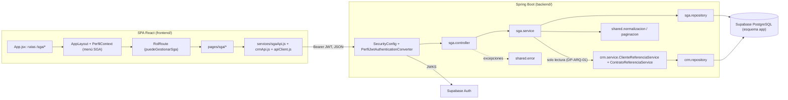
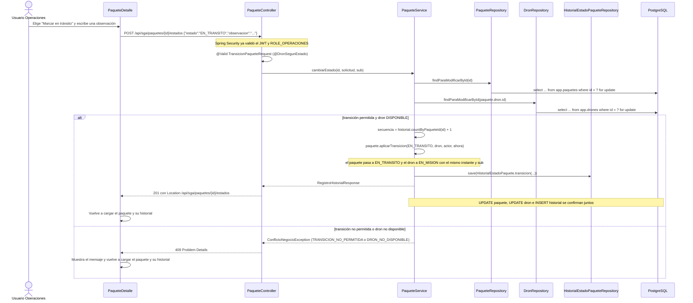
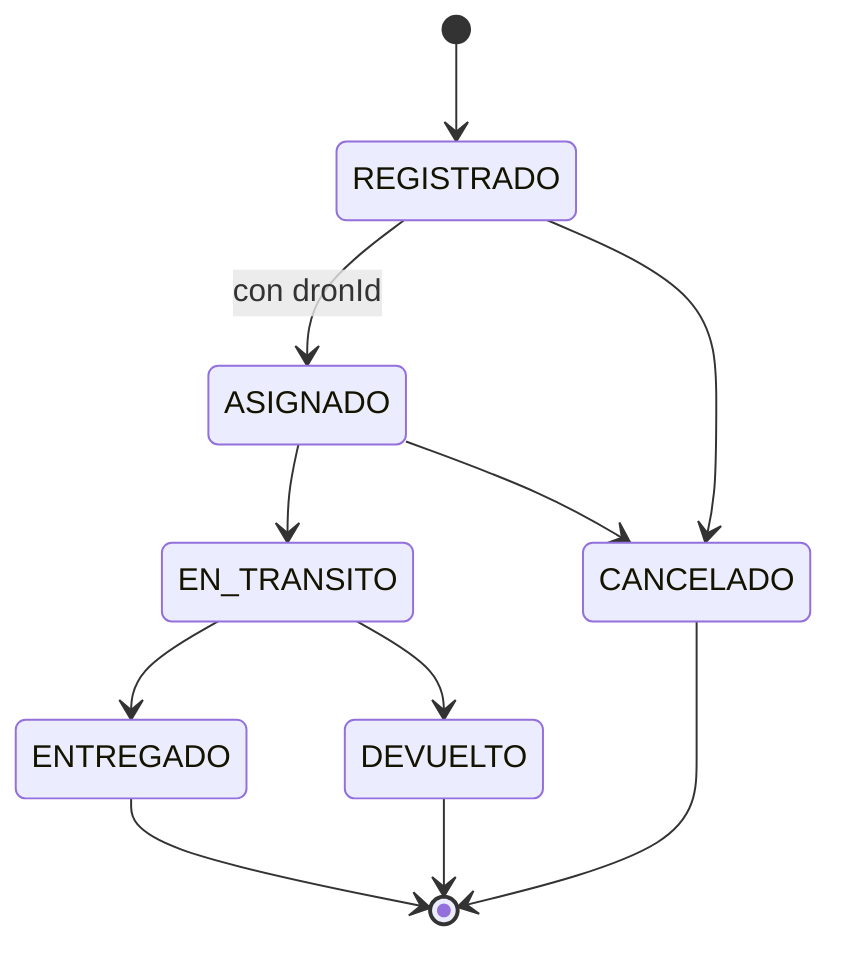
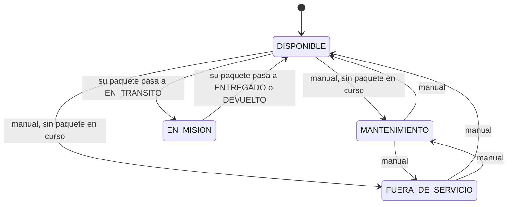
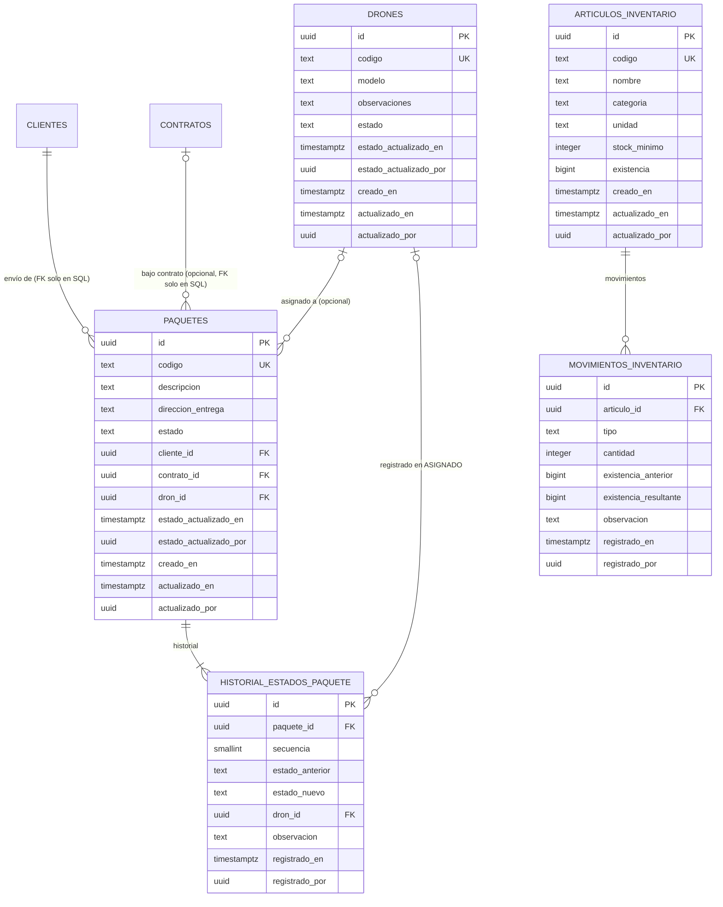

# Documento de diseño: 004-sga-drones-paquetes-inventario

## Overview

Esta especificación construye el módulo SGA (drones, paquetes con historial de estados, inventario con movimientos controlados e indicadores) sobre el patrón del CRM de `002-crm-clientes-contratos` y del ERP de `003-erp-empleados-proveedores-finanzas`. Los paquetes se asocian a clientes y contratos del CRM mediante servicios de solo lectura del CRM y a drones del propio SGA, y con ellos se cierra el flujo integrado del MVP: cliente → contrato → paquete → cambio de estado y trazabilidad (CA-05). La spec reutiliza Docker, Docker Compose, Testcontainers y los tres workflows de CI sin cambiarlos. Cubre los requisitos 1 a 30 de `requirements.md`.

Requisitos del MVP cubiertos: SGA-01 a SGA-05 (Must); SGA-06 (Should incluido); NF-01 a NF-07; CA-01 a CA-07; ENG-01 a ENG-04; AUTH-03 y AUTH-05 en las vistas SGA.

### Estado de partida

| Elemento | Ruta | Estado | Uso en esta spec |
|---|---|---|---|
| Matriz de seguridad con `/api/sga/**` para ADMINISTRADOR y OPERACIONES y lecturas cruzadas de clientes y contratos para OPERACIONES | `backend/src/main/java/com/arise/corp/config/SecurityConfig.java` | [Implementado] | Se usa sin cambios (Requirement 18.1) |
| Converter `ROLE_<ROL>` desde el perfil activo | `config/PerfilJwtAuthenticationConverter.java` | [Implementado] | Fuente del rol en producción y en MockMvc |
| Bean `Clock` UTC y `ValidationConfigurationCustomizer` | `config/ClockConfig.java` | [Implementado] | Auditoría reproducible; sin cambios |
| `ClienteReferenciaService` (`buscar`, `buscarTodos`, `buscarParaAsociar` con `PESSIMISTIC_READ` y `MANDATORY`) y `ClienteReferencia(id, nombre, activo)` | `crm/service/`, `crm/dto/` | [Implementado] | Lo usa el SGA sin cambios (Requirement 1.5) |
| `Contrato` con `@ManyToOne(LAZY) cliente`, `EstadoContrato` y `ContratoRepository` | `crm/entity/`, `crm/repository/` | [Implementado] | Se envuelven en el servicio nuevo `ContratoReferenciaService` (D2) |
| `ConflictoNegocioException`, `RecursoNoEncontradoException` (con `campo`), `ParametroInvalidoException`, `GlobalExceptionHandler` | `shared/error/` | [Implementado] | Se reutilizan sin cambios |
| `NormalizadorTexto` (`texto`, `codigo`, `patronContiene`) | `shared/normalizacion/` | [Implementado] | `codigo` produce el Codigo_Normalizado (D4) |
| `Paginacion` y `PaginaResponse` | `shared/paginacion/` | [Implementado] | Se reutilizan sin cambios |
| Patrón ERP: controladores, `ConflictosErp`, `EspecificacionesErp`, `findParaModificarById` con `PESSIMISTIC_WRITE` | `erp/**` | [Implementado] | Plantilla del SGA. El SGA no importa nada de `erp` (Requirement 1.8) |
| `AutorizacionModulosTests` con el doble `GET /api/sga/paquetes` | `backend/src/test/java/com/arise/corp/login/controller/` | [Implementado] | Se elimina en el commit que crea `PaqueteController` (D16) |
| `CrmAutorizacionTests` (OPERACIONES lee clientes con vista reducida y contratos; 403 en escrituras) | `backend/src/test/java/com/arise/corp/crm/controller/` | [Implementado] | Cubre Requirements 18.7 y 25.9 sin cambios |
| `CrmDatosPrueba`, `AutenticacionPerfilTestSupport` | `backend/src/test/java/com/arise/corp/crm/`, `login/` | [Implementado] | Base de `SgaDatosPrueba` |
| `PostgresIntegracionBase`, `MigracionesSupabase`, `preparacion-supabase.sql` | `backend/src/test/java/com/arise/corp/integration/`, `src/test/resources/integration/` | [Implementado] | Se reutilizan; el `truncate` añade las tablas del SGA |
| Migraciones de perfiles, CRM y ERP (la última, `20261118095500`) | `supabase/migrations/` | [Implementado, aplicadas] | `app.clientes` y `app.contratos` son destino de FK. No se modifican |
| Workflows `backend-ci`, `integration-tests` y `frontend-ci` | `.github/workflows/` | [Implementado] | Se usan sin cambios (D22) |
| SPA con `AppLayout`, `GrupoMenu`, `PerfilContext`, `RolRoute`, `Panel`, `apiClient`, `crmApi`, `permisos`, `validacionCrm`, `formato`, `useConsulta`, `SelectorRegistro`, `DialogoConfirmacion` | `frontend/src/` | [Implementado] | Se amplía con rutas `/sga/*`, `sgaApi.js`, `validacionSga.js`, páginas `pages/sga/*`, menú y tarjetas SGA. `opcionesMenu(rol)` ya da a OPERACIONES Clientes y Contratos en consulta (Requirement 20.6) |
| Generador `mulberry32` y utilidades `entero`, `elegir`, `cadena` | `frontend/src/test/generadores.js` | [Implementado] | Se reutiliza sin cambios |

### Decisiones resueltas en este diseño

| Código | Tema | Decisión | Sección |
|---|---|---|---|
| D1 | Relaciones del SGA | Dentro del módulo, `@ManyToOne(fetch = LAZY)` sin colecciones inversas: `Paquete → Dron` (opcional), `HistorialEstadoPaquete → Paquete` y `→ Dron` (opcional), `MovimientoInventario → ArticuloInventario`. `cliente_id` y `contrato_id` son `UUID` sin asociación JPA; sus FK existen solo en PostgreSQL (DP-ARQ-01) | Data Models |
| D2 | Lectura de contratos desde el SGA | Servicio nuevo `crm.service.ContratoReferenciaService` con `buscar`, `buscarTodos` (lote) y `buscarParaAsociar` (`PESSIMISTIC_READ`, propagación `MANDATORY`). Devuelve el DTO nuevo `crm.dto.ContratoReferencia(id, clienteId, codigo, estado)`, con `estado` como texto para que el SGA no importe `crm.entity`. Se añade `ContratoRepository.findParaAsociarById`. `ContratoService` y los endpoints CRM no cambian. Se registra en `architecture.md` antes de programarlo | Integración con el CRM |
| D3 | Referencias anidadas | DTO propios del SGA: `ClienteAsociado(id, nombre, activo)`, `ContratoAsociado(id, codigo, estado)`, `DronAsociado(id, codigo, estado)`, `DronRef(id, codigo)` y `PaqueteEnCursoRef(id, codigo, estado)`. Las listas resuelven clientes y contratos de la página con una consulta en lote por servicio | DTO, Servicios |
| D4 | Normalización de códigos | `NormalizadorTexto.codigo` (recorte y mayúsculas) y el patrón `[A-Z0-9-]{3,30}` del código de contrato de 002, para drones, paquetes y artículos | DTO |
| D5 | Cantidades enteras | `cantidad` y `stockMinimo` se reciben como `BigDecimal` y se validan como enteros con `@CantidadEntera` y `@MovimientoInventarioValido`, porque Jackson 3 tiene `ACCEPT_FLOAT_AS_INT` activo por defecto y truncaría `1.5` a `1` en un campo `int`. `existencia`, `existencia_anterior` y `existencia_resultante` son `bigint` (`long`) para que una suma de entradas no desborde | DTO, Data Models |
| D6 | Coherencia transición–dron | Restricción de clase `@DronSegunEstado` en `TransicionPaqueteRequest`: `dronId` obligatorio con `ASIGNADO` y prohibido con otro estado (400 en `dronId`) | DTO |
| D7 | Máquinas de estado | `EstadoPaquete` (`transicionesPermitidas`, `esFinal`, `esEditable`, `EN_CURSO`) y `EstadoDron` (`transicionesManuales`, `puedeCambiarManualmenteA`); defensas en las entidades; réplicas `TRANSICIONES_PAQUETE` y `TRANSICIONES_MANUALES_DRON` en `frontend/src/lib/permisos.js` | Servicios, Frontend |
| D8 | Sincronización dron–paquete | Función pura `EstadoPaquete.efectoSobreDron(destino)`; `Paquete.aplicarTransicion` cambia el paquete y llama a `Dron.sincronizarConPaquete` en la misma transacción. `Dron.cambiarEstadoManual` es un método distinto que nunca fija ni abandona `EN_MISION` | Servicios, Data Models |
| D9 | Orden de evaluación | 401 → 403 → 400 → todos los 404 (ruta y referencias del cuerpo) → 409 en un orden fijo por operación (tabla en "Convenciones comunes"). Sigue la regla de 003 de resolver referencias antes de los conflictos | API |
| D10 | Concurrencia | `PESSIMISTIC_WRITE` sobre el paquete, el dron y el artículo que se modifican, también en `PUT` (Hibernate escribe todas las columnas); `PESSIMISTIC_READ` sobre cliente y contrato al asociarlos. Orden fijo: paquete → dron; cliente → contrato. Índice único parcial y `CHECK` de existencia como última defensa | Servicios |
| D11 | Orden del historial | Columna `secuencia` (1 a 4, única por paquete) calculada bajo el bloqueo del paquete. El historial se ordena por `secuencia`, no por el reloj | Data Models |
| D12 | Aritmética del inventario | Función pura `TipoMovimientoInventario.existenciaResultante(anterior, cantidad)`; el servicio rechaza un resultado negativo con 409 antes de tocar el artículo; `CHECK` de aritmética en `app.movimientos_inventario` | Servicios, Data Models |
| D13 | Indicadores | Una consulta agrupada por tabla (paquetes por estado, drones por estado, artículos con total y bajo stock en una sola consulta). Totales y ceros los calcula la función pura `ResumenSgaResponse.desde` con `EnumMap` | Servicios |
| D14 | Auditoría | `Clock` inyectado, instantes truncados a microsegundos. `PUT` actualiza solo `actualizado_*`; los cambios de estado solo `estado_actualizado_*`; un movimiento no toca la auditoría del artículo | Servicios |
| D15 | DTO de entrada | `DronRequest` (POST y PUT), `EstadoDronRequest`, `PaqueteCrearRequest`, `PaqueteActualizarRequest`, `TransicionPaqueteRequest`, `ArticuloRequest` (POST y PUT) y `MovimientoInventarioRequest` | DTO |
| D16 | Doble de autorización | Se elimina `AutorizacionModulosTests` (su único endpoint era el doble `GET /api/sga/paquetes`) en el mismo commit que crea `PaqueteController`; sus casos pasan a `SgaAutorizacionTests` sobre los controladores reales | Testing Strategy |
| D17 | Alcance de las pruebas | Sin librería nueva. Pruebas exhaustivas con `@ParameterizedTest`/`it.each` para dominios finitos y generadores con semilla fija para el inventario. No se repiten pruebas de normalización, paginación ni traducción genérica de errores de 002 y 003 | Testing Strategy |
| D18 | Menú y panel SGA | `puedeGestionarSga`, `OPCIONES_SGA` y `opcionesMenuSga(rol)` en `permisos.js`, separadas de `opcionesMenu(rol)`; grupo "SGA" en `AppLayout` con `/assets/sga.svg` y cuatro tarjetas en `Panel.jsx` | Frontend |
| D19 | Validación local del SGA | `lib/validacionSga.js` reutiliza `texto`, `revisar`, `maximo` y `normalizarCodigo` de `lib/validacionCrm.js` | Frontend |
| D20 | Selectores | Cliente con `SelectorRegistro` (prop nueva opcional `textoVacio`); contrato y dron asignable con un `<select>` simple cargado con `GET /api/crm/contratos?clienteId&estado=ACTIVO&size=100` y `GET /api/sga/drones?asignable=true&size=100` | Frontend |
| D21 | Migración SGA | Aditiva; la prepara Davidson con Supabase CLI, la revisa Sebastián y Davidson la aplica en `arise-corp-dev` antes de la validación manual, tras validarla `MigracionesSgaIT` (DP-TEC-03) | Data Models |
| D22 | Infraestructura | Sin cambios en `Dockerfile`, `.dockerignore`, `docker-compose.yml`, workflows, `SecurityConfig`, dependencias Maven o npm ni variables de entorno. Solo se añade el icono estático `frontend/public/assets/sga.svg` | Infraestructura |

### Confirmación de interpretaciones de los requisitos

| # | Interpretación | Resultado | Dónde se aplica |
|---|---|---|---|
| 1 | Requirement 2.6 enumera las columnas mínimas del historial | Se añade `secuencia smallint` (D11) con `unique (paquete_id, secuencia)`. No contradice el requisito: ordena el historial sin depender de que dos registros tengan instantes distintos (con un `Clock` fijo en pruebas lo tendrían iguales) | Migración, `HistorialEstadoPaquete` |
| 2 | "`cantidad` no es un entero" (Requirements 13.5, 15.7) | Confirmada: `1.5` responde 400; `5`, `5.0` y `5E0` se aceptan como 5; `"5"` (texto) también, por la coerción por defecto de Jackson, igual que `valor` en el ERP. `"abc"` responde 400 con "debe ser un número válido" | `@CantidadEntera`, `@MovimientoInventarioValido` |
| 3 | Existencia sin máximo | Decidida: `bigint` (`long` en Java, número JSON). Con entradas de 1 000 000 como máximo, llegar a 2^53 exige más de 9 000 millones de movimientos | Migración, `ArticuloInventario` |
| 4 | `paqueteEnCurso` en la lista de drones | Confirmada: la representación del dron es la misma en lista y detalle (Requirement 17.1); la lista lo resuelve con una consulta en lote por página | `DronService.listar` |
| 5 | `campo` de los conflictos del dron | `TRANSICION_DRON_NO_PERMITIDA` lleva `campo = "estado"`, como `TRANSICION_NO_PERMITIDA`. `DRON_CON_PAQUETE_EN_CURSO` y `DRON_NO_DISPONIBLE` llevan `campo = "dronId"` solo cuando el dron llega en el cuerpo (asignación); en el cambio manual y en `ASIGNADO→EN_TRANSITO` van sin `campo` | `ConflictosSga` |
| 6 | Solicitar `EN_MISION` en `PATCH /api/sga/drones/{id}/estado` | 409 `TRANSICION_DRON_NO_PERMITIDA`, no 400: `EN_MISION` es un Estado_Dron válido; la regla es de negocio (Requirement 6.2) | `DronService.cambiarEstado` |
| 7 | `ASIGNADO→CANCELADO` | El paquete conserva `dron_id`; el `CHECK` admite `CANCELADO` con o sin dron y el índice parcial solo cubre `ASIGNADO` y `EN_TRANSITO`, así que el dron vuelve a ser asignable (Requirements 11.10, 11.11) | Migración |
| 8 | `AJUSTE` con la misma cantidad que la existencia actual | Se acepta y registra un movimiento con `existenciaAnterior = existenciaResultante`: es un conteo que confirma el stock | `MovimientoInventarioService` |
| 9 | `SALIDA` que deja la existencia exactamente en 0 | Se acepta; solo un resultado negativo responde 409 (Requirement 15.5) | `TipoMovimientoInventario` |
| 10 | Observación del alta | Se guarda en el primer Registro_Historial, no en el paquete (Requirement 7.1) | `PaqueteService.crear` |
| 11 | Lectura del nombre del cliente y del estado del contrato | En cada consulta, con `ClienteReferenciaService` y `ContratoReferenciaService`; nunca se copian (Requirement 8.8). La FK garantiza que existen, así que una ausencia es un error de programación (500) | `PaqueteResponse.desde` |
| 12 | `GET /api/sga/paquetes/{id}/estados` | Devuelve un arreglo JSON, no una Lista_Paginada (supuesto "Historial sin paginación"); se registra como excepción en `api-conventions.md` | `PaqueteController.historial` |
| 13 | `DELETE` y métodos no mapeados de las subcolecciones | 405 con `Allow` para Rol_Gestor_SGA; la matriz de seguridad se evalúa antes, así que sin token responde 401 y con COMERCIAL o FINANZAS_RRHH responde 403 (Requirements 4.11, 9.9, 12.6, 13.10, 15.13) | `GlobalExceptionHandler` (sin cambios) |
| 14 | Requirements 18.7 y 25.9 | Los cubren `CrmAutorizacionTests` y `ClienteControllerTests` existentes, que no cambian; no se duplican en `SgaAutorizacionTests` | Testing Strategy |

### Ajustes de steering a registrar

Cambios de reglas que se registran al inicio de la rama `feat/sga-drones-paquetes-inventario`, antes del código que los aplica (`sdd-workflow.md`, "Registro de decisiones"; Requirement 29.2):

| Archivo | Ajuste | Decisión |
|---|---|---|
| `architecture.md`, DP-ARQ-01 | Los módulos consumidores leen contratos mediante `crm.service.ContratoReferenciaService`, que expone solo identificador, cliente, código y estado (solo lectura, en lote y con bloqueo de lectura dentro de la transacción del llamador), junto a `ClienteReferenciaService`. El SGA define sus propios DTO de salida | D2, D3 |
| `api-conventions.md`, DP-API-04 | Las cantidades enteras se reciben como número JSON y se validan como enteros sin truncar (`BigDecimal` con `@CantidadEntera` en el DTO), porque Jackson 3 trunca decimales en campos `int` por defecto | D5 |
| `api-conventions.md`, DP-API-05 | `POST .../estados` y `POST .../movimientos` responden 201 con el registro creado y `Location` de la colección donde se consulta; el historial del paquete se devuelve completo, sin paginación | Interpretación 12 |

Los cambios de estado ([Implementado]) se registran al terminar cada área: ver "Documentación y steering a actualizar".

### Migración y DP-TEC-03

La Migracion_SGA solo crea cinco tablas, sus índices y restricciones, y revoca privilegios sobre ellas, así que se sigue el procedimiento de 003 para migraciones aditivas (D21, Requirement 29.8):

1. Davidson crea el archivo con `supabase migration new app_sga_drones_paquetes_inventario`. Supabase CLI asigna un timestamp posterior a `20261118095500` (Requirement 2.1). El nombre real se registra en `tasks.md` y en `supabase/migrations/README.md`.
2. Sebastián la revisa en la rama de la spec.
3. Cuando `MigracionesSgaIT` la ha validado en PostgreSQL efímero, Davidson la aplica de forma controlada en `arise-corp-dev`, antes de la validación manual del Requirement 30.
4. Después de aplicada no se edita.

Mientras no esté aplicada, el backend de la rama no arranca contra `arise-corp-dev` (`ddl-auto=validate`); las suites automáticas no se ven afectadas.

## Architecture

El SGA se añade al monolito modular con las mismas capas que el CRM y el ERP (`architecture.md`). La SPA llama a `/api/sga/**` con el Bearer de Supabase; Spring Security valida el JWT y convierte el perfil activo en `ROLE_<ROL>`; los controladores delegan en servicios transaccionales que usan repositorios Spring Data JPA sobre el esquema `app`. Para clientes y contratos, los servicios del SGA llaman a `ClienteReferenciaService` y `ContratoReferenciaService`, que pertenecen al CRM.

### Diagrama de componentes



La flecha `sga.service → crm.service` es la única dependencia del SGA hacia otro módulo. No existe dependencia de `crm` ni de `erp` hacia `sga`, ni de `sga` hacia `erp` (Requirement 1.8).

### Flujo de un cambio de estado con efecto en el dron



### Flujo de alta de un paquete asociado al CRM

```mermaid
sequenceDiagram
    participant C as PaqueteController
    participant S as PaqueteService
    participant CLI as ClienteReferenciaService
    participant CON as ContratoReferenciaService
    participant DB as PostgreSQL

    C->>C: @Valid PaqueteCrearRequest
    C->>S: crear(solicitud, sub)
    Note over S: @Transactional (transacción del SGA)
    S->>CLI: buscarParaAsociar(clienteId) [MANDATORY]
    CLI->>DB: select ... from app.clientes where id = ? for share
    opt contratoId presente
        S->>CON: buscarParaAsociar(contratoId) [MANDATORY]
        CON->>DB: select ... from app.contratos where id = ? for share
    end
    alt cliente o contrato inexistente
        S-->>C: RecursoNoEncontradoException(campo) → 404
    else cliente inactivo, contrato de otro cliente o no ACTIVO, código duplicado
        S-->>C: ConflictoNegocioException → 409
    else asociación válida
        S->>DB: insert paquete (REGISTRADO) e insert historial (secuencia 1)
        S-->>C: PaqueteResponse → 201 con Location
        Note over DB: los bloqueos de lectura se liberan al confirmar; una desactivación o un cambio de estado simultáneo del CRM espera
    end
```

### Organización del backend

```text
com.arise.corp
├── config/                                     # sin cambios
├── shared/                                     # sin cambios
├── login/                                      # sin cambios
├── crm/
│   ├── service/ContratoReferenciaService.java  # nuevo: lectura de contratos para otros módulos (D2)
│   ├── dto/ContratoReferencia.java             # nuevo (D2)
│   ├── repository/ContratoRepository.java      # ampliado: findParaAsociarById con PESSIMISTIC_READ (D2)
│   └── ...                                     # resto sin cambios
├── erp/                                        # sin cambios
└── sga/
    ├── controller/
    │   ├── DronController.java
    │   ├── PaqueteController.java              # incluye GET y POST /{id}/estados
    │   ├── ArticuloController.java             # incluye GET y POST /{id}/movimientos
    │   └── ResumenSgaController.java
    ├── service/
    │   ├── DronService.java
    │   ├── PaqueteService.java
    │   ├── ArticuloService.java
    │   ├── MovimientoInventarioService.java
    │   ├── ResumenSgaService.java
    │   ├── ConflictosSga.java                  # fábrica de ConflictoNegocioException
    │   └── FiltroDrones.java, FiltroPaquetes.java, FiltroArticulos.java
    ├── repository/
    │   ├── DronRepository.java, PaqueteRepository.java, HistorialEstadoPaqueteRepository.java
    │   ├── ArticuloInventarioRepository.java, MovimientoInventarioRepository.java
    │   ├── ConteoPorEstado.java                # proyección (clave, total)
    │   ├── ConteoArticulos.java                # proyección (total, bajoStockMinimo)
    │   └── EspecificacionesSga.java
    ├── entity/
    │   ├── Dron.java, Paquete.java, HistorialEstadoPaquete.java
    │   ├── ArticuloInventario.java, MovimientoInventario.java
    │   └── EstadoDron.java, EstadoPaquete.java, CategoriaArticulo.java, UnidadArticulo.java, TipoMovimientoInventario.java
    └── dto/
        ├── DronRequest, EstadoDronRequest, DronResponse, PaqueteEnCursoRef
        ├── PaqueteCrearRequest, PaqueteActualizarRequest, TransicionPaqueteRequest, PaqueteResponse
        ├── RegistroHistorialResponse, ClienteAsociado, ContratoAsociado, DronAsociado, DronRef
        ├── ArticuloRequest, ArticuloResponse, MovimientoInventarioRequest, MovimientoInventarioResponse
        ├── ResumenSgaResponse
        └── validacion/
            ├── CantidadEntera.java             # (+ validador) entero en rango sobre BigDecimal (D5)
            ├── MovimientoInventarioValido.java # (+ validador) rango por tipo y observación del AJUSTE (D5)
            └── DronSegunEstado.java            # (+ validador) dronId solo con ASIGNADO (D6)
```

Dependencias permitidas: `sga.controller → sga.service → sga.repository → sga.entity`; `sga.service → crm.service.ClienteReferenciaService` y `crm.service.ContratoReferenciaService`; `sga.service` y `sga.dto → crm.dto.ClienteReferencia` y `crm.dto.ContratoReferencia`; `sga.* → shared.*`. El SGA no importa `crm.entity`, `crm.repository`, `crm.controller` ni nada de `erp` (Requirements 1.5, 1.8). Las firmas públicas de este documento son el contrato interno entre capas.

### Organización del frontend

```text
frontend/src/
├── App.jsx                         # ampliado: rutas /sga/* bajo RolRoute(puedeGestionarSga)
├── components/
│   ├── AppLayout.jsx               # ampliado: grupo de menú "SGA" y sección "SGA" en la ruta de navegación
│   ├── SelectorRegistro.jsx        # ampliado: prop opcional textoVacio (por defecto "Sin asociación") (D20)
│   ├── EstadoPaqueteEtiqueta.jsx   # nuevo
│   ├── EstadoDronEtiqueta.jsx      # nuevo
│   └── ...                         # Campo, EstadoConsulta, Paginacion, DialogoConfirmacion sin cambios
├── lib/
│   ├── permisos.js                 # ampliado: puedeGestionarSga, opcionesMenuSga, TRANSICIONES_PAQUETE, TRANSICIONES_MANUALES_DRON (D7, D18)
│   ├── validacionSga.js            # nuevo (D19)
│   └── validacionCrm.js, formato.js, useConsulta.js   # sin cambios
├── pages/
│   ├── Panel.jsx                   # ampliado: tarjetas SGA
│   └── sga/
│       ├── DronesLista.jsx, DronFormulario.jsx, DronDetalle.jsx
│       ├── PaquetesLista.jsx, PaqueteFormulario.jsx, PaqueteDetalle.jsx
│       ├── ArticulosLista.jsx, ArticuloFormulario.jsx, ArticuloDetalle.jsx
│       └── IndicadoresSga.jsx
└── services/
    └── sgaApi.js                   # nuevo
frontend/public/assets/sga.svg      # nuevo icono del grupo de menú (SVG estático propio)
```

## Components and Interfaces

### Contratos de la API del SGA

Este apartado es la documentación de API del SGA (DP-API-06, Requirement 29.1). Frontend y backend lo usan como referencia común.

#### Convenciones comunes

- **Autenticación y autorización:** todas las rutas exigen `Authorization: Bearer <access_token>`. Sin token, o con un token inválido o vencido, responden 401 Problem Details con `WWW-Authenticate`. `SecurityConfig` aplica `/api/sga/**` → ADMINISTRADOR y OPERACIONES sin cambios; un JWT sin Perfil_Activo o con COMERCIAL o FINANZAS_RRHH responde 403 antes del controlador, así que un recurso inexistente no se distingue de uno existente (Requirements 18.1–18.5).
- **Cuerpo:** `Content-Type: application/json` en UTF-8. Los DTO de entrada ignoran propiedades desconocidas (`@JsonIgnoreProperties(ignoreUnknown = true)`), así que `id`, `estado`, `dronId` en el alta, `existencia` y los campos de auditoría enviados por el cliente no tienen efecto (Requirements 4.7, 7.11, 13.7).
- **Normalización (Requirement 3):** los textos se recortan con `strip` y un texto vacío se convierte en `null`; los códigos pasan a Codigo_Normalizado con `NormalizadorTexto.codigo`. Las validaciones, comparaciones, el almacenamiento y las respuestas usan el valor normalizado.
- **Tipos (DP-API-04):** identificadores UUID; instantes ISO-8601 UTC con microsegundos; cantidades, stock mínimo y existencias como enteros JSON; enumeraciones en `UPPER_SNAKE_CASE`.
- **Listas (DP-API-03):** `page` ≥ 0 (por defecto 0), `size` de 1 a 100 (por defecto 20) y `sort` `campo,asc|desc` con los campos permitidos de cada endpoint; `Paginacion.crear` añade `id,asc` como desempate. La respuesta es `{ "content": [], "page", "size", "totalElements", "totalPages" }`.
- **Búsqueda `q`:** máximo 100 caracteres; vacía se ignora. Coincide si el código contiene el Codigo_Normalizado de `q` o el texto indicado del recurso contiene `q` sin distinguir mayúsculas. Los comodines `%`, `_` y `\` se escapan con `NormalizadorTexto.patronContiene`.
- **Errores:** RFC 9457 Problem Details con mensajes en español. Los 400 por campo usan `errors: [{ "field", "message" }]`; los 409 de negocio añaden `conflicto`, `campo` cuando corresponde y sus extensiones; los 404 de referencias del cuerpo añaden `campo`. El catálogo está en "Error Handling".

#### Orden de evaluación (D9)

En todas las operaciones se evalúa primero 401, después 403 y después 400 (cuerpo, parámetros y `{id}` no UUID). Cada operación resuelve después todas sus referencias (404) y solo entonces comprueba los conflictos (409) en el orden de la tabla. El primer error encontrado es la respuesta.

| Operación | 404 (en orden) | 409 (en orden) |
|---|---|---|
| `POST /api/sga/drones` | — | `DRON_CODIGO_DUPLICADO` |
| `PUT /api/sga/drones/{id}` | dron | `DRON_CODIGO_DUPLICADO` |
| `PATCH /api/sga/drones/{id}/estado` | dron | `TRANSICION_DRON_NO_PERMITIDA` → `DRON_CON_PAQUETE_EN_CURSO` |
| `POST /api/sga/paquetes` | `clienteId` → `contratoId` | `CLIENTE_INACTIVO` → `CONTRATO_DE_OTRO_CLIENTE` → `CONTRATO_NO_ACTIVO` → `PAQUETE_CODIGO_DUPLICADO` |
| `PUT /api/sga/paquetes/{id}` | paquete → `contratoId` (solo si es distinto del actual) | `PAQUETE_NO_EDITABLE` → `CONTRATO_DE_OTRO_CLIENTE` → `CONTRATO_NO_ACTIVO` (solo para un contrato nuevo) |
| `POST /api/sga/paquetes/{id}/estados` | paquete → `dronId` | `TRANSICION_NO_PERMITIDA` → `DRON_NO_DISPONIBLE` → `DRON_CON_PAQUETE_EN_CURSO` |
| `POST /api/sga/articulos` | — | `ARTICULO_CODIGO_DUPLICADO` |
| `PUT /api/sga/articulos/{id}` | artículo | `ARTICULO_CODIGO_DUPLICADO` |
| `POST /api/sga/articulos/{id}/movimientos` | artículo | `EXISTENCIA_INSUFICIENTE` |
| `GET` de un recurso, del historial o de los movimientos | recurso o padre | — |

Consecuencias que las pruebas fijan: una transición `ASIGNADO` con un `dronId` inexistente sobre un paquete `ENTREGADO` responde 404 en `dronId`; un alta con cliente inactivo y código duplicado responde `CLIENTE_INACTIVO`; un `PUT` sobre un paquete `EN_TRANSITO` con un contrato inexistente responde 404 en `contratoId`. Un duplicado de código concurrente que supera la comprobación previa lo rechaza la restricción `UNIQUE` y responde 409 genérico (Requirement 19.7).

#### Representaciones JSON

Todas son las mismas para ADMINISTRADOR y OPERACIONES y las mismas en lista y en detalle (Requirement 17.1).

**Dron (`DronResponse`)** (Requirement 5.7):

```json
{
  "id": "7a1b2c3d-0000-4000-8000-000000000031",
  "codigo": "DRN-001",
  "modelo": "Arise X4 Carga ligera",
  "observaciones": null,
  "estado": "DISPONIBLE",
  "paqueteEnCurso": { "id": "8b2c3d4e-0000-4000-8000-000000000041", "codigo": "PAQ-0001", "estado": "ASIGNADO" },
  "estadoActualizadoEn": "2026-11-25T14:00:00.123456Z",
  "estadoActualizadoPor": "9a8b7c6d-0000-4000-8000-000000000004",
  "creadoEn": "2026-11-25T14:00:00.123456Z",
  "actualizadoEn": "2026-11-25T14:00:00.123456Z",
  "actualizadoPor": "9a8b7c6d-0000-4000-8000-000000000004"
}
```

`paqueteEnCurso` es `null` si ningún paquete del dron está en `ASIGNADO` o `EN_TRANSITO`.

**Paquete (`PaqueteResponse`)** (Requirements 8.7, 17.2):

```json
{
  "id": "8b2c3d4e-0000-4000-8000-000000000041",
  "codigo": "PAQ-0001",
  "descripcion": "Repuestos para mantenimiento de bodega",
  "direccionEntrega": "Calle 10 # 20-30, Bogotá",
  "estado": "ASIGNADO",
  "cliente": { "id": "3f2c9a4e-0000-4000-8000-000000000001", "nombre": "Cliente de Ejemplo", "activo": true },
  "contrato": { "id": "4a3b2c1d-0000-4000-8000-000000000002", "codigo": "CTR-2026-001", "estado": "ACTIVO" },
  "dron": { "id": "7a1b2c3d-0000-4000-8000-000000000031", "codigo": "DRN-001", "estado": "DISPONIBLE" },
  "estadoActualizadoEn": "2026-11-25T14:05:00.000000Z",
  "estadoActualizadoPor": "9a8b7c6d-0000-4000-8000-000000000004",
  "creadoEn": "2026-11-25T14:00:00.123456Z",
  "actualizadoEn": "2026-11-25T14:00:00.123456Z",
  "actualizadoPor": "9a8b7c6d-0000-4000-8000-000000000004"
}
```

`contrato` y `dron` son `null` cuando no existe la relación. El cliente solo expone `id`, `nombre` y `activo` (Requirement 17.2); nombre, estado activo y datos del contrato se leen del CRM en cada consulta (Requirement 8.8).

**Registro de historial (`RegistroHistorialResponse`)** (Requirement 12.1), en `GET .../estados` (arreglo en orden cronológico) y como respuesta 201 de `POST .../estados`:

```json
[
  { "id": "c1d2e3f4-0000-4000-8000-000000000051", "estadoAnterior": null, "estadoNuevo": "REGISTRADO", "dron": null, "observacion": "Recibido en bodega", "registradoEn": "2026-11-25T14:00:00.123456Z", "registradoPor": "9a8b7c6d-0000-4000-8000-000000000004" },
  { "id": "c1d2e3f4-0000-4000-8000-000000000052", "estadoAnterior": "REGISTRADO", "estadoNuevo": "ASIGNADO", "dron": { "id": "7a1b2c3d-0000-4000-8000-000000000031", "codigo": "DRN-001" }, "observacion": null, "registradoEn": "2026-11-25T14:05:00.000000Z", "registradoPor": "9a8b7c6d-0000-4000-8000-000000000004" }
]
```

**Artículo (`ArticuloResponse`)** (Requirement 14.6):

```json
{
  "id": "d4e5f6a7-0000-4000-8000-000000000061",
  "codigo": "BAT-4S-5000",
  "nombre": "Batería LiPo 4S 5000 mAh",
  "categoria": "BATERIA",
  "unidad": "UNIDAD",
  "stockMinimo": 10,
  "existencia": 7,
  "bajoStockMinimo": true,
  "creadoEn": "2026-11-25T13:00:00.000000Z",
  "actualizadoEn": "2026-11-25T13:00:00.000000Z",
  "actualizadoPor": "9a8b7c6d-0000-4000-8000-000000000004"
}
```

`bajoStockMinimo = existencia < stockMinimo`, calculado al construir la respuesta.

**Movimiento de inventario (`MovimientoInventarioResponse`)** (Requirement 15.1), en la lista paginada y como respuesta 201:

```json
{
  "id": "e5f6a7b8-0000-4000-8000-000000000071",
  "articuloId": "d4e5f6a7-0000-4000-8000-000000000061",
  "tipo": "SALIDA",
  "cantidad": 3,
  "existenciaAnterior": 10,
  "existenciaResultante": 7,
  "observacion": null,
  "registradoEn": "2026-11-25T15:00:00.000000Z",
  "registradoPor": "9a8b7c6d-0000-4000-8000-000000000004"
}
```

**Resumen SGA (`ResumenSgaResponse`)** (Requirement 16):

```json
{
  "paquetes": {
    "porEstado": { "REGISTRADO": 2, "ASIGNADO": 1, "EN_TRANSITO": 1, "ENTREGADO": 5, "CANCELADO": 0, "DEVUELTO": 1 },
    "total": 10
  },
  "drones": {
    "porEstado": { "DISPONIBLE": 3, "EN_MISION": 1, "MANTENIMIENTO": 1, "FUERA_DE_SERVICIO": 0 },
    "total": 5
  },
  "articulos": { "bajoStockMinimo": 2, "total": 12 }
}
```

`porEstado` contiene siempre los seis Estado_Paquete y los cuatro Estado_Dron, con 0 para los que no tienen registros, y cada `total` es la suma de sus cantidades (Requirements 16.2, 16.3).

#### Campos de entrada y validaciones

Mensaje de código común: "debe tener entre 3 y 30 caracteres: letras, dígitos o guiones" (patrón `[A-Z0-9-]{3,30}` sobre el Codigo_Normalizado, D4). Un campo obligatorio ausente o vacío produce "es obligatorio".

`DronRequest` (POST y PUT de drones):

| Campo | Tipo JSON | Obligatorio | Normalización | Regla | Mensaje |
|---|---|---|---|---|---|
| `codigo` | string | Sí | Codigo_Normalizado | Patrón de código | Mensaje de código |
| `modelo` | string | Sí | Recorte | Máximo 100 | "debe tener como máximo 100 caracteres" |
| `observaciones` | string o null | No | Recorte; vacío → null | Máximo 500 | "debe tener como máximo 500 caracteres" |

`PaqueteCrearRequest` (POST de paquetes):

| Campo | Tipo JSON | Obligatorio | Normalización | Regla | Mensaje |
|---|---|---|---|---|---|
| `codigo` | string | Sí | Codigo_Normalizado | Patrón de código | Mensaje de código |
| `descripcion` | string | Sí | Recorte | Máximo 500 | "debe tener como máximo 500 caracteres" |
| `direccionEntrega` | string | Sí | Recorte | Máximo 200 | "debe tener como máximo 200 caracteres" |
| `clienteId` | uuid | Sí | — | UUID | "debe ser un identificador UUID válido" |
| `contratoId` | uuid o null | No | — | UUID | "debe ser un identificador UUID válido" |
| `observacion` | string o null | No | Recorte; vacío → null | Máximo 500 | "debe tener como máximo 500 caracteres" |

`PaqueteActualizarRequest` (PUT de paquetes): `descripcion`, `direccionEntrega` y `contratoId` con las mismas reglas. `codigo`, `clienteId`, `estado` y `dronId` no forman parte del DTO, así que se ignoran (Requirement 9.4).

`TransicionPaqueteRequest` (POST `.../estados`):

| Campo | Tipo JSON | Obligatorio | Regla | Mensaje |
|---|---|---|---|---|
| `estado` | string | Sí | Estado_Paquete | "es obligatorio" / "debe ser uno de: REGISTRADO, ASIGNADO, EN_TRANSITO, ENTREGADO, CANCELADO, DEVUELTO" |
| `dronId` | uuid o null | Solo con `ASIGNADO` | `@DronSegunEstado` | "es obligatorio para asignar el paquete" / "solo se admite en la transición a ASIGNADO" |
| `observacion` | string o null | No | Recorte; vacío → null; máximo 500 | "debe tener como máximo 500 caracteres" |

`EstadoDronRequest` (PATCH `/api/sga/drones/{id}/estado`): `{ "estado": "MANTENIMIENTO" }`, `estado` obligatorio y Estado_Dron ("debe ser uno de: DISPONIBLE, EN_MISION, MANTENIMIENTO, FUERA_DE_SERVICIO").

`ArticuloRequest` (POST y PUT de artículos):

| Campo | Tipo JSON | Obligatorio | Normalización | Regla | Mensaje |
|---|---|---|---|---|---|
| `codigo` | string | Sí | Codigo_Normalizado | Patrón de código | Mensaje de código |
| `nombre` | string | Sí | Recorte | Máximo 200 | "debe tener como máximo 200 caracteres" |
| `categoria` | string | Sí | — | `REPUESTO`, `BATERIA`, `EMPAQUE`, `OTRO` | "debe ser uno de: REPUESTO, BATERIA, EMPAQUE, OTRO" |
| `unidad` | string | Sí | — | `UNIDAD`, `CAJA`, `JUEGO`, `ROLLO` | "debe ser uno de: UNIDAD, CAJA, JUEGO, ROLLO" |
| `stockMinimo` | number | Sí | — | `@CantidadEntera(min = 0)`: entero de 0 a 1000000 | "debe ser un número entero entre 0 y 1000000" |

`MovimientoInventarioRequest` (POST `.../movimientos`):

| Campo | Tipo JSON | Obligatorio | Regla | Mensaje |
|---|---|---|---|---|
| `tipo` | string | Sí | `ENTRADA`, `SALIDA`, `AJUSTE` | "es obligatorio" / "debe ser uno de: ENTRADA, SALIDA, AJUSTE" |
| `cantidad` | number | Sí | `@MovimientoInventarioValido`: entero de 1 a 1000000 en `ENTRADA` y `SALIDA`; de 0 a 1000000 en `AJUSTE` | "debe ser un número entero entre 1 y 1000000" / "debe ser un número entero entre 0 y 1000000" |
| `observacion` | string o null | Solo en `AJUSTE` | Recorte; vacío → null; máximo 500 | "es obligatoria en un ajuste" / "debe tener como máximo 500 caracteres" |

Un valor de tipo incorrecto (`"estado": "PERDIDO"`, `"cantidad": "abc"`, `"clienteId": "x"`) responde 400 con una entrada en `errors` para ese campo, con el mecanismo que ya implementa `GlobalExceptionHandler` (Requirement 19.3).

#### Drones

##### GET /api/sga/drones
- Requisitos: SGA-01, SGA-05, DP-API-03; Requirements 5.1–5.6.
- Roles permitidos: ADMINISTRADOR, OPERACIONES.
- Parámetros: `q` (código o `modelo`), `estado` (Estado_Dron), `asignable` (boolean: `true` solo Dron_Asignable, `false` solo los que no lo son), `page`, `size`, `sort` (`codigo`, `modelo`, `creadoEn`; por defecto `codigo,asc`).
- Respuesta 200: Lista_Paginada de `DronResponse` en cualquier estado. Los filtros se combinan con `y`.
- Errores: 400 (parámetros), 401, 403.

##### GET /api/sga/drones/{id}
- Requisitos: SGA-01, SGA-05; Requirements 5.7–5.9.
- Roles permitidos: ADMINISTRADOR, OPERACIONES.
- Respuesta 200: `DronResponse` con `paqueteEnCurso`.
- Errores: 400 (`id` no UUID, `errors[0].field = "id"`), 401, 403, 404 ("El dron no existe.").

##### POST /api/sga/drones
- Requisitos: SGA-01, DP-SEG-06; Requirements 3.1, 4.1–4.7.
- Roles permitidos: ADMINISTRADOR, OPERACIONES.
- Solicitud: `DronRequest`.
- Respuesta 201: `DronResponse` en `DISPONIBLE`, `paqueteEnCurso = null`, con `creadoEn = actualizadoEn = estadoActualizadoEn = ahora` y `actualizadoPor = estadoActualizadoPor = sub`. `Location: /api/sga/drones/{id}`.
- Errores: 400, 401, 403, 409 (`DRON_CODIGO_DUPLICADO` o restricción de la base).

##### PUT /api/sga/drones/{id}
- Requisitos: SGA-01, DP-SEG-06; Requirements 4.8–4.10.
- Roles permitidos: ADMINISTRADOR, OPERACIONES.
- Solicitud: `DronRequest`. Reemplaza `codigo`, `modelo` y `observaciones` (omitido o nulo queda nulo); conserva el estado, su auditoría y `creadoEn`.
- Respuesta 200: `DronResponse` con `actualizadoEn` y `actualizadoPor` nuevos.
- Errores: 400, 401, 403, 404, 409 (`DRON_CODIGO_DUPLICADO` si el código pertenece a otro dron).

##### PATCH /api/sga/drones/{id}/estado
- Requisitos: SGA-01, SGA-05, DP-SEG-06; Requirements 6.1–6.6.
- Roles permitidos: ADMINISTRADOR, OPERACIONES.
- Solicitud: `EstadoDronRequest`.
- Respuesta 200: `DronResponse` con `estado`, `estadoActualizadoEn` y `estadoActualizadoPor` nuevos; datos, `actualizadoEn` y `actualizadoPor` sin cambios.
- Errores: 400 (`estado` ausente o desconocido), 401, 403, 404, 409 (`TRANSICION_DRON_NO_PERMITIDA` con `estadoActual` y `estadoSolicitado`; `DRON_CON_PAQUETE_EN_CURSO` con `paqueteId`).

##### DELETE /api/sga/drones/{id}
- Requisitos: SGA-01; Requirement 4.11.
- No existe borrado: `FUERA_DE_SERVICIO` hace las veces de desactivación. Para Rol_Gestor_SGA responde 405 ("La operación no está disponible para este recurso.") con `Allow` (`GET`, `PUT`).

#### Paquetes

##### GET /api/sga/paquetes
- Requisitos: SGA-02, SGA-05, DP-API-03; Requirements 8.1–8.6.
- Roles permitidos: ADMINISTRADOR, OPERACIONES.
- Parámetros: `estado` (Estado_Paquete), `clienteId`, `contratoId`, `dronId` (UUID, sin comprobar su existencia), `q` (código o `descripcion`), `page`, `size`, `sort` (`codigo`, `creadoEn`, `estadoActualizadoEn`; por defecto `creadoEn,desc`).
- Respuesta 200: Lista_Paginada de `PaqueteResponse`. Todos los filtros se combinan con `y`; un identificador sin paquetes o sin registro produce una lista vacía.
- Errores: 400 (paginación, orden, `q` largo, `estado` desconocido, UUID inválidos), 401, 403.

##### GET /api/sga/paquetes/{id}
- Requisitos: SGA-02, SGA-05; Requirements 8.7–8.9.
- Roles permitidos: ADMINISTRADOR, OPERACIONES.
- Respuesta 200: `PaqueteResponse`.
- Errores: 400, 401, 403, 404 ("El paquete no existe.").

##### POST /api/sga/paquetes
- Requisitos: SGA-02, SGA-04, SGA-05, DP-ARQ-01, DP-SEG-06; Requirements 3.1, 7.1–7.12.
- Roles permitidos: ADMINISTRADOR, OPERACIONES.
- Solicitud: `PaqueteCrearRequest`.
- Respuesta 201: `PaqueteResponse` en `REGISTRADO` y `dron = null`, con la auditoría de datos y de estado iguales al instante de creación y al `sub`. En la misma transacción se crea el Registro_Historial con `secuencia = 1`, `estadoAnterior = null`, `estadoNuevo = REGISTRADO` y la `observacion` recibida. `Location: /api/sga/paquetes/{id}`.
- Errores: 400, 401, 403, 404 (`clienteId` o `contratoId` inexistente, con `campo`), 409 (`CLIENTE_INACTIVO`, `CONTRATO_DE_OTRO_CLIENTE`, `CONTRATO_NO_ACTIVO` con `estadoActual`, `PAQUETE_CODIGO_DUPLICADO`, o restricción de la base).

##### PUT /api/sga/paquetes/{id}
- Requisitos: SGA-02, SGA-05, DP-SEG-06; Requirements 9.1–9.8.
- Roles permitidos: ADMINISTRADOR, OPERACIONES.
- Solicitud: `PaqueteActualizarRequest`. Reemplaza `descripcion`, `direccionEntrega` y `contratoId`; un `contratoId` omitido o nulo elimina la asociación. Conserva código, cliente, estado, su auditoría, dron e historial.
- Regla de asociación (Requirements 9.5–9.7): el contrato destino se acepta si es `null`, si es el contrato actual (aunque ya no esté en `ACTIVO`) o si es otro contrato existente, del cliente del paquete y en `ACTIVO`.
- Respuesta 200: `PaqueteResponse` con `actualizadoEn` y `actualizadoPor` nuevos.
- Errores: 400, 401, 403, 404 (paquete; `contratoId` con `campo`), 409 (`PAQUETE_NO_EDITABLE` con `estadoActual`; `CONTRATO_DE_OTRO_CLIENTE` o `CONTRATO_NO_ACTIVO` para un contrato nuevo).

##### DELETE /api/sga/paquetes/{id}
- Requisitos: SGA-02; Requirement 9.9.
- 405 con `Allow` (`GET`, `PUT`) para Rol_Gestor_SGA. Un paquete no se elimina: se cancela.

#### Historial de estados del paquete

##### GET /api/sga/paquetes/{id}/estados
- Requisitos: SGA-04; Requirements 12.1–12.3, 12.7.
- Roles permitidos: ADMINISTRADOR, OPERACIONES.
- Respuesta 200: arreglo JSON de `RegistroHistorialResponse` ordenado por `secuencia` ascendente (máximo cuatro registros, sin paginación).
- Errores: 400, 401, 403, 404 ("El paquete no existe.").

##### POST /api/sga/paquetes/{id}/estados
- Requisitos: SGA-01, SGA-02, SGA-04, SGA-05, DP-API-05, DP-SEG-06; Requirements 10.1–10.8, 11.1–11.12, 12.4, 12.5.
- Roles permitidos: ADMINISTRADOR, OPERACIONES.
- Solicitud: `TransicionPaqueteRequest`.
- Respuesta 201: el `RegistroHistorialResponse` creado. `Location: /api/sga/paquetes/{id}/estados`. En la misma transacción: `estado`, `estadoActualizadoEn` y `estadoActualizadoPor` del paquete; el Registro_Historial con el mismo instante y `sub`; y el efecto sobre el dron de la tabla "Máquinas de estado". Los datos del paquete, `actualizadoEn` y `actualizadoPor` no cambian. La regla no tiene en cuenta si el cliente está inactivo o el contrato ya no está en `ACTIVO` (Requirement 10.6).
- Errores: 400 (`estado`, `dronId`, `observacion`), 401, 403, 404 (paquete; `dronId` con `campo`), 409 (`TRANSICION_NO_PERMITIDA` con `campo = "estado"`, `estadoActual` y `estadoSolicitado`; `DRON_NO_DISPONIBLE` con `estadoActual`; `DRON_CON_PAQUETE_EN_CURSO` con `paqueteId`; restricción de la base, por ejemplo el índice parcial ante una asignación concurrente).

##### PUT, PATCH y DELETE /api/sga/paquetes/{id}/estados
- Requisitos: SGA-04; Requirement 12.6.
- 405 con `Allow` (`GET`, `POST`) para Rol_Gestor_SGA. Los registros del historial no se editan ni se eliminan.

#### Artículos e inventario

##### GET /api/sga/articulos
- Requisitos: SGA-03, SGA-06, DP-API-03; Requirements 14.1–14.5.
- Roles permitidos: ADMINISTRADOR, OPERACIONES.
- Parámetros: `q` (código o `nombre`), `categoria` (Categoria_Articulo), `bajoStockMinimo` (boolean: `true` solo `existencia < stockMinimo`, `false` solo los demás), `page`, `size`, `sort` (`codigo`, `nombre`, `existencia`, `creadoEn`; por defecto `nombre,asc`).
- Respuesta 200: Lista_Paginada de `ArticuloResponse`.
- Errores: 400, 401, 403.

##### GET /api/sga/articulos/{id}
- Requisitos: SGA-03; Requirements 14.6, 14.7.
- Roles permitidos: ADMINISTRADOR, OPERACIONES.
- Respuesta 200: `ArticuloResponse`.
- Errores: 400, 401, 403, 404 ("El artículo no existe.").

##### POST /api/sga/articulos
- Requisitos: SGA-03, DP-SEG-06; Requirements 3.1, 13.1–13.7.
- Roles permitidos: ADMINISTRADOR, OPERACIONES.
- Solicitud: `ArticuloRequest`.
- Respuesta 201: `ArticuloResponse` con `existencia = 0` y la auditoría del actor. `Location: /api/sga/articulos/{id}`.
- Errores: 400, 401, 403, 409 (`ARTICULO_CODIGO_DUPLICADO` o restricción de la base).

##### PUT /api/sga/articulos/{id}
- Requisitos: SGA-03, DP-SEG-06; Requirements 13.8, 13.9.
- Roles permitidos: ADMINISTRADOR, OPERACIONES.
- Solicitud: `ArticuloRequest`. Reemplaza los cinco campos; conserva `existencia` y `creadoEn`.
- Respuesta 200: `ArticuloResponse` con la auditoría actualizada.
- Errores: 400, 401, 403, 404, 409 (`ARTICULO_CODIGO_DUPLICADO`).

##### DELETE /api/sga/articulos/{id}
- Requisitos: SGA-03; Requirement 13.10.
- 405 con `Allow` (`GET`, `PUT`) para Rol_Gestor_SGA. Los artículos no se desactivan ni se eliminan.

##### GET /api/sga/articulos/{id}/movimientos
- Requisitos: SGA-03, DP-API-03; Requirements 15.11, 15.14.
- Roles permitidos: ADMINISTRADOR, OPERACIONES.
- Parámetros: `page`, `size`, `sort` (`registradoEn` con `asc` o `desc`; por defecto `registradoEn,desc`).
- Respuesta 200: Lista_Paginada de `MovimientoInventarioResponse` del artículo.
- Errores: 400, 401, 403, 404 (artículo).

##### POST /api/sga/articulos/{id}/movimientos
- Requisitos: SGA-03, DP-API-05, DP-SEG-06; Requirements 15.1–15.10, 15.12, 15.15.
- Roles permitidos: ADMINISTRADOR, OPERACIONES.
- Solicitud: `MovimientoInventarioRequest`.
- Respuesta 201: el `MovimientoInventarioResponse` creado. `Location: /api/sga/articulos/{id}/movimientos`. En la misma transacción se fija `existencia = existenciaResultante`; `actualizadoEn` y `actualizadoPor` del artículo no cambian.
- Aritmética (D12): `ENTRADA` → anterior + cantidad; `SALIDA` → anterior − cantidad; `AJUSTE` → cantidad (la existencia contada).
- Errores: 400 (`tipo`, `cantidad`, `observacion`), 401, 403, 404 (artículo), 409 (`EXISTENCIA_INSUFICIENTE` con `campo = "cantidad"`, `existenciaActual` y `cantidadSolicitada`; restricción de la base).

##### PUT, PATCH y DELETE /api/sga/articulos/{id}/movimientos
- Requisitos: SGA-03; Requirement 15.13.
- 405 con `Allow` (`GET`, `POST`). Un error se corrige con un movimiento nuevo, por ejemplo un `AJUSTE`.

#### Indicadores

##### GET /api/sga/resumen
- Requisitos: SGA-06, CA-04; Requirements 16.1–16.4.
- Roles permitidos: ADMINISTRADOR, OPERACIONES.
- Parámetros: ninguno; muestra el estado actual.
- Respuesta 200: `ResumenSgaResponse`, calculado en una transacción de solo lectura.
- Errores: 401, 403.

#### Máquinas de estado

Paquete (Transicion_Permitida_Paquete, D7):



Dron (Transicion_Manual_Dron y cambios ligados al paquete):



Efecto de cada transición del paquete sobre el dron (D8, `EstadoPaquete.efectoSobreDron`):

| Transición del paquete | Dron requerido | Condición del dron | Efecto sobre el dron | Requisitos |
|---|---|---|---|---|
| `REGISTRADO→ASIGNADO` | El de `dronId` | `DISPONIBLE` y sin Paquete_En_Curso | Se asocia al paquete; sigue en `DISPONIBLE`; se registra en el historial | 11.1–11.6 |
| `ASIGNADO→EN_TRANSITO` | El asignado | `DISPONIBLE` | Pasa a `EN_MISION` con el instante y el `sub` del registro | 11.7, 11.8 |
| `EN_TRANSITO→ENTREGADO`, `EN_TRANSITO→DEVUELTO` | El asignado | `EN_MISION` (invariante) | Vuelve a `DISPONIBLE` con el instante y el `sub` del registro | 11.9 |
| `ASIGNADO→CANCELADO` | — | — | Ninguno; deja de tener Paquete_En_Curso y vuelve a ser asignable | 11.10 |
| `REGISTRADO→CANCELADO` | — | — | Ninguno | 10.1 |

El paquete conserva `dron_id` en cualquier Estado_Final_Paquete (Requirement 11.11). Un dron en `MANTENIMIENTO` o `FUERA_DE_SERVICIO` no puede tener un paquete `ASIGNADO`, porque el cambio manual exige que no tenga Paquete_En_Curso; la comprobación de `DISPONIBLE` en `ASIGNADO→EN_TRANSITO` es una defensa.

#### Matriz de acceso por endpoint

| Endpoint | ADMINISTRADOR | COMERCIAL | FINANZAS_RRHH | OPERACIONES | Patrón de `SecurityConfig` |
|---|---|---|---|---|---|
| `GET`, `POST`, `PUT` de `/api/sga/drones` y `/{id}`; `PATCH /{id}/estado` | Sí | 403 | 403 | Sí | `/api/sga/**` |
| `GET`, `POST`, `PUT` de `/api/sga/paquetes` y `/{id}`; `GET` y `POST /{id}/estados` | Sí | 403 | 403 | Sí | `/api/sga/**` |
| `GET`, `POST`, `PUT` de `/api/sga/articulos` y `/{id}`; `GET` y `POST /{id}/movimientos` | Sí | 403 | 403 | Sí | `/api/sga/**` |
| `GET /api/sga/resumen` | Sí | 403 | 403 | Sí | `/api/sga/**` |
| `DELETE` de drones, paquetes y artículos; métodos no mapeados de `/estados` y `/movimientos` | 405 | 403 | 403 | 405 | `/api/sga/**` |
| `GET /api/crm/clientes`, `/api/crm/clientes/{id}` (selector y enlace) | Completa | Completa | Reducida | Reducida | `GET /api/crm/clientes`, `/api/crm/clientes/*` (sin cambios) |
| `GET /api/crm/contratos`, `/api/crm/contratos/{id}` (selector y enlace) | Sí | Sí | 403 | Sí | `GET /api/crm/contratos`, `/api/crm/contratos/*` (sin cambios) |
| Escrituras del CRM | Sí | Sí | 403 | 403 | `/api/crm/**` (sin cambios) |

Ninguna regla anterior de `SecurityConfig` coincide con `/api/sga/**`, así que no hay lecturas cruzadas hacia el SGA (supuesto "Vista de los recursos SGA").

### Backend: controladores

Los controladores reciben y devuelven DTO, validan con `@Valid` y delegan en el servicio (Requirements 1.2, 1.3). Toman el actor de `@AuthenticationPrincipal Jwt jwt` (`jwt.getSubject()`, Requirement 18.6) y construyen `Location` con URI relativas. Las restricciones de los parámetros de lista se declaran en los `@RequestParam` sin `@Validated` a nivel de clase (D8 de 002), como en `MovimientoController` del ERP.

| Controlador | Ruta base | Métodos | Campos de orden |
|---|---|---|---|
| `DronController` | `/api/sga/drones` | `GET`, `GET /{id}`, `POST`, `PUT /{id}`, `PATCH /{id}/estado` | `codigo`, `modelo`, `creadoEn` |
| `PaqueteController` | `/api/sga/paquetes` | `GET`, `GET /{id}`, `POST`, `PUT /{id}`, `GET /{id}/estados`, `POST /{id}/estados` | `codigo`, `creadoEn`, `estadoActualizadoEn` |
| `ArticuloController` | `/api/sga/articulos` | `GET`, `GET /{id}`, `POST`, `PUT /{id}`, `GET /{id}/movimientos`, `POST /{id}/movimientos` | `codigo`, `nombre`, `existencia`, `creadoEn`; movimientos: `registradoEn` |
| `ResumenSgaController` | `/api/sga/resumen` | `GET` | — |

```java
@GetMapping("/{id}/estados")
public List<RegistroHistorialResponse> historial(@PathVariable UUID id) {
    return paqueteService.historial(id);
}

@PostMapping("/{id}/estados")
public ResponseEntity<RegistroHistorialResponse> cambiarEstado(
        @PathVariable UUID id,
        @Valid @RequestBody TransicionPaqueteRequest request,
        @AuthenticationPrincipal Jwt jwt) {

    RegistroHistorialResponse registro =
            paqueteService.cambiarEstado(id, request, jwt.getSubject());
    return ResponseEntity.created(URI.create("/api/sga/paquetes/" + id + "/estados")).body(registro);
}
```

`ArticuloController.registrarMovimiento` sigue la misma forma con `Location: /api/sga/articulos/{id}/movimientos`. Los listados de drones y artículos reciben `Boolean asignable` y `Boolean bajoStockMinimo` como `@RequestParam(required = false)`; un valor no booleano llega como `MethodArgumentTypeMismatchException` y responde 400 ("debe ser verdadero o falso").

### Backend: DTO

Todos los DTO son `record` (DP-EST-03). Los de entrada llevan `@JsonIgnoreProperties(ignoreUnknown = true)` y normalizan en el constructor compacto, como `ContratoCrearRequest`:

```java
@JsonIgnoreProperties(ignoreUnknown = true)
@DronSegunEstado
public record TransicionPaqueteRequest(
        @NotNull(message = "es obligatorio") EstadoPaquete estado,
        UUID dronId,
        @Size(max = 500, message = "debe tener como máximo 500 caracteres") String observacion) {

    public TransicionPaqueteRequest {
        observacion = NormalizadorTexto.texto(observacion);
    }

    @Override
    public String toString() {
        return "TransicionPaqueteRequest[datos protegidos]";
    }
}

@JsonIgnoreProperties(ignoreUnknown = true)
@MovimientoInventarioValido
public record MovimientoInventarioRequest(
        @NotNull(message = "es obligatorio") TipoMovimientoInventario tipo,
        @NotNull(message = "es obligatorio") BigDecimal cantidad,
        @Size(max = 500, message = "debe tener como máximo 500 caracteres") String observacion) {

    public MovimientoInventarioRequest {
        observacion = NormalizadorTexto.texto(observacion);
    }

    /** Cantidad ya validada como entero dentro del rango de su tipo. */
    public int cantidadEntera() {
        return cantidad.intValueExact();
    }

    @Override
    public String toString() {
        return "MovimientoInventarioRequest[datos protegidos]";
    }
}
```

Reglas de validación:

- Igual que en 002 y 003, la normalización convierte un texto vacío en `null`; la obligatoriedad se comprueba con `@NotNull` y las reglas de formato aceptan `null`. Cada campo produce como máximo un error y el handler conserva la primera entrada por campo.
- `@CantidadEntera(min, max = 1_000_000)` (en `sga.dto.validacion`, sobre `BigDecimal`): acepta `null`; informa "debe ser un número entero entre {min} y {max}" si `valor.stripTrailingZeros().scale() > 0` o el valor está fuera de rango. Expone el predicado estático `CantidadEntera.esEnteroEnRango(BigDecimal, long min, long max)`, que reutiliza el validador del movimiento.
- `@MovimientoInventarioValido` (restricción de clase): si `cantidad` es `null` no informa nada sobre ella; si no, usa `min = tipo == null ? 0 : tipo.cantidadMinima()` y aplica `esEnteroEnRango(cantidad, min, 1_000_000)` sobre el nodo `cantidad`. Si `tipo == AJUSTE` y `observacion == null`, informa "es obligatoria en un ajuste" sobre `observacion`. Un `@Size` violado implica `observacion != null`, así que nunca hay dos errores en el mismo campo.
- `@DronSegunEstado` (restricción de clase): si `estado` es `null` no informa nada; con `ASIGNADO` y `dronId == null` informa "es obligatorio para asignar el paquete"; con otro estado y `dronId != null` informa "solo se admite en la transición a ASIGNADO". Ambos sobre el nodo `dronId` (Requirements 11.1, 11.2).
- Los DTO que contienen la dirección de entrega, observaciones o el nombre del cliente (`DronRequest`, `DronResponse`, `PaqueteCrearRequest`, `PaqueteActualizarRequest`, `PaqueteResponse`, `TransicionPaqueteRequest`, `RegistroHistorialResponse`, `MovimientoInventarioRequest`, `MovimientoInventarioResponse`) sobrescriben `toString()` con "`<Nombre>[datos protegidos]`" (Requirement 17.3).

DTO de salida:

| DTO | Contenido |
|---|---|
| `DronResponse` | Los 11 campos de Requirement 5.7; `static desde(Dron, Paquete enCurso)` |
| `PaqueteEnCursoRef(UUID id, String codigo, EstadoPaquete estado)` | Paquete en curso del dron; `static desde(Paquete)` devuelve `null` con entrada `null` |
| `PaqueteResponse` | Los campos de Requirement 8.7; `static desde(Paquete, ClienteReferencia, ContratoReferencia)` con `Objects.requireNonNull` sobre las referencias cuando el paquete tiene `clienteId` o `contratoId` |
| `ClienteAsociado(UUID id, String nombre, boolean activo)` | `static desde(ClienteReferencia)` |
| `ContratoAsociado(UUID id, String codigo, String estado)` | `static desde(ContratoReferencia)`; `null` con entrada `null` |
| `DronAsociado(UUID id, String codigo, EstadoDron estado)` | `static desde(Dron)`; `null` con entrada `null` |
| `RegistroHistorialResponse` | `id`, `estadoAnterior`, `estadoNuevo`, `dron` (`DronRef(id, codigo)` o `null`), `observacion`, `registradoEn`, `registradoPor` |
| `ArticuloResponse` | Los 11 campos de Requirement 14.6; `bajoStockMinimo` desde `ArticuloInventario.bajoStockMinimo()` |
| `MovimientoInventarioResponse` | `id`, `articuloId`, `tipo`, `cantidad`, `existenciaAnterior`, `existenciaResultante`, `observacion`, `registradoEn`, `registradoPor` |
| `ResumenSgaResponse(ConteoEstados<EstadoPaquete> paquetes, ConteoEstados<EstadoDron> drones, ResumenArticulos articulos)` | `ConteoEstados(Map<E, Long> porEstado, long total)` con `EnumMap` completo y `ResumenArticulos(long bajoStockMinimo, long total)`; `static desde(...)` es una función pura (D13) |

### Backend: integración con el CRM (D2)

El SGA usa `ClienteReferenciaService` tal como existe (`buscar`, `buscarTodos`, `buscarParaAsociar`). Para los contratos, el CRM ofrece un servicio nuevo con la misma forma, sin cambiar `ContratoService` ni sus endpoints (Requirement 1.6):

```java
package com.arise.corp.crm.dto;

/**
 * Lectura de un contrato para otros módulos (DP-ARQ-01): identificador, cliente, código y estado.
 * El estado viaja como texto para que el consumidor no dependa de crm.entity.
 */
public record ContratoReferencia(UUID id, UUID clienteId, String codigo, String estado) {

    public static ContratoReferencia desde(Contrato contrato) { ... }  // estado = contrato.getEstado().name()

    /** true si el contrato está en ACTIVO. */
    public boolean activo() {
        return EstadoContrato.ACTIVO.name().equals(estado);
    }
}
```

```java
package com.arise.corp.crm.service;

@Service
@Transactional(readOnly = true)
public class ContratoReferenciaService {

    private final ContratoRepository contratos;

    /** Existencia, cliente, código y estado, sin bloqueo. */
    public Optional<ContratoReferencia> buscar(UUID id);

    /** Varios contratos en una sola consulta (findAllById); colección vacía → mapa vacío sin consultar. */
    public Map<UUID, ContratoReferencia> buscarTodos(Collection<UUID> ids);

    /**
     * Carga el contrato con bloqueo de lectura (PESSIMISTIC_READ) dentro de la transacción del
     * llamador, que debe existir.
     */
    @Transactional(propagation = Propagation.MANDATORY)
    public Optional<ContratoReferencia> buscarParaAsociar(UUID id);
}
```

`ContratoRepository` añade un método, sin *fetch join*, como `findParaContratoById` de clientes:

```java
/** Carga el contrato con bloqueo de lectura para asociarlo a un paquete del SGA (D2, D10). */
@Lock(LockModeType.PESSIMISTIC_READ)
Optional<Contrato> findParaAsociarById(UUID id);
```

- **Identificador del cliente sin cargarlo:** `Contrato.cliente` es `@ManyToOne(fetch = LAZY)`; `contrato.getCliente().getId()` devuelve el identificador del proxy sin inicializarlo, así que `findAllById` no consulta `app.clientes`.
- **Transacción:** `buscar` y `buscarTodos` se unen a la transacción del servicio SGA (propagación `REQUIRED`). `buscarParaAsociar` usa `MANDATORY` y lanza `IllegalTransactionStateException` fuera de una transacción, porque un bloqueo fuera de la transacción del paquete no protegería la asociación (Requirement 7.12).
- **Efecto del bloqueo:** en PostgreSQL produce `select ... for share`. `ContratoService.cambiarEstado` bloquea el contrato con `for update`, así que un cambio simultáneo de `ACTIVO` a `FINALIZADO` espera a que termine el alta, o el alta ve el contrato ya finalizado y responde 409. Lo mismo ocurre con la desactivación del cliente y `ClienteReferenciaService.buscarParaAsociar`.
- **Sin dependencia inversa:** `ContratoReferencia` y `ContratoReferenciaService` no conocen el SGA. El SGA no ve `Contrato`, `EstadoContrato` ni `ContratoRepository` (Requirements 1.5, 1.7).
- **Datos expuestos:** `id`, `clienteId`, `codigo` y `estado`, que OPERACIONES ya puede leer en `GET /api/crm/contratos/{id}`.

### Backend: servicios

Todos los servicios reciben el `sub` del actor como `String`, lo convierten con `UUID.fromString` y usan `Instant.now(clock).truncatedTo(ChronoUnit.MICROS)` (D14). Las lecturas usan `@Transactional(readOnly = true)` a nivel de clase y las escrituras `@Transactional`. Convierten entidades en DTO dentro de la transacción, porque `open-in-view` está desactivado. No registran en logs direcciones, observaciones ni nombres de clientes (Requirement 17.3).

#### DronService

Dependencias: `DronRepository`, `PaqueteRepository`, `Clock`.

| Método | Reglas |
|---|---|
| `PaginaResponse<DronResponse> listar(FiltroDrones, Pageable)` | `Specification` con `q`, `estado` y `asignable`; después `paquetes.findByDronIdInAndEstadoIn(ids de la página, EN_CURSO)` en una consulta y conversión con el mapa |
| `DronResponse obtener(UUID id)` | 404 "El dron no existe."; `paquetes.findFirstByDronIdAndEstadoIn(id, EN_CURSO)` |
| `DronResponse crear(DronRequest, String actorSub)` | `findByCodigo` → `DRON_CODIGO_DUPLICADO`; `Dron.crear(...)` en `DISPONIBLE` con auditoría de datos y de estado iguales |
| `DronResponse actualizar(UUID id, DronRequest, String actorSub)` | 1) `findParaModificarById` con `PESSIMISTIC_WRITE` (404); 2) código de otro dron → `DRON_CODIGO_DUPLICADO`; 3) `actualizarDatos(...)` |
| `DronResponse cambiarEstado(UUID id, EstadoDron destino, String actorSub)` | 1) `findParaModificarById` con `PESSIMISTIC_WRITE` (404); 2) `!estado.puedeCambiarManualmenteA(destino)` → `TRANSICION_DRON_NO_PERMITIDA`; 3) paquete en curso → `DRON_CON_PAQUETE_EN_CURSO` con `paqueteId`; 4) `dron.cambiarEstadoManual(destino, actor, ahora)` |

#### PaqueteService

Dependencias: `PaqueteRepository`, `DronRepository`, `HistorialEstadoPaqueteRepository`, `ClienteReferenciaService`, `ContratoReferenciaService`, `Clock`.

| Método | Reglas |
|---|---|
| `PaginaResponse<PaqueteResponse> listar(FiltroPaquetes, Pageable)` | `Specification.allOf` de `estado`, `clienteId`, `contratoId`, `dronId` y `q`; `findAll` con `@EntityGraph("dron")`; después `clientesCrm.buscarTodos` y `contratosCrm.buscarTodos` con los identificadores de la página (dos consultas en lote) |
| `PaqueteResponse obtener(UUID id)` | `findConDronById` (404 "El paquete no existe."); `clientesCrm.buscar` y, si hay contrato, `contratosCrm.buscar` |
| `PaqueteResponse crear(PaqueteCrearRequest, String actorSub)` | 1) `clientesCrm.buscarParaAsociar(clienteId)` (404 con `campo = "clienteId"`); 2) si hay `contratoId`: `contratosCrm.buscarParaAsociar` (404 con `campo = "contratoId"`); 3) cliente inactivo → `CLIENTE_INACTIVO`; 4) `contrato.clienteId() ≠ clienteId` → `CONTRATO_DE_OTRO_CLIENTE`; 5) `!contrato.activo()` → `CONTRATO_NO_ACTIVO`; 6) `findByCodigo` → `PAQUETE_CODIGO_DUPLICADO`; 7) `save(Paquete.crear(...))` y `save(HistorialEstadoPaquete.alta(paquete, observacion, actor, ahora))` |
| `PaqueteResponse actualizar(UUID id, PaqueteActualizarRequest, String actorSub)` | 1) `findParaModificarById` con `PESSIMISTIC_WRITE` (404); 2) contrato destino: `null`, el actual (`contratosCrm.buscar`, sin comprobar su estado) o uno nuevo (`contratosCrm.buscarParaAsociar`, 404 con `campo`); 3) `!estado.esEditable()` → `PAQUETE_NO_EDITABLE`; 4) contrato nuevo de otro cliente o no `ACTIVO` → 409; 5) `actualizarDatos(...)` |
| `RegistroHistorialResponse cambiarEstado(UUID id, TransicionPaqueteRequest, String actorSub)` | Ver el fragmento siguiente |
| `List<RegistroHistorialResponse> historial(UUID id)` | `existsById` (404); `findByPaqueteIdOrderBySecuenciaAsc` con `@EntityGraph("dron")` |

```java
@Transactional
public RegistroHistorialResponse cambiarEstado(UUID id, TransicionPaqueteRequest solicitud, String actorSub) {
    Paquete paquete = paquetes.findParaModificarById(id)                       // for update; 404
            .orElseThrow(() -> new RecursoNoEncontradoException(PAQUETE_NO_ENCONTRADO));
    EstadoPaquete origen = paquete.getEstado();
    EstadoPaquete destino = solicitud.estado();

    Dron dron = null;
    if (destino == EstadoPaquete.ASIGNADO) {
        dron = drones.findParaModificarById(solicitud.dronId())               // for update; 404 dronId
                .orElseThrow(() -> new RecursoNoEncontradoException(DRON_NO_ENCONTRADO, "dronId"));
    } else if (origen.efectoSobreDron(destino).isPresent()) {
        dron = drones.findParaModificarById(paquete.getDron().getId()).orElseThrow();
    }

    if (!origen.puedeTransicionarA(destino)) {
        throw ConflictosSga.transicionNoPermitida(origen, destino);
    }
    if (destino == EstadoPaquete.ASIGNADO) {
        if (dron.getEstado() != EstadoDron.DISPONIBLE) throw ConflictosSga.dronNoDisponible(dron.getEstado(), "dronId");
        paquetes.findFirstByDronIdAndEstadoIn(dron.getId(), EstadoPaquete.EN_CURSO).ifPresent(otro -> {
            throw ConflictosSga.dronConPaqueteEnCurso(otro.getId(), "dronId");
        });
    } else if (destino == EstadoPaquete.EN_TRANSITO && dron.getEstado() != EstadoDron.DISPONIBLE) {
        throw ConflictosSga.dronNoDisponible(dron.getEstado(), null);
    }

    UUID actor = UUID.fromString(actorSub);
    Instant ahora = ahora();
    int secuencia = (int) historial.countByPaqueteId(id) + 1;
    paquete.aplicarTransicion(destino, dron, actor, ahora);                     // paquete y dron (D8)
    HistorialEstadoPaquete registro = historial.save(HistorialEstadoPaquete.transicion(
            paquete, secuencia, origen, destino,
            destino == EstadoPaquete.ASIGNADO ? dron : null,
            solicitud.observacion(), actor, ahora));
    return RegistroHistorialResponse.desde(registro);
}
```

Cualquier excepción dentro del método, o una violación de restricción al confirmar, revierte el paquete, el dron y el registro juntos (Requirement 10.5). Un error 400, 404 o 409 sale antes de crear el registro, así que el historial no cambia (Requirement 12.4).

Enumeraciones con las reglas de las máquinas de estado (D7, D8) y de la aritmética (D12), en `sga.entity`:

```java
public enum EstadoPaquete {
    REGISTRADO, ASIGNADO, EN_TRANSITO, ENTREGADO, CANCELADO, DEVUELTO;

    public static final Set<EstadoPaquete> EN_CURSO = EnumSet.of(ASIGNADO, EN_TRANSITO);

    public Set<EstadoPaquete> transicionesPermitidas() {
        return switch (this) {
            case REGISTRADO -> EnumSet.of(ASIGNADO, CANCELADO);
            case ASIGNADO -> EnumSet.of(EN_TRANSITO, CANCELADO);
            case EN_TRANSITO -> EnumSet.of(ENTREGADO, DEVUELTO);
            case ENTREGADO, CANCELADO, DEVUELTO -> EnumSet.noneOf(EstadoPaquete.class);
        };
    }
    public boolean puedeTransicionarA(EstadoPaquete destino) { return transicionesPermitidas().contains(destino); }
    public boolean esFinal() { return transicionesPermitidas().isEmpty(); }
    public boolean esEditable() { return this == REGISTRADO || this == ASIGNADO; }

    /** Estado al que pasa el dron asignado; vacío si la transición no lo cambia o no está permitida. */
    public Optional<EstadoDron> efectoSobreDron(EstadoPaquete destino) {
        if (this == ASIGNADO && destino == EN_TRANSITO) return Optional.of(EstadoDron.EN_MISION);
        if (this == EN_TRANSITO && (destino == ENTREGADO || destino == DEVUELTO)) return Optional.of(EstadoDron.DISPONIBLE);
        return Optional.empty();
    }
}

public enum EstadoDron {
    DISPONIBLE, EN_MISION, MANTENIMIENTO, FUERA_DE_SERVICIO;

    private static final Set<EstadoDron> MANUALES = EnumSet.of(DISPONIBLE, MANTENIMIENTO, FUERA_DE_SERVICIO);

    /** EN_MISION no se fija ni se abandona a mano; el mismo estado no es una transición. */
    public Set<EstadoDron> transicionesManuales() {
        if (this == EN_MISION) return EnumSet.noneOf(EstadoDron.class);
        EnumSet<EstadoDron> destinos = EnumSet.copyOf(MANUALES);
        destinos.remove(this);
        return destinos;
    }
    public boolean puedeCambiarManualmenteA(EstadoDron destino) { return transicionesManuales().contains(destino); }
}

public enum TipoMovimientoInventario {
    ENTRADA, SALIDA, AJUSTE;

    public long existenciaResultante(long anterior, int cantidad) {
        return switch (this) {
            case ENTRADA -> anterior + cantidad;
            case SALIDA -> anterior - cantidad;
            case AJUSTE -> cantidad;
        };
    }
    public int cantidadMinima() { return this == AJUSTE ? 0 : 1; }
}
```

`CategoriaArticulo { REPUESTO, BATERIA, EMPAQUE, OTRO }` y `UnidadArticulo { UNIDAD, CAJA, JUEGO, ROLLO }` completan las enumeraciones.

#### ArticuloService y MovimientoInventarioService

| Método | Reglas |
|---|---|
| `ArticuloService.listar(FiltroArticulos, Pageable)`, `obtener(UUID)` | `Specification` con `q`, `categoria` y `bajoStockMinimo`; 404 "El artículo no existe." |
| `ArticuloService.crear(ArticuloRequest, actorSub)` | `findByCodigo` → `ARTICULO_CODIGO_DUPLICADO`; `ArticuloInventario.crear(...)` con existencia 0 |
| `ArticuloService.actualizar(UUID, ArticuloRequest, actorSub)` | 1) `findParaModificarById` con `PESSIMISTIC_WRITE` (404); 2) código de otro artículo → 409; 3) `actualizarDatos(...)` sin tocar la existencia |
| `MovimientoInventarioService.registrar(UUID articuloId, MovimientoInventarioRequest, actorSub)` | 1) `articulos.findParaModificarById` con `PESSIMISTIC_WRITE` (404); 2) `anterior = articulo.getExistencia()`; `resultante = tipo.existenciaResultante(anterior, cantidad)`; 3) `resultante < 0` → `EXISTENCIA_INSUFICIENTE` con `existenciaActual = anterior` y `cantidadSolicitada`; 4) `articulo.aplicarMovimiento(tipo, cantidad)`; 5) `save(MovimientoInventario.registrar(articulo, tipo, cantidad, anterior, resultante, observacion, actor, ahora))` |
| `MovimientoInventarioService.listar(UUID articuloId, Pageable)` | `articulos.existsById` (404); `movimientos.findByArticuloId(articuloId, pageable)` |

La existencia solo cambia en `registrar` (Requirement 15.12): `ArticuloInventario` no tiene otro método que la modifique y `actualizarDatos` no la recibe.

#### ResumenSgaService (D13)

```java
@Service
@Transactional(readOnly = true)
public class ResumenSgaService {
    public ResumenSgaResponse obtener() {
        return ResumenSgaResponse.desde(
                paquetes.contarPorEstado(), drones.contarPorEstado(), articulos.contarArticulos());
    }
}
```

`ResumenSgaResponse.desde` crea un `EnumMap` con todos los estados en 0, copia cada fila `(clave, total)` y calcula cada `total` como la suma de sus cantidades (Requirements 16.2, 16.3). `contarArticulos()` devuelve el total y la cantidad bajo stock mínimo en una sola consulta, así que la segunda nunca supera a la primera.

#### ConflictosSga

Clase `final` en `sga.service` con una fábrica por conflicto del catálogo ("Error Handling"), igual que `ConflictosErp`: `dronCodigoDuplicado()`, `paqueteCodigoDuplicado()`, `articuloCodigoDuplicado()`, `clienteInactivo()`, `contratoDeOtroCliente()`, `contratoNoActivo(String estado)`, `paqueteNoEditable(EstadoPaquete)`, `transicionNoPermitida(EstadoPaquete, EstadoPaquete)`, `dronNoDisponible(EstadoDron, String campo)`, `dronConPaqueteEnCurso(UUID paqueteId, String campo)`, `transicionDronNoPermitida(EstadoDron, EstadoDron)` y `existenciaInsuficiente(long existenciaActual, int cantidadSolicitada)`. Los textos solo contienen estados, códigos de conflicto y cantidades: nunca direcciones, observaciones ni nombres (Requirement 17.4). El SGA declara sus propias constantes, también `TRANSICION_NO_PERMITIDA`, sin importar las del ERP ni del CRM.

#### Concurrencia (D10)

| Operación | Bloqueo | Motivo |
|---|---|---|
| `POST .../estados` | `PESSIMISTIC_WRITE` sobre el paquete y después sobre el dron que se asigna o cuyo estado cambia | Dos asignaciones simultáneas del mismo dron se ejecutan una tras otra; la segunda ve el Paquete_En_Curso de la primera y responde `DRON_CON_PAQUETE_EN_CURSO` (Requirement 11.12). Dos transiciones del mismo paquete no se sobrescriben |
| `PATCH /api/sga/drones/{id}/estado` | `PESSIMISTIC_WRITE` sobre el dron | Un cambio manual y una asignación simultáneos se serializan: si gana la asignación, el cambio manual ve el paquete en curso; si gana el cambio manual, la asignación ve el dron fuera de `DISPONIBLE` |
| `PUT` de dron, paquete y artículo | `PESSIMISTIC_WRITE` sobre la fila | Hibernate escribe todas las columnas mapeadas; sin el bloqueo, un `PUT` podría devolver a su valor anterior un estado o una existencia cambiados por otra transacción |
| `POST .../movimientos` | `PESSIMISTIC_WRITE` sobre el artículo | Las salidas simultáneas se aplican una tras otra sobre la existencia ya actualizada (Requirement 15.10) |
| Asociación de cliente y contrato en `POST` y `PUT` de paquetes | `PESSIMISTIC_READ` mediante `buscarParaAsociar` (`MANDATORY`) | Una desactivación del cliente o un cambio de estado del contrato simultáneo espera, o la asociación ve el nuevo estado |

Orden de bloqueo: paquete → dron; cliente → contrato. El cambio manual solo bloquea el dron y el CRM nunca bloquea en el orden inverso, así que no se forman ciclos. Las consultas con bloqueo no hacen *fetch join*. Últimas defensas en PostgreSQL: el índice único parcial `paquetes_dron_en_curso_uk`, los `CHECK` de existencia no negativa y de aritmética, y las restricciones `UNIQUE`; su violación y un `ConcurrencyFailureException` responden 409 genérico (Requirement 19.7).

### Backend: repositorios

```java
public interface DronRepository extends JpaRepository<Dron, UUID>, JpaSpecificationExecutor<Dron> {
    Optional<Dron> findByCodigo(String codigo);
    @Lock(LockModeType.PESSIMISTIC_WRITE)
    Optional<Dron> findParaModificarById(UUID id);
    @Query("select d.estado as clave, count(d) as total from Dron d group by d.estado")
    List<ConteoPorEstado<EstadoDron>> contarPorEstado();
}

public interface PaqueteRepository extends JpaRepository<Paquete, UUID>, JpaSpecificationExecutor<Paquete> {
    Optional<Paquete> findByCodigo(String codigo);
    @Override
    @EntityGraph(attributePaths = "dron")
    Page<Paquete> findAll(Specification<Paquete> spec, Pageable pageable);
    @EntityGraph(attributePaths = "dron")
    Optional<Paquete> findConDronById(UUID id);
    @Lock(LockModeType.PESSIMISTIC_WRITE)
    Optional<Paquete> findParaModificarById(UUID id);
    Optional<Paquete> findFirstByDronIdAndEstadoIn(UUID dronId, Collection<EstadoPaquete> estados);
    List<Paquete> findByDronIdInAndEstadoIn(Collection<UUID> dronIds, Collection<EstadoPaquete> estados);
    @Query("select p.estado as clave, count(p) as total from Paquete p group by p.estado")
    List<ConteoPorEstado<EstadoPaquete>> contarPorEstado();
}

public interface HistorialEstadoPaqueteRepository extends JpaRepository<HistorialEstadoPaquete, UUID> {
    @EntityGraph(attributePaths = "dron")
    List<HistorialEstadoPaquete> findByPaqueteIdOrderBySecuenciaAsc(UUID paqueteId);
    long countByPaqueteId(UUID paqueteId);
}

public interface ArticuloInventarioRepository
        extends JpaRepository<ArticuloInventario, UUID>, JpaSpecificationExecutor<ArticuloInventario> {
    Optional<ArticuloInventario> findByCodigo(String codigo);
    @Lock(LockModeType.PESSIMISTIC_WRITE)
    Optional<ArticuloInventario> findParaModificarById(UUID id);
    @Query("select count(a) as total,"
            + " coalesce(sum(case when a.existencia < a.stockMinimo then 1 else 0 end), 0) as bajoStockMinimo"
            + " from ArticuloInventario a")
    ConteoArticulos contarArticulos();
}

public interface MovimientoInventarioRepository extends JpaRepository<MovimientoInventario, UUID> {
    Page<MovimientoInventario> findByArticuloId(UUID articuloId, Pageable pageable);
}
```

`ConteoPorEstado<E>` (`getClave()`, `getTotal()`) y `ConteoArticulos` (`getTotal()`, `getBajoStockMinimo()`) son proyecciones del SGA: el SGA no reutiliza `crm.repository.ConteoPorClave` (Requirement 1.5).

`EspecificacionesSga` construye las condiciones con la API de criterios y JPQL portable, como `EspecificacionesErp`:

- `codigoOTextoContiene(q, campoTexto)` (genérica): `codigo like patronContiene(codigo(q)) escape '\'` o `lower(campoTexto) like lower(patronContiene(q)) escape '\'`, con `modelo`, `descripcion` o `nombre`.
- `estadoIgual`, `categoriaIgual`, `clienteIgual` (`clienteId`), `contratoIgual` (`contratoId`) y `dronIgual` (`dron.id`, que Hibernate resuelve sobre la columna FK sin *join*).
- `asignable(Boolean)`: `estado = DISPONIBLE and not exists (select p from Paquete p where p.dron = d and p.estado in EN_CURSO)`; con `false`, la negación de esa condición.
- `bajoStockMinimo(Boolean)`: `cb.lt(existencia, stockMinimo)` (admite `Long` frente a `Integer`) o su negación.
- Un filtro ausente devuelve `Specification.unrestricted()` y se combinan con `Specification.allOf(...)`.

Los nombres de orden de la API coinciden con las propiedades de las entidades, así que `Paginacion.crear` se usa sin traducción.

### Backend: manejo de errores y seguridad

`shared.error` no cambia: `ConflictoNegocioException`, `RecursoNoEncontradoException` con `campo` y los handlers de tipo, JSON mal formado, 405 con `Allow`, 415, `DataIntegrityViolationException`, `ConcurrencyFailureException` y 500 ya cubren el SGA (Requirements 19.1–19.8). Los handlers no registran el mensaje de las excepciones de datos.

`SecurityConfig` no cambia (Requirement 18.1). `/api/sga/**` ya permite ADMINISTRADOR y OPERACIONES y las lecturas cruzadas de OPERACIONES sobre clientes y contratos ya existen (Requirement 18.7). No hay autorización fina dentro del SGA: los dos roles tienen las mismas operaciones y la misma representación.

### Frontend

#### Rutas

Siguen el patrón de las rutas ERP. Todas las rutas SGA están bajo `RolRoute permite={puedeGestionarSga}` (Requirement 20.9) y sus páginas se cargan con `lazy(() => import(...))`.

| Ruta | Página | Datos que solicita |
|---|---|---|
| `/sga/drones` | `DronesLista` | `GET /api/sga/drones` |
| `/sga/drones/nuevo` | `DronFormulario` | — |
| `/sga/drones/:id` | `DronDetalle` | `GET /api/sga/drones/{id}` |
| `/sga/drones/:id/editar` | `DronFormulario` | `GET /api/sga/drones/{id}` |
| `/sga/paquetes` | `PaquetesLista` | `GET /api/sga/paquetes` |
| `/sga/paquetes/nuevo` | `PaqueteFormulario` | `GET /api/crm/clientes?activo=true&...` y `GET /api/crm/contratos?clienteId&estado=ACTIVO&size=100&sort=codigo,asc` |
| `/sga/paquetes/:id` | `PaqueteDetalle` | `GET /api/sga/paquetes/{id}`, `GET /api/sga/paquetes/{id}/estados` y, al elegir `ASIGNADO`, `GET /api/sga/drones?asignable=true&size=100&sort=codigo,asc` |
| `/sga/paquetes/:id/editar` | `PaqueteFormulario` | Paquete (solo si es editable) y contratos `ACTIVO` de su cliente |
| `/sga/inventario` | `ArticulosLista` | `GET /api/sga/articulos` |
| `/sga/inventario/nuevo` | `ArticuloFormulario` | — |
| `/sga/inventario/:id` | `ArticuloDetalle` | `GET /api/sga/articulos/{id}` y `GET /api/sga/articulos/{id}/movimientos` |
| `/sga/inventario/:id/editar` | `ArticuloFormulario` | `GET /api/sga/articulos/{id}` |
| `/sga/resumen` | `IndicadoresSga` | `GET /api/sga/resumen` |

Las rutas `/login`, `/perfil`, `/panel`, `/admin/usuarios`, `/crm/*` y `/erp/*` no cambian (Requirement 20.11).

#### Permisos, menú y panel (D18)

Adiciones a `lib/permisos.js` (las funciones existentes no cambian):

```js
export const puedeGestionarSga = rol => rol === 'ADMINISTRADOR' || rol === 'OPERACIONES'

export const TRANSICIONES_PAQUETE = {
  REGISTRADO: ['ASIGNADO', 'CANCELADO'], ASIGNADO: ['EN_TRANSITO', 'CANCELADO'],
  EN_TRANSITO: ['ENTREGADO', 'DEVUELTO'], ENTREGADO: [], CANCELADO: [], DEVUELTO: [],
}
export const esPaqueteFinal = estado => (TRANSICIONES_PAQUETE[estado] ?? []).length === 0
export const esPaqueteEditable = estado => estado === 'REGISTRADO' || estado === 'ASIGNADO'

export const TRANSICIONES_MANUALES_DRON = {
  DISPONIBLE: ['MANTENIMIENTO', 'FUERA_DE_SERVICIO'], MANTENIMIENTO: ['DISPONIBLE', 'FUERA_DE_SERVICIO'],
  FUERA_DE_SERVICIO: ['DISPONIBLE', 'MANTENIMIENTO'], EN_MISION: [],
}
export const transicionesManualesDron = dron => (dron.paqueteEnCurso ? [] : TRANSICIONES_MANUALES_DRON[dron.estado] ?? [])

export const OPCIONES_SGA = [
  { texto: 'Drones', ruta: '/sga/drones', accion: 'Gestionar drones' },
  { texto: 'Paquetes', ruta: '/sga/paquetes', accion: 'Registrar y seguir paquetes' },
  { texto: 'Inventario', ruta: '/sga/inventario', accion: 'Controlar inventario' },
  { texto: 'Indicadores SGA', ruta: '/sga/resumen', accion: 'Ver indicadores' },
]
export const opcionesMenuSga = rol => (puedeGestionarSga(rol) ? OPCIONES_SGA : [])
```

- `opcionesMenu(rol)` no cambia: OPERACIONES ya recibe Clientes y Contratos en modo consulta (Requirement 20.6) y no recibe opciones ERP.
- `AppLayout` calcula `const sga = opcionesMenuSga(rol)` y, si no está vacío, muestra un `GrupoMenu` "SGA" con `/assets/sga.svg` debajo del grupo ERP. La ruta de navegación muestra "SGA" cuando `pathname.startsWith('/sga/')` y el título se busca en `[...opciones, ...erp, ...sga]` (Requirements 20.5, 20.7).
- `Panel.jsx` añade, si `puedeGestionarSga(rol)`, una tarjeta por elemento de `OPCIONES_SGA` con `<small>SGA</small>` (Requirement 20.8).
- La visibilidad es una ayuda de interfaz. Un 403 del backend muestra el mensaje de falta de permisos del Cliente_HTTP sin cerrar la sesión (Requirement 20.10).

#### Validación local (`lib/validacionSga.js`, D19)

Funciones puras que devuelven `{ campo: mensaje }` con los mismos límites y mensajes del contrato de API, a partir de `texto`, `revisar`, `maximo` y `normalizarCodigo` de `lib/validacionCrm.js`:

```js
export const esCodigoValido = valor => /^[A-Z0-9-]{3,30}$/.test(normalizarCodigo(valor) ?? '')
export function esEnteroEnRango(valor, min, max)   // texto sin espacios exteriores: /^\d{1,7}$/ y min ≤ n ≤ max
export function validarDron(datos)                 // codigo, modelo ≤ 100, observaciones ≤ 500
export function validarPaquete(datos)              // alta: codigo, descripcion ≤ 500, direccionEntrega ≤ 200, clienteId obligatorio, observacion ≤ 500
export function validarEdicionPaquete(datos)       // descripcion y direccionEntrega
export function validarTransicion({ estado, dronId, observacion })   // dronId obligatorio con ASIGNADO; observacion ≤ 500
export function validarArticulo(datos)             // codigo, nombre ≤ 200, categoria, unidad, stockMinimo entero de 0 a 1000000
export function validarMovimientoInventario(datos) // tipo; cantidad entera de 1 (0 en AJUSTE) a 1000000; observacion obligatoria en AJUSTE
```

El frontend solo acepta cantidades escritas como dígitos (sin signo ni decimales); el backend aplica la misma regla de rango sobre el valor numérico (Property 8).

#### Servicio del SGA (`services/sgaApi.js`)

Usa `apiRequest` de `apiClient.js` (token de la sesión vigente y errores de 002, Requirements 20.1, 20.4) y la misma función local `listar(ruta, filtros)` de `erpApi.js`, que solo añade los filtros con valor (Requirement 20.3). Construye los cuerpos que tienen reglas de forma (Requirement 20.2):

```js
export const cuerpoTransicion = ({ estado, dronId, observacion }) =>
  ({ estado, observacion: texto(observacion), ...(estado === 'ASIGNADO' ? { dronId } : {}) })
export const cuerpoMovimientoInventario = ({ tipo, cantidad, observacion }) =>
  ({ tipo, cantidad: Number(String(cantidad).trim()), observacion: texto(observacion) })
```

| Función | Petición |
|---|---|
| `listarDrones(filtros)` | `GET /api/sga/drones?q&estado&asignable&page&size&sort` |
| `obtenerDron(id)`, `crearDron(datos)`, `actualizarDron(id, datos)` | `GET /api/sga/drones/{id}`, `POST /api/sga/drones`, `PUT /api/sga/drones/{id}` |
| `cambiarEstadoDron(id, estado)` | `PATCH /api/sga/drones/{id}/estado` con `{ estado }` |
| `listarPaquetes(filtros)` | `GET /api/sga/paquetes?estado&clienteId&contratoId&dronId&q&page&size&sort` |
| `obtenerPaquete(id)`, `crearPaquete(datos)`, `actualizarPaquete(id, datos)` | `GET`, `POST` y `PUT` de paquetes |
| `obtenerHistorialPaquete(id)` | `GET /api/sga/paquetes/{id}/estados` |
| `cambiarEstadoPaquete(id, transicion)` | `POST /api/sga/paquetes/{id}/estados` con `cuerpoTransicion(transicion)` |
| `listarArticulos(filtros)` | `GET /api/sga/articulos?q&categoria&bajoStockMinimo&page&size&sort` |
| `obtenerArticulo(id)`, `crearArticulo(datos)`, `actualizarArticulo(id, datos)` | `GET`, `POST` y `PUT` de artículos, con `stockMinimo: Number(...)` |
| `listarMovimientosInventario(id, filtros)` | `GET /api/sga/articulos/{id}/movimientos?page&size&sort` |
| `registrarMovimientoInventario(id, datos)` | `POST /api/sga/articulos/{id}/movimientos` con `cuerpoMovimientoInventario(datos)` |
| `obtenerResumenSga()` | `GET /api/sga/resumen` |

Los selectores de cliente y contrato usan `listarClientes` y `listarContratos` de `crmApi.js`, que no cambian.

#### Componentes compartidos

| Componente | Estado | Responsabilidad |
|---|---|---|
| `components/SelectorRegistro.jsx` | Ampliado (D20) | Prop opcional `textoVacio` (por defecto "Sin asociación") para la primera opción; el formulario de paquete usa "Selecciona un cliente". El resto no cambia |
| `components/EstadoPaqueteEtiqueta.jsx` | Nuevo | Clases existentes: `REGISTRADO`/`ASIGNADO → borrador`, `EN_TRANSITO`/`ENTREGADO → activo`, `CANCELADO`/`DEVUELTO → inactivo` |
| `components/EstadoDronEtiqueta.jsx` | Nuevo | `DISPONIBLE → activo`, `EN_MISION → borrador`, `MANTENIMIENTO → finalizado`, `FUERA_DE_SERVICIO → inactivo` |
| `EstadoConsulta`, `Campo`, `Paginacion`, `DialogoConfirmacion`, `useConsulta` | Sin cambios | Carga, errores con "Reintentar", campos con `aria-invalid`, paginación y confirmación |

#### Páginas SGA (`pages/sga/`)

| Página | Comportamiento |
|---|---|
| `DronesLista` | Búsqueda (`q`), filtro por Estado_Dron y paginación en la URL (`useSearchParams`). Columnas: código, modelo y estado. Botón "Nuevo dron". "No hay drones para los criterios elegidos." si la página está vacía (Requirements 21.1–21.3) |
| `DronFormulario` | Alta y edición con `codigo` y `modelo` marcados con `*` y `observaciones` opcional. Validación local antes de enviar; `fieldset` deshabilitado y "Guardando…" durante el envío; errores 400 y 409 junto al campo (`errors[].field` o `campo`) sin perder lo escrito (Requirements 21.4–21.7) |
| `DronDetalle` | Datos, estado, auditoría del último cambio de estado y enlace a `/sga/paquetes/{id}` del Paquete_En_Curso. Botones de `transicionesManualesDron(dron)` ("Marcar como disponible", "Enviar a mantenimiento", "Poner fuera de servicio") con `DialogoConfirmacion` y `PATCH`. Con `EN_MISION` o paquete en curso no muestra botones e indica "El dron tiene el paquete {código} en curso". Un 409 muestra el mensaje en `role="alert"` y vuelve a cargar el dron (Requirements 21.8–21.12) |
| `PaquetesLista` | Filtro por Estado_Paquete, búsqueda por código o descripción y paginación en la URL. Columnas: código, descripción, cliente, dron ("—" sin dron) y estado. Botón "Nuevo paquete". "No hay paquetes para los criterios elegidos." (Requirements 22.1–22.3) |
| `PaqueteFormulario` | Alta: `codigo`, `descripcion`, `direccionEntrega` y cliente obligatorios; `SelectorRegistro` de clientes con `q => listarClientes({ activo: true, q, size: 20, sort: 'nombre,asc' })`; `<select>` de contrato con "Sin contrato" y los contratos `ACTIVO` del cliente elegido; observación opcional. Cambiar de cliente quita la selección de contrato. Edición (solo en Estado_Editable_Paquete; si no, "Solo se editan paquetes registrados o asignados." con enlace al detalle): código y cliente en lectura; si el contrato actual ya no está en `ACTIVO`, aparece seleccionado como "{código} ({estado})" con el texto "El contrato asociado ya no está activo; puedes conservarlo". Errores 400, 404 y 409 con `campo` junto al campo; un 409 sin campo (`PAQUETE_NO_EDITABLE`) muestra el mensaje y vuelve a cargar el paquete (Requirements 22.4–22.10, 22.17) |
| `PaqueteDetalle` | Datos, estado, enlaces a `/crm/clientes/{id}`, `/crm/contratos/{id}` y `/sga/drones/{id}`, y tabla del Historial_Paquete en orden con estado anterior, estado nuevo, dron, observación, fecha y hora (`formatoInstante`) y actor. Fuera de un Estado_Final_Paquete: "Editar" (solo si es editable) y una sección "Cambiar estado" con las opciones de `TRANSICIONES_PAQUETE[estado]` y una observación opcional. Al elegir `ASIGNADO` carga los drones asignables y exige elegir uno; un destino final abre `DialogoConfirmacion` con "Este cambio es irreversible.". 201 o 409 vuelven a cargar paquete e historial; el 409 muestra el mensaje en `role="alert"`. En estado final no muestra edición ni transiciones (Requirements 22.11–22.17) |
| `ArticulosLista` | Búsqueda, filtro por Categoria_Articulo y casilla "Solo bajo stock mínimo" (`bajoStockMinimo=true`) en la URL. Columnas: código, nombre, categoría, existencia con su unidad, stock mínimo y la etiqueta "Bajo stock" cuando corresponde. "No hay artículos para los criterios elegidos." (Requirements 23.1–23.4) |
| `ArticuloFormulario` | `codigo`, `nombre`, selectores de categoría y unidad y `stockMinimo` (`inputMode="numeric"`), todos obligatorios; sin campo de existencia. Mismo tratamiento de errores que los demás formularios (Requirements 23.5–23.7) |
| `ArticuloDetalle` | Datos, existencia con su unidad y etiqueta "Bajo stock". Formulario de movimiento con tipo, cantidad y observación; con `AJUSTE` muestra "La cantidad es la existencia contada y la observación es obligatoria.". 201 muestra "Existencia resultante: {n}" y vuelve a cargar el artículo y los movimientos. 409 `EXISTENCIA_INSUFICIENTE` muestra el mensaje junto a la cantidad, conserva lo escrito y vuelve a cargar el artículo. Tabla paginada de movimientos con fecha y hora, tipo, cantidad, existencia anterior, existencia resultante y observación (Requirements 23.2, 23.8–23.12) |
| `IndicadoresSga` | Tres secciones: paquetes con los seis estados y el total, drones con los cuatro estados y el total, y artículos bajo stock mínimo sobre el total con el enlace "Ver artículos bajo stock mínimo" a `/sga/inventario?bajoStockMinimo=true`. Los estados con 0 se muestran. Carga con `EstadoConsulta` y error con "Reintentar" (Requirements 24.1–24.5) |

Etiquetas de las transiciones del paquete: `ASIGNADO → "Asignar dron"`, `EN_TRANSITO → "Marcar en tránsito"`, `ENTREGADO → "Marcar como entregado"`, `CANCELADO → "Cancelar paquete"`, `DEVUELTO → "Marcar como devuelto"`. Las cantidades se muestran con `toLocaleString('es-CO')`. Ninguna página renderiza HTML recibido ni guarda el token fuera de `supabase-js`.

#### Tratamiento de errores en las vistas SGA

| Situación | Comportamiento | Requisitos |
|---|---|---|
| Validación local fallida | Mensaje junto a cada campo; no se envía la petición | 21.5, 22.9, 23.6, 23.9 |
| Envío en curso | `fieldset` y botón deshabilitados con "Guardando…" | 21.6 |
| 400 con `errors` | Cada mensaje junto a su campo (también `clienteId`, `contratoId` y `dronId` bajo su selector); valores conservados | 21.7, 22.10, 23.7 |
| 404 con `campo` | `detail` junto al selector; valores conservados | 22.10 |
| 409 con `campo` | `detail` junto al campo; valores conservados | 21.7, 22.10, 23.7, 23.11 |
| 409 en un cambio de estado del dron o del paquete, o en una edición de paquete sin `campo` | `detail` en `role="alert"` y recarga del recurso (y del historial en paquetes) | 21.12, 22.17 |
| 404 de la ruta | Mensaje de `EstadoConsulta` | 20.4 |
| 403 | "No tienes permisos para…" del Cliente_HTTP, sin cerrar sesión ni reintentar | 20.4, 20.10, 30.5 |
| 401 | Comportamiento de `001-foundation`: fin de sesión y `/login` | 20.4 |
| 5xx, red o 30 s | Mensaje genérico y "Reintentar" | 20.4, 24.5 |
| Ruta SGA sin Rol_Gestor_SGA | "No tienes permisos para acceder a esta sección." sin pedir datos (`RolRoute`) | 20.9 |

### Infraestructura (D22)

| Elemento | Cambio | Comprobación |
|---|---|---|
| `backend/Dockerfile`, `backend/.dockerignore`, `docker-compose.yml` | Ninguno. El Dockerfile copia `src/main/` completo, así que el paquete `sga` entra en el JAR | `backend-ci` ejecuta `docker build --pull -t arise-backend:ci .`; con la Migracion_SGA aplicada, `docker compose up backend` y `curl -i http://localhost:8080/api/sga/drones` → 401 con `WWW-Authenticate` (Requirements 28.1–28.3) |
| `pom.xml` | Ninguno | Failsafe incluye `**/integration/**/*IT.java` y recoge `MigracionesSgaIT`, `FlujoSgaIT` y `SgaTransaccionIT` sin configuración nueva |
| `.github/workflows/*.yml` | Ninguno | Los tres workflows validan la spec y conservan `permissions: contents: read`, acciones oficiales y ausencia de secretos (Requirements 28.4–28.8) |
| Dependencias y variables de entorno | Ninguna nueva | `@Immutable` (Hibernate), Criteria API y `EnumMap` ya están disponibles; `.env.example` no cambia (Requirement 29.6) |
| `frontend/public/assets/sga.svg` | Nuevo archivo estático | Icono del grupo de menú, sin datos ni referencias externas |

## Data Models

### Diagrama entidad-relación



`CLIENTES` y `CONTRATOS` son las tablas existentes del CRM. El inventario no se relaciona con los paquetes ni con los proveedores del ERP (fuera de alcance).

### Migración SGA

- Archivo: `supabase/migrations/<timestamp>_app_sga_drones_paquetes_inventario.sql`, generado con `supabase migration new app_sga_drones_paquetes_inventario`. El timestamp es posterior a `20261118095500`, así que el aplicador de las IT, que ordena por nombre, ejecuta antes las migraciones del CRM y las FK encuentran `app.clientes` y `app.contratos` (Requirements 2.1, 26.1).
- Una sola migración crea las cinco tablas en orden de dependencia, con `create table` sin `if not exists`, `text` con `CHECK` de longitud y formato, y solo estructura: sin `insert`, UUID personales ni secretos (Requirement 2.13). `MigracionesCrmIT` ya comprueba que ningún archivo de migración contiene `insert into`.

```sql
-- Migracion: modulo SGA (drones, paquetes con historial de estados e inventario)
-- Spec: 004-sga-drones-paquetes-inventario
-- Decisiones: DP-ARQ-01, DP-ARQ-02, DP-SEG-05, DP-SEG-06, DP-TEC-03, DP-API-04
-- Requisitos: SGA-01 a SGA-05, NF-01, NF-03, NF-05
-- Solo estructura: no inserta datos, UUID personales ni secretos (NF-01).

-- ====================================
-- Drones (SGA-01)
-- ====================================
create table app.drones (
    id                      uuid        primary key default gen_random_uuid(),
    codigo                  text        not null,
    modelo                  text        not null,
    observaciones           text,
    estado                  text        not null default 'DISPONIBLE',
    estado_actualizado_en   timestamptz not null default now(),
    -- sub del JWT del actor; sin FK para conservar la auditoria (DP-SEG-06)
    estado_actualizado_por  uuid        not null,
    creado_en               timestamptz not null default now(),
    actualizado_en          timestamptz not null default now(),
    actualizado_por         uuid        not null,
    constraint drones_codigo_uk unique (codigo),
    constraint drones_codigo_ck check (codigo ~ '^[A-Z0-9-]{3,30}$'),
    constraint drones_modelo_ck check (char_length(modelo) between 1 and 100),
    constraint drones_observaciones_ck
        check (observaciones is null or char_length(observaciones) between 1 and 500),
    constraint drones_estado_ck
        check (estado in ('DISPONIBLE', 'EN_MISION', 'MANTENIMIENTO', 'FUERA_DE_SERVICIO'))
);

-- ====================================
-- Paquetes (SGA-02, SGA-05)
-- ====================================
create table app.paquetes (
    id                      uuid        primary key default gen_random_uuid(),
    codigo                  text        not null,
    descripcion             text        not null,
    direccion_entrega       text        not null,
    estado                  text        not null default 'REGISTRADO',
    -- Relaciones con el CRM por UUID; sin asociacion JPA entre modulos (DP-ARQ-01)
    cliente_id              uuid        not null references app.clientes (id),
    contrato_id             uuid        references app.contratos (id),
    dron_id                 uuid        references app.drones (id),
    estado_actualizado_en   timestamptz not null default now(),
    estado_actualizado_por  uuid        not null,
    creado_en               timestamptz not null default now(),
    actualizado_en          timestamptz not null default now(),
    actualizado_por         uuid        not null,
    constraint paquetes_codigo_uk unique (codigo),
    constraint paquetes_codigo_ck check (codigo ~ '^[A-Z0-9-]{3,30}$'),
    constraint paquetes_descripcion_ck check (char_length(descripcion) between 1 and 500),
    constraint paquetes_direccion_entrega_ck
        check (char_length(direccion_entrega) between 1 and 200),
    constraint paquetes_estado_ck
        check (estado in ('REGISTRADO', 'ASIGNADO', 'EN_TRANSITO', 'ENTREGADO', 'CANCELADO', 'DEVUELTO')),
    -- REGISTRADO sin dron; ASIGNADO, EN_TRANSITO, ENTREGADO y DEVUELTO con dron;
    -- CANCELADO con o sin dron segun se cancele antes o despues de asignarlo (SGA-05)
    constraint paquetes_dron_estado_ck check (
        (estado = 'REGISTRADO' and dron_id is null)
        or (estado in ('ASIGNADO', 'EN_TRANSITO', 'ENTREGADO', 'DEVUELTO') and dron_id is not null)
        or estado = 'CANCELADO')
);

-- Un dron tiene como maximo un paquete en curso (SGA-05, NF-03)
create unique index paquetes_dron_en_curso_uk on app.paquetes (dron_id)
    where estado in ('ASIGNADO', 'EN_TRANSITO');
create index paquetes_cliente_id_idx on app.paquetes (cliente_id);
create index paquetes_contrato_id_idx on app.paquetes (contrato_id);
create index paquetes_dron_id_idx on app.paquetes (dron_id);

-- ====================================
-- Historial de estados del paquete (SGA-04)
-- ====================================
create table app.historial_estados_paquete (
    id               uuid        primary key default gen_random_uuid(),
    paquete_id       uuid        not null references app.paquetes (id),
    -- Orden del registro dentro del paquete, independiente del reloj
    secuencia        smallint    not null,
    estado_anterior  text,
    estado_nuevo     text        not null,
    dron_id          uuid        references app.drones (id),
    observacion      text,
    registrado_en    timestamptz not null default now(),
    registrado_por   uuid        not null,
    constraint historial_estados_paquete_secuencia_uk unique (paquete_id, secuencia),
    constraint historial_estados_paquete_secuencia_ck check (secuencia between 1 and 4),
    constraint historial_estados_paquete_estado_anterior_ck
        check (estado_anterior is null or estado_anterior in
               ('REGISTRADO', 'ASIGNADO', 'EN_TRANSITO', 'ENTREGADO', 'CANCELADO', 'DEVUELTO')),
    constraint historial_estados_paquete_estado_nuevo_ck
        check (estado_nuevo in ('REGISTRADO', 'ASIGNADO', 'EN_TRANSITO', 'ENTREGADO', 'CANCELADO', 'DEVUELTO')),
    -- El alta es el primer registro: sin estado anterior y en REGISTRADO
    constraint historial_estados_paquete_alta_ck check (
        ((secuencia = 1) = (estado_anterior is null))
        and (secuencia > 1 or estado_nuevo = 'REGISTRADO')),
    -- El dron se registra solo en la transicion a ASIGNADO
    constraint historial_estados_paquete_dron_ck
        check ((estado_nuevo = 'ASIGNADO') = (dron_id is not null)),
    constraint historial_estados_paquete_observacion_ck
        check (observacion is null or char_length(observacion) between 1 and 500)
);

-- ====================================
-- Articulos de inventario (SGA-03)
-- ====================================
create table app.articulos_inventario (
    id               uuid        primary key default gen_random_uuid(),
    codigo           text        not null,
    nombre           text        not null,
    categoria        text        not null,
    unidad           text        not null,
    stock_minimo     integer     not null,
    -- Solo cambia con movimientos (SGA-03); bigint para que las entradas no desborden
    existencia       bigint      not null default 0,
    creado_en        timestamptz not null default now(),
    actualizado_en   timestamptz not null default now(),
    actualizado_por  uuid        not null,
    constraint articulos_inventario_codigo_uk unique (codigo),
    constraint articulos_inventario_codigo_ck check (codigo ~ '^[A-Z0-9-]{3,30}$'),
    constraint articulos_inventario_nombre_ck check (char_length(nombre) between 1 and 200),
    constraint articulos_inventario_categoria_ck
        check (categoria in ('REPUESTO', 'BATERIA', 'EMPAQUE', 'OTRO')),
    constraint articulos_inventario_unidad_ck
        check (unidad in ('UNIDAD', 'CAJA', 'JUEGO', 'ROLLO')),
    constraint articulos_inventario_stock_minimo_ck check (stock_minimo between 0 and 1000000),
    constraint articulos_inventario_existencia_ck check (existencia >= 0)
);

-- ====================================
-- Movimientos de inventario (SGA-03)
-- ====================================
create table app.movimientos_inventario (
    id                     uuid        primary key default gen_random_uuid(),
    articulo_id            uuid        not null references app.articulos_inventario (id),
    tipo                   text        not null,
    cantidad               integer     not null,
    existencia_anterior    bigint      not null,
    existencia_resultante  bigint      not null,
    observacion            text,
    registrado_en          timestamptz not null default now(),
    registrado_por         uuid        not null,
    constraint movimientos_inventario_tipo_ck check (tipo in ('ENTRADA', 'SALIDA', 'AJUSTE')),
    constraint movimientos_inventario_cantidad_ck check (
        (tipo in ('ENTRADA', 'SALIDA') and cantidad between 1 and 1000000)
        or (tipo = 'AJUSTE' and cantidad between 0 and 1000000)),
    constraint movimientos_inventario_existencia_ck
        check (existencia_anterior >= 0 and existencia_resultante >= 0),
    constraint movimientos_inventario_aritmetica_ck check (
        (tipo = 'ENTRADA' and existencia_resultante = existencia_anterior + cantidad)
        or (tipo = 'SALIDA' and existencia_resultante = existencia_anterior - cantidad)
        or (tipo = 'AJUSTE' and existencia_resultante = cantidad)),
    constraint movimientos_inventario_observacion_ck
        check (observacion is null or char_length(observacion) between 1 and 500),
    constraint movimientos_inventario_observacion_ajuste_ck
        check (tipo <> 'AJUSTE' or observacion is not null)
);

create index movimientos_inventario_articulo_registrado_idx
    on app.movimientos_inventario (articulo_id, registrado_en);

-- ====================================
-- Comentarios (resumen)
-- ====================================
comment on table app.drones is 'Drones de entrega; FUERA_DE_SERVICIO hace las veces de desactivacion (SGA-01).';
comment on table app.paquetes is 'Paquetes asociados a cliente, contrato opcional y dron; estados controlados (SGA-02, SGA-05).';
comment on table app.historial_estados_paquete is 'Historial inmutable de estados del paquete (SGA-04).';
comment on table app.articulos_inventario is 'Catalogo de inventario; la existencia solo cambia con movimientos (SGA-03).';
comment on table app.movimientos_inventario is 'Entradas, salidas y ajustes de inventario; no se editan (SGA-03).';

-- ====================================
-- Seguridad: RLS y revocacion de grants (DP-SEG-05)
-- ====================================
alter table app.drones enable row level security;
alter table app.paquetes enable row level security;
alter table app.historial_estados_paquete enable row level security;
alter table app.articulos_inventario enable row level security;
alter table app.movimientos_inventario enable row level security;

-- La revocacion explicita no depende de los privilegios por defecto del esquema.
revoke all on table app.drones, app.paquetes, app.historial_estados_paquete,
    app.articulos_inventario, app.movimientos_inventario
    from anon, authenticated;
```

Índices: las restricciones `UNIQUE` crean los índices de los códigos y de `(paquete_id, secuencia)`, que también sirve para leer el historial de un paquete. Se añaden índices para las FK `cliente_id`, `contrato_id` y `dron_id` de paquetes (filtros y paquete en curso) y para `(articulo_id, registrado_en)` de movimientos (lista paginada). El filtro `bajoStockMinimo` y los indicadores recorren la tabla de artículos; con el volumen del MVP es aceptable. Las FK usan la acción por defecto (`no action`): no hay borrados físicos.

Las FK a `app.clientes` y `app.contratos` viven solo en PostgreSQL; en las pruebas H2 (`create-drop` desde las entidades) no existen, porque `clienteId` y `contratoId` no son asociaciones JPA. El índice único parcial tampoco existe en H2: la regla se prueba en el servicio y el índice en `MigracionesSgaIT` y `SgaTransaccionIT`.

Verificación después de aplicar en `arise-corp-dev` (sin datos personales): la misma consulta de `pg_class.relrowsecurity` y `has_table_privilege` de 003 sobre las cinco tablas, y confirmar en Supabase (Settings → Data API → Exposed schemas) que `app` sigue fuera de la lista.

### Entidades JPA (`sga.entity`)

Reglas comunes (iguales a las del CRM y el ERP): `@Table(name = ...)` sin esquema (`hibernate.default_schema=app`); `@Id @GeneratedValue(strategy = GenerationType.UUID)`; enumeraciones con `@Enumerated(EnumType.STRING)`; `creadoEn` con `updatable = false`; sin setters públicos, con métodos de fábrica y de cambio que reciben el actor y el instante; `@ManyToOne(fetch = FetchType.LAZY)` solo dentro del SGA y ninguna asociación hacia entidades del CRM (Requirement 1.7); restricciones `UNIQUE` repetidas en `@Table(uniqueConstraints = ...)` con el nombre de SQL.

| Entidad | Columnas → campos | Métodos de dominio |
|---|---|---|
| `Dron` (`drones`) | `id`, `codigo`, `modelo`, `observaciones`, `estado` (`EstadoDron`), auditoría de estado y de datos | `static crear(codigo, modelo, observaciones, UUID actor, Instant ahora)` en `DISPONIBLE`; `actualizarDatos(...)`; `cambiarEstadoManual(destino, actor, ahora)` (defensa: `puedeCambiarManualmenteA`); `sincronizarConPaquete(destino, actor, ahora)` (defensa: solo `DISPONIBLE→EN_MISION` y `EN_MISION→DISPONIBLE`) |
| `Paquete` (`paquetes`) | `id`, `codigo` (`updatable = false`), `descripcion`, `direccionEntrega`, `estado` (`EstadoPaquete`), `clienteId` (`UUID`, `updatable = false`), `contratoId` (`UUID`), `dron` (`@ManyToOne(fetch = LAZY) @JoinColumn(name = "dron_id")`), auditoría | `static crear(codigo, descripcion, direccion, UUID clienteId, UUID contratoId, actor, ahora)` en `REGISTRADO` sin dron; `actualizarDatos(descripcion, direccion, contratoId, actor, ahora)` (defensa: `esEditable`); `aplicarTransicion(destino, Dron dron, actor, ahora)` |
| `HistorialEstadoPaquete` (`historial_estados_paquete`, `@Immutable`) | `id`, `paquete` (`@ManyToOne(fetch = LAZY)`), `secuencia`, `estadoAnterior` (anulable), `estadoNuevo`, `dron` (`@ManyToOne(fetch = LAZY)`, opcional), `observacion`, `registradoEn`, `registradoPor` | `static alta(paquete, observacion, actor, ahora)` (secuencia 1, anterior `null`, nuevo `REGISTRADO`); `static transicion(paquete, secuencia, anterior, nuevo, dron, observacion, actor, ahora)` |
| `ArticuloInventario` (`articulos_inventario`) | `id`, `codigo`, `nombre`, `categoria`, `unidad`, `stockMinimo` (`int`), `existencia` (`long`), auditoría | `static crear(...)` con existencia 0; `actualizarDatos(...)` (no recibe la existencia); `long aplicarMovimiento(tipo, cantidad)` (defensa: resultado ≥ 0; no toca `actualizado_*`); `boolean bajoStockMinimo()` |
| `MovimientoInventario` (`movimientos_inventario`, `@Immutable`) | `id`, `articulo` (`@ManyToOne(fetch = LAZY)`), `tipo`, `cantidad`, `existenciaAnterior`, `existenciaResultante`, `observacion`, `registradoEn`, `registradoPor` | `static registrar(articulo, tipo, cantidad, anterior, resultante, observacion, actor, ahora)` |

`Paquete.aplicarTransicion` concentra las invariantes de D8; el servicio comprueba antes cada regla y lanza el conflicto correspondiente, así que estas excepciones solo protegen el modelo:

1. `IllegalStateException` si `!estado.puedeTransicionarA(destino)`.
2. Con `destino == ASIGNADO`: `IllegalArgumentException` si `dron == null`; asigna `this.dron = dron`.
3. Con otro destino y `dron != null`: `IllegalArgumentException` si no es el dron asignado.
4. Actualiza `estado`, `estadoActualizadoEn` y `estadoActualizadoPor`; no toca los datos ni `actualizado_*` (D14).
5. Si `efectoSobreDron(destino)` tiene valor, llama a `dron.sincronizarConPaquete(efecto, actor, ahora)` con el mismo instante y actor.

`@Immutable` (`org.hibernate.annotations`, parte de `hibernate-core`) hace que Hibernate no emita `UPDATE` sobre el historial ni sobre los movimientos.

## Correctness Properties

*Una propiedad es una característica o un comportamiento que debe cumplirse en todas las ejecuciones válidas del sistema: una afirmación formal sobre lo que el sistema debe hacer. Las propiedades conectan la especificación legible con garantías verificables por máquina.*

Las propiedades se derivan del análisis previo de los criterios de aceptación y se limitan a las reglas de negocio del SGA (D17). En la reflexión se agruparon: la máquina de estados del paquete con la regla de edición y las transiciones que ofrece el frontend (Property 1); el cambio manual del dron con su réplica en el frontend (Property 2); la elegibilidad del dron con la coherencia de `dronId` en el DTO y en el cuerpo del frontend (Property 3); la sincronización del dron con la conservación de su referencia (Property 4); las combinaciones de cliente y contrato del alta y de la edición (Property 6); y la validación de cantidades del backend y del frontend (Property 8). La normalización de códigos, la paginación y la traducción genérica de errores ya tienen propiedades en 002 y 003 y no se repiten. Los criterios de estructura, migración, concurrencia, transaccionalidad, logs, infraestructura, CI y documentación se verifican con pruebas de integración, por ejemplo o con revisión (ver "Testing Strategy").

### Property 1: Solo se aplican las transiciones permitidas del paquete

*Para todo* par `(origen, destino)` de Estado_Paquete (36 combinaciones), con el dron en el estado que la transición exige, `POST .../estados` se acepta si y solo si el par pertenece a Transicion_Permitida_Paquete; si se acepta, el paquete queda en `destino` con `estadoActualizadoEn` y `estadoActualizadoPor` del actor y conserva sus datos, `actualizadoEn` y `actualizadoPor`; si no, responde 409 `TRANSICION_NO_PERMITIDA` con `estadoActual` y `estadoSolicitado` y ni el paquete, ni el historial, ni el dron cambian. *Para todo* Estado_Paquete, `PUT` se aplica si y solo si el estado es `REGISTRADO` o `ASIGNADO` (si no, 409 `PAQUETE_NO_EDITABLE`), y el frontend ofrece exactamente `TRANSICIONES_PAQUETE[estado]` y la edición si y solo si el estado es editable.

**Validates: Requirements 9.1, 9.3, 10.1, 10.2, 10.7, 22.7, 22.12, 22.15, 25.2**

### Property 2: El dron solo cambia a mano entre sus estados manuales y sin paquete en curso

*Para todo* par `(origen, destino)` de Estado_Dron (16 combinaciones) y *para toda* situación del dron (con o sin Paquete_En_Curso), `PATCH /api/sga/drones/{id}/estado` se acepta si y solo si el par pertenece a Transicion_Manual_Dron y el dron no tiene Paquete_En_Curso; si se acepta, cambia solo `estado` y su auditoría; si el par no es manual responde 409 `TRANSICION_DRON_NO_PERMITIDA`, y si lo es pero hay paquete en curso responde 409 `DRON_CON_PAQUETE_EN_CURSO` con `paqueteId`, sin cambios en ambos casos. *Para todo* dron, `transicionesManualesDron(dron)` del frontend devuelve exactamente los destinos que el backend aceptaría.

**Validates: Requirements 6.1, 6.2, 6.3, 6.5, 21.9, 21.10, 25.2**

### Property 3: Solo se asigna un dron asignable

*Para todo* Estado_Dron del dron indicado y *para toda* situación (con o sin otro Paquete_En_Curso), la transición `REGISTRADO→ASIGNADO` se acepta si y solo si el dron está en `DISPONIBLE` y no tiene Paquete_En_Curso; si no está en `DISPONIBLE` responde 409 `DRON_NO_DISPONIBLE` y si tiene paquete en curso responde 409 `DRON_CON_PAQUETE_EN_CURSO`, ambos con `campo = "dronId"` y sin cambios. *Para todo* Estado_Paquete solicitado y *para toda* presencia o ausencia de `dronId`, la validación del DTO acepta el cuerpo si y solo si `dronId` está presente exactamente cuando el estado es `ASIGNADO`, y `cuerpoTransicion` del frontend incluye `dronId` si y solo si el estado es `ASIGNADO`.

**Validates: Requirements 11.1, 11.2, 11.4, 11.5, 11.6, 20.2**

### Property 4: El estado del dron sigue al de su paquete

*Para todo* recorrido de transiciones permitidas de un paquete desde `REGISTRADO` (todos los prefijos de `R→C`, `R→A→C`, `R→A→T→E` y `R→A→T→D`), después de cada paso el dron asignado está en `EN_MISION` si y solo si el paquete está en `EN_TRANSITO`, y en `DISPONIBLE` en cualquier otro estado; cada cambio del dron lleva el mismo instante y `sub` que el Registro_Historial del paso; el dron tiene como máximo un Paquete_En_Curso; y un paquete en Estado_Final_Paquete al que se asignó dron conserva su `dron_id`. Al terminar `ASIGNADO→CANCELADO`, `EN_TRANSITO→ENTREGADO` o `EN_TRANSITO→DEVUELTO`, el dron vuelve a ser Dron_Asignable.

**Validates: Requirements 11.6, 11.7, 11.9, 11.10, 11.11**

### Property 5: El historial está encadenado

*Para todo* recorrido de transiciones permitidas, intercalado con solicitudes rechazadas (400, 404 o 409), el Historial_Paquete contiene exactamente un registro por el alta más uno por cada transición aplicada, con `secuencia` 1, 2, …; el primero tiene `estadoAnterior = null`, `estadoNuevo = REGISTRADO` y la observación del alta; el `estadoAnterior` de cada registro siguiente es el `estadoNuevo` del anterior; el `estadoNuevo` del último es el Estado_Paquete actual; solo el registro de `ASIGNADO` lleva dron; y `registradoPor` es el `sub` del actor de cada paso. Las solicitudes rechazadas no añaden registros.

**Validates: Requirements 7.1, 10.1, 12.2, 12.3, 12.4, 12.5**

### Property 6: Solo se asocian clientes activos y contratos activos del mismo cliente

*Para toda* combinación de cliente (inexistente, inactivo o activo) y contrato (ninguno, inexistente, de otro cliente o del mismo cliente en cada uno de los cuatro Estado_Contrato), el alta de un paquete se acepta si y solo si el cliente está activo y no hay contrato o el contrato es del cliente y está en `ACTIVO`; en otro caso responde, en el orden de D9, 404 con `campo` (`clienteId` o `contratoId`), 409 `CLIENTE_INACTIVO`, 409 `CONTRATO_DE_OTRO_CLIENTE` o 409 `CONTRATO_NO_ACTIVO` con `estadoActual`, sin crear el paquete ni su historial. *Para todo* paquete editable con contrato actual en cualquier estado y *para todo* contrato destino (ninguno, el actual, otro del cliente en cada estado, de otro cliente o inexistente), `PUT` se acepta si y solo si el destino es ninguno, el actual o otro contrato del cliente en `ACTIVO`; aceptar ninguno elimina la asociación.

**Validates: Requirements 7.6, 7.7, 7.8, 7.9, 7.10, 9.5, 9.6, 9.7**

### Property 7: La existencia sigue la aritmética de los movimientos y nunca es negativa

*Para toda* secuencia de movimientos generada con semilla fija (tipos, cantidades válidas y salidas que a veces superan la existencia), aplicada sobre un artículo con existencia inicial 0: cada movimiento aceptado cumple `existenciaResultante = anterior + cantidad` en `ENTRADA`, `anterior − cantidad` en `SALIDA` y `cantidad` en `AJUSTE`, con `existenciaAnterior` igual a la existencia previa; toda `SALIDA` cuyo resultado sería negativo responde 409 `EXISTENCIA_INSUFICIENTE` con `existenciaActual` y `cantidadSolicitada` y no cambia la existencia ni registra movimiento; la existencia final es igual a la de un modelo de referencia en memoria y nunca es negativa; y `actualizadoEn` y `actualizadoPor` del artículo no cambian.

**Validates: Requirements 15.1, 15.2, 15.3, 15.4, 15.5, 15.15, 25.3**

### Property 8: Las cantidades se aceptan solo como enteros dentro del rango de su tipo

*Para todo* valor numérico `v` generado (enteros, decimales con parte fraccionaria, negativos, notación exponencial y los bordes 0, 1, 1000000 y 1000001) y *para todo* Tipo_Movimiento_Inventario, la validación del backend acepta `cantidad = v` si y solo si `v` es entero y está entre 1 (0 en `AJUSTE`) y 1000000, nunca truncándolo; `stockMinimo` sigue la misma regla con mínimo 0; un `AJUSTE` sin observación responde 400 en `observacion`. *Para todo* texto, el validador local del frontend acepta una cantidad si y solo si el texto, sin espacios exteriores, son dígitos cuyo valor cumple la misma regla, y el cuerpo enviado lleva ese valor como número entero JSON.

**Validates: Requirements 13.5, 15.6, 15.7, 15.8, 20.2, 23.6, 23.9**

### Property 9: Los indicadores son consistentes con los datos

*Para todo* conjunto de conteos por estado de paquetes y drones (con estados ausentes) y *para todo* conjunto de artículos con existencias y stocks mínimos generados, el Resumen_SGA contiene los seis Estado_Paquete y los cuatro Estado_Dron con 0 para los ausentes; cada `total` es la suma de sus cantidades por estado; y `articulos.bajoStockMinimo` es el número de artículos con `existencia < stockMinimo` estricto (un artículo con stock mínimo 0 nunca cuenta), que nunca supera a `articulos.total`.

**Validates: Requirements 16.1, 16.2, 16.3, 16.4**

### Property 10: La matriz de acceso se aplica a todos los endpoints del SGA

*Para toda* operación del SGA (18 endpoints y los tres `DELETE`) y *para toda* identidad (sin token, JWT sin perfil, perfil inactivo y cada uno de los cuatro roles con perfil activo), la respuesta es 401 con `WWW-Authenticate` sin token; 403 sin perfil activo o con COMERCIAL o FINANZAS_RRHH, también cuando el `{id}` no existe y sin modificar datos; 405 con `Allow` para los `DELETE` con ADMINISTRADOR u OPERACIONES, conservando el registro; y la respuesta de éxito del endpoint para ADMINISTRADOR y OPERACIONES.

**Validates: Requirements 4.11, 9.9, 13.10, 18.1, 18.2, 18.3, 18.4, 18.5, 25.4, 25.5**

## Error Handling

### Backend

| Situación | Código | `title` / `detail` | Extensiones | Requisitos |
|---|---|---|---|---|
| Sin token, token inválido o vencido | 401 | "No autenticado" (sin cambios) | `WWW-Authenticate` | 18.2 |
| JWT sin perfil activo o con COMERCIAL o FINANZAS_RRHH | 403 | "Acceso denegado" / "No tienes permisos para realizar esta operación." | — | 18.3–18.5 |
| DTO inválido (incluidos `@DronSegunEstado`, `@CantidadEntera` y `@MovimientoInventarioValido`) | 400 | "Solicitud inválida" / "La solicitud contiene campos inválidos." | `errors` (una por campo) | 4.3–4.5, 6.4, 7.3, 7.4, 10.3, 10.4, 11.1, 11.2, 13.3–13.5, 15.6–15.8, 19.2 |
| JSON mal formado, tipo incorrecto o enumeración desconocida | 400 | "Solicitud inválida" / "El cuerpo de la solicitud no es válido." o "La solicitud contiene campos inválidos." | `errors` con el campo cuando se identifica | 19.3 |
| Parámetro de consulta o de ruta inválido | 400 | "Solicitud inválida" / "Los parámetros de la solicitud no son válidos." | `errors` con el parámetro (`id` para la ruta) | 5.6, 5.9, 8.6, 14.5 |
| Recurso de la ruta inexistente | 404 | "Recurso no encontrado" / "El dron no existe.", "El paquete no existe." o "El artículo no existe." | — | 4.10, 5.8, 6.6, 8.9, 9.8, 10.8, 12.7, 13.9, 14.7, 15.14 |
| Referencia del cuerpo inexistente | 404 | "Recurso no encontrado" / "El cliente indicado no existe.", "El contrato indicado no existe." o "El dron indicado no existe." | `campo` (`clienteId`, `contratoId` o `dronId`) | 7.6, 7.8, 9.5, 11.3, 19.6 |
| `DELETE` o método no mapeado de una subcolección (gestor) | 405 | "Método no permitido" / "La operación no está disponible para este recurso." | `Allow` | 4.11, 9.9, 12.6, 13.10, 15.13 |
| `Content-Type` distinto de JSON | 415 | "Tipo de contenido no admitido" / "Envía el cuerpo como application/json." | — | 19.1 |
| Restricción de la base (código duplicado concurrente, índice parcial, `CHECK`) | 409 | "Conflicto" / "La operación entra en conflicto con el estado actual del recurso." | — | 19.7 |
| Bloqueo no obtenido o *deadlock* | 409 | "Conflicto" / "El recurso está siendo modificado. Intenta nuevamente." | — | 19.7 |
| Error inesperado | 500 | "Error interno" / "Ocurrió un error inesperado. Intenta nuevamente." | — | 19.8 |

Catálogo de conflictos de negocio del SGA (409, `title` "Conflicto", fábricas en `ConflictosSga`):

| `conflicto` | `campo` | `detail` | Extensiones adicionales | Requisitos |
|---|---|---|---|---|
| `DRON_CODIGO_DUPLICADO` | `codigo` | "Ya existe un dron registrado con este código." | — | 4.6 |
| `PAQUETE_CODIGO_DUPLICADO` | `codigo` | "Ya existe un paquete registrado con este código." | — | 7.5 |
| `ARTICULO_CODIGO_DUPLICADO` | `codigo` | "Ya existe un artículo registrado con este código." | — | 13.6 |
| `CLIENTE_INACTIVO` | `clienteId` | "El cliente está inactivo y no puede asociarse a un paquete." | — | 7.7 |
| `CONTRATO_DE_OTRO_CLIENTE` | `contratoId` | "El contrato indicado no pertenece al cliente del paquete." | — | 7.9, 9.5 |
| `CONTRATO_NO_ACTIVO` | `contratoId` | "Solo se pueden asociar contratos en estado ACTIVO. Estado actual: {estado}." | `estadoActual` | 7.10, 9.5 |
| `PAQUETE_NO_EDITABLE` | — | "Solo se pueden editar paquetes en estado REGISTRADO o ASIGNADO. Estado actual: {estado}." | `estadoActual` | 9.3 |
| `TRANSICION_NO_PERMITIDA` | `estado` | "No se puede cambiar el paquete de {estadoActual} a {estadoSolicitado}." | `estadoActual`, `estadoSolicitado` | 10.2 |
| `DRON_NO_DISPONIBLE` | `dronId` al asignar; sin campo en `EN_TRANSITO` | "El dron no está disponible. Estado actual: {estado}." | `estadoActual` | 11.4, 11.8 |
| `DRON_CON_PAQUETE_EN_CURSO` | `dronId` al asignar; sin campo en el cambio manual | "El dron tiene un paquete en curso." | `paqueteId` | 6.3, 11.5 |
| `TRANSICION_DRON_NO_PERMITIDA` | `estado` | "No se puede cambiar manualmente el dron de {estadoActual} a {estadoSolicitado}." | `estadoActual`, `estadoSolicitado` | 6.2 |
| `EXISTENCIA_INSUFICIENTE` | `cantidad` | "La existencia disponible es {existenciaActual}; no alcanza para la salida solicitada." | `existenciaActual`, `cantidadSolicitada` | 15.5 |

Los valores entre llaves son constantes de enumeración o cantidades. Ningún `detail` incluye direcciones, observaciones, nombres ni datos de contacto (Requirement 17.4).

### Frontend

El tratamiento de cada respuesta está en "Tratamiento de errores en las vistas SGA". El Cliente_HTTP no cambia: 401 cierra la sesión, 403 no la cierra, los 4xx leen Problem Details con el límite de 300 caracteres para `detail` y los 5xx nunca leen el cuerpo (AUTH-05, CA-06).

## Testing Strategy

### Enfoque (D17)

Las pruebas nuevas se concentran en las reglas de negocio del SGA, en la matriz de acceso que `security.md` exige por endpoint y en las restricciones de la Migracion_SGA. Se mantiene la decisión D13 de 002 y D15 de 003: no se añade jqwik ni fast-check.

- Dominios finitos, probados de forma exhaustiva con `@ParameterizedTest` o `it.each`: los 36 pares del paquete (Property 1), los 16 pares del dron por 2 situaciones (Property 2), los 4 estados del dron por 2 situaciones y los 6 estados por 2 presencias de `dronId` (Property 3), los recorridos del grafo de estados (Properties 4 y 5), las combinaciones de cliente y contrato (Property 6) y la matriz de 21 operaciones por 7 identidades (Property 10).
- Dominios amplios, con generadores de semilla fija: secuencias de movimientos (Property 7), valores numéricos y textos de cantidad (Property 8) y conteos del resumen (Property 9). Cada una ejecuta al menos 100 casos más los bordes; el mensaje de la aserción incluye la entrada que falló. La clase de prueba `com.arise.corp.sga.GeneradoresSga` (`SEMILLA = 20261125L`) y `frontend/src/test/generadores.js` (sin cambios) aportan los generadores.
- No se repiten pruebas de `NormalizadorTexto`, `Paginacion`, `PaginaResponse`, los handlers genéricos de `GlobalExceptionHandler` ni combinaciones masivas de filtros: ya las cubren 002 y 003. Los controladores llevan un caso por cada código de conflicto, por cada referencia 404 y un 400 por DTO (Requirement 25.6).

Cada prueba de propiedad lleva un `@DisplayName` (o el título de `it`) con el formato:

`Feature: 004-sga-drones-paquetes-inventario, Property {número}: {texto de la propiedad}`

### Backend: pruebas unitarias y de seguridad (Surefire, `.\mvnw.cmd test`)

Las clases `*Tests` van en el paquete de la clase probada (DP-EST-05). Ninguna necesita Docker, Supabase ni `.env` (Requirement 25.10). Las pruebas existentes de 001, 002 y 003 siguen sin cambios, salvo la eliminación de `AutorizacionModulosTests` (D16).

| Clase de prueba | Tipo | Cubre |
|---|---|---|
| `crm/service/ContratoReferenciaServiceTests` (`@SpringBootTest`, H2, `CrmDatosPrueba`) | Ejemplos | `buscar` con contrato existente e inexistente y `clienteId` correcto; `buscarTodos` con colección vacía (sin consulta) e ids mezclados; `buscarParaAsociar` dentro de un `TransactionTemplate` y `IllegalTransactionStateException` fuera de él (Requirements 1.6, 7.12) |
| `sga/entity/EstadoPaqueteTests` | Exhaustiva | Property 1 a nivel de enumeración (36 pares, `esFinal`, `esEditable`) y `efectoSobreDron` para los 36 pares (Property 4) |
| `sga/entity/EstadoDronTests` | Exhaustiva | Property 2 a nivel de enumeración (16 pares) |
| `sga/dto/SgaValidacionTests` (`jakarta.validation.Validator`) | Propiedad + exhaustiva | Property 8 en el backend (`@CantidadEntera` y `@MovimientoInventarioValido` con valores generados y bordes, una violación por campo, mensajes en español) y la parte DTO de Property 3 (6 estados × `dronId` presente o ausente) |
| `sga/dto/ResumenSgaResponseTests` | Propiedad | Property 9 sobre la función pura con conteos generados |
| `sga/service/PaqueteServiceTests` (Mockito, `Clock.fixed`) | Exhaustiva + ejemplos | Property 6 (combinaciones de cliente y contrato con `ClienteReferenciaService` y `ContratoReferenciaService` simulados, alta y `PUT`); Property 1 a nivel de servicio (en los rechazos no se llama a `historial.save` ni cambia el dron); Property 3 (4 estados × paquete en curso); Properties 4 y 5 aplicando todos los recorridos sobre entidades reales con repositorios simulados que guardan en memoria; orden de D9; `sub` del actor en auditoría e historial (Requirement 25.1) |
| `sga/service/DronServiceTests` (Mockito, `Clock.fixed`) | Exhaustiva + ejemplos | Property 2 a nivel de servicio (16 pares × paquete en curso, sin cambios en los rechazos); duplicado de código en alta y edición |
| `sga/service/MovimientoInventarioServiceTests` (Mockito, `Clock.fixed`) | Propiedad | Property 7 con secuencias generadas sobre una entidad real; `sub` del actor en el movimiento; `AJUSTE` con la misma cantidad que la existencia |
| `sga/controller/DronControllerTests`, `PaqueteControllerTests`, `ArticuloControllerTests` (MockMvc + H2) | Ejemplos | 201 con `Location` (también la de la colección en `.../estados` y `.../movimientos`), un 400 por DTO con `errors`, un caso por código de conflicto con `conflicto`, `campo` y extensiones, 404 de la ruta y de cada referencia con `campo`, 405 de las subcolecciones con `Allow`, campos del servidor ignorados, código con espacios y minúsculas detectado como duplicado, historial como arreglo ordenado, nombre del cliente leído del CRM en cada consulta y `detail` sin dirección, observación ni nombre del cliente (Requirements 17.4, 25.6) |
| `sga/controller/SgaAutorizacionTests` (MockMvc + H2) | Exhaustiva parametrizada | Property 10: 21 operaciones × {sin token, sin perfil, perfil inactivo, ADMINISTRADOR, COMERCIAL, FINANZAS_RRHH, OPERACIONES}; en los denegados comprueba que los datos no cambian y que un `{id}` inexistente da 403 (Requirements 25.4, 25.5, 25.8) |
| `sga/SgaLogsTests` (`OutputCaptureExtension`, `@MockitoBean ContratoReferenciaService` cuyo `buscarParaAsociar` lanza una excepción sin datos) | Ejemplo | Requirement 25.7: crea y edita paquetes sin contrato, provoca un 409 de código duplicado y un 500 (alta con `contratoId`, que llega al doble), con una dirección de entrega, una observación y un nombre de cliente ficticios conocidos; la salida capturada no contiene esos valores |

Autenticación en MockMvc: `AutenticacionPerfilTestSupport.como(converter, sub, email)` con el `PerfilJwtAuthenticationConverter` real y perfiles persistidos en H2 (Requirement 25.5). La clase de soporte `com.arise.corp.sga.SgaDatosPrueba` (importada con `@Import({CrmDatosPrueba.class, SgaDatosPrueba.class})`) crea drones, paquetes en cualquier estado (aplicando las transiciones de la entidad y su historial), artículos y movimientos ficticios; su `limpiar()` borra movimientos, artículos, historial, paquetes y drones y después llama a `CrmDatosPrueba.limpiar()`. Los perfiles, clientes y contratos se crean con `CrmDatosPrueba`.

Eliminación de `AutorizacionModulosTests` (D16, Requirement 25.8). Se hace en el mismo commit que crea `PaqueteController`, porque el doble `@GetMapping("/api/sga/paquetes")` y el controlador real en el mismo contexto provocan un error de mapeo ambiguo al arrancar:

- La clase solo conserva el doble SGA desde 003 y todos sus casos (`sinTokenDevuelve401`, `sinPerfilActivoDevuelve403EnCualquierModulo`, `perfilInactivoDevuelve403EnCualquierModulo`, `operacionesAccedeASgaYFinanzasNo`, `comercialNoAccedeASga` y `administradorAccedeASga`) son casos de la matriz de `SgaAutorizacionTests`, así que se elimina el archivo completo.
- El Javadoc de `SgaAutorizacionTests` indica que la matriz de los tres módulos se prueba ahora sobre controladores reales en `CrmAutorizacionTests`, `ErpAutorizacionTests` y `SgaAutorizacionTests`.

### Backend: pruebas de integración con PostgreSQL (Failsafe, `.\mvnw.cmd verify`)

Ubicación: `backend/src/test/java/com/arise/corp/integration/` con sufijo `IT`. Todas extienden `PostgresIntegracionBase` y aplican todas las migraciones de `supabase/migrations/`, incluida la Migracion_SGA, sobre el PostgreSQL preparado con el Script_Preparacion_IT, sin copiarlas ni modificarlas (Requirement 26.1). Ningún archivo usa credenciales de `arise-corp-dev`, `.env` ni red hacia Supabase (Requirement 26.11).

Cambio en `PostgresIntegracionBase` (Requirement 26.10):

```java
@BeforeEach
void vaciarTablas() {
    jdbc.execute("truncate table app.movimientos_inventario, app.articulos_inventario,"
            + " app.historial_estados_paquete, app.paquetes, app.drones,"
            + " app.movimientos_financieros, app.proveedores, app.empleados,"
            + " app.contratos, app.clientes, app.cuentas_corporativas,"
            + " app.perfiles_usuario, auth.users cascade");
}
```

| Clase | Cubre |
|---|---|
| `MigracionesSgaIT` | El contexto arranca con `ddl-auto=validate` y las entidades del SGA (Requirements 2.14, 26.2); las cinco tablas están vacías tras migrar (2.13); `information_schema` confirma `uuid`, `integer`, `bigint`, `smallint`, `timestamptz` y `text` (2.2–2.11); inserciones JDBC inválidas producen SQLState 23505 (códigos duplicados en las tres tablas, segundo paquete en curso con el mismo dron, `secuencia` repetida), 23514 (estados, categorías, unidades, formato de código, longitudes, dron incoherente con el estado del paquete, dron en un registro que no es `ASIGNADO`, alta sin `REGISTRADO`, existencia negativa, cantidad fuera de rango por tipo, aritmética incorrecta de cada tipo, `AJUSTE` sin observación) y 23503 (FK a `app.clientes`, `app.contratos`, `app.drones`, `app.paquetes` y `app.articulos_inventario`) (2.2–2.10, 26.3); dos paquetes `CANCELADO` con el mismo dron se aceptan; `relrowsecurity = true` y `has_table_privilege` falso para `anon` y `authenticated` en `select`, `insert`, `update` y `delete` (2.12, 26.4) |
| `FlujoSgaIT` | Por MockMvc contra PostgreSQL: cliente activo con contrato `ACTIVO` (creados por COMERCIAL), dron y paquete asociado a ambos (por OPERACIONES), transiciones `ASIGNADO`, `EN_TRANSITO` y `ENTREGADO`, historial con cuatro registros encadenados y el `sub` del actor, dron en `DISPONIBLE`, `EN_MISION` y de nuevo `DISPONIBLE`, y conteos del resumen (Requirement 26.5, CA-05); recorridos `EN_TRANSITO→DEVUELTO` y `ASIGNADO→CANCELADO` con el dron de nuevo asignable (26.6); con un conjunto pequeño de datos, filtros de paquetes por estado, cliente y dron, `asignable` de drones (cuatro estados × con y sin paquete en curso) y `bajoStockMinimo` de artículos (existencia menor, igual y mayor que el mínimo, y mínimo 0) (26.9); el nombre del cliente cambiado en el CRM se refleja en el detalle del paquete (8.8) |
| `SgaTransaccionIT` | Dentro de un `TransactionTemplate` que llama a `PaqueteService.cambiarEstado(ASIGNADO→EN_TRANSITO)` y después lanza una excepción, la lectura posterior conserva el estado, el historial y el dron anteriores; lo mismo con `MovimientoInventarioService.registrar` y la existencia (Requirements 10.5, 15.9, 26.7). Concurrencia con dos hilos y un `CountDownLatch`: dos asignaciones del mismo dron a paquetes distintos terminan en un 201 y un 409, con un solo paquete en curso; dos `SALIDA` de 7 sobre una existencia de 10 terminan en un 201 y un 409 `EXISTENCIA_INSUFICIENTE`, con existencia final 3 (Requirements 11.12, 15.10, 26.8) |

### Frontend (Vitest + React Testing Library, `npm test`)

Supabase y la API se simulan con `vi.mock('../lib/supabase.js')` y `vi.stubGlobal('fetch', ...)`, como en 002 y 003; no hay llamadas de red reales (Requirement 27.7). Solo se prueban las vistas con reglas; las listas y los formularios de dron y artículo se apoyan en componentes ya probados y en `validacionSga.test.js`. Las pruebas existentes siguen sin cambios (Requirement 27.8).

| Archivo | Tipo | Cubre |
|---|---|---|
| `services/sgaApi.test.js` | Exhaustiva + ejemplos | Rutas, métodos, consulta sin parámetros vacíos y cuerpos JSON; `cuerpoTransicion` con `dronId` solo en `ASIGNADO` para los seis estados (Property 3, lado frontend); cantidades y stock mínimo como enteros JSON (Requirement 27.1) |
| `lib/validacionSga.test.js` | Propiedad (generadores) | Property 8 en el frontend (textos de cantidad generados por tipo y bordes); reglas de código, longitudes, `dronId` obligatorio con `ASIGNADO` y observación obligatoria en `AJUSTE` (Requirement 27.2) |
| `lib/permisos.test.js` (ampliado) | Exhaustiva | Property 1 (`TRANSICIONES_PAQUETE`, `esPaqueteEditable`, `esPaqueteFinal`) y Property 2 (`transicionesManualesDron` para cuatro estados × con y sin paquete en curso); `puedeGestionarSga` y `opcionesMenuSga` para los cuatro roles, sin perfil y un valor desconocido; los casos existentes no cambian (Requirement 27.2) |
| `App.test.jsx` (ampliado) | Integración | Menú y tarjetas SGA por rol; una ruta `/sga/*` con COMERCIAL o FINANZAS_RRHH muestra el mensaje sin peticiones; OPERACIONES conserva Clientes y Contratos y no ve el ERP (Requirement 27.6) |
| `pages/sga/PaqueteFormulario.test.jsx` | Integración | Selector de contratos `ACTIVO` del cliente elegido, limpieza del contrato al cambiar de cliente, contrato actual no activo conservado en la edición, validación local y errores 400/404/409 por campo (Requirement 27.3) |
| `pages/sga/PaqueteDetalle.test.jsx` | Integración | Transiciones según el estado, elección obligatoria de un dron asignable para `ASIGNADO`, confirmación irreversible en los destinos finales, recarga tras 201 y tras 409, historial en orden y enlaces al cliente, al contrato y al dron (Requirement 27.4) |
| `pages/sga/ArticuloDetalle.test.jsx` | Integración | `AJUSTE` sin observación bloqueado localmente, existencia resultante tras 201 y 409 `EXISTENCIA_INSUFICIENTE` junto a la cantidad con los valores conservados (Requirement 27.5) |
| `pages/sga/DronDetalle.test.jsx` | Integración | Cambio manual oculto con paquete en curso o en `EN_MISION` y enlace al paquete; confirmación y `PATCH`; recarga tras 409 (Requirement 27.5) |
| `pages/sga/IndicadoresSga.test.jsx` | Integración | Estados con 0 visibles, totales, enlace a artículos bajo stock mínimo, carga y error con "Reintentar" (Requirement 27.5) |

`npm run build` y `npm run check:secrets` completan sin errores (Requirement 27.9). Los archivos de prueba no contienen cadenas que coincidan con los patrones de `check-secrets.mjs`.

### Infraestructura y CI

| Verificación | Cómo | Requisitos |
|---|---|---|
| Imagen construida con el SGA, sin credenciales ni IT | Paso `docker build` de `backend-ci` en la rama y en el PR | 28.1, 28.5 |
| Sin `.env` en la imagen | `docker run --rm --entrypoint sh arise-backend:local -c "find / -name '.env*' 2>/dev/null"` vacío; `docker history --no-trunc` sin valores de configuración | 28.2 |
| Compose con el SGA | `docker compose up backend` con la Migracion_SGA aplicada y `curl -i http://localhost:8080/api/sga/drones` → 401 con `WWW-Authenticate` | 28.3 |
| Workflows | Una ejecución verde de `backend-ci`, `integration-tests` y `frontend-ci` en la rama y en el PR; los YAML no cambian | 28.4–28.8 |
| IT nuevas en CI | El log de `integration-tests` lista `MigracionesSgaIT`, `FlujoSgaIT` y `SgaTransaccionIT` | 26.12, 28.5 |

### Validación manual extremo a extremo (Requirement 30)

Precondiciones: Migracion_SGA aplicada en `arise-corp-dev` según D21; cuentas de prueba en Supabase Auth con perfiles COMERCIAL, OPERACIONES y FINANZAS_RRHH creadas con `PUT /api/admin/usuarios/{id}/perfil`; backend con `docker compose up backend`; frontend con `npm run dev`.

1. Con COMERCIAL: registrar un cliente ficticio y un contrato, y activarlo. Con OPERACIONES: registrar un dron, registrar un paquete asociado a ese cliente y contrato, asignarlo al dron, pasarlo a `EN_TRANSITO` y a `ENTREGADO`; recargar la aplicación y consultar desde el detalle del paquete el historial (cuatro registros), el cliente y el contrato (Requirement 30.1, CA-05).
2. Con OPERACIONES: registrar un artículo, una `ENTRADA` de 10, una `SALIDA` de 4 y una `SALIDA` de 20; la última responde 409 con la existencia disponible (6). Recargar y comprobar la existencia y los indicadores (Requirement 30.2).
3. Con COMERCIAL y con FINANZAS_RRHH: abrir `/sga/drones` muestra el mensaje de falta de permisos sin pedir datos. Para comprobar el 403 del backend sin copiar tokens se usa el procedimiento de 002 y 003: el usuario OPERACIONES abre el formulario de edición de un dron, el Administrador cambia temporalmente su rol a COMERCIAL y el usuario envía el formulario; el backend responde 403, el dron no cambia y la interfaz muestra el mensaje sin cerrar la sesión. Se repite con FINANZAS_RRHH y al terminar se restablece el rol (Requirements 30.3, 30.5).
4. Con OPERACIONES: el detalle de un cliente muestra la vista reducida y no ofrece edición; para la escritura del CRM, un usuario COMERCIAL con el formulario de un cliente abierto pasa temporalmente a OPERACIONES y recibe 403 sin cambios (Requirement 30.4).
5. Registrar en `tasks.md` fecha, pasos y resultado, sin credenciales, tokens, UUID personales ni datos personales reales. El dron se pone en `FUERA_DE_SERVICIO` al terminar (Requirement 30.6).

## Documentación y steering a actualizar

Todos los cambios se confirman en la rama `feat/sga-drones-paquetes-inventario` con Conventional Commits de alcance `sga`, `crm`, `db`, `frontend` o `docs` y se revisan en el único PR final de la spec (DP-SDD-04, DP-SDD-05, Requirement 29.7). No se añaden dependencias ni variables de entorno, así que `.env.example`, `pom.xml` y `package.json` no cambian (Requirement 29.6). Los ajustes de reglas de "Ajustes de steering a registrar" se confirman al inicio de la rama; el resto se actualiza al terminar cada área.

| Archivo | Cambio | Requisitos |
|---|---|---|
| `README.md` (aviso inicial, §4 y §5) | Estado: SGA implementado; estructura con `sga/`, `pages/sga`, `sgaApi.js` y la Migracion_SGA | 29.3 |
| `README.md` §11.6 | Subsección "Vistas del SGA por rol" con las rutas `/sga/*` y sus roles (ADMINISTRADOR y OPERACIONES), y la nota de que OPERACIONES consulta clientes y contratos en modo lectura para asociarlos a paquetes | 29.3 |
| `supabase/migrations/README.md` | Fila de la Migracion_SGA con su nombre real | 29.5 |
| `.kiro/steering/product.md` | "Estado actual": SGA (SGA-01 a SGA-06) implementado con migración, entidades, servicios, controladores, vistas y pruebas, y flujo integrado CA-05 demostrable; `004-sga-drones-paquetes-inventario` cerrada al integrar su PR; "Aprobado, pendiente de implementar" queda vacío | 29.4 |
| `.kiro/steering/architecture.md` | Componentes: la SPA presenta las vistas SGA; la API incluye el SGA; PostgreSQL incluye las cinco tablas del SGA; módulo `sga` con su relación de solo lectura con el CRM mediante `ClienteReferenciaService` y `ContratoReferenciaService` | 29.4 |
| `.kiro/steering/structure.md` | Árbol con `sga/` y sus capas, `crm/service/ContratoReferenciaService`, `pages/sga`, `services/sgaApi.js`, `lib/validacionSga.js`, componentes de estado, pruebas `sga/` e IT nuevas, `public/assets/sga.svg` y la Migracion_SGA | 29.4 |
| `.kiro/steering/api-conventions.md` | Endpoints del SGA en "Endpoints existentes"; códigos de conflicto del SGA; `campo` en los 404 de `clienteId`, `contratoId` y `dronId`; 405 de los `DELETE` y de las subcolecciones | 29.4 |
| `.kiro/steering/tech.md` | Persistencia "[Implementado: perfil, CRM, ERP y SGA]"; validación "[Implementado] en DTO de login, CRM, ERP y SGA" | 29.4 |
| `.kiro/steering/security.md` | Datos personales del SGA: dirección de entrega, observaciones y nombre del cliente fuera de logs y de `detail`, una sola representación para los gestores del SGA, DTO con `toString()` protegido y `SgaLogsTests` como verificación | 29.4 |
| `.kiro/specs/004-sga-drones-paquetes-inventario/tasks.md` | Nombre real de la migración y evidencia de la validación manual sin datos sensibles | 29.8, 30.6 |

## Riesgos y limitaciones

| Riesgo | Mitigación |
|---|---|
| Una transición toma dos bloqueos de escritura (paquete y dron) | Orden fijo (paquete primero); el cambio manual solo bloquea el dron y el CRM no bloquea filas del SGA. Un *deadlock* se traduce a 409 genérico |
| Hibernate escribe todas las columnas en un `UPDATE` | Los `PUT` de dron, paquete y artículo bloquean la fila, así que no pisan un estado o una existencia cambiados por otra transacción |
| H2 no tiene el índice único parcial ni las FK al CRM | La regla del dron se prueba en el servicio; el índice y las FK, en `MigracionesSgaIT` y `SgaTransaccionIT` |
| `ContratoReferencia.estado` es texto y no `EstadoContrato` | Evita que el SGA dependa de `crm.entity`; `activo()` encapsula la comparación y `ContratoReferenciaServiceTests` la cubre |
| `"cantidad": "5"` (texto) se acepta por la coerción de Jackson | Mismo comportamiento que `valor` en el ERP; el frontend siempre envía un número entero |
| Lectura del CRM en listas de paquetes | Dos consultas en lote por página (clientes y contratos), sin N+1 |
| Selectores de drones asignables y de contratos limitados a 100 resultados | Suficiente para el volumen del MVP; el selector de clientes usa búsqueda |
| El filtro `bajoStockMinimo` y los indicadores recorren la tabla de artículos | Aceptable con el volumen del MVP |
| Un contrato o un cliente cambian de estado después de asociarse | Comportamiento esperado: el paquete los conserva y sigue admitiendo sus transiciones (supuesto "Cliente o contrato que cambian después") |
| Una migración aplicada en `arise-corp-dev` antes del PR no puede editarse | Revisión previa obligatoria y validación con `MigracionesSgaIT` (D21); los cambios posteriores van en una migración nueva |

## Trazabilidad

| Requirement | Diseño | Pruebas principales |
|---|---|---|
| 1 Organización del módulo | Organización del backend; D1, D2 | Revisión de código; `ContratoReferenciaServiceTests` |
| 2 Modelo y migración | Data Models; D5, D11, D21 | `MigracionesSgaIT` |
| 3 Normalización | D4, DTO | `NormalizadorTextoTests` (existente); caso de duplicado con variante en los controladores |
| 4 Registro y edición de drones | `POST` y `PUT /api/sga/drones`, `DronService` | `DronControllerTests`, `DronServiceTests` |
| 5 Listado y consulta de drones | `GET /api/sga/drones`, `EspecificacionesSga.asignable` | `FlujoSgaIT` (filtro `asignable`), `DronControllerTests` |
| 6 Cambio manual del dron | `EstadoDron`, `DronService.cambiarEstado`, D10 | Property 2; `EstadoDronTests`, `DronServiceTests` |
| 7 Registro de paquetes | `POST /api/sga/paquetes`, D2, D9, D10 | Properties 5, 6; `PaqueteServiceTests`, `PaqueteControllerTests` |
| 8 Listado y consulta de paquetes | `GET /api/sga/paquetes`, D3 | `FlujoSgaIT`, `PaqueteControllerTests` |
| 9 Edición de paquetes | `PUT /api/sga/paquetes/{id}`, `EstadoPaquete.esEditable` | Properties 1, 6 |
| 10 Cambio de estado del paquete | `EstadoPaquete`, `PaqueteService.cambiarEstado`, D8, D14 | Properties 1, 5; `SgaTransaccionIT` |
| 11 Asignación y sincronización del dron | D6, D8, D10, tabla de efectos | Properties 3, 4; `SgaTransaccionIT` |
| 12 Historial | `HistorialEstadoPaquete`, D11 | Property 5; `PaqueteControllerTests` |
| 13 Catálogo de artículos | `POST` y `PUT /api/sga/articulos`, D5 | Property 8; `ArticuloControllerTests` |
| 14 Listado y consulta de artículos | `GET /api/sga/articulos`, `EspecificacionesSga.bajoStockMinimo` | `FlujoSgaIT`, `ArticuloControllerTests` |
| 15 Movimientos de inventario | `TipoMovimientoInventario`, `MovimientoInventarioService`, D10, D12 | Properties 7, 8; `SgaTransaccionIT` |
| 16 Indicadores | D13, `ResumenSgaService` | Property 9; `FlujoSgaIT` |
| 17 Datos personales | Representación única, `toString()` protegido, `ConflictosSga` | `SgaLogsTests`, controladores |
| 18 Autorización | Matriz de acceso, `SecurityConfig` sin cambios | Property 10; `SgaAutorizacionTests`, `CrmAutorizacionTests` (existente) |
| 19 Errores | Error Handling, catálogo de conflictos | Controladores |
| 20 Servicios y navegación | `sgaApi.js`, `permisos.js`, `AppLayout`, `Panel`, `RolRoute`, D18 | Properties 1–3; `sgaApi.test.js`, `permisos.test.js`, `App.test.jsx` |
| 21 Vistas de drones | Páginas `Dron*` | Property 2; `DronDetalle.test.jsx` |
| 22 Vistas de paquetes | Páginas `Paquete*`, `SelectorRegistro`, D20 | Property 1; `PaqueteFormulario.test.jsx`, `PaqueteDetalle.test.jsx` |
| 23 Vistas de inventario | Páginas `Articulo*`, D19 | Property 8; `ArticuloDetalle.test.jsx` |
| 24 Vista de indicadores | `IndicadoresSga` | `IndicadoresSga.test.jsx` |
| 25 Pruebas backend | Testing Strategy: Surefire; D16, D17 | Suite `.\mvnw.cmd test` |
| 26 Pruebas de integración | Testing Strategy: Failsafe y Testcontainers | Suite `.\mvnw.cmd verify` |
| 27 Pruebas frontend | Testing Strategy: Frontend | `npm test`, `npm run build`, `npm run check:secrets` |
| 28 Docker y CI | Infraestructura, D22 | `backend-ci`, `integration-tests`, `frontend-ci` |
| 29 Documentación y cierre | Ajustes de steering; documentación y steering; D21 | Revisión del PR |
| 30 Validación E2E | Validación manual | Evidencia en `tasks.md` |
