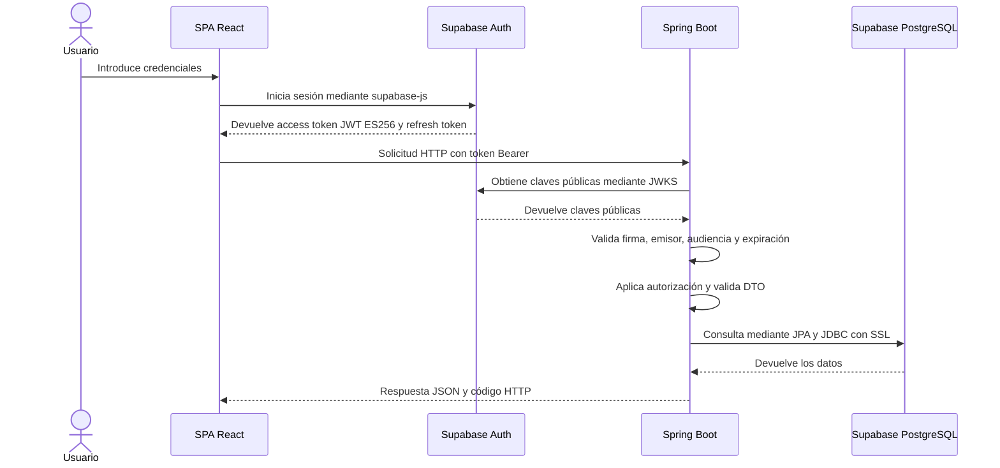

# Arquitectura

Etiquetas de estado: ver `product.md`. El diagrama general de componentes está en `README.md` §2; este archivo define responsabilidades y reglas.

## Estilo arquitectónico [Aprobado]
- Cliente-servidor de tres capas: presentación (SPA en React), lógica de negocio (API REST en Spring Boot) y datos (Supabase PostgreSQL).
- El frontend es una SPA independiente del backend. Solo se comunican mediante HTTP y JSON.
- El backend es un monolito modular: una sola aplicación Spring Boot, desplegada como una unidad, con los módulos `login`, `crm`, `erp` y `sga` separados lógicamente.
- Supabase aporta dos servicios: Auth (identidad y JWT) y PostgreSQL (persistencia).
- El backend Spring Boot se empaqueta y ejecuta en un contenedor Docker; Docker Compose facilita su ejecución local. Supabase permanece como servicio administrado externo y no se dockeriza.
- GitHub Actions automatiza CI: pruebas, compilación y comprobación de la construcción de la imagen. El proyecto se ejecuta en local (`localhost`): no hay despliegue continuo (CD), publicación de imágenes ni entornos de destino.
- Quedan excluidos del MVP los microservicios, las colas de eventos, Kubernetes y cualquier arquitectura distribuida.

## Componentes y responsabilidades
| Componente | Responsabilidades | No debe | Estado |
|---|---|---|---|
| SPA React (Vite, Tailwind CSS, React Router) | Gestiona la sesión, comparte el perfil de `GET /api/me`, presenta las vistas según el rol y envía las consultas y escrituras del CRM a Spring Boot con el token vigente | Acceder directamente a tablas de negocio, decidir la autorización definitiva o ejecutar reglas de negocio del servidor | [Implementado] Acceso, perfil, clientes, contratos, cuentas corporativas y resumen comercial |
| Supabase Auth | Inicio y cierre de sesión, emisión y renovación de JWT (ES256), publicación de las claves públicas (JWKS) | Almacenar datos de negocio | [Implementado] e integrado; flujo validado manualmente en `arise-corp-dev` |
| API Spring Boot | Validar JWT, autorizar por rol, validar entradas, reglas de negocio, transacciones y persistencia | Renderizar vistas; delegar permisos al frontend | JWT, `/api/me`, perfil, autorización por rol, administración de perfiles y Problem Details implementados (tareas 15–18) |
| Supabase PostgreSQL | Persistencia e integridad relacional | Ser modificado por Hibernate; exponer tablas de negocio al frontend | [Implementada] la conexión y `app.perfiles_usuario`; tablas de negocio pendientes |

## Flujo de una petición autenticada

- Estado: [Implementado] el login/perfil frontend (incluido el rol), la validación JWT hasta `GET /api/me`, el perfil empresarial, la autorización por rol, la administración de perfiles y Problem Details. `001-foundation` está cerrada (tareas 1–21); los datos de negocio se construyen en specs posteriores.
- El backend no guarda sesión (`SessionCreationPolicy.STATELESS`): cada petición se autentica solo con su JWT.

## Capas del backend [Aprobado, MVP §9]
Orden de una petición: filtro de Spring Security → Controller → Service → Repository → PostgreSQL.

| Capa | Responsabilidad | Reglas |
|---|---|---|
| Seguridad (`config`) | Autenticación JWT, CORS y reglas de acceso por ruta | Ver `security.md` |
| Controller | Recibir HTTP, validar el DTO de entrada con `@Valid`, delegar en el servicio y devolver el código HTTP y el DTO de respuesta | Sin reglas de negocio ni acceso directo a repositorios |
| Service | Reglas de negocio, autorización fina, transacciones (`@Transactional`), conversión entre entidades y DTO | No depende de tipos HTTP; lanza excepciones de dominio que el manejador global traduce a respuestas |
| Repository | Interfaces de Spring Data JPA | Sin reglas de negocio |
| Entity | Mapeo JPA de las tablas creadas por migraciones | No se expone en la API |

Justificación de que las entidades no salgan de la capa de servicio: con `spring.jpa.open-in-view=false`, serializar una entidad con relaciones perezosas fuera de la transacción falla. Además, exponerla publicaría campos internos y acoplaría el contrato de la API al esquema de la base.

## Módulos [Aprobado]
| Módulo | Contenido | Relaciones con otros módulos |
|---|---|---|
| `login` | Perfil y rol del usuario autenticado (AUTH-04); hoy, `GET /api/me` | Usa el `sub` del JWT emitido por Supabase Auth |
| `crm` | Clientes, cuentas corporativas, contratos | Es el dueño de los datos maestros del cliente |
| `erp` | Empleados, proveedores, facturas o movimientos financieros | Puede relacionar registros financieros con clientes del CRM (ERP-05) |
| `sga` | Drones, paquetes, inventario, historial de estados | Asocia paquetes a clientes y contratos del CRM (SGA-05) |

Todos los módulos dependen de la autorización por rol. ERP y SGA consultan CRM solo a través de sus servicios y para las lecturas cruzadas autorizadas en `product.md`. Las relaciones entre módulos conservan UUID y FK en PostgreSQL; no se crean asociaciones JPA entre módulos.

### Orden de construcción [Aprobado, MVP §13]
1. Constitución del proyecto: alcance, stack, arquitectura y convenciones (estos steering files).
2. Especificación `001-foundation`: autenticación e integración técnica.
3. Integración vertical: inicio de sesión en React, JWT validado en Spring Boot y respuesta de un endpoint protegido.
4. Datos y API: entidades, migraciones, contrato REST, códigos de respuesta y validaciones compartidas.
5. CRM primero, como patrón de referencia; después ERP y SGA con las mismas convenciones.
6. Flujo integrado cliente → contrato → paquete → estado/trazabilidad.
7. Validación final: pruebas, criterios de aceptación y documentación.

## Datos [Aprobado]
- Una única instancia de Supabase PostgreSQL. Las tablas de negocio y perfiles viven en el esquema privado `app`, fuera de los esquemas expuestos por la Data API.
- Spring Boot es el único componente que lee y escribe tablas de negocio, mediante Spring Data JPA/Hibernate sobre JDBC, con el Session pooler y `sslmode=require`.
- React usa Supabase solo para autenticación.
- Supabase Auth gestiona los usuarios en su propio esquema (`auth`). No crear tablas ni modificar objetos en ese esquema. El backend identifica al usuario por el claim `sub` del JWT (UUID).
- El esquema se crea y modifica solo con migraciones (ver `tech.md`).
- Los cambios de estado del paquete generan un registro de historial (SGA-04). Las cantidades de inventario cambian solo mediante operaciones controladas (SGA-03).

## Contenedorización y entrega [Aprobado]
- La unidad contenedorizada inicial es el backend Spring Boot. La imagen se construye desde `backend/Dockerfile`; el proceso y las variables de entorno se describen en `tech.md`.
- El contenedor no incluye `.env`, credenciales, claves privadas ni archivos locales de configuración. Los secretos se inyectan en tiempo de ejecución.
- `docker-compose.yml` facilita la ejecución local del backend. No debe iniciar una base local como sustituto de Supabase, salvo que una especificación de pruebas defina explícitamente una PostgreSQL efímera o aislada.
- GitHub Actions valida el backend y frontend, ejecuta pruebas unitarias y de integración, y comprueba la construcción Docker. El backend se ejecuta en local con Docker Compose; no hay publicación de imagen ni despliegue a un entorno remoto.

## Estrategia de pruebas [Aprobado]
- Las pruebas unitarias verifican reglas y componentes aislados en backend y frontend.
- Las pruebas de integración backend deben verificar la interacción de repositorios/JPA con PostgreSQL real en una instancia aislada o efímera; no se ejecutan contra la base compartida de desarrollo.
- Las pruebas de integración frontend comprueban la colaboración entre componentes, estado de autenticación, cliente HTTP y contrato de API.
- Las pruebas de extremo a extremo validan los flujos críticos completos; su herramienta y automatización se definirán en la especificación correspondiente.
- GitHub Actions ejecuta las suites aplicables y bloquea la integración de un cambio si fallan los controles requeridos.

## Comunicación frontend–backend [Aprobado]
- API REST sobre HTTP con cuerpos JSON. Convenciones en `api-conventions.md`.
- El token de acceso de Supabase viaja en el encabezado `Authorization: Bearer <token>`. No se usan cookies de sesión.
- Desarrollo local: frontend en `http://localhost:5173` y API en `http://localhost:8080`, con CORS configurado en el backend (ver `security.md`).
- La URL base de la API usa `VITE_API_BASE_URL` (DP-TEC-01).

## Decisiones adoptadas
- **DP-ARQ-01:** dependencias unidireccionales `erp → crm` y `sga → crm`; CRM no depende de ERP ni SGA. Se consulta otro módulo mediante su servicio. Las entidades guardan UUIDs de referencia y las FK se definen en PostgreSQL; no hay `@ManyToOne` entre módulos.
- **DP-ARQ-02:** las tablas de negocio se crean en el esquema privado `app`, no expuesto por la Data API. Hibernate y las migraciones seleccionan explícitamente ese esquema. La protección se completa con permisos de base de datos y RLS según `security.md`.
