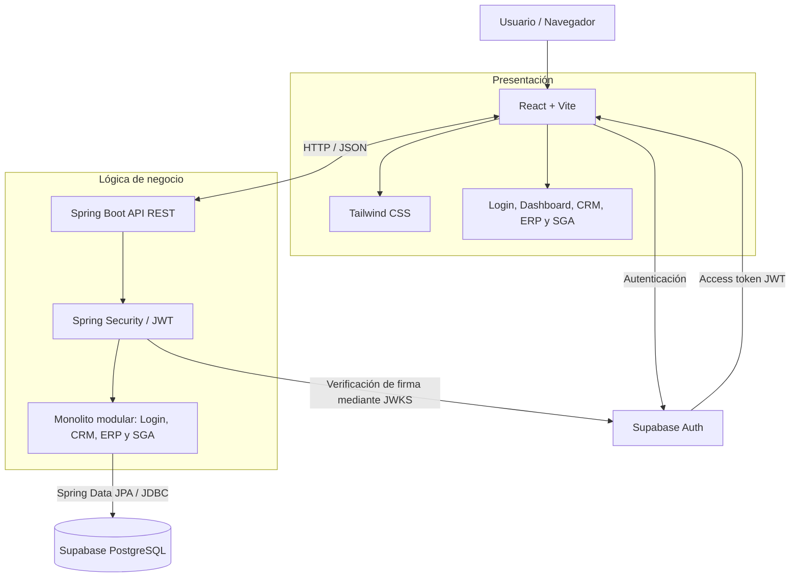

# Arise Corp.

Plataforma web de gestión empresarial para centralizar los procesos comerciales, administrativos y operativos de Arise Corp., empresa colombiana orientada al transporte y entrega de paquetes mediante drones.

> **Estado del proyecto:** infraestructura inicial del backend configurada; conexión de Spring Boot con Supabase PostgreSQL verificada; validación de JWT de Supabase Auth configurada en Spring Security y endpoint protegido `GET /api/me` implementado. La integración completa con React, los módulos funcionales, Docker, las pruebas automatizadas ampliadas y GitHub Actions están planificados para las siguientes etapas.

## 1. Objetivo del proyecto

El MVP busca integrar en una sola aplicación web los procesos principales de Arise Corp. mediante cuatro áreas:

- **Login y autorización:** autenticación de usuarios y control de acceso mediante roles y permisos.
- **CRM:** gestión de clientes, cuentas corporativas y contratos.
- **ERP:** gestión administrativa básica de empleados, proveedores y facturación.
- **SGA:** gestión de drones, paquetes, inventario y trazabilidad.

El objetivo demostrable del MVP es completar el flujo:

**Autenticar usuario → registrar/consultar cliente → asociar contrato → registrar paquete → cambiar su estado → consultar información e historial.**

El MVP no incluye control autónomo de vuelo, navegación, telemetría ni conexión con drones físicos.

## 2. Arquitectura

Se utiliza una arquitectura cliente-servidor de tres capas. El backend será un **monolito modular** desplegado como una sola aplicación Spring Boot; el frontend será una SPA independiente.



### Responsabilidades de cada componente

| Componente | Responsabilidad |
|---|---|
| React | Interfaz, navegación, formularios, estado de sesión y consumo de la API. |
| Supabase Auth | Inicio y cierre de sesión, emisión y renovación de JWT. |
| Spring Boot | API REST, lógica de negocio, validaciones, autorización y transacciones. |
| Spring Security | Validación de los JWT y protección de endpoints. |
| Supabase PostgreSQL | Persistencia e integridad de los datos de negocio. |
| Docker | Empaquetar y ejecutar el backend de forma reproducible. |
| GitHub Actions | Automatizar pruebas, compilación y tareas de entrega. |

React utilizará Supabase para autenticación, pero las operaciones sobre las tablas de negocio se realizarán a través de la API de Spring Boot. El frontend no debe conectarse directamente a PostgreSQL para sustituir la lógica del backend.

### Flujo de autenticación previsto

1. El usuario inicia sesión desde React mediante `@supabase/supabase-js`.
2. Supabase Auth devuelve un access token JWT y un refresh token.
3. React envía el access token en el encabezado `Authorization: Bearer <token>` al consumir la API.
4. Spring Security valida firma, emisor, audiencia y vigencia del JWT mediante las claves públicas JWKS de Supabase.
5. Spring Boot aplica la autorización correspondiente, ejecuta la lógica de negocio y consulta PostgreSQL.

El claim técnico `role` de Supabase (por ejemplo, `authenticated`) no representa los roles empresariales de Arise Corp. Estos se definirán y aplicarán en el backend.

## 3. Tecnologías

| Área | Tecnología | Uso |
|---|---|---|
| Frontend | React + Vite | Aplicación web SPA. |
| Estilos | Tailwind CSS | Diseño visual y estilos. |
| Navegación | React Router | Rutas y vistas. |
| Cliente Supabase | `@supabase/supabase-js` | Autenticación desde React. |
| Backend | Java 21 + Spring Boot 4.1.2 | API REST y lógica de negocio. |
| Seguridad | Spring Security + OAuth2 Resource Server | Protección de endpoints y validación JWT. |
| Persistencia | Spring Data JPA / Hibernate | Acceso a datos desde el backend. |
| Base de datos | Supabase PostgreSQL | Persistencia centralizada. |
| Autenticación | Supabase Auth | Identidad y emisión de JWT. |
| Construcción backend | Maven Wrapper | Compilación, pruebas y ejecución. |
| Contenedores | Docker y Docker Compose | Empaquetado y ejecución local del backend. |
| Automatización | GitHub Actions | CI y tareas automatizadas de entrega. |
| Registro de imágenes | GitHub Container Registry (GHCR) | Publicación de imágenes Docker, sujeto a la configuración final del pipeline. |
| Metodología | Spec-Driven Development (SDD) con Kiro | Requisitos, diseño, tareas e implementación. |
| Control de versiones | Git y GitHub | Versionamiento y colaboración. |

Las versiones y dependencias adicionales que aún no estén aprobadas se definirán en las especificaciones correspondientes antes de incorporarse al proyecto.

## 4. Estado actual del desarrollo

### Implementado o configurado
- Backend Spring Boot 4.1.2 con Java 21 y Maven Wrapper.
- Conexión de Spring Boot con Supabase PostgreSQL mediante Session Pooler.
- Configuración local mediante `backend/.env`, plantilla `backend/.env.example` y exclusión de secretos en Git.
- Proveedor Email de Supabase Auth habilitado; registro público desactivado y confirmación de correo habilitada.
- Spring Security como OAuth2 Resource Server, configurado para validar JWT ES256 mediante JWKS, emisor y audiencia.
- Endpoint protegido de prueba `GET /api/me`.
- CORS configurado para el frontend local en `http://localhost:5173`.
- Steering Files de Kiro para producto, tecnología, estructura, arquitectura, API, seguridad y flujo SDD.

### Pendiente de implementación o validación
- Prueba completa de autenticación desde React hasta Spring Boot con un usuario real.
- Inicialización del frontend React y conexión con Supabase Auth y la API.
- Modelo de perfiles, roles empresariales y autorización por módulo.
- Migraciones iniciales y tablas de negocio.
- Pruebas unitarias ampliadas de backend y frontend.
- Pruebas de integración con PostgreSQL aislado.
- Dockerfile, `.dockerignore` y Docker Compose del backend.
- Workflows de GitHub Actions para CI y construcción de imagen.
- Publicación de imágenes Docker y despliegue automático, sujetos a las decisiones de infraestructura.

> Los elementos de la estructura y del roadmap marcados como planificados no deben interpretarse como funcionalidades ya disponibles.

## 5. Estructura del repositorio

Estructura actual y objetivo a medida que se incorporen las etapas de desarrollo:

```text
arise-corp/
├── .github/
│   └── workflows/
│       ├── backend-ci.yml              # Planificado
│       ├── frontend-ci.yml             # Planificado
│       ├── integration-tests.yml       # Planificado
│       └── cd.yml                      # Planificado
│
├── .kiro/
│   ├── steering/
│   │   ├── product.md
│   │   ├── tech.md
│   │   ├── structure.md
│   │   ├── architecture.md
│   │   ├── api-conventions.md
│   │   ├── security.md
│   │   └── sdd-workflow.md
│   └── specs/
│       └── 001-foundation/             # Primera especificación por desarrollar
│           ├── requirements.md
│           ├── design.md
│           └── tasks.md
│
├── backend/
│   ├── .env                            # Local; no versionar
│   ├── .env.example                    # Plantilla versionada
│   ├── Dockerfile                      # Planificado
│   ├── .dockerignore                   # Planificado
│   ├── pom.xml
│   ├── mvnw
│   ├── mvnw.cmd
│   └── src/
│       ├── main/
│       │   ├── java/com/arise/corp/
│       │   │   ├── config/
│       │   │   │   └── SecurityConfig.java
│       │   │   ├── controller/
│       │   │   │   └── AuthController.java
│       │   │   └── AriseBackendApplication.java
│       │   └── resources/
│       │       └── application.properties
│       └── test/
│           └── java/com/arise/corp/
│               └── AriseBackendApplicationTests.java
│
├── frontend/
│   └── .gitkeep                       # React por inicializar
│
├── supabase/
│   └── migrations/
│       └── .gitkeep                   # Migraciones por incorporar
│
├── docs/
│   └── def_MVP/
│       └── MVP_Arise_Corp.md
│
├── docker-compose.yml                 # Planificado
├── .gitignore
└── README.md
```

Los archivos marcados como **Planificado** representan la estructura objetivo, no componentes que ya estén implementados. Los Steering Files de `.kiro/steering/` contienen las reglas permanentes del proyecto; las especificaciones funcionales se desarrollan en `.kiro/specs/`.

## 6. Equipo y división de responsabilidades

El equipo está compuesto por tres integrantes. Las responsabilidades principales son:

### Sebastián Pardo Tirado — Backend, seguridad, CRM y Docker

- Estructura y desarrollo del backend Spring Boot.
- Integración Supabase Auth, Spring Security y validación JWT.
- Perfiles, roles, permisos y convenciones de API.
- Manejo global de errores y seguridad de endpoints.
- Desarrollo del backend CRM: clientes, cuentas corporativas y contratos.
- Desarrollo de facturación básica del ERP.
- Dockerización del backend: `Dockerfile`, `.dockerignore` y `docker-compose.yml`.
- Pruebas unitarias del backend relacionadas con seguridad, CRM y lógica asignada.
- **Diseño e implementación de las pruebas de integración con PostgreSQL**, incluyendo persistencia, relaciones, restricciones y transacciones.
- Coordinación técnica de la integración backend–frontend.

### Davidson Sánchez Gordillo — Backend, datos, ERP, SGA y GitHub Actions

- Diseño del modelo entidad-relación.
- Diseño y mantenimiento de migraciones SQL versionadas.
- Entidades, repositorios y servicios de acceso a datos.
- Desarrollo de empleados y proveedores del ERP.
- Desarrollo de drones, paquetes, inventario y trazabilidad del SGA.
- Pruebas unitarias de servicios y reglas de negocio de los módulos asignados.
- **Configuración y mantenimiento de GitHub Actions**.
- Automatización de pruebas, compilación y construcción del backend y frontend.
- Automatización de la construcción y publicación de imágenes Docker.
- Preparación de los workflows de CI/CD y coordinación de su integración.

### Paula Isabella Martínez Escalante — Frontend

- Inicialización y configuración de React, Vite y Tailwind CSS.
- Configuración de React Router y estructura de carpetas del frontend.
- Configuración de `@supabase/supabase-js`.
- Implementación de Login, Logout, AuthContext y persistencia de sesión.
- Implementación de rutas protegidas y control de acceso visual.
- Desarrollo de Navbar, Sidebar y Dashboard.
- Interfaces de CRM, ERP y SGA.
- Integración del frontend con la API REST de Spring Boot.
- Pruebas unitarias de componentes, formularios, hooks y servicios HTTP.
- Pruebas de integración del frontend.
- Colaboración con Davidson para incorporar las pruebas frontend en GitHub Actions.

### Responsabilidades compartidas

| Actividad | Responsable principal | Colaboradores |
|---|---|---|
| Especificaciones y contratos de API | Sebastián | Paula y Davidson |
| Modelo de datos y migraciones | Davidson | Sebastián |
| Docker del backend | Sebastián | Davidson |
| Pruebas de integración PostgreSQL | Sebastián | Davidson |
| GitHub Actions y CI/CD | Davidson | Sebastián y Paula |
| Pruebas unitarias frontend | Paula | — |
| Pruebas de extremo a extremo | Los tres | Los tres |
| Integración funcional y validación del MVP | Los tres | Los tres |

La asignación concreta de tareas debe quedar registrada en `tasks.md` de cada especificación, con responsable, área y requisitos relacionados.

## 7. Plan de desarrollo por etapas

El desarrollo se realizará de forma incremental. Las pruebas se incorporarán desde el inicio de cada funcionalidad y no se dejarán exclusivamente para el cierre del proyecto.

### Etapa 1 — Foundation y autenticación

**Objetivo:** completar la integración vertical entre React, Supabase Auth y Spring Boot.

Actividades:
- Crear y aprobar la especificación `001-foundation`.
- Inicializar React, Vite y Tailwind CSS.
- Configurar Supabase JS en el frontend.
- Implementar Login, Logout y gestión de sesión.
- Validar JWT en Spring Security.
- Verificar el endpoint protegido `GET /api/me`.
- Definir el modelo inicial de perfiles y roles.
- Definir los contratos de integración entre frontend y backend.

**Responsables:** los tres integrantes.

**Entregable:** un usuario autorizado puede iniciar sesión en React, obtener un JWT y consumir `/api/me` en Spring Boot.

### Etapa 2 — Infraestructura, Docker y automatización de calidad

**Objetivo:** conseguir un entorno reproducible y automatizar las validaciones del proyecto.

**Sebastián:**
- Crear el `Dockerfile` multi-stage del backend.
- Crear `.dockerignore`.
- Configurar Docker Compose para ejecutar Spring Boot.
- Inyectar las variables de entorno en tiempo de ejecución, sin copiar `.env` a la imagen.
- Preparar pruebas de integración con PostgreSQL.

**Davidson:**
- Configurar GitHub Actions para backend y frontend.
- Automatizar instalación, compilación y ejecución de pruebas.
- Automatizar la construcción de la imagen Docker.
- Preparar publicación de imágenes en GHCR, una vez aprobada su configuración.

**Paula:**
- Configurar las herramientas de pruebas unitarias del frontend.
- Crear pruebas de componentes, formularios y servicios.
- Preparar los comandos de test y build que utilizará GitHub Actions.

**Entregable:** backend ejecutable en Docker y pipeline de CI que valida el backend y frontend. El despliegue automático queda sujeto a la selección del ambiente de hosting.

### Etapa 3 — Base de datos y autorización

**Objetivo:** establecer la estructura persistente y el control de acceso empresarial.

Actividades:
- Aprobar el modelo entidad-relación.
- Definir y crear las migraciones iniciales.
- Implementar perfiles y roles.
- Definir la matriz de permisos por módulo y operación.
- Implementar autorización en Spring Security.
- Definir restricciones e integridad referencial en PostgreSQL.
- Incorporar manejo global de errores.
- Preparar pruebas unitarias y de integración de persistencia y seguridad.

**Responsable principal:** Davidson para datos y migraciones; Sebastián para autorización, pruebas PostgreSQL y seguridad; Paula para la representación de permisos en la interfaz.

**Entregable:** base de datos inicial versionada y usuarios con perfiles y permisos aplicados desde el backend.

### Etapa 4 — Desarrollo del CRM

**Objetivo:** implementar el primer módulo funcional y utilizarlo como patrón para los demás.

Actividades:
- Gestión de clientes: crear, listar, consultar, editar y desactivar.
- Gestión de cuentas corporativas, según alcance aprobado.
- Gestión de contratos y estados.
- Validaciones de campos y duplicados.
- Interfaces de listado, formularios y detalle.
- Pruebas unitarias, de integración y de autorización.

**Responsables:** Sebastián (backend), Paula (frontend) y Davidson (modelo de datos y migraciones).

**Entregable:** módulo CRM funcional con información persistida en PostgreSQL.

### Etapa 5 — Desarrollo del SGA

**Objetivo:** implementar las operaciones de inventario y trazabilidad.

Actividades:
- Gestión de drones.
- Gestión de paquetes.
- Gestión de inventario y movimientos controlados.
- Asociación de paquetes con clientes, contratos y drones.
- Registro y consulta del historial de estados.
- Validación de transiciones y restricciones.
- Interfaces de operaciones e inventario.
- Pruebas unitarias, de integración y de autorización.

**Responsables:** Davidson (backend y datos), Paula (frontend) y Sebastián (seguridad e integración).

**Entregable:** módulo SGA funcional, con paquetes, inventario y trazabilidad persistidos.

### Etapa 6 — Desarrollo del ERP

**Objetivo:** implementar la gestión administrativa y financiera básica.

Actividades:
- Gestión de empleados.
- Gestión de proveedores.
- Facturas o movimientos financieros básicos.
- Relaciones con clientes y proveedores, según alcance aprobado.
- Interfaces administrativas y financieras.
- Pruebas unitarias, de integración y de autorización.

**Responsables:** Davidson (empleados y proveedores), Sebastián (facturación), Paula (frontend).

**Entregable:** módulo ERP funcional con registros administrativos y financieros básicos.

### Etapa 7 — Integración final, validación y despliegue

**Objetivo:** comprobar que el MVP funciona como una solución integrada y preparar su entrega.

Actividades:
- Integrar Login, CRM, ERP y SGA.
- Completar el flujo cliente → contrato → paquete → cambio de estado → trazabilidad.
- Ejecutar pruebas unitarias, de integración y de extremo a extremo.
- Validar roles, permisos y respuestas HTTP.
- Ejecutar todos los workflows de GitHub Actions.
- Construir y versionar la imagen Docker final.
- Configurar el despliegue automático cuando el hosting esté definido.
- Actualizar README, especificaciones y documentación de instalación.
- Preparar la demostración académica del MVP.

**Responsables:** los tres integrantes.

**Entregable:** MVP integrado, probado, documentado y listo para demostración.

## 8. Estrategia de pruebas

Se adoptarán tres niveles de pruebas:

| Nivel | Backend | Frontend |
|---|---|---|
| Unitarias | Servicios, reglas de negocio, validaciones y componentes de seguridad aislados | Componentes, hooks, formularios y funciones de servicios |
| Integración | Controladores, servicios, repositorios, Spring Security y PostgreSQL | Componentes, contexto de autenticación, servicios HTTP y respuestas de API |
| Extremo a extremo (E2E) | Participa exponiendo la API y persistencia | Recorrido completo desde la interfaz |

### Criterios generales

- Las pruebas unitarias deben ejecutarse sin depender de la instancia compartida de Supabase.
- Las pruebas de seguridad pueden simular JWT y authorities; no necesitan tokens reales.
- Las pruebas de integración con PostgreSQL deben utilizar una base de pruebas aislada y no modificar la base compartida de desarrollo.
- Las pruebas E2E validarán flujos completos y se incorporarán progresivamente.
- Las pruebas deben cubrir casos exitosos, validaciones, errores y permisos.
- Las herramientas concretas se aprobarán en las especificaciones correspondientes. Testcontainers es una alternativa propuesta para PostgreSQL; su incorporación requiere aprobación como dependencia.

## 9. Docker y ejecución del backend

El backend se empaquetará mediante un Dockerfile multi-stage:

- Etapa de construcción: Maven y JDK 21.
- Etapa de ejecución: imagen de runtime Java 21.
- Las credenciales se inyectan al iniciar el contenedor.
- El archivo `.env` no debe copiarse a la imagen.
- Docker Compose permitirá iniciar el backend localmente.
- Supabase PostgreSQL continuará siendo un servicio externo administrado; no se dockerizará la base de datos de Supabase.

Los archivos previstos son:

```text
backend/
├── Dockerfile
└── .dockerignore

docker-compose.yml
```

Estos archivos se incorporarán durante la etapa 2.

## 10. Integración continua y entrega (GitHub Actions)

Davidson será responsable de configurar y mantener los workflows de GitHub Actions.

Estructura prevista:

```text
.github/
└── workflows/
    ├── backend-ci.yml
    ├── frontend-ci.yml
    ├── integration-tests.yml
    └── cd.yml
```

Los workflows deberán cubrir progresivamente:

1. Instalación de dependencias.
2. Compilación del backend.
3. Ejecución de pruebas unitarias.
4. Ejecución de pruebas de integración.
5. Pruebas y build del frontend.
6. Construcción de la imagen Docker.
7. Publicación de imagen en GHCR, si se aprueba.
8. Despliegue automático al ambiente configurado.

**CI** se implementará durante la etapa 2. El **CD hacia un hosting** se completará cuando el equipo seleccione y configure el proveedor y los ambientes de despliegue.

Los secretos de GitHub Actions se gestionarán mediante GitHub Secrets o variables de configuración apropiadas. Nunca se escribirán credenciales en workflows, logs, imágenes Docker o repositorio.

## 11. Configuración local del backend

### 10.1 Requisitos previos

- Git.
- JDK 21.
- Acceso al repositorio.
- Acceso autorizado al proyecto Supabase `arise-corp-dev`.
- PowerShell en Windows (los comandos pueden adaptarse a macOS/Linux).

### 10.2 Clonar el repositorio

```bash
git clone https://github.com/SebastianUD/arise-corp.git
cd arise-corp
```

### 10.3 Crear el archivo `.env`

Desde la raíz del repositorio, en PowerShell:

```powershell
Copy-Item .\backend\.env.example .\backend\.env
```

Completar `backend/.env` con los datos de conexión reales del proyecto Supabase:

```properties
SUPABASE_DB_HOST=YOUR_POOLER_HOST
SUPABASE_DB_PORT=5432
SUPABASE_DB_NAME=postgres
SUPABASE_DB_USERNAME=YOUR_POOLER_USERNAME
SUPABASE_DB_PASSWORD=YOUR_DATABASE_PASSWORD
SUPABASE_URL=https://YOUR_PROJECT_REF.supabase.co
```

Usar los valores exactos de Supabase Dashboard → Connect → Session pooler. La contraseña es la de PostgreSQL, no la contraseña de la cuenta de Supabase.

Cada integrante debe crear su propio archivo `.env`. No compartirlo mediante GitHub ni incluirlo en commits.

### 10.4 Configuración de Spring

`backend/src/main/resources/application.properties` importa el archivo local `.env` mediante Spring Boot:

```properties
spring.config.import=optional:file:./.env[.properties]

spring.application.name=arise-backend

# Supabase PostgreSQL
spring.datasource.url=jdbc:postgresql://${SUPABASE_DB_HOST}:${SUPABASE_DB_PORT}/${SUPABASE_DB_NAME}?sslmode=require
spring.datasource.username=${SUPABASE_DB_USERNAME}
spring.datasource.password=${SUPABASE_DB_PASSWORD}
spring.datasource.driver-class-name=org.postgresql.Driver

# JPA / Hibernate
spring.jpa.hibernate.ddl-auto=none
spring.jpa.open-in-view=false

# Supabase Auth - JWT
spring.security.oauth2.resourceserver.jwt.issuer-uri=${SUPABASE_URL}/auth/v1
spring.security.oauth2.resourceserver.jwt.jwk-set-uri=${SUPABASE_URL}/auth/v1/.well-known/jwks.json
spring.security.oauth2.resourceserver.jwt.jws-algorithms=ES256
spring.security.oauth2.resourceserver.jwt.audiences[0]=authenticated
```

El archivo `.env` se resuelve respecto al directorio de trabajo. Por eso los comandos Maven deben ejecutarse desde `backend/`.

### 10.5 Ejecutar pruebas e iniciar Spring Boot

En PowerShell:

```powershell
cd backend
.\mvnw.cmd test
.\mvnw.cmd spring-boot:run
```

La API se ejecuta por defecto en:

```text
http://localhost:8080
```

Para detener el servidor, utilizar `Ctrl + C`.

El comando `spring-boot:run` mantiene el proceso activo porque inicia el servidor web.

## 12. Seguridad y manejo de secretos

- Nunca versionar `backend/.env`.
- Versionar únicamente `.env.example` con marcadores de posición.
- No incluir contraseñas, tokens JWT, claves `secret` o `service_role` en el código, documentación o workflows.
- Las variables `VITE_*` son públicas porque se incorporan al bundle del navegador. Solo deben contener valores publicables.
- La clave publishable de Supabase puede utilizarse en el frontend; las claves secretas son exclusivas del servidor.
- No copiar el archivo `.env` dentro de imágenes Docker.
- No imprimir credenciales ni tokens en logs de aplicación o GitHub Actions.
- Si un secreto se expone, debe rotarse o revocarse inmediatamente.

## 13. Metodología de desarrollo SDD con Kiro

El desarrollo seguirá Specification-Driven Development (SDD).

Cada funcionalidad tendrá una especificación en `.kiro/specs/<nombre>/` con:

```text
requirements.md
design.md
tasks.md
```

El ciclo de trabajo será:

1. Definir requisitos e historias de usuario con criterios de aceptación verificables.
2. Aclarar dudas y casos límite con el equipo.
3. Diseñar arquitectura, API, datos, seguridad e interfaz.
4. Dividir la implementación en tareas pequeñas y asignar responsables.
5. Implementar las tareas con apoyo de Kiro y revisar los cambios generados.
6. Ejecutar pruebas y validar los criterios de aceptación.
7. Actualizar la especificación y documentación si cambia el comportamiento.

Los Steering Files de `.kiro/steering/` son el contexto permanente del proyecto. Las especificaciones aprobadas son la referencia común para frontend y backend.

La primera especificación será `001-foundation`, centrada en completar la integración de autenticación e infraestructura.

## 14. Git y colaboración

- `main` es la rama estable e integrada.
- Para el desarrollo habitual se crea una rama por tarea o especificación, por ejemplo `feat/auth-foundation`, `feat/crm-clientes` o `fix/db-config`.
- Los cambios funcionales se integran mediante Pull Requests y revisión de al menos otro integrante.
- El autor no aprueba su propio Pull Request.
- No incluir `.env` ni credenciales en commits.
- Las especificaciones SDD y el código deben mantenerse sincronizados.
- Los cambios de base de datos deben acompañarse de su migración versionada.

### Definition of Done

Una funcionalidad se considera terminada cuando:

- Sus requisitos, criterios de aceptación y diseño están aprobados.
- El código respeta la arquitectura y convenciones acordadas.
- Las pruebas unitarias y de integración acordadas pasan.
- Los casos de error y permisos están cubiertos cuando corresponda.
- La documentación, configuración y especificación están actualizadas.
- El cambio fue revisado e integrado en Git.
- No contiene secretos ni credenciales.

## 15. Decisiones técnicas pendientes

Las siguientes decisiones deben resolverse en las especificaciones SDD antes de implementarlas como definitivas:

- Herramientas y versiones concretas del frontend, incluyendo framework de pruebas y cliente HTTP.
- Herramienta para pruebas de integración PostgreSQL (Testcontainers es una propuesta).
- Herramienta y procedimiento para crear y aplicar migraciones SQL.
- Almacenamiento de roles empresariales y mecanismo de autorización.
- Estrategia para bloquear el acceso directo a las tablas de negocio mediante Supabase Data API.
- Registro de imágenes Docker y configuración de GHCR.
- Proveedor de hosting, ambientes y despliegue automático.
- Estrategia definitiva de cobertura y criterios de calidad del pipeline.

Las decisiones pendientes no deben implementarse como definitivas sin aprobación del equipo.

---

**Arise Corp.**  
Proyecto académico — Construcción de Software  
Repositorio: https://github.com/SebastianUD/arise-corp
