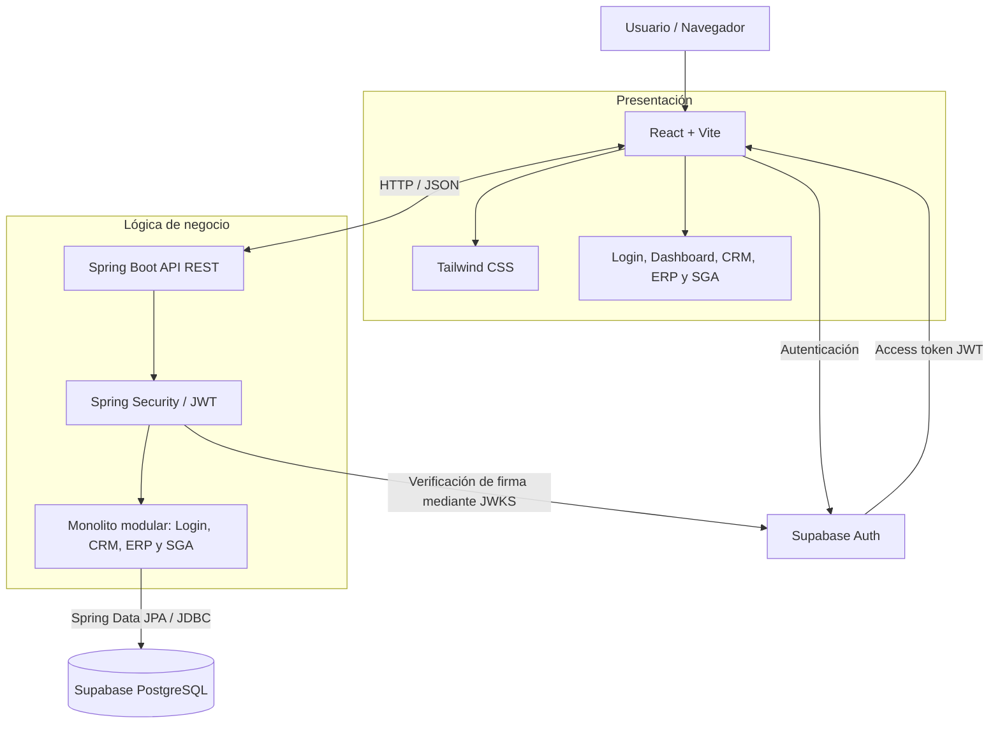

# Arise Corp.

Plataforma web de gestión empresarial para centralizar los procesos comerciales, administrativos y operativos de Arise Corp., empresa colombiana orientada al transporte y entrega de paquetes mediante drones.

> **Estado del proyecto:** `001-foundation` está completada y `002-crm-clientes-contratos` tiene el backend, el frontend, la migración, Docker y CI implementados; quedan la validación extremo a extremo y la entrega del PR. El resumen vigente y las próximas funcionalidades están en `.kiro/steering/product.md`.

## 1. Objetivo del proyecto

El MVP busca integrar en una sola aplicación web los procesos principales de Arise Corp. mediante cuatro áreas:

- **Login y autorización:** autenticación de usuarios y control de acceso mediante roles y permisos.
- **CRM:** gestión de clientes, cuentas corporativas y contratos.
- **ERP:** gestión administrativa básica de empleados, proveedores y facturación.
- **SGA:** gestión de drones, paquetes, inventario y trazabilidad.

El objetivo demostrable del MVP es completar el flujo:

**Autenticar usuario → registrar/consultar cliente → asociar contrato → registrar paquete → cambiar su estado → consultar información e historial.**

El MVP no incluye control autónomo de vuelo, navegación, telemetría ni conexión con drones físicos.

## 2. Arquitectura

Se utiliza una arquitectura cliente-servidor de tres capas. El backend será un **monolito modular** desplegado como una sola aplicación Spring Boot; el frontend será una SPA independiente.



### Responsabilidades de cada componente

| Componente | Responsabilidad |
|---|---|
| React | Interfaz, navegación, formularios, estado de sesión y consumo de la API. |
| Supabase Auth | Inicio y cierre de sesión, emisión y renovación de JWT. |
| Spring Boot | API REST, lógica de negocio, validaciones, autorización y transacciones. |
| Spring Security | Validación de los JWT y protección de endpoints. |
| Supabase PostgreSQL | Persistencia e integridad de los datos de negocio. |
| Docker | Empaquetar y ejecutar el backend de forma reproducible en local. |
| GitHub Actions | CI: automatizar pruebas, compilación y comprobación del build de la imagen. |

React utilizará Supabase para autenticación, pero las operaciones sobre las tablas de negocio se realizarán a través de la API de Spring Boot. El frontend no debe conectarse directamente a PostgreSQL para sustituir la lógica del backend.

### Flujo de autenticación previsto

1. El usuario inicia sesión desde React mediante `@supabase/supabase-js`.
2. Supabase Auth devuelve un access token JWT y un refresh token.
3. React envía el access token en el encabezado `Authorization: Bearer <token>` al consumir la API.
4. Spring Security valida firma, emisor, audiencia y vigencia del JWT mediante las claves públicas JWKS de Supabase.
5. Spring Boot aplica la autorización correspondiente, ejecuta la lógica de negocio y consulta PostgreSQL.

El claim técnico `role` de Supabase (por ejemplo, `authenticated`) no representa los roles empresariales de Arise Corp. Se almacenan en perfiles de negocio y se aplican en el backend conforme a la matriz de `.kiro/steering/product.md`.

## 3. Tecnologías

| Área | Tecnología | Uso |
|---|---|---|
| Frontend | React + Vite | Aplicación web SPA. |
| Estilos | Tailwind CSS | Diseño visual y estilos. |
| Navegación | React Router | Rutas y vistas. |
| Cliente Supabase | `@supabase/supabase-js` | Autenticación desde React. |
| Backend | Java 21 + Spring Boot 4.1.2 | API REST y lógica de negocio. |
| Seguridad | Spring Security + OAuth2 Resource Server | Protección de endpoints y validación JWT. |
| Persistencia | Spring Data JPA / Hibernate | Acceso a datos desde el backend. |
| Base de datos | Supabase PostgreSQL | Persistencia centralizada. |
| Autenticación | Supabase Auth | Identidad y emisión de JWT. |
| Construcción backend | Maven Wrapper | Compilación, pruebas y ejecución. |
| Contenedores | Docker y Docker Compose | Empaquetado y ejecución local del backend. |
| Automatización | GitHub Actions | CI: validación, pruebas y build de la imagen. |
| Metodología | Spec-Driven Development (SDD) con Kiro | Requisitos, diseño, tareas e implementación. |
| Control de versiones | Git y GitHub | Versionamiento y colaboración. |

Las versiones y dependencias adicionales que aún no estén aprobadas se definirán en las especificaciones correspondientes antes de incorporarse al proyecto.

## 4. Estado actual del desarrollo

El estado implementado y las próximas funcionalidades se mantienen en `.kiro/steering/product.md`. La spec `001-foundation` está cerrada y `002-crm-clientes-contratos` tiene implementados el backend, el frontend, la migración, Docker y CI; sus tareas pendientes son la validación extremo a extremo con Supabase real, los checkpoints finales y la entrega del PR. Las tareas y evidencias de verificación se conservan en `.kiro/specs/`. Este README concentra instalación y uso.

El proyecto se ejecuta localmente (`localhost`) con el backend en Docker Compose o con Maven, y el frontend con Vite. No incluye CD, publicación de imágenes ni entornos remotos.

## 5. Estructura del repositorio

Estructura actual:

```text
arise-corp/
├── .github/
│   └── workflows/
│       ├── backend-ci.yml              # Pruebas con H2 y build de la imagen
│       ├── frontend-ci.yml             # Vitest, build y comprobación de secretos
│       └── integration-tests.yml       # Maven verify con PostgreSQL efímero
│
├── .kiro/
│   ├── steering/                       # Reglas permanentes del proyecto
│   └── specs/
│       ├── 001-foundation/             # Autenticación, perfil y errores (cerrada)
│       └── 002-crm-clientes-contratos/ # CRM de clientes, cuentas y contratos
│
├── backend/
│   ├── .env                            # Local; no versionar
│   ├── .env.example                    # Plantilla versionada
│   ├── Dockerfile                      # Imagen multi-stage del backend
│   ├── .dockerignore                   # Excluye secretos y archivos innecesarios
│   ├── pom.xml
│   ├── mvnw
│   ├── mvnw.cmd
│   └── src/
│       ├── main/
│       │   ├── java/com/arise/corp/
│       │   │   ├── AriseBackendApplication.java
│       │   │   ├── config/                    # SecurityConfig, CORS y converter JWT de rol
│       │   │   ├── login/                     # Perfil y administración de usuarios
│       │   │   ├── crm/                       # clientes, contratos y cuentas corporativas
│       │   │   └── shared/                    # error, normalizacion, paginacion y validacion
│       │   └── resources/
│       │       └── application.properties
│       └── test/
│           ├── java/com/arise/corp/           # *Tests con Surefire y H2
│           └── java/com/arise/corp/integration/ # *IT con Failsafe y Testcontainers
│
├── frontend/
│   ├── package.json                   # React/Vite y herramientas de prueba
│   └── src/                            # login, perfil, sesión y vistas CRM
│
├── supabase/
│   └── migrations/
│       ├── 20261108000000_app_perfiles_usuario.sql
│       └── 20261111120000_app_crm_clientes_contratos.sql
│
├── docs/
│   └── def_MVP/
│       └── MVP_Arise_Corp.md
│
├── docker-compose.yml                 # Servicio backend para ejecución local
├── .gitignore
└── README.md
```

Los Steering Files de `.kiro/steering/` contienen las reglas permanentes del proyecto; las especificaciones funcionales se desarrollan en `.kiro/specs/`.

## 6. Equipo y responsabilidades

La asignación vigente de responsabilidades está en `.kiro/steering/sdd-workflow.md`. Cada spec registra responsable, área y requisitos en `tasks.md`.

## 7. Roadmap

El roadmap y el avance detallado viven en `.kiro/steering/architecture.md` y `.kiro/steering/product.md`. El orden acordado es:

1. Completar `001-foundation`: autenticación, perfil, roles, errores y validación con Supabase real.
2. Definir e implementar la base de datos y API transversal.
3. Construir CRM como primer módulo.
4. Completar ERP y SGA conforme a Must/Should del MVP.
5. Validar el flujo cliente → contrato → paquete → trazabilidad y preparar la entrega local.

## 8. Estrategia de pruebas

Los comandos locales están en §11.5 y §11.6; decisiones y responsabilidades por tipo de prueba están en `.kiro/steering/tech.md`.

- `.\mvnw.cmd test` ejecuta Surefire: pruebas unitarias, de contexto y de seguridad con H2. No necesita Docker ni Supabase.
- `.\mvnw.cmd verify` ejecuta además Failsafe: pruebas de integración `*IT` contra PostgreSQL efímero con Testcontainers. Requiere Docker en ejecución y nunca escribe en `arise-corp-dev`.
- El workflow `integration-tests` ejecuta `verify` en CI usando el Docker del runner. Ninguna suite recibe credenciales de Supabase.

La validación manual con Supabase real se realiza por separado y no utiliza credenciales en CI.

## 9. Docker y ejecución del backend

El backend se empaqueta mediante un Dockerfile multi-stage:

- Etapa de construcción: Maven y JDK 21. Compila con `./mvnw -Dmaven.test.skip=true` y reutiliza la caché de BuildKit para `~/.m2`.
- Etapa de ejecución: `eclipse-temurin:21-jre` con un usuario `arise` sin privilegios, solo el JAR, `EXPOSE 8080` y sin variables de configuración.
- Las credenciales se inyectan al iniciar el contenedor mediante `env_file`.
- El archivo `.env` no se copia a la imagen; `.dockerignore` lo excluye junto con `src/test/`, `target/` y archivos de IDE.
- Supabase PostgreSQL sigue siendo un servicio externo administrado; no se dockeriza.

Los archivos son:

```text
backend/
├── Dockerfile
└── .dockerignore

docker-compose.yml
```

Comandos, desde la raíz del repositorio (requiere Docker Compose 2.24 o posterior):

```powershell
docker compose build backend
docker compose up backend
docker build -t arise-backend:local backend
```

- `docker compose up backend` lee `backend/.env` en tiempo de ejecución con `env_file` (`required: true`). Sin ese archivo Compose no arranca el servicio.
- `docker build -t arise-backend:local backend` no necesita credenciales ni conexión a Supabase; la imagen solo contiene el JAR.
- `backend/.env` se lee a la vez por Compose y por Spring Boot. Para que ambos obtengan el mismo valor, el archivo no debe usar comillas ni contener `$`; si la contraseña de la base lo contiene, se restablece en Supabase con una que no lo contenga.
- La aplicación usa `ddl-auto=validate`, así que la migración del CRM debe estar aplicada en `arise-corp-dev` antes de arrancar el contenedor.
- Comprobación con el contenedor en ejecución:

```powershell
curl -i http://localhost:8080/api/me
```

Debe responder `401` con el encabezado `WWW-Authenticate`. El puerto se publica solo en `127.0.0.1`, de modo que la API no se expone a la red local.

## 10. Integración continua (GitHub Actions)

El CI está implementado en `.github/workflows/` con tres workflows independientes. Los tres se ejecutan con `push` a cualquier rama (`branches: ['**']`), con `pull_request` hacia `main` y con `workflow_dispatch`; cada uno cancela la ejecución anterior de la misma rama (`concurrency` con `cancel-in-progress`) y declara `permissions: contents: read`.

| Workflow | Comandos | Alcance |
|---|---|---|
| `backend-ci` (`backend-ci.yml`) | `./mvnw -B test` y `docker build --pull -t arise-backend:ci .` desde `backend/` | Pruebas unitarias, de contexto y de seguridad con H2 (Surefire, sin Docker) y construcción de la imagen del backend sin publicarla. Configura Temurin 21 con caché de Maven. `timeout-minutes: 20`. |
| `integration-tests` (`integration-tests.yml`) | `./mvnw -B verify` desde `backend/` | Pruebas unitarias y de integración con PostgreSQL efímero (Failsafe + Testcontainers) usando el Docker del runner. `timeout-minutes: 30`. |
| `frontend-ci` (`frontend-ci.yml`) | `npm ci`, `npm test`, `npm run build` y `npm run check:secrets` desde `frontend/` | Pruebas Vitest, build del bundle con variables `VITE_*` ficticias declaradas solo en el paso de build y verificación de ausencia de credenciales en fuente, plantilla y bundle. Usa la versión de `frontend/.nvmrc` con caché de npm. `timeout-minutes: 15`. |

Todos los workflows usan solo acciones oficiales (`actions/checkout@v7`, `actions/setup-java@v6`, `actions/setup-node@v7`), con `persist-credentials: false`. No usan GitHub Secrets ni credenciales de `arise-corp-dev`, no inician sesión en registros, no publican imágenes ni despliegan: el proyecto se ejecuta en local (`localhost`) y el alcance es únicamente CI.

En la protección de `main` los checks `backend-ci`, `integration-tests` y `frontend-ci` son obligatorios (Requirement 29.9). El Dockerfile ya existe, por lo que el paso `docker build` de `backend-ci` construye la imagen sin credenciales ni conexión a Supabase.

**Diferencia de comandos:** `.\mvnw.cmd test` no necesita Docker ni Supabase; `.\mvnw.cmd verify` sí necesita Docker, porque ejecuta las pruebas de integración con Testcontainers.

Los secretos de GitHub Actions, si algún workflow los necesitara, se gestionarán mediante GitHub Secrets. Nunca se escribirán credenciales en workflows, logs, imágenes Docker o repositorio.

## 11. Configuración local del backend

### 11.1 Requisitos previos

- Git.
- JDK 21.
- Acceso al repositorio.
- Acceso autorizado al proyecto Supabase `arise-corp-dev`.
- PowerShell en Windows (los comandos pueden adaptarse a macOS/Linux).

### 11.2 Clonar el repositorio

```bash
git clone https://github.com/SebastianUD/arise-corp.git
cd arise-corp
```

### 11.3 Crear el archivo `.env`

Desde la raíz del repositorio, en PowerShell:

```powershell
Copy-Item .\backend\.env.example .\backend\.env
```

Completar `backend/.env` con los datos de conexión reales del proyecto Supabase:

```properties
SUPABASE_DB_HOST=YOUR_POOLER_HOST
SUPABASE_DB_PORT=5432
SUPABASE_DB_NAME=postgres
SUPABASE_DB_USERNAME=YOUR_POOLER_USERNAME
SUPABASE_DB_PASSWORD=YOUR_DATABASE_PASSWORD
SUPABASE_URL=https://YOUR_PROJECT_REF.supabase.co
CORS_ALLOWED_ORIGINS=http://localhost:5173
```

Usar los valores exactos de Supabase Dashboard → Connect → Session pooler. La contraseña es la de PostgreSQL, no la contraseña de la cuenta de Supabase. `CORS_ALLOWED_ORIGINS` enumera los orígenes del frontend separados por coma; en local se conserva `http://localhost:5173`.

Cada integrante debe crear su propio archivo `.env`. No compartirlo mediante GitHub ni incluirlo en commits.

### 11.4 Configuración de Spring

`backend/src/main/resources/application.properties` importa el archivo local `.env` mediante Spring Boot:

```properties
spring.config.import=optional:file:./.env[.properties]

spring.application.name=arise-backend

# CORS (DP-SEG-04)
cors.allowed-origins=${CORS_ALLOWED_ORIGINS:http://localhost:5173}

# Supabase PostgreSQL
spring.datasource.url=jdbc:postgresql://${SUPABASE_DB_HOST}:${SUPABASE_DB_PORT}/${SUPABASE_DB_NAME}?sslmode=require
spring.datasource.username=${SUPABASE_DB_USERNAME}
spring.datasource.password=${SUPABASE_DB_PASSWORD}
spring.datasource.driver-class-name=org.postgresql.Driver

# JPA / Hibernate
spring.jpa.hibernate.ddl-auto=validate
spring.jpa.open-in-view=false
spring.jpa.properties.hibernate.default_schema=app

# Supabase Auth - JWT
spring.security.oauth2.resourceserver.jwt.issuer-uri=${SUPABASE_URL}/auth/v1
spring.security.oauth2.resourceserver.jwt.jwk-set-uri=${SUPABASE_URL}/auth/v1/.well-known/jwks.json
spring.security.oauth2.resourceserver.jwt.jws-algorithms=ES256
spring.security.oauth2.resourceserver.jwt.audiences[0]=authenticated
```

El archivo `.env` se resuelve respecto al directorio de trabajo. Por eso los comandos Maven deben ejecutarse desde `backend/`.

### 11.5 Ejecutar pruebas e iniciar Spring Boot

En PowerShell:

```powershell
cd backend
.\mvnw.cmd test        # Surefire: unitarias, contexto y seguridad con H2; sin Docker
.\mvnw.cmd verify      # añade Failsafe y las *IT con Testcontainers; requiere Docker
.\mvnw.cmd spring-boot:run
```

`.\mvnw.cmd test` no necesita Docker ni Supabase y es la suite rápida de trabajo diario. `.\mvnw.cmd verify` levanta un PostgreSQL efímero con Testcontainers para las pruebas de integración `*IT` y nunca usa `arise-corp-dev`. Si Docker no está en ejecución, use `test` y ejecute `verify` antes de integrar.

La API se ejecuta por defecto en:

```text
http://localhost:8080
```

Para detener el servidor, utilizar `Ctrl + C`.

El comando `spring-boot:run` mantiene el proceso activo porque inicia el servidor web.

### 11.6 Instalar e iniciar el frontend

DP-TEC-01 aprobada. Usar Node.js 24 LTS (>=24.14.0 y <25; referencia en `frontend/.nvmrc`) y npm 11 (referencia 11.9.0).

Desde la raíz, en PowerShell:

```powershell
cd frontend
npm ci
Copy-Item .env.example .env
npm run dev
```

La SPA se ejecuta en `http://localhost:5173`. El puerto es estricto para coincidir con el CORS del backend; si está ocupado, liberarlo antes de iniciar. Detener con `Ctrl + C`.

`frontend/.env.example` define únicamente configuración pública:

| Variable | Valor local / uso |
|---|---|
| `VITE_SUPABASE_URL` | URL pública del proyecto Supabase; sustituir el marcador ficticio |
| `VITE_SUPABASE_PUBLISHABLE_KEY` | Clave publishable pública; sustituir el marcador ficticio |
| `VITE_API_BASE_URL` | URL base de Spring Boot: `http://localhost:8080` |

Las variables `VITE_*` se incorporan al navegador: no contienen contraseñas de PostgreSQL ni claves secretas. Reiniciar Vite al cambiar `.env`. Sin configuración de Supabase la aplicación muestra un mensaje de indisponibilidad. Para autenticar, sustituir los marcadores por la URL y clave publishable del proyecto. La API debe estar iniciada en el puerto configurado.

Comandos desde `frontend/`:

```powershell
npm test             # Vitest, una ejecución; no necesita Supabase ni backend
npm run test:watch   # pruebas en modo observación
npm run build        # bundle de producción en dist/
npm run check:secrets # verifica patrones de credenciales en fuente y bundle
npm run preview      # vista previa local del bundle
```

Dependencias fijadas en `package.json` y `package-lock.json`; usar `npm ci` para reproducir la instalación. Tailwind CSS usa `@tailwindcss/vite`; las pruebas usan React Testing Library + jsdom.

#### Vistas del CRM por rol

Al iniciar sesión, la SPA abre `/perfil` y construye el menú con el rol que devuelve `GET /api/me`. Los **gestores** (`ADMINISTRADOR` y `COMERCIAL`) ven Clientes, Cuentas corporativas y Resumen comercial. `OPERACIONES` y `FINANZAS_RRHH` entran por Clientes y consultan una vista reducida. Desde el detalle del cliente, Operaciones también puede abrir sus contratos. El CRM utiliza las tres variables públicas de esta sección.

| Vista | Ruta en la SPA | Roles con acceso |
|---|---|---|
| Lista de clientes con búsqueda, estado y paginación | `/crm/clientes` | Los cuatro roles |
| Detalle del cliente | `/crm/clientes/:id` | Los cuatro roles |
| Alta y edición de clientes | `/crm/clientes/nuevo`, `/crm/clientes/:id/editar` | Gestores |
| Alta de contrato desde un cliente activo | `/crm/clientes/:clienteId/contratos/nuevo` | Gestores |
| Detalle del contrato | `/crm/contratos/:id` | Gestores y `OPERACIONES`. Solo los gestores pueden cambiar el estado |
| Edición de un contrato en borrador | `/crm/contratos/:id/editar` | Gestores |
| Lista y detalle de cuentas corporativas con sus clientes asociados | `/crm/cuentas-corporativas`, `/crm/cuentas-corporativas/:id` | Gestores |
| Alta y edición de cuentas corporativas | `/crm/cuentas-corporativas/nueva`, `/crm/cuentas-corporativas/:id/editar` | Gestores |
| Resumen de clientes y contratos por estado | `/crm/resumen` | Gestores |

### 11.7 Validar la integración de autenticación

Las pruebas automáticas se ejecutan sin servicios externos: el backend usa H2 y JWT simulados, y el frontend simula Supabase y la API. La configuración en `backend/src/test/resources/application.properties` reemplaza la principal y no importa el archivo `.env`. Los tokens inválidos/vencidos se prueban simulando el rechazo del decoder de Spring Security.

Con ambos servidores iniciados, abrir `http://localhost:5173/login` y usar una cuenta autorizada existente en el proyecto Supabase. Verificar que el login lleva a `/perfil`, muestra ID/correo y rol empresarial obtenidos de `GET /api/me` y que Cerrar sesión devuelve al login. Al visitar `/perfil` sin sesión, se redirige al login. La app no incluye registro de usuarios.

Ante una sesión rechazada por la API, se vuelve al login con un mensaje de expiración; ante falta de perfil activo o permisos se muestra un mensaje y se conserva la sesión hasta elegir Volver al inicio de sesión, que la cierra localmente. Los errores de conexión permiten reintentar. Login y API tienen un límite de 30 segundos. El cierre usa el alcance local para eliminar la sesión del dispositivo aun si falla la revocación remota; no cierra las sesiones de otros dispositivos.

La validación con una cuenta real es manual y no forma parte de la suite automática. No compartir credenciales ni tokens en capturas o logs. El verificador de patrones no sustituye la revisión de cambios y nunca abre archivos `.env`.

## 12. Seguridad y manejo de secretos

- Nunca versionar `backend/.env`.
- Versionar únicamente `.env.example` con marcadores de posición.
- No incluir contraseñas, tokens JWT, claves `secret` o `service_role` en el código, documentación o workflows.
- Las variables `VITE_*` son públicas porque se incorporan al bundle del navegador. Solo deben contener valores publicables.
- La clave publishable de Supabase puede utilizarse en el frontend; las claves secretas son exclusivas del servidor.
- No copiar el archivo `.env` dentro de imágenes Docker.
- No imprimir credenciales ni tokens en logs de aplicación o GitHub Actions.
- Si un secreto se expone, debe rotarse o revocarse inmediatamente.

## 13. Metodología de desarrollo SDD con Kiro

El desarrollo seguirá Specification-Driven Development (SDD).

Cada funcionalidad tendrá una especificación en `.kiro/specs/<nombre>/` con:

```text
requirements.md
design.md
tasks.md
```

El ciclo de trabajo será:

1. Definir requisitos e historias de usuario con criterios de aceptación verificables.
2. Aclarar dudas y casos límite con el equipo.
3. Diseñar arquitectura, API, datos, seguridad e interfaz.
4. Dividir la implementación en tareas pequeñas y asignar responsables.
5. Implementar las tareas con apoyo de Kiro y revisar los cambios generados.
6. Ejecutar pruebas y validar los criterios de aceptación.
7. Actualizar la especificación y documentación si cambia el comportamiento.

Los Steering Files de `.kiro/steering/` son el contexto permanente del proyecto. Las especificaciones aprobadas son la referencia común para frontend y backend.

La primera especificación `001-foundation`, centrada en la integración de autenticación e infraestructura, está completada. Las siguientes especificaciones cubrirán los módulos de negocio del MVP.

## 14. Git y colaboración

- `main` es la rama estable e integrada.
- Se crea una rama por especificación, por ejemplo `feat/auth-foundation`; los commits de tareas y actualizaciones documentales se hacen en esa rama.
- Se abre un único Pull Request al completar la spec; se revisa por otro integrante y se integra con squash merge. No se crean PR intermedios por tarea o commit.
- El autor no aprueba su propio Pull Request.
- No incluir `.env` ni credenciales en commits.
- Las especificaciones SDD y el código se mantienen sincronizados mediante commits en la rama de la spec.
- Los cambios de base de datos deben acompañarse de su migración versionada.

### Definition of Done

Una funcionalidad se considera terminada cuando:

- Sus requisitos, criterios de aceptación y diseño están aprobados.
- El código respeta la arquitectura y convenciones acordadas.
- Las pruebas unitarias y de integración acordadas pasan.
- Los casos de error y permisos están cubiertos cuando corresponda.
- La documentación, configuración y especificación están actualizadas.
- El cambio fue revisado e integrado en Git.
- No contiene secretos ni credenciales.

## 15. Estado de las decisiones

Las decisiones de producto, arquitectura, seguridad, API, stack y flujo de trabajo se consolidaron en `.kiro/steering/` el 2026-11-08; ya no hay decisiones pendientes de aprobación. Las implementaciones aún abiertas están registradas como tareas, no como decisiones. Consulte `.kiro/steering/product.md` para el estado resumido y cada steering temático para las reglas adoptadas.

---

**Arise Corp.**  
Proyecto académico — Construcción de Software  
Repositorio: https://github.com/SebastianUD/arise-corp

### Referencia visual del acceso

La pantalla `/login` implementa el diseño [01 · Acceso · Claro de Figma](https://www.figma.com/design/1Cj9qZtJ9HeBpdTWhrX2sC/Sin-t%C3%ADtulo?node-id=9-2), con logo y tipografías locales en `frontend/public/assets/`, y disposición adaptable a escritorio, tablet y móvil. La autenticación conserva su configuración de Supabase descrita en §11.6.
