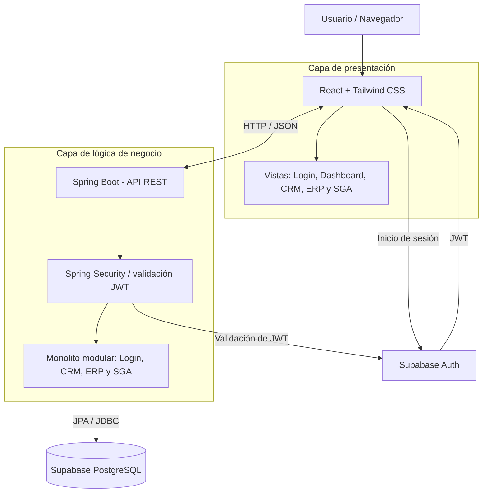

# Arise Corp.

Plataforma web para integrar la gestión comercial, administrativa y de inventario de Arise Corp., empresa orientada al transporte y entrega de paquetes mediante drones.

> **Estado del proyecto:** infraestructura inicial y autenticación base. La conexión de Spring Boot con Supabase PostgreSQL y la validación de tokens JWT (OAuth2 Resource Server con Supabase Auth) se encuentran configuradas con un endpoint de prueba protegido (`/api/me`). Los módulos funcionales y el cliente frontend se desarrollarán progresivamente mediante Specification-Driven Development (SDD) con Kiro.

## 1. Objetivo

Centralizar en una sola aplicación la información y los procesos de Arise Corp. mediante cuatro áreas principales:

- **Login y autorización:** autenticación de usuarios y control de acceso según roles y permisos.
- **CRM:** clientes, cuentas corporativas y contratos.
- **ERP:** empleados, proveedores, facturación y gestión administrativa/financiera básica.
- **SGA:** drones, paquetes, inventario y trazabilidad.

El MVP priorizará los flujos esenciales y no pretende automatizar operaciones reales de vuelo de drones.

## 2. Arquitectura

Se utiliza una arquitectura cliente-servidor de tres capas, con frontend SPA y backend REST monolítico modular:



**Flujo principal:** React consume la API REST de Spring Boot mediante HTTP/JSON. Supabase Auth gestionará la autenticación y emitirá tokens JWT; Spring Security validará esos tokens y protegerá los endpoints. Spring Boot contendrá la lógica de negocio y accederá a PostgreSQL mediante Spring Data JPA/Hibernate.

React no debe conectarse directamente a las tablas de negocio para reemplazar la API de Spring Boot.

## 3. Tecnologías

| Área | Tecnología | Responsabilidad |
|---|---|---|
| Frontend | React + Vite | Interfaz web SPA y componentes. |
| Estilos | Tailwind CSS | Diseño visual de la aplicación. |
| Navegación | React Router | Rutas y vistas del frontend. |
| Backend | Java 21 + Spring Boot 4.1.2 | API REST y lógica de negocio. |
| Seguridad backend | Spring Security + OAuth2 Resource Server | Protección de endpoints y validación de JWT. |
| Persistencia | Spring Data JPA / Hibernate | Mapeo objeto-relacional y acceso a datos. |
| Base de datos | Supabase PostgreSQL | Almacenamiento centralizado. |
| Autenticación | Supabase Auth | Registro, inicio de sesión y emisión de JWT. |
| Construcción | Maven Wrapper | Compilación, pruebas y ejecución del backend. |
| Trabajo asistido | Kiro + SDD | Especificaciones, diseño, tareas e implementación. |
| Versionamiento | Git + GitHub | Colaboración y control de cambios. |

## 4. Estructura del repositorio

La estructura objetivo es:

```text
arise-corp/
├── backend/
│   ├── .env                 # Local, no se versiona
│   ├── .env.example         # Plantilla, sí se versiona
│   ├── pom.xml
│   ├── mvnw
│   ├── mvnw.cmd
│   └── src/
│       ├── main/
│       │   ├── java/com/arise/corp/
│       │   │   ├── config/          # Seguridad (JWT Supabase) y CORS
│       │   │   ├── controller/      # Controladores REST (ej. AuthController)
│       │   │   └── AriseBackendApplication.java
│       │   └── resources/application.properties
│       └── test/
├── frontend/
│   └── src/                 # Aplicación React (en construcción)
├── supabase/
│   └── migrations/          # Migraciones versionadas del esquema
├── docs/
│   ├── def_MVP/             # Especificación y alcance del MVP
├── .kiro/
│   ├── steering/            # Contexto y convenciones del proyecto
│   └── specs/               # Especificaciones SDD
├── .gitignore
└── README.md
```

Los directorios `frontend`, `supabase`, `docs` y `.kiro` pueden completarse a medida que avance el desarrollo.

## 5. Requisitos previos

Para trabajar en el backend se necesita:

- Git.
- JDK 21.
- Acceso al repositorio GitHub.
- Acceso autorizado al proyecto Supabase `arise-corp-dev`.
- PowerShell en Windows (los comandos pueden adaptarse a macOS/Linux).

Cuando se inicialice el frontend también se necesitará Node.js, usando una versión LTS compatible con Vite.

## 6. Configuración local del backend

### 6.1 Clonar el repositorio

```bash
git clone <URL_DEL_REPOSITORIO>
cd arise-corp
```

### 6.2 Crear el archivo `.env`

Desde la raíz del repositorio, en PowerShell:

```powershell
Copy-Item .\backend\.env.example .\backend\.env
```

Editar `backend/.env` con los datos reales entregados/configurados para el proyecto Supabase. No agregar `export`, no subir el archivo y no publicar su contenido.

Variables esperadas:

```properties
SUPABASE_DB_HOST=HOST_DEL_SESSION_POOLER
SUPABASE_DB_PORT=5432
SUPABASE_DB_NAME=postgres
SUPABASE_DB_USERNAME=USUARIO_DEL_SESSION_POOLER
SUPABASE_DB_PASSWORD=CONTRASENA_DE_POSTGRESQL
SUPABASE_URL=https://YOUR_PROJECT_REF.supabase.co
```

Usar exactamente el host, puerto y usuario que aparecen en **Supabase Dashboard → proyecto → Connect → Direct → Session pooler → JDBC**. No construir el host manualmente. La contraseña corresponde a la contraseña de la base de datos, no a la contraseña de la cuenta Supabase. `SUPABASE_URL` corresponde a la URL base del proyecto en Supabase (requerida para la validación y decodificación de JWTs).

### 6.3 Configurar `application.properties`

`backend/src/main/resources/application.properties` debe importar el archivo local `.env` como archivo de propiedades y mapear sus valores:

```properties
# ====================================
# APPLICATION
# ====================================
spring.config.import=optional:file:./.env[.properties]
spring.application.name=arise-backend

# ====================================
# SUPABASE - POSTGRESQL
# ====================================
spring.datasource.url=jdbc:postgresql://${SUPABASE_DB_HOST}:${SUPABASE_DB_PORT}/${SUPABASE_DB_NAME}?sslmode=require
spring.datasource.username=${SUPABASE_DB_USERNAME}
spring.datasource.password=${SUPABASE_DB_PASSWORD}
spring.datasource.driver-class-name=org.postgresql.Driver

# ====================================
# JPA / HIBERNATE
# ====================================
# No permitir que Hibernate altere automáticamente el esquema.
spring.jpa.hibernate.ddl-auto=none
spring.jpa.open-in-view=false

# ====================================
# SUPABASE AUTH - JWT
# ====================================
spring.security.oauth2.resourceserver.jwt.issuer-uri=${SUPABASE_URL}/auth/v1
spring.security.oauth2.resourceserver.jwt.jwk-set-uri=${SUPABASE_URL}/auth/v1/.well-known/jwks.json
spring.security.oauth2.resourceserver.jwt.jws-algorithms=ES256
spring.security.oauth2.resourceserver.jwt.audiences[0]=authenticated
```

**Importante:** el import `file:./.env[.properties]` se resuelve respecto al directorio de trabajo. Por eso, ejecutar los comandos Maven desde `backend/` permite que Spring Boot encuentre `backend/.env`. El archivo usa sintaxis de propiedades `CLAVE=valor`; no se deben poner comillas alrededor de los valores.

### 6.4 Ejecutar pruebas e iniciar Spring Boot

En PowerShell:

```powershell
cd backend
.\mvnw.cmd test
.\mvnw.cmd spring-boot:run
```

Para detener el servidor: `Ctrl + C`.

La API se ejecutará por defecto en `http://localhost:8080`.

En macOS/Linux se utiliza `./mvnw test` y `./mvnw spring-boot:run`.

> La conexión a Supabase necesita acceso a Internet. Si falla, comprobar que `backend/.env` existe, que sus valores son correctos y que se usa Session pooler en una red IPv4. No pegar credenciales en incidencias, capturas ni mensajes.

## 7. Seguridad y manejo de secretos

- **Nunca** hacer commit de `backend/.env`, contraseñas de PostgreSQL, tokens de acceso, claves `secret` o claves `service_role`.
- Versionar únicamente `backend/.env.example`, con valores ficticios o marcadores de posición.
- Cada integrante crea su propio `backend/.env` local.
- Las variables `VITE_*` se incorporan al bundle del navegador. Nunca colocar contraseñas de PostgreSQL ni claves `secret`/`service_role` en variables del frontend. La clave publishable de Supabase está diseñada para el cliente, siempre con las políticas de acceso adecuadas.

## 8. Flujo de trabajo SDD con Kiro

El desarrollo se organizará por especificaciones funcionales. Para cada característica:

1. Definir y revisar requisitos y criterios de aceptación.
2. Aclarar ambigüedades y casos límite con el equipo.
3. Diseñar la solución y sus contratos (API, datos, seguridad e interfaz).
4. Dividir el trabajo en tareas pequeñas y asignar responsables.
5. Implementar con Kiro y revisar el código generado.
6. Ejecutar pruebas y comprobar los criterios de aceptación.
7. Actualizar la especificación cuando cambien los requisitos o el diseño.

Los archivos de contexto compartido se mantendrán en `.kiro/steering/` y las especificaciones en `.kiro/specs/`. Las especificaciones aprobadas son la referencia común para frontend y backend.

## 9. Convenciones de Git

- `main`: rama estable e integrada.
- Crear ramas por tarea o especificación, por ejemplo `feat/auth-foundation`, `feat/crm-clientes` o `fix/db-config`.
- Abrir Pull Requests para integrar cambios y solicitar revisión de al menos otro integrante.
- No incluir `.env` ni credenciales en commits.
- Mantener sincronizadas las especificaciones SDD y el código que implementan.

## 10. Alcance inicial del MVP

El MVP busca demostrar la integración de los procesos esenciales de la empresa:

- Login y control de acceso por roles.
- CRM: gestión básica de clientes, cuentas y contratos.
- ERP: gestión básica de empleados, proveedores y facturación.
- SGA: gestión de drones, paquetes, inventario y trazabilidad.
- Vistas de resumen para consultar la información principal.

La automatización de vuelos, navegación autónoma, telemetría en tiempo real e integraciones físicas con drones no forman parte de la primera entrega, salvo que el alcance académico se amplíe explícitamente.

## 11. Estado y próximos pasos

- [x] Crear backend Spring Boot con Java 21 y Maven.
- [x] Ejecutar la prueba inicial de contexto con H2.
- [x] Crear proyecto Supabase PostgreSQL.
- [x] Verificar conexión de Spring Boot a Supabase mediante Session pooler.
- [x] Incorporar `.env` local, plantilla `.env.example` y reglas de `.gitignore` en el repositorio compartido.
- [x] Configurar Spring Security como OAuth2 Resource Server para validar JWT emitidos por Supabase Auth (ES256, JWKS).
- [x] Crear endpoint de prueba protegido `GET /api/me` y configurar CORS base para desarrollo con React (`http://localhost:5173`).
- [ ] Crear la especificación `001-foundation` en Kiro.
- [ ] Diseñar y versionar las migraciones iniciales del esquema.
- [ ] Inicializar y conectar el frontend React.
- [ ] Implementar los módulos del MVP de manera incremental.

---

**Arise Corp.** · Proyecto académico · Construcción de Software
